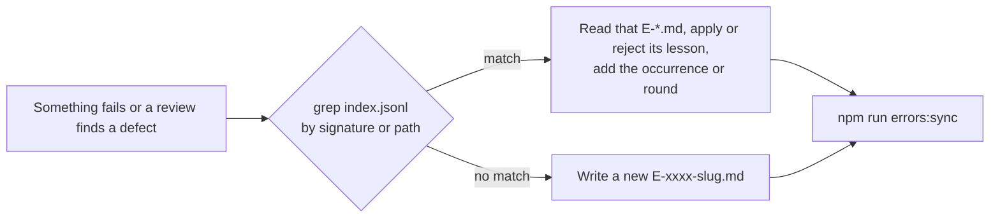

# Error ledger

Repository-local memory of errors that cost us rework, shared by every agent (Claude, Codex, OpenCode, one-shot runs). It lets an agent look up earlier experience before repeating it. It is a convention, not a gate: nothing blocks work on it.

## When to write and read

| When | Do |
|---|---|
| A failure or finding costs a fix round | Write or update a record at that moment. No authorization needed. |
| Before starting a packet | `grep` `index.jsonl` for the write-set paths. |
| On a failure | `grep` `index.jsonl` for the signature before debugging. |
| After editing any record | `npm run errors:sync` regenerates `index.jsonl`. Never hand-edit the index. |

## Record format

One `E-xxxx-<slug>.md` per error class: YAML frontmatter plus a short body (cue, what happened, lesson, evidence).

| Field | Meaning |
|---|---|
| `id` | `E-xxxx`, matching the file name |
| `signature` | Stable kebab-case key to grep for |
| `class` | Root-cause class, for example `split-decision`, `test-coupling`, `report-protocol` |
| `sites` | Files or decision sites involved, including unchanged consumers |
| `violates` | The acceptance clause the error broke, quoted |
| `scope` | `in`, `out` (a known limit) or `unresolved` (owner decision) |
| `status` | `open`, `lesson` or `mechanism`. Learning state, not closure |
| `mechanism_ref` | Test, hook, template or skill that now carries the lesson, or `null` |
| `episodes` | Independent occurrences. Each lists its `rounds` |

- **Episodes vs rounds.** An episode is one independent occurrence (a new feature or session meeting the same class). Rounds are attempts inside an episode: round 0 is discovery; each corrective change followed by a substantive review is one round, including the closing review. A rerun of the same report is not a new round, and several reviewers describing one incident is one episode.
- **Unknown stays unknown.** Missing history is written as `unknown`, never as `0`. An episode without a closing review is `closed: false`.
- **Promotion is a signal for the advisor, not automatic.** Two episodes suggest `lesson`; three, or one severe episode, suggest `mechanism`.
- **Public repository.** Cite issues, PRs and commit SHAs. No local paths, session IDs or secrets.

## Distribution

The ledger is for this repository's own development, so it stays out of distributed packages:
- **npm:** the local `.npmignore` drops this directory from the npm tarball.
- **OpenAI plugin and submission:** neither includes it, because they copy only the listed skills and runtime trees.
- **Claude Code plugin:** this one cannot exclude it. It installs the whole repository (`source: "./"`), so these Markdown files arrive with it as inert text, the same as `docs/` and `ci/`.
