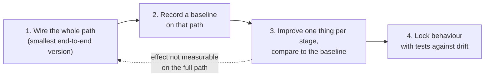
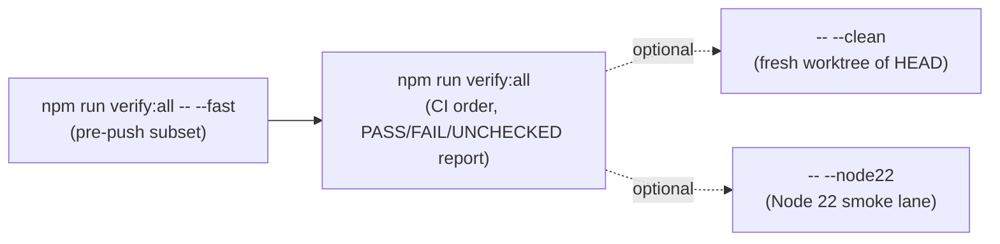

# AGENTS.md — Working in This Repository

You are modifying **Harness**: an orchestrated agent operating system (skills + hooks/plugins + routing) for AI coding agents. Changes here ship to real agent sessions. A vague `SKILL.md`, a stale manifest, a contradictory platform claim or a bypassable selected workflow can misroute other people's agents. Precision is the product.

## How We Work

Harness exists to put agents on the **fastest path to a working result**, not to fence them in. Prefer mechanisms that make the right action the easy one over written demands that agents talk themselves out of.

- **Whole path first.** Do not polish details or add tests for parts that are not connected yet.
- **Stages follow the full path.** A stage whose effect cannot be measured end to end is split wrongly.
- **Mechanisms over mandates.** Put recurring rules in CI, hooks, mods or templates so actions match them naturally. A new prose MUST is the last resort.
- **Dogfood the rules.** Docs, packets and reports written here follow the same doc rules Harness ships.
- **Coordinator role.** In multi-agent work the coordinator dispatches and analyses. Agents and the reviewer check each step; the coordinator re-verifies everything at the final stage.

### Writing docs (this file included)

1. **Mermaid** for anything that can be drawn: flows, stages, dependencies, state.
2. **Short bullets or tables** for rules and facts.
3. **Prose** only for detail that needs it; link it rather than inline it.

## Repository Layout

| Path | What it is |
|---|---|
| `<skill-name>/SKILL.md` | One canonical skill per top-level directory. Frontmatter: `name`, `description`, `metadata.author`, `metadata.version`. |
| `hooks/` | Claude Code lifecycle hooks and shared mechanisms (circuit breaker, workflow/action/scope guards, stop gates). Not every host packages every hook. |
| `harness-everything/scripts/` | Runtime: kernel/tier routing, workflow contract, verification, bootstrap, self-heal. |
| `opencode-plugin/` | OpenCode native plugin. Mechanism-tested, with partial live-host evidence (see the boundary below). |
| `.agents/plugins/` + `plugins/harness-everything/` | Local OpenAI/Codex marketplace + `.codex-plugin` package with canonical skill copies and packaged session/prompt hooks. |
| `submission/openai/` | Public OpenAI Skills-only listing/test inputs. The public artifact does not include local `.codex-plugin` lifecycle hooks. |
| `evals/<skill>/` | Trigger/routing eval per skill (waza format). Required for every canonical routed skill. |
| `behavioral-evals/` | LLM-behavior cases run via headless CLI sessions, structurally validated by CI. |
| `benchmarks/` | BENCHMARK_SOP fixtures and recorded results. Evidence lives here or nowhere. |
| `.claude-plugin/` | Claude Code plugin manifests. Must list exactly the on-disk canonical skills. |
| `docs/platform-capabilities.md` | Canonical platform/install/enforcement/evidence matrix. |
| `docs/repository-contract.md` | Generated Node/workflow/action/gate contract. Regenerate with `npm run docs:sync`; never hand-edit. |
| `.nvmrc` | Primary dev/CI Node runtime. `package.json#engines.node` stays the supported minimum. |
| `docs/`, `references/` | Philosophy, architecture, workflow docs, shared checklists. |

## OpenCode evidence boundary

The retained [OpenCode evidence](benchmarks/results/live-host/opencode-2026-09-16/README.md) supports project-scope `.js` loading and edit/verification state on OpenCode 1.18.31 (macOS).

- The final snapshot is post-reset (`hardLock: false`, `count: 1`).
- Hard lock is only an interactive observation with no retained blocked-tool trace.
- Reflection was operator-seeded, then agent-rewritten. Agent-controlled state deletion resets the breaker.
- Global scope, npm-package installation, and other OpenCode versions remain unverified.

## Change Rules

**Skills and routing**

1. **Every canonical SKILL.md keeps ≤ 500 tokens** (CI gate) and contains `## USE FOR:` and `## DO NOT USE FOR:`. Detail goes in references/guides.
2. **Descriptions are routing surfaces.** Differentiate neighbouring skills deliberately; `test:collision` guards overlap.
3. **A new canonical skill ships with a routing eval.** The positive task `description:` exactly matches the skill frontmatter description.

**Release and distribution**

4. **Versions:** normal PRs never bump versions. `semantic-release` owns SemVer; `scripts/sync-release-version.js` syncs distributions. Nested sub-skills inherit their parent's version.
5. **Distribution manifests are generated facts.** After add/remove/rename run `npm run plugin:sync`, `npm run test:consistency` and `npm run test:plugin:openai`.
6. **Platform capability claims are tested contracts.** Update `docs/platform-capabilities.md` with integration changes. Package/mechanism evidence is not live-host evidence; public Skills-only behavior has no local lifecycle hooks.
7. **Runtime/workflow claims are generated facts.** `package.json`, `.nvmrc`, Dockerfile and active workflows feed `scripts/repository-contract.js`; run `npm run docs:sync` after relevant changes.
8. **CHANGELOG.md:** human notes go under `[Unreleased]`; semantic-release owns stable headings, tags and release notes.
9. **Conventional Commit type is release input:** breaking→major, `feat`→minor, `fix`/`perf`/`refactor`/`build`/`revert`→patch; docs/test/ci/style/chore do not release alone.

**Workflow behaviour**

10. **Selected workflow is a semantic contract; tactics remain flexible.** Compose ordered requirement steps with declared required/optional skill or reference bindings. Resolve a binding only when its step (or dependency-ready Fable stage) is active; required bindings MUST resolve before that step passes, and applicable skill core contracts MUST be followed. Unknown/unavailable bindings stay visible. Selected-topology obligations MUST resolve; missing host evidence yields reminders, not a persistent Harness lock.
11. **User-visible Harness Status is mandatory for non-trivial work.** One Markdown block headed `### 🚦 Harness Status` with bold `Current`, `Read / Evidence`, `Next`, optional `Risk / Blocked`; use nested evidence bullets when useful. Emit it before substantive execution, after major phases, on direction changes, at long-run boundaries and before completion. The routing checkpoint is internal state, not a second block. Not a hard lock.
12. **Tier-3/Fable isolation disposition is mandatory before broad mutation.** Use a verified linked Git worktree, or record an explicit degraded fallback when isolation is unavailable or the user chooses to stay in place. Ordinary isolation SHOULD be used when it materially reduces collision risk. Failure to isolate is a visible gap, not a Harness deadlock. See [workflow-runtime.md](docs/workflow-runtime.md).
13. **Use contract strength deliberately** ([philosophy.md](docs/philosophy.md#contract-strength-must--should--may)): MUST = required semantic obligation, SHOULD = default with an evidence-based exception, MAY = optional. Do not use recommend/prefer/advisory/guidance to weaken a MUST.
14. **The turn label line is mandatory on every turn, trivial ones included.** End each turn's final message with one hidden `<!-- harness-label {...} -->` line giving your post-work judgement ([docs/routing.md](docs/routing.md#turn-label-line)). It records data and never gates routing.

## Verification Before You Claim Done

- `npm run verify:all` runs every CI gate category and prints paste-ready evidence. Individual gates: `npm test`, `npm run test:mutations`, `test:mechanism`, `test:consistency`, `test:repo-contract`, `test:docs:capabilities`, `test:references`, `test:release`, `test:collision`, `test:routing:skills`, `test:routing:invariants`, `test:plugin:openai`, `test:plugin:submission`, `test:platform:compatibility`, `test:portability`.
- With waza (`~/bin/waza`): `waza check <skill-dir>`, `waza spec verify <skill> evals/<skill>/eval.yaml --fail --threshold 1`, `waza tokens check`.
- CI runs Node.js 24 on Ubuntu/Windows/macOS plus a Node.js 22 floor lane ([repository-contract.md](docs/repository-contract.md)). Node 22 install compatibility stays UNCHECKED locally.
- Never report "it works" from code reading. Name the evidence layer: package, deterministic mechanism, live host or behavior.

## Behavioral & Benchmark Evidence

| Claim | Evidence required |
|---|---|
| Hook/plugin contract holds | Deterministic mechanism test |
| A real host loaded and fired it | Preserved host/session artifact |
| Behavior improved | Paired evidence per #71 (baseline vs treatment) |

- Behavior runs: `node behavioral-evals/run.js run --engine opencode` (or `--engine claude`). On demand; costs tokens. The weekly workflow validates structure and runs live cases only where the CLI exists.
- Benchmarks: `node benchmarks/run.js scaffold <scenario>`, run both variants, then `record` with evidence logs.
