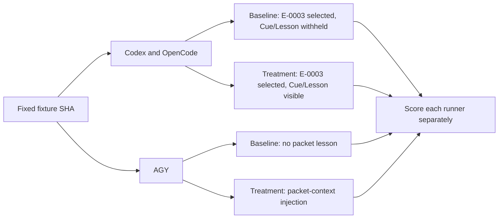

# E-0003 paired lesson visibility experiment

## Design



- Four baseline/treatment pairs per runner: 12 pairs, 24 arms total. Codex uses `gpt-6-luna` at high effort; OpenCode uses `opencode/hy4-flash-free` on V2.4.1; AGY uses `gemini-4-hydrogen-high`.
- Each pair uses the same deterministic fixture commit, task, hooks, permissions, rubric, and runner configuration. The fixture starts at the same SHA in all arms.
- For Codex and OpenCode, baseline changes only the E-0003 record's selected Cue/Lesson sections in the working tree to a fixed withheld marker. The E-0003 frontmatter, generated matcher row/binding, repository action, and matcher selection stay the same. Treatment uses the original Cue/Lesson. The launcher restores the fixture's record before final artifact packaging; any agent-written ledger changes invalidate that arm's quality result.
- AGY has no repository-ledger carrier. Its pair compares no lesson with an initial-prompt packet-context injection and is labelled `agy-injection`; it cannot fill a Codex/OpenCode matcher receipt or be pooled with those runners.
- The `commitlint` CLI is reused by absolute path from this checkout through a small fixture `.bin/commitlint` shim. The fixture copies the installed config package's transitive dependency closure, not the checkout's full `node_modules`; no network install is needed. The `commit-msg` file and rule config are copied into each fixture, and the fixture calls the hook for every task commit.
- No runner in this setup advertises a reliable hard 200k total-token cap. Every arm records `post-hoc only`, enforces a wall-clock timeout, and the coordinator must stop/mark an arm invalid if cumulative usage reaches 200k. Include retries and reasoning tokens in that count.
- OpenCode's lesson is delivered in the context hook after the triggering action. Keep first-commit acceptance descriptive; the receipt can only support a later decision. Report receipt timing as before, after, or unknown.

## Preflight and arms

First run the no-model preflight. It creates a clean fixture, exercises the real copied `commit-msg` hook with uppercase rejection and lowercase acceptance, and writes `preflight.json`. It intentionally marks real host delivery `UNCHECKED`; it cannot prove model-request receipt without the coordinator's isolated live-host capture.

```sh
node behavioral-evals/ledger-pairs/preflight.js --no-model --out /tmp/ledger-pairs-preflight
```

Before arms, run a separate live receipt preflight for Codex and OpenCode. Require E-0003 in the matcher receipt for the `git commit` action and retain the next request's actual context. For Codex inspect the isolated `CODEX_HOME` user-hook compatibility runtime output and a correlated `codex exec --json` request capture. For OpenCode inspect isolated server plugin-load lines, V2 `execute.before/after`, then the next V2 `context` hook and corresponding model request; a context output alone is not proof it reached the model. Keep the raw capture private and publish a sanitized copy with IDs, paths, credentials, and unrelated prompts removed. No-model preflight and mechanism tests do not substitute for either host receipt.

Use the following balanced order: for each runner, randomly shuffle pair IDs 1–4 and assign two pairs baseline-first and two treatment-first using a recorded random seed. Run each pair's two arms consecutively in its assigned order, with an isolated HOME/XDG/TMPDIR/CODEX_HOME per arm. Copy only the relevant host auth file into the isolated profile; never copy general settings or trust state. `--auth-dir` accepts the directory containing auth files. OpenCode also needs `OPENCODE_PASSWORD` for its isolated long-lived server.

Example arm (the coordinator runs all 24 only after preflight):

```sh
node behavioral-evals/ledger-pairs/arm.js --runner codex --arm baseline --pair 1 --out benchmarks/results/live-host/ledger-pairs-2026-11-28 --auth-dir /private/path/to/auth
```

Use `--dry-run` to inspect the resolved plan without starting a model. `arm-plan.json` records the fixture SHA, selected intervention, command shape, timeout, carrier, and token-cap enforcement. Live runs retain a sanitized transcript, process exit, Git log/status, and `arm-result.json`. Sanitize and review all artifacts before sharing them.

## Scoring and claim boundary

Feed normalized `arm-result.json` files to the scorer:

```sh
node behavioral-evals/ledger-pairs/score.js /path/to/arm-result.json ...
```

For each arm report first commit accepted, `subject-case` and `header-max-length` rejections, retries, manual intervention, correct diff plus test, hook bypass, tokens, elapsed time, failures/unknowns, and receipt status. Manual intervention is always zero only for unattended autonomous arms; if a coordinator repairs an arm, record that arm as invalid and report the intervention. Report valid pairs and paired transitions separately for each runner. Four pairs are descriptive only: every verdict must say **descriptive, inconclusive**. Do not pool runner outcomes or interpret AGY injection as proof of repository-ledger delivery.

Results belong in `benchmarks/results/live-host/ledger-pairs-2026-11-28/` after sanitization. Preserve failures and unknowns alongside successful arms. Keep private raw captures outside the repository.
