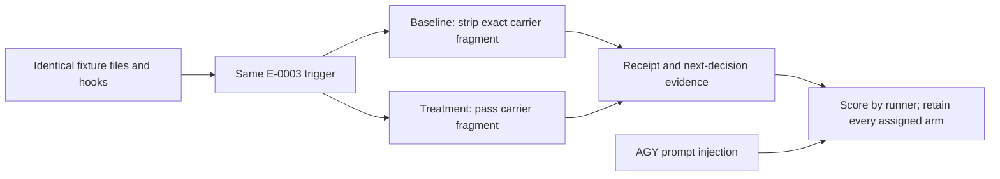

# E-0003 paired carrier experiment

## Design



- Four baseline/treatment pairs per runner (12 pairs, 24 arms). Score Codex/Luna, OpenCode and AGY separately; never pool runners. Verdicts are **descriptive, inconclusive**.
- Baseline and treatment have byte-identical fixture files, initial commit, Git hook and permissions. Both can discover E-0003 in the workspace. OpenCode and Codex baseline probes strip only the exact `Cue`/`Lesson` carrier fragment after the Harness carrier appends it; treatment passes it through. This estimates the exploratory incremental effect of the carrier when the lesson is self-discoverable. Receipt files contain keyed statuses only, never command text.
- AGY remains a separate `agy-injection` intervention: same fixture files, with packet context added only to treatment.
- Luna's scored action is `prepared-commit`: Codex makes the source change, runs the test, stages `src/sample.js`, and writes `.commit-msg.txt`. The driver then performs `git add -A`, unstages the message file, verifies only `src/sample.js` is staged, and invokes `git commit -F` through the fixture hook. Do not pool this with direct commits from other runners.
- Token usage is post-hoc measurement including input, output and reasoning tokens when reported (cached usage is retained). Arms over 200,000 tokens are invalid and remain in the assigned-arm denominator. Every arm has a 45-minute timeout.
- Scoring requires an explicit correlated receipt before the matching scored decision. `unknown` remains unknown. Same-attempt diagnostics are merged; retries represent distinct attempts. File reads of the error ledger and `git log`/`git show` touching it are retained as a per-arm covariate.

## Preflight and dry-run

Run the same no-model trigger against both fixture arms, then dry-run each runner. Keep the output directory outside the repository.

```sh
node behavioral-evals/ledger-pairs/preflight.js --no-model --out "$OUT/pf"
node behavioral-evals/ledger-pairs/arm.js --runner codex --arm baseline --pair 1 --dry-run --out "$OUT/dry"
node behavioral-evals/ledger-pairs/arm.js --runner opencode --arm baseline --pair 1 --dry-run --out "$OUT/dry"
node behavioral-evals/ledger-pairs/arm.js --runner agy --arm baseline --pair 1 --dry-run --out "$OUT/dry"
```

The preflight checks equal fixture bytes, matching E-0003 selection and commitlint accept/reject controls. It sends no model request and cannot establish live receipt. Review isolated live receipts before launching arms; OpenCode requires the isolated long-lived V2 server and actual next-request capture. Keep raw host captures private.

## Balanced live order

Record a seed and shuffle pair IDs `1..4` separately for each runner. Assign exactly two pairs baseline-first and two treatment-first, run each pair consecutively, and retain the resulting order. For each arm, use an isolated HOME/XDG/TMPDIR/CODEX_HOME. Supply the coordinator's auth directory to Codex/OpenCode; OpenCode also needs `OPENCODE_PASSWORD`.

```sh
node behavioral-evals/ledger-pairs/arm.js --runner codex --arm baseline --pair 1 --out "$OUT/live" --auth-dir "$AUTH_DIR"
node behavioral-evals/ledger-pairs/arm.js --runner codex --arm treatment --pair 1 --out "$OUT/live" --auth-dir "$AUTH_DIR"
```

Run the same two commands for every assigned pair and runner in the recorded balanced order. Stop/mark an arm invalid if post-hoc usage exceeds 200,000 or elapsed time exceeds 45 minutes. Keep every assigned arm and its missing/contamination reasons.

## Scoring

```sh
node behavioral-evals/ledger-pairs/score.js "$OUT"/*/pair-*/arm-result.json
```

Report assigned arms, valid pairs, missing/contamination reasons, commit action, first attempt, retries, correct diff/test, hook bypass, file reads, token usage, elapsed time and receipt state per runner. A no-model preflight or mechanism test is not live-host evidence.
