# Cycle B — ROUTE-001 error-lesson delivery design record

- **Preparer:** one-shot worker; compiled from the retained trail; **not an independent adjudication**.
- **Date:** 2026-11-11.
- **Packet input SHA:** `bde411dea9ea1d7f6a90cc6996aea8e0edbb2692`.
- **Run identity:** `t1-records-1`, packet revision 1. The preparer's model/effort are not recorded in this cycle trail.

## Task, scope, and starting version

| Field | Record |
|---|---|
| Task | Produce one forward-looking design ADR for #402: choose a recurring error class, its ledger lesson, an existing intervention seam, success/failure observations, and the smallest follow-up implementation acceptance. The selected artifact is `docs/adr/ROUTE-001-error-lesson-delivery.md`. |
| Agreed scope | E-0002 report-terminal-status lesson; prompt context at `UserPromptSubmit`; explicit report-required signal; delivery and output observations kept separate; no engine rewrite or claim that error handling improved. Owner scope and rulings are recorded in [#402 comment 6785928296](https://github.com/dyphn1/Harness-everything/issues/402#issuecomment-6785928296), [#402 comment 6786069987](https://github.com/dyphn1/Harness-everything/issues/402#issuecomment-6786069987), and the later ruling below. |
| Starting version | Repository input `bde411dea9ea1d7f6a90cc6996aea8e0edbb2692`; `git cat-file -e bde411dea9ea1d7f6a90cc6996aea8e0edbb2692:docs/adr/ROUTE-001-error-lesson-delivery.md` exited 128 (`fatal: path ... is not in ...`), so the target did not yet exist at that version. |
| Scope authority | The local definition §5 sets the simplified E1 cycle and after-the-fact adjudication; answer 32 establishes the reduction decisions, answer 33 and packet B-draft record the O1–O5 rulings. The ADR remains `status: proposed`. See `LOCAL_ONLY: trail/definition.md; sha256:48f6664f4e80f4007b1a519b36875b630cd4071f6b50ef4e7fc77262d705157f`, `LOCAL_ONLY: trail/advisor-answer-32.md; sha256:a93ff4fecd5318e6b3fe06bde7f24629020abc51401d83007d58fc8f6760e539`, `LOCAL_ONLY: trail/advisor-answer-33.md; sha256:cb5ddcdfa5b348f3edfb3a0d021c54b77aa14754b6247a3f790662bf2a0b8174`, and `LOCAL_ONLY: trail/packet-b-draft.md; sha256:dd03e5f7772495bf4086a8ac825b0a45b073bd54b84783fa131789e789e9b6a1`. |

## Reading list

The final ADR's `Reading list` table is the full source inventory, pinned to artifact SHA-256 `6822a091dff2086c4aeabf65685e26e3b5c804495462b128f3b5bddb4113bde2` at commit `6a997cc9dcb478ab6d4f8470a96e7371e0ea5be4`. Its rows cover the following topic sources:

| Source group | Sources and purpose |
|---|---|
| Lesson and ledger | Error-ledger `README.md`, `index.jsonl`, and E-0001–E-0014; E-0002 is the content authority, the index is only a locator. |
| Routing and delivery | `AGENTS.md`, `docs/routing.md`, `docs/system-one-observations.md`, `harness-everything/scripts/kernel-router.js`, `hooks/scripts/codex-user-prompt.js`, both hook manifests, `scripts/sync-openai-plugin.js`, and `hooks/scripts/openai-session-start.js`: label rule, actual prompt signal availability, existing seams and packaging boundary. |
| Existing reflection/candidate paths | `scripts/errors-sync.js`, `hooks/scripts/rule-of-3.js`, tracker/reset hooks, learning-opportunity and telemetry helpers, `zoom-out/` references/templates, `self-evolve/` skills/scripts, workflow docs, `docs/reflection.md`, and the related tests/evals: distinguish ledger lookup/delivery from reflection and candidate lifecycle. |
| Contract and host boundary | `docs/mechanism-first-skill-mesh.md`, `docs/platform-capabilities.md`, `docs/enforcement-locks.md`, `docs/troubleshooting.md`, `docs/workflow-runtime.md`, `docs/architecture.md`, `harness-everything/SKILL.md`, `README.md`, `VERIFICATION.md`, `opencode-plugin/README.md`, and `opencode-plugin/index.mjs`: no-template intent, existing breaker boundaries, and separate OpenCode implementation. |
| Durable scope references | #402 comments 6785928296, 6786069987, 6790477633; #394, #359, #141; and #421 comment 6785927033. The issue/comment text was supplied in the trail/packets; it was not fetched online in this run. |

The artifact itself names each path and its source relevance. It retains the restored `docs/workflows/harness-everything.md` row and adds the bounded OpenCode source rows; this source evidence does not claim OpenCode was run.

## Outline, reviews, triage, and dispatch

```mermaid
flowchart LR
  S["Scope packet"] --> O["Outline O: 4320fce8"]
  O --> R["Two independent outline reviews"]
  R --> T["One triage + owner ruling"]
  T --> D["Draft: 171bc079"]
  D --> F["Independent final review at H: blocker + deferred"]
  F --> C["One blocker correction H2: 6a997cc9"]
  C --> Q["Targeted re-check: F1 closed"]
  Q --> M["PR #431 merged: 0f08daa4"]
```

| Stage | Version and outcome |
|---|---|
| Scope preparation | `b-scope-1` selected E-0002 because it fits #402's report-format concern and has post-lesson recurrences; the report also noted E-0009 has more episodes, so E-0002 was never the “top-ranked” class. |
| Outline | O = `4320fce85e79187ecf39f95494160f712d83d067`; outline digest `bd9430f311a111945b410de371d7efa84363241e12d06dff1234b93c5625b3ed`. |
| Outline reviews | Two independent, fresh-context review packets. Review 1 content verdict: ACCEPT WITH CHANGES, two deferred findings; its report ended in `STATUS: BLOCKED` because the trailing-label rule conflicted with packet terminal-STATUS format. Triage states the review content was complete and that status was false for substantive completion. Review 2: REJECT, three blockers and one deferred, requiring owner ruling on label/STATUS and stronger delivery evidence/read-list coverage. Both were source-traced except the stated index-count evidence; GitHub issue links were not fetched. |
| Triage | One triage round in `triage-b.md`: U1/U2 deferred in review and corrected in the draft; U3/U4 blockers; U5 required owner ruling; U6 required an owner boundary; U7 added the requirement to define a prompt-time report-required signal and negative controls. Advisor answer 33 narrowed the changes; no second outline-review round. |
| Owner ruling | [#402 comment 6790477633](https://github.com/dyphn1/Harness-everything/issues/402#issuecomment-6790477633) is quoted in packet B-draft as agreeing to five points: prompt-context delivery, explicit signal selecting E-0002, E-0002/ROUTE, distinct report-file STATUS vs turn label handling, and no counter/lock/forced reflection for this delivery. Its quoted final direction says a hook hint is enough and counting is unnecessary because it had failed before. |
| Draft dispatch | Draft bytes have ADR SHA-256 `acac7c0d64ca3f2d83f02e319deb40e3918b4070e5c11e015760546d1f7d718f`; coordinator integration commit D = `171bc079b58422c15d302b6468a1ad539bdc8b0c`. The governed index was regenerated. |
| Final review | Bound to H = `27e0a6ffa69439f90c6421b7d9493b9e8ac17cfc` after main/index merge; ADR digest `acac7c0d64ca3f2d83f02e319deb40e3918b4070e5c11e015760546d1f7d718f`. ACCEPT WITH CHANGES: one blocker, missing direct Rule-of-3 boundary sources; one deferred issue, undefined “source stale” condition. |
| Correction and re-check | Advisor answer 35 limited the single correction to the class-level source/boundary gap and preserved “source stale” as deferred. Correction H2 = `6a997cc9dcb478ab6d4f8470a96e7371e0ea5be4`, digest `6822a091dff2086c4aeabf65685e26e3b5c804495462b128f3b5bddb4113bde2`; only the ADR changed. Targeted re-check at H2 closed F1. This was not a second full review. |

Trail: `LOCAL_ONLY: trail/packet-b-scope.md; sha256:b570584a4dfa536b6a782253e99bdab78fd4555d1a26aed39449ab53fe763aeb`; `LOCAL_ONLY: trail/report-b-scope.md; sha256:030de9487715c1ae076ab01ef2fd79f93cfc14adec8ef08cadb809e655c47a84`; `LOCAL_ONLY: trail/packet-b-outline.md; sha256:475b0fd5150dee4c4875cf0f168115571fc6dfcaeb281ca633190534fda54ce1`; `LOCAL_ONLY: trail/report-b-outline.md; sha256:388017cb9c16de72e2614073bc4928f59073cfd0fa21a978c282654cab8b5067`; `LOCAL_ONLY: trail/report-b-review-1.md; sha256:8ce189155a7b867e154e63d75d5fef0ec0589e878135cdf0e64b540744142b30`; `LOCAL_ONLY: trail/report-b-review-2.md; sha256:34bce9f454fdd27bd3e52eefac00db6d789dc14f95b352b3a4d2e5eafb8a1fd0`; `LOCAL_ONLY: trail/triage-b.md; sha256:186227ae51d4275be032a04118c718f15fec8f55c8c7335f36c5424c98320a32`.

`LOCAL_ONLY: trail/report-b-draft.md; sha256:fd0b73e8fc894805cc1f64e39c50a3750e2c2912f49199434e46827f62d7a399`; `LOCAL_ONLY: trail/report-b-final.md; sha256:d3dfb7d667b6601c10cf990afd5562d2ff8697af8696c71f533b350b23cabcaf`; `LOCAL_ONLY: trail/packet-b-fix.md; sha256:bc214e3ee8dc6f20e1c777964cf42ac0158857fa1cd35d563e3cbb3e72577ca5`; `LOCAL_ONLY: trail/report-b-fix.md; sha256:3e06dcd0bae4381f44727881a34ebce79a2bb15b9a56e3e2624e8921e9b4aa18`; `LOCAL_ONLY: trail/packet-b-recheck.md; sha256:c4fafc8505e27fa3207e49aa02edeee2afb5de78eacab7f72ce2c3dff372a4fa`; `LOCAL_ONLY: trail/report-b-recheck.md; sha256:14b74b38cb6796f399ea5cc4535e09353d06cca76c38d737fc6d29ee3cd598ef`; `LOCAL_ONLY: trail/advisor-answer-33.md; sha256:cb5ddcdfa5b348f3edfb3a0d021c54b77aa14754b6247a3f790662bf2a0b8174`; `LOCAL_ONLY: trail/advisor-answer-35.md; sha256:a1016ecb7268d08ad6f836bb1902cb4b47a4e21807a17943079ffc5d42fa53d4`; `LOCAL_ONLY: trail/advisor-answer-36.md; sha256:197bf990528fed05eb02ee290657424ba33a3ac65dbe725d99b44a0ddf3246c3`.

## Authors, reviewers, and assistance

- Scope, outline, draft, and correction packets were performed by one-shot workers. Their logs show `gpt-6-luna` at `xhigh` for scope/review runs and `glm-5.3-flash-free` for build runs; build effort is not recorded. Personal worker/reviewer identities are unknown.
- Review 1, review 2, final reviewer, and re-checker are identified by role only. The final reviewer and re-checker were separate read-only participants from the author/corrector per their packet declarations.
- Coordinator assistance included scope and outline preparation; answer 32 plus answers 33 and 35; owner-ruling capture; triage; packet preparation; source/check coordination; branch commits, governed-index regeneration, and PR merge. The work was assisted, not unassisted.
- Git author/committer fields on O, draft D, and H2 say `Miya Daniel`; no retained evidence maps that identity to each worker. The PR snapshot records D/H/H2 and merge separately. Do not infer a one-shot identity from the commit author.
- Model/effort locators: `LOCAL_ONLY: trail/b-scope.log; sha256:61ef9788664fc9f0aecaec25ad46791e1a067cfbe75de2680dbf41a1aed6e6b5`; `LOCAL_ONLY: trail/b-outline.log; sha256:f336a3cc8595415eb8d7d1a1c54e464ef315a2ca72302cbdd3e71b2b549eb5dc`; `LOCAL_ONLY: trail/b-review-1.log; sha256:47e3c2fcc27cb01eeaf7a16254a6f8e885ca761206777a4e07562c0f2cef84c6`; `LOCAL_ONLY: trail/b-review-2.log; sha256:59f8894a36cdbf9e0a800f966c1d253555f69b6a4c660c72e2403eaadcd5be7f`; `LOCAL_ONLY: trail/b-draft.log; sha256:ad43657738b9bfa1144700e8c3a37b946d01e1baebef17932e9d15f504003343`; `LOCAL_ONLY: trail/b-final.log; sha256:fcbe8ea269c97b1ba36c4c1672fd2fbeb2eaa69154aa8b5876af04c201b55bef`; `LOCAL_ONLY: trail/b-fix.log; sha256:b13bbe3a404e4e57ed9a291d78b4694e4891a3b3e13f9bf01f2a3b291051ba01`; `LOCAL_ONLY: trail/b-recheck.log; sha256:771ad42f7a0316b01c2ebbee238a15760bb7c93498e1c3d3db83e47b88931b96`.

## Final artifact commit and owner decision

| Item | Evidence |
|---|---|
| Final artifact | `docs/adr/ROUTE-001-error-lesson-delivery.md` at PR #431 head H2 `6a997cc9dcb478ab6d4f8470a96e7371e0ea5be4`; SHA-256 `6822a091dff2086c4aeabf65685e26e3b5c804495462b128f3b5bddb4113bde2`; Git blob `d58c894965a1275682f36a326a8cd9ae68777c43`. |
| Generated companion | `docs/governed-index.md` at H2; SHA-256 `0067016f70b814f9f420c4d7bdd6d73aa1abb076f9726d21c4c33698be265a57`; Git blob `1c3dcd463b2dc4d0ca64e1d21e9697e8107ec74f`. |
| PR and merge | [PR #431](https://github.com/dyphn1/Harness-everything/pull/431) head H2 merged at `0f08daa42801f1ed83e55b82e3fc34db772eaebe`. `git diff --exit-code` for the ADR and index from H2 to merge exited 0; merge commit differs from artifact head. |
| Owner ruling reference | The quoted #402 comment 6790477633 in packet B-draft states agreement to the five A7 choices and the “hook hint”/no-counting direction. The issue URL was not fetched by this run; the quoted packet text is the retained basis. |
| U5 comment | [PR #431 comment 6793866005](https://github.com/dyphn1/Harness-everything/pull/431#issuecomment-6793866005) says “U5 PASS (design/document review only)” for the exact base/head, with scope limited to the proposed ADR and regenerated index, no runtime/hook/policy-code change, and no blocking finding remaining in the simplified cycle scope. The supplied comment body is truncated during its first review item; no further claim is based on unseen text. |
| Attribution limit | The PR comment author is `dyphn1`, also the coordinator account. Packet instructions say owner merge instructions were given in the coordinator session and are recorded only as quoted in PR comments/coordinator notes. The account does not distinguish owner from coordinator; no separately attributable owner approval/delegated authority is established here. A merge alone is not treated as approval. |

## Checks and their scope

| Check | Result and scope |
|---|---|
| `node scripts/errors-sync.js --check` during scope and both outline reviews | In the scope log it was followed by `git status --porcelain`; the outer shell exited 0, but the check printed `Cannot find module 'js-yaml'` and its subcommand exit is not isolated in the retained log. In each outline-review log the direct command exited 1 with the same missing-module error. Ledger-index freshness was UNCHECKED at those points; no retry in those clones. |
| `node scripts/errors-sync.js --check` during draft | Exit 0: `.agents/harness-everything/errors/index.jsonl is current.` Episode counts in the ADR were then checked against the record/index. |
| ADR lint and `npm run test:consistency`, `npm run test:references`, `npm run test:portability` | Each exit 0 on the draft bytes (ADR digest `acac7c0d…`); lifecycle diagnostics empty, consistency/reference/portability gates passed. These are package/repository gates, not live-host injection evidence. |
| `npm run verify:all -- --fast` | Exit 0 at H `27e0a6ffa69439f90c6421b7d9493b9e8ac17cfc`, Node `v24.14.1` on macOS: 5 PASS, 0 FAIL, 11 UNCHECKED. Local deterministic-mechanism evidence before the correction, not a post-correction or host-independent result. |
| Targeted re-check at H2 | ADR lint exit 0; index generator exit 0 and stdout matched `docs/governed-index.md`; working tree clean. No `test:consistency`, references, portability, or full `verify:all` rerun after the correction is recorded. |
| PR #431 hosted checks at H2 | Supplied PR snapshot has 17 checks: 16 SUCCESS, `doc-governance` FAILURE. The snapshot has no failure diagnosis; do not call all hosted checks green. |
| Scope limit | No live-host lesson delivery/receipt run occurred; OpenCode rows are source evidence only. No engine behavior or improvement was measured. |

The check/run snapshots are `LOCAL_ONLY: trail/b-verify-fast.log; sha256:223dbe5c111f24718b77898d60063a212910e3fcf9b1e5e57155aab5eb0cc099` and `LOCAL_ONLY: trail/gh-pr-431.json; sha256:cfc2e01bbf7be7fb0729ab948cec5def2e1c1ada85c23eb7339c42272a542f0c`.

## Final review version, owner disposition, and result

- **Final review version:** independent final review was at H (`27e0a6ffa…`), draft ADR SHA-256 `acac7c0d…`; it was ACCEPT WITH CHANGES. The correction bytes are H2 (`6a997cc9…`), checked only by the targeted F1 re-check (`report-b-recheck.md`), which says F1 CLOSED. No full re-review of H2 is claimed.
- **Owner disposition:** the supplied PR comment says U5 PASS on the exact H2 revision for design/document review. The comment account is shared with the coordinator; separate owner approval remains unknown. The ADR stays `status: proposed`.
- **Expected:** deliver a design-only proposal with a selectable report-task signal, explicit delivery/output evidence, and no new counter or lock.
- **Actual:** the ADR was delivered and merged; the selected `report-status:E-0002` signal and Rule-of-3 host boundary are documented. Nothing was implemented or run as lesson delivery. The stale-source trigger remains undefined and deferred. No effect on error recurrence is claimed.
- **Raw report exceptions:** `report-b-review-1.md` says `STATUS: BLOCKED` even though the substantive review is complete and its verdict is ACCEPT WITH CHANGES; the blocker wording reflects the packet-vs-label terminal-line conflict, not an unfinished review. The hidden label follows `STATUS` there, as it does in the final-review and targeted-recheck reports. These reports were not rewritten. Completion, review verdict, and raw terminal-format compliance remain separate facts.

## Cost, deferred items, and unknowns

- **Packets counted:** 8 task dispatch packets by this rule: scope, outline, two outline-review packets, draft, final-review packet, one fix packet, one targeted re-check packet. `triage-b.md`, advisor answers, coordinator integration, and the fast-check log are listed separately, not counted as dispatch packets.
- **Correction rounds:** 1 blocker correction round; correction plus targeted re-check counts as one round.
- **Time, tokens, and monetary/tool cost:** unknown; no retained active-time/token/cost measurement supports a number. Copied file mtimes and PR timestamps are not treated as work duration.
- **Deferred:** undefined “source stale” condition; unresolved whether A2 requires separate action on the existing Rule-of-3 breaker; #394 tracker state; proving scope reduction effective from these packet counts. The PR snapshot's `doc-governance` failure is preserved as a check result.
- **Unknown:** distinct owner identity/approval, individual worker/reviewer identities, build-run effort, current external issue state, and any live lesson-delivery/engine safety result. Supplied GitHub issue text was not independently fetched; the PR comment bodies in the local snapshot are truncated to 700 characters.

## Separate outcomes

- **document delivered:** yes — artifact commit `6a997cc9dcb478ab6d4f8470a96e7371e0ea5be4`, merged by `0f08daa42801f1ed83e55b82e3fc34db772eaebe`; Git blob `d58c894965a1275682f36a326a8cd9ae68777c43`; SHA-256 `6822a091dff2086c4aeabf65685e26e3b5c804495462b128f3b5bddb4113bde2`.
- **cycle qualifies: UNCHECKED — adjudication pending**
- **reconciliation engine safe / expansion GO: UNCHECKED** — the definition records pilot/default OFF and the PR snapshot has `pilot-offline-evidence` SUCCESS; this trail contains no reconciliation execution/credit observation for these cycles. “OFF as recorded” is not a safety finding or engine GO.
