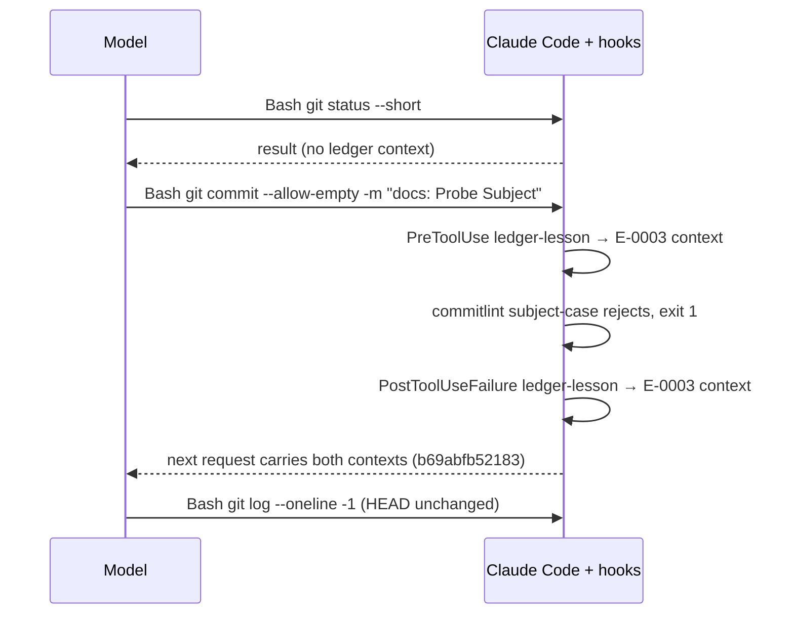

# Claude Code ledger-lesson delivery (#394)

**Observed:** Claude Code 2.1.330 on macOS, 2026-11-21, model `claude-haiku-5-5`, plugin loaded with `--plugin-dir` from integration commit `a8533ed6` (branch `feat/394-inject`). One fresh disposable clone of that commit with `npm ci` (real ledger index with the E-0003 `match` rules, real commitlint and husky). The prompt asked only to run three commands and report exit codes; it did not mention the ledger or the lesson.

[`trace.jsonl`](trace.jsonl) is a sanitized extract of the session transcript (home and scratch paths replaced): tool calls, tool results, hook context attachments, and for each model request whether the ledger context was in it.

| Row | Observed |
|---|---|
| Control (`git status`, `git log`) | No ledger context. |
| Action (`git commit`) | `PreToolUse:Bash` additional context = E-0003 Cue + Lesson + one neutral invitation (667 chars). |
| Failure (commitlint `subject-case`, exit 1) | `PostToolUseFailure:Bash` additional context, same lesson (phase-keyed dedupe allows both). |
| Model input | The model request after the commit (`b69abfb52183`) contains both contexts; no earlier request does. |
| Tool result / permission | Commit refused by the existing husky hook; HEAD unchanged (`a8533ed6` before and after); no permission decision emitted by the carrier. |

## What this does not establish

- **Timing:** the action context reached the model only in the request after the commit ran, so on Claude Code the pre-tool lesson cannot stop the first attempt; it informs the next step.
- **Behaviour:** the model reported the rejection and did not retry; consideration and use of the lesson are not observed, and one run says nothing about recurrence. A behaviour claim needs paired baseline/treatment runs.
- **Other hosts:** Codex and OpenCode delivery were not captured in this session (see the #394 PR).
