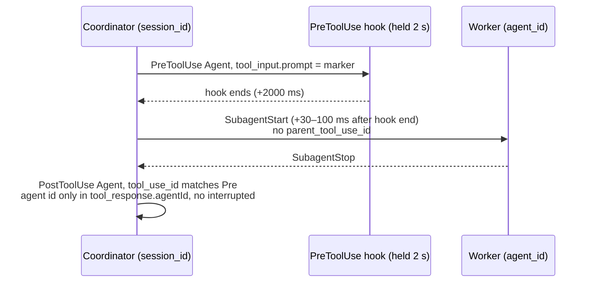

# Live-host capture: claude-341-outline-dispatch (2026-10-28)

**Verdict: the outline live gate stays UNMET.** Claude Code 2.1.312 carries the `HARNESS_OUTLINE_DISPATCH_V1` prompt, the coordinator `session_id` and a synchronous PreToolUse boundary. It does not carry two fields that `outlineCaptureMappingValid` requires: `SubagentStart.parent_tool_use_id` and an `interrupted` field on the Agent PostToolUse. This is field-availability evidence, not live-host credit. `hooks/scripts/lib/doc-reconciliation-qualification.json` is unchanged, so positive outline credit stays disabled.

## What was captured



## Pins

| Item | Value |
|---|---|
| Harness HEAD (staged) | `f1e6ab4e45fefa908c06f4f6fe96750b731987f9` (main after #387), clean tree |
| Staging | `node scripts/stage-claude-plugin.js <scratch>/plugin` (1788 tracked files) |
| Host | Claude Code `2.1.312`, macOS (darwin 25.6.0), zsh, `--model haiku` |
| Pilot | `HARNESS_DOC_RECONCILIATION_PILOT=1`, fresh `HARNESS_STATE_HOME` per run |

| File | sha256 |
|---|---|
| `capture.sanitized.jsonl` (this dir) | `cf1ea56c3d329edcb0a18fc6437af9d9aedf56c76a829f3949de382d07c5a657` |
| `capture-settings.json` (session `--settings`: PreToolUse/PostToolUse `Agent\|Task`, SubagentStart, SubagentStop) | `1c3081a86a0b1e0aa894f2f09a7884ca9bf5dbf55a08ab84074d8a318bd9c587` |
| `wrapper.js` (log-only, holds PreToolUse 2 s, runs no Harness hook) | `9071ab6b482fc31b1753df242fcf5983f1dd75ce6c5acf8ba78b1a5921f6b2fe` |
| staged `hooks/hooks.json` | `aca70167da0fa792e34fb55e2904e2935c83f8f087de9e3cd130dd536b01eafd` |
| staged `hooks/scripts/lib/doc-reconciliation-provider.js` | `1e0a9cc6fd040c074d96a79ec6445c328957951a7c0074427687d0a22179ec3b` |

## Command (sanitized)

```text
cd <scratch>/project            # fresh git repo, one commit
HARNESS_DOC_RECONCILIATION_PILOT=1 HARNESS_STATE_HOME=<scratch>/state \
claude -p "<fixed prompt: dispatch outline-worker twice via Agent; 1 = no isolation, 2 = isolation worktree; each prompt = marker line + 'Reply with: worker done'>" \
  --model haiku --plugin-dir <scratch>/plugin --settings <scratch>/capture-settings.json \
  --agents '{"outline-worker":{"description":"Capture worker that replies once and uses no tools","prompt":"Use no tools. Reply exactly: worker done"}}' \
  --allowedTools Agent Task --session-id <fresh UUID> --setting-sources project,local \
  --output-format stream-json --verbose
```

No bypass flag. Marker: `HARNESS_OUTLINE_DISPATCH_V1 taskId=<id> attemptId=a1 token=<token-n> workerRoot=<scratch>/project`. Both runs exited `0`.

- **Run 1** used `taskId=cap-00N`. The plugin rejected it as `dispatch-marker-invalid`, because task ids must match `task-*`. This was a fixture error. The raw host payloads are still valid field evidence.
- **Run 2** used `taskId=task-cap-00N`. The plugin parsed the marker and recorded `workflow-task-binding-invalid`. That rejection is expected, since no accepted review, handoff or lease exists in this bounded fixture.

## Must-report table (mapping in `outlineCaptureMappingValid`)

| Mapping clause | 2.1.312 observed | Evidence |
|---|---|---|
| `promptField: tool_input.prompt` | **yes**, verbatim marker | PreToolUse Agent `tool_input.prompt`, 4/4 dispatches |
| `coordinatorPrincipalField: session_id` | **yes**, but the worker's SubagentStart/Stop carry the **same** `session_id` | Coordinator and worker differ only by `agent_id` presence |
| `synchronousPreToolUse` | **yes** | 4/4: SubagentStart 30–100 ms after the 2 s PreToolUse hold ended |
| `workerStartDispatchField: parent_tool_use_id` | **no**, the field is absent | 0/4 SubagentStart payloads. Only `session_id`, `prompt_id` (shared by both dispatches), `agent_id`, `agent_type`, `cwd` |
| `workerStartRootField: cwd` | **partial** | No isolation: `cwd` = coordinator cwd. `isolation: worktree`: `cwd` = `<project>/.claude/worktrees/agent-<agent_id>`, which is unknown before dispatch, so it cannot equal the marker's `workerRoot` |
| `taskResultDispatchField: tool_use_id` | **yes** | PostToolUse `tool_use_id` equals the Pre's, 4/4 |
| Result `agent_id` + `interrupted === false` | **no** | No top-level `agent_id` (the plugin journal lifts `tool_response.agentId`). No `interrupted` field on the Agent result at all |

## Extra finding: async launch

In Run 2 dispatch 1 the model omitted `run_in_background`. The host launched the worker asynchronously: PostToolUse `status: async_launched`, `isAsync: true`, and it fired **before** SubagentStop (+2040 ms vs +3490 ms). A PostToolUse is therefore not proof that the worker finished. Any result correlation must require `status: completed` or an explicit `run_in_background: false`.

## What would unblock the gate (owner/advisor decision, not done here)

- Correlate worker start without `parent_tool_use_id`: for example, by the order of Pre end → next SubagentStart within the same `session_id` while one dispatch is in flight, or by `tool_response.agentId` ↔ SubagentStart `agent_id` after the fact.
- Replace `interrupted === false` with `tool_response.status === 'completed'`.
- Define worker-root for isolation worktrees, where the path is derived from `agent_id`, not predeclared.

Each of these changes the mapping in `doc-reconciliation-provider.js`, so it needs advisor adjudication against answer-10 item 2/3 before any implementation.
