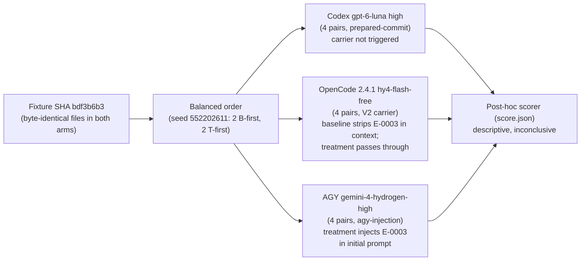

# Paired E-0003 ledger-lesson live-host run (2026-11-28, #552 F)

**Observed:** 2026-11-28, macOS, coordinator-run paired evaluation (`behavioral-evals/ledger-pairs/`) across three runners, 4 baseline/treatment pairs per runner (12 pairs, 24 arms total), seed `552202611` (balanced: 2 baseline-first, 2 treatment-first per runner). Verdict: **descriptive, inconclusive** — no behavioural evidence for or against the E-0003 ledger lesson.

- **Codex (`gpt-6-luna`, effort `high`, action `prepared-commit`):** 8/8 arms exited 0; carrier never fired (model writes `.commit-msg.txt`; driver commits outside the sandbox through the same Husky hook).
- **OpenCode `v2.4.1` (`opencode/hy4-flash-free`, long-lived server):** 8/8 arms exited 0; E-0003 Cue/Lesson reached the next `context` hook after a matched `git commit` in 6/8 arms (baseline: stripped by probe; treatment: delivered), always **after** the scored commit.
- **Antigravity / AGY (`gemini-4-hydrogen-high`, `agy-injection`):** 8/8 arms exited 0; separate intervention (initial-prompt injection, no native repo-ledger carrier).

**Fixture & candidate:** Initial fixture SHA `bdf3b6b3774849c45426b138081ba67b39b41541` identical in all 24 arms; harness commits `661b061c`, `60046ca0`, `f4df4d66`, `07b55c44` on branch `chore/552-close-out`.

## Design

Owner-approved protocol (2026-11-28): 4 pairs per runner; per-arm cap of 200,000 tokens measured post-hoc as `uncached input + output + reasoning` (cache reads retained separately; AGY usage unavailable → `n/a`); shared exposure (both arms start from byte-identical worktree files, so the ledger lesson is self-discoverable in both); Codex uses a `prepared-commit` protocol. No manual intervention occurred inside any arm.

Runners are reported separately and never pooled. AGY tests initial-prompt injection (`agy-injection`), which is a different intervention from host-carrier delivery and does not fill Codex or OpenCode carrier receipt gaps.

## Results by runner

### Codex (`gpt-6-luna` high, `prepared-commit`)

- **First prepared commit accepted:** baseline `2/4`, treatment `1/4`. All five rejections were `type-empty` / `subject-empty` (missing conventional commit type), not the E-0003 failure classes (`subject-case`, `header-max-length`).
- **Carrier receipt:** `0/8` arms (expected: under `prepared-commit`, the model writes `.commit-msg.txt` and never executes `git commit` itself).
- **Paired transitions (quality):** `bothPass: 1`, `treatmentOnly: 0`, `baselineOnly: 1`, `neitherPass: 2`, `invalid: 0` (4 valid pairs).
- **Verdict:** descriptive, inconclusive.

| Pair | Arm | First commit accepted | Commitlint rejections | E-0003 in `context` | Uncached tokens | Cache read | Elapsed | Quality pass |
|---|---|---|---|---|---:|---:|---:|---|
| 1 | baseline | `false` | `type-empty`, `subject-empty` | 0 | 6,523 | 118,400 | 30 s | `false` |
| 1 | treatment | `false` | `type-empty`, `subject-empty` | 0 | 7,383 | 103,424 | 40 s | `false` |
| 2 | baseline | `false` | `type-empty`, `subject-empty` | 0 | 6,553 | 87,680 | 33 s | `false` |
| 2 | treatment | `false` | `type-empty`, `subject-empty` | 0 | 6,637 | 87,424 | 35 s | `false` |
| 3 | baseline | `true` | none | 0 | 6,594 | 87,168 | 34 s | `true` |
| 3 | treatment | `true` | none | 0 | 9,598 | 93,568 | 36 s | `true` |
| 4 | baseline | `true` | none | 0 | 10,601 | 83,840 | 26 s | `true` |
| 4 | treatment | `false` | `type-empty`, `subject-empty` | 0 | 11,437 | 114,688 | 35 s | `false` |

### OpenCode `v2.4.1` (`opencode/hy4-flash-free`, long-lived server)

- **First commit accepted:** `7/8` (`4/4` baseline, `3/4` treatment; `pair-3-treatment` never committed). Zero `subject-case` or `header-max-length` rejections in any arm.
- **Carrier receipt:** E-0003 Cue/Lesson reached the next `context` hook after a matched `git commit` in **6/8 arms** (`4/4` baseline where the probe stripped the exact fragment; `2/4` treatment where it was delivered). In every matched arm, delivery occurred **after** the scored commit because the OpenCode V2 carrier delivers on the next `context` hook after `tool.execute.before/after`. Most commits used compound shell commands and still matched the current matcher (`#502` / `#518`).
- **Paired transitions (quality):** `bothPass: 1`, `treatmentOnly: 2`, `baselineOnly: 1`, `neitherPass: 0`, `invalid: 0` (4 valid pairs). Differences come from diff/test/hook-bypass quality (`pair-2-baseline` and `pair-4-baseline` flagged `hookBypass: true`; `pair-3-treatment` did not commit), not from commitlint rejections.
- **Verdict:** descriptive, inconclusive.

| Pair | Arm | First commit accepted | Commitlint rejections | E-0003 in `context` | Commit shell shape | Uncached tokens | Cache read | Elapsed | Quality pass |
|---|---|---|---|---|---|---:|---:|---:|---|
| 1 | baseline | `true` | none | 1 (stripped, post-commit) | `compound: 1` | 36,352 | 99,840 | 42 s | `true` |
| 1 | treatment | `true` | none | 0 | `compound: 2` | 41,377 | 449,536 | 103 s | `true` |
| 2 | baseline | `true` | none | 1 (stripped, post-commit) | `direct: 1` | 89,121 | 796,160 | 157 s | `false` (`hookBypass`) |
| 2 | treatment | `true` | none | 1 (delivered, post-commit) | `compound: 1` | 19,491 | 67,328 | 28 s | `true` |
| 3 | baseline | `true` | none | 1 (stripped, post-commit) | `compound: 1` | 39,462 | 121,344 | 41 s | `true` |
| 3 | treatment | none | none | 0 | none | 16,746 | 51,712 | 19 s | `false` |
| 4 | baseline | `true` | none | 1 (stripped, post-commit) | `direct: 1`, `other: 1` | 103,977 | 1,138,176 | 153 s | `false` (`hookBypass`) |
| 4 | treatment | `true` | none | 1 (delivered, post-commit) | `compound: 1`, `other: 1` | 71,101 | 599,040 | 97 s | `true` |

### Antigravity / AGY (`gemini-4-hydrogen-high`, `agy-injection`)

- **Intervention boundary:** Initial-prompt packet-context injection (`agy-injection`), not a native repo-ledger hook carrier (AGY has no native repo-ledger carrier).
- **First commit accepted:** `7/8` (`3/4` baseline, `4/4` treatment; `pair-4-baseline` never committed). Zero commitlint rejections in any arm; treatment subjects occasionally added a scope (`feat(sample): …`).
- **Paired transitions (quality):** `bothPass: 3`, `treatmentOnly: 1`, `baselineOnly: 0`, `neitherPass: 0`, `invalid: 0` (4 valid pairs).
- **Token usage:** unavailable from the AGY CLI (`n/a`).
- **Verdict:** descriptive, inconclusive.

| Pair | Arm | First commit accepted | Commitlint rejections | Uncached tokens | Cache read | Elapsed | Quality pass |
|---|---|---|---|---|---:|---:|---|
| 1 | baseline | `true` | none | `n/a` | `n/a` | 74 s | `true` |
| 1 | treatment | `true` | none | `n/a` | `n/a` | 89 s | `true` |
| 2 | baseline | `true` | none | `n/a` | `n/a` | 112 s | `true` |
| 2 | treatment | `true` | none | `n/a` | `n/a` | 86 s | `true` |
| 3 | baseline | `true` | none | `n/a` | `n/a` | 92 s | `true` |
| 3 | treatment | `true` | none | `n/a` | `n/a` | 77 s | `true` |
| 4 | baseline | none | none | `n/a` | `n/a` | 79 s | `false` |
| 4 | treatment | `true` | none | `n/a` | `n/a` | 103 s | `true` |

## What the files show

| Path | Contents |
|---|---|
| [score.json](score.json) | Post-hoc scorer output across all three runners (`claim: "descriptive, inconclusive"`), per-arm quality/cap/receipt fields and paired transition tables. |
| [run-order.sh](run-order.sh) | Sanitised coordinator stream launcher showing the seed-`552202611` balanced arm order. |
| `codex/pair-{1..4}-{baseline,treatment}/` | Per-arm `arm-plan.json` and `arm-result.json` for Codex (`prepared-commit`). |
| `opencode/pair-{1..4}-{baseline,treatment}/` | Per-arm `arm-plan.json`, `arm-result.json`, and `receipt.jsonl` (sanitised hook/context trace without host session or message IDs). |
| `agy/pair-{1..4}-{baseline,treatment}/` | Per-arm `arm-plan.json` and `arm-result.json` for AGY (`agy-injection`). |

## Harness notes

Not part of the behavioural result: the live preflight surfaced 9+4 launcher and scorer defects that the dry-run self-test did not exercise (fixed in `f4df4d66` and `07b55c44`; E-0008 class):

- OpenCode V2 auto-discovery loads plugins only under `.js` (not `.mjs`).
- OpenCode nested token-usage fields and uncached 200k cap accounting (`uncached input + output + reasoning`, cache reads separate) plus unifying the 200k over-cap decision in the scorer.
- Codex compatibility-hook install failing from a linked Git worktree.
- Counting all commitlint diagnostic codes (not only E-0003 classes) and protocol-aware working-tree checks for `prepared-commit`.

## Boundary

- **Ceiling effect:** all three models already produced compliant lower-case conventional subjects without the lesson, and the E-0003 failure classes (`subject-case`, `header-max-length`) occurred in `0/24` arms. Combined with post-action delivery (OpenCode) or absent carrier firing (Codex `prepared-commit`, AGY `agy-injection`), this run gives **no behavioural evidence for or against** the ledger lesson.
- **Live receipt boundary:** establishes for OpenCode 2.4.1 (macOS, long-lived server) that the E-0003 Cue/Lesson reached the next `context` hook after a matched `git commit` in 6/8 arms (after the action). Does **not** establish pre-commit delivery, model-request visibility before a subsequent commit decision, or Codex live receipt on a real `git commit` (remains `UNCHECKED`).
- **Scope & hygiene:** four pairs per runner are descriptive only (`inconclusive`); runners are not pooled; shared worktree exposure is retained as a design condition; all retained files are sanitised of local user paths and host session/message identifiers.
