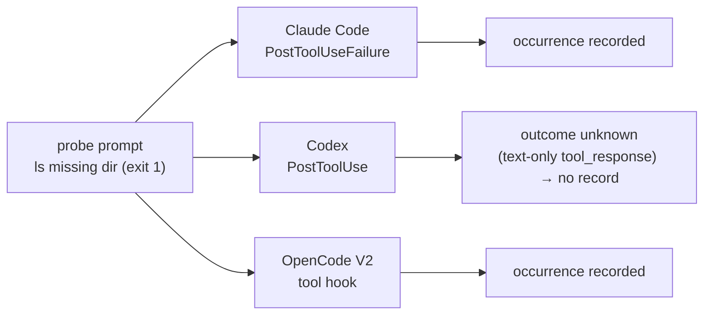

# #496 L0 capture on live hosts (macOS, 2026-11-25)

**Observed:** macOS (Darwin 25.6.0), release `v1.1.0` (includes #522 `819175cb`). Claude Code 2.1.332 (installed plugin 1.1.0, model haiku), Codex CLI 0.172.0 (compat-hooks runtime `1.1.0-8d1bc23f452c`, `gpt-6-luna` low), OpenCode 2.1.4 (`--standalone`, global plugin shim loading `opencode-plugin/index.mjs` from main `d2c63df5`, model `opencode/hy4-flash-free`).

Each host ran [`probe.sh`](probe.sh): a fresh empty Git repo, its own `HARNESS_OBSERVATIONS_DIR` and `TMPDIR`, one prompt asking the model to run `ls ./missing-496-probe-dir .` (exit 1) and report the exit code. Afterwards `scripts/errors-local.js list --json` ran in the same workspace with the same store. Home and scratch paths are replaced in the retained files.

| Host | Hook delivered | Record | Notes |
|---|---|---|---|
| Claude Code | `PostToolUseFailure` | [`claude-records.json`](claude-records.json): 1 `occurrence`, `host: claude`, `commandClass: shell`, `exitCode: null`, `destination: unknown` | The host payload carries no structured exit code; the excerpt starts with the host's `Exit code 1` line. |
| OpenCode V2 | tool hook in `--standalone` run | [`opencode-records.json`](opencode-records.json): 1 `occurrence`, `host: opencode`, `exitCode: 1`, `destination: unknown` | |
| Codex | `PostToolUse` fired 5× ([`codex-hook-trace.txt`](codex-hook-trace.txt)) | none (`list` → `[]`) | By design: `readCodexToolOutcome` returns `unknown` without a structured exit status, and capture runs only on `failure`. This is the #488 host gap, not a capture defect. |

## What this establishes

- Live capture works end to end on Claude Code and OpenCode V2 for a shell failure: host hook → redacted store record → `errors-local list` in the same workspace.
- Records are workspace-scoped (`workspaceKey`), carry a `p-` provisional id outside the `E-` namespace, and default to `destination: unknown`.

## What this does not establish

- **Codex capture:** not observed; blocked on a structured exit status from the host (#488). No text parsing was added.
- **Cross-host signatures:** the same failure produced different signatures (`v1-shell-generic-6732037fac2f` on Claude vs `v1-shell-generic-b6246d9928fe` on OpenCode) because the Claude excerpt includes the host's `Exit code 1` prefix. L1 clustering across hosts would split this class (finding, follow-up).
- Matcher delivery of provisional lessons, review/CI sources, other OSes (Windows is #516), other host versions, and any behaviour change.
