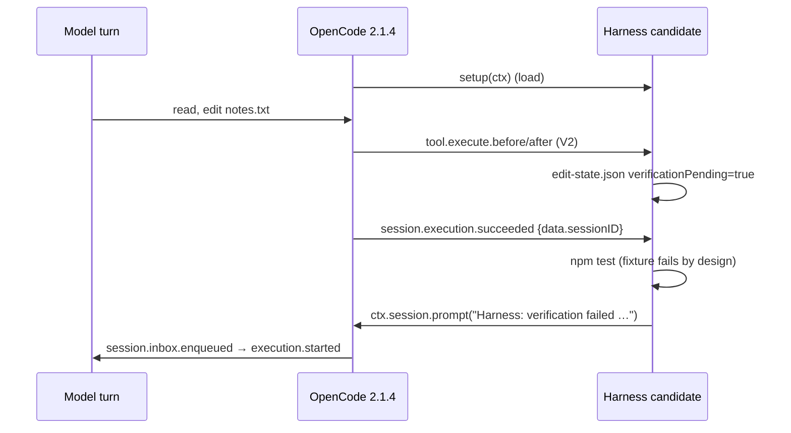

# OpenCode V2 lifecycle trace (2.1.4, #453)

**Observed:** OpenCode 2.1.4 on macOS 26.6.2, Node 24.14.1, 2026-11-24. One `opencode serve` on loopback, one `opencode run --server` turn, one model call (`opencode/hy4-flash-free`).

**Candidate:** `opencode-plugin/index.mjs` from branch `fix/453-opencode-v2-only` at `29635b98`, copied byte-identical (sha256 `d9e762a1…5071e`) to the probe workspace as `.opencode/plugins/harness-enforcement.js`.

## Isolation (E-0029)

`HOME`, `XDG_CONFIG_HOME`, `XDG_DATA_HOME`, `XDG_STATE_HOME`, `XDG_CACHE_HOME` and `TMPDIR` pointed at an empty probe directory, so no global Harness plugin, user config or long-running service could load. [plugin-load-lines.txt](plugin-load-lines.txt) shows the server loaded exactly two plugins: the candidate and the [event-trace probe](live-event-trace-probe.js), which only appends event type and value-type shape to a file.

## Sequence

## What the files show

| File | Shows |
|---|---|
| [events-2026-11-24.jsonl](events-2026-11-24.jsonl) | Every host event, shape only. Session events carry `data.sessionID`; the envelope is `{id, created, type, durable, data}`. No `session.idle` was emitted. Completion was `session.execution.succeeded`; a second `inbox.enqueued` + `execution.started` follow it 157 ms later. |
| [edit-state-final.json](edit-state-final.json) | The candidate's session state after the turn: one edit, `verificationPending: true` (the fixture's `test` script always exits 1), follow-up delivered. |
| [reminder-excerpt.txt](reminder-excerpt.txt) | The user message stored by the host for the second turn: the Harness verification-failed reminder text. |

## Boundary

- Establishes, for this one host/version/run: V2 default-export loading, V2 tool hooks, the V2 event envelope and completion type, and completion → verification → reminder delivery on a long-lived server.
- `opencode run --standalone` shuts the server down ~140 ms after `session.execution.succeeded`, which disposes the plugin before verification finishes; one-shot standalone runs therefore do not show the reminder. Not a regression: the pre-change plugin uses the same completion path.
- Not exercised: router/context injection with a Harness checkout present (the copied file found no Harness root, logged `router-unavailable (runtime-missing)`), observation recording on a pilot-ON workspace, ledger lessons, session create/delete reset, cancellation, global scope, npm-package install, other OpenCode versions, Windows/Linux.
