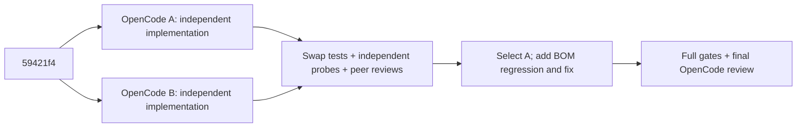

# PR #353 — two independent implementations and cross-validation

- Base: `59421f41a8ce2b00250c96634a4a43ae0ba782bf`.
- Environment: macOS, Node 24.14.1; per-worktree temporary directories.
- Selected: **A plus the coordinator's BOM fix**. Both OpenCode reviewers accept A; B accepts the final delta.
- Scope: S2a only. No runtime wiring, public derive/checker API, digest schema, version or dependency change.
- Evidence layer: **deterministic mechanism**, with fake origin providers; no host provenance or live-host claim.

## Requirements addressed

| Comment | Final behavior |
| --- | --- |
| P1: disconnected origin and event identity halves | Match all five origin-correlated identity fields, captured plan fields and selected active host; reject partial substitutions in verification, review and cached evidence. |
| P1 same-class config link | Captured config source bytes must match the captured candidate inventory. |
| P2: ordinary binary assets reject a complete capture | Keep all captured bytes in baseline/candidate hashes; omit undecodable data only outside the conservative document/code/test/derived/frontmatter relevance surface. Producer and core use one helper. |
| Coordinator's BOM defect | A leading UTF-8 BOM cannot conceal undecodable frontmatter from the relevance check. |

## Comparison and selection (executed unless marked)

| Check | A | Revised B |
| --- | --- | --- |
| Own core / producer suites | 195/0; 76/0 | 193/0; 78/0 |
| Common coordinator probes | 26/0 | 26/0 |
| Candidate-content transition probes | 4/0 | 4/0 (initial B was 0/4; fixed before comparison) |
| BOM frontmatter probe | 0/2 | 0/2 |
| B's tests against A | 193/0 core; 78/0 producer | — |
| A's tests against B | — | 193/2 core; 74/2 producer |
| Peer assessment | accepted by B | A found plan/config links and masked-frontmatter gaps; not accepted as-is |

A closes more represented identity links and fails closed on ambiguous semantic inputs. Its relevance rule avoids extra derivation passes but mirrors existing path rules; this maintenance cost is stated in code with a `shortcut:` comment. The BOM gap was independently reproduced for both candidates, then fixed in the selected tree.

Peer reviews are [A reviews B](a-reviews-b.md) and [B reviews A](b-reviews-a.md). [Final integration review](final-review.md): **ACCEPT**, source-traced (no tests rerun by the reviewer).

## Final evidence

| Check | Result |
| --- | --- |
| Baseline coordinator probes | 10 PASS / 16 FAIL |
| BOM regression before fix | 78 PASS / 2 FAIL / 0 INFRA |
| Final core | **195 PASS / 0 FAIL / 0 INFRA** |
| Final producer | **80 PASS / 0 FAIL / 0 INFRA** |
| Final independent probes | **26 + 4 + 2 = 32 PASS / 0 FAIL** |
| `npm run verify:all` | **13 PASS / 0 FAIL / 3 UNCHECKED** |
| `verify-gate.js --json` after cleanup | Discovered `package-test` ran with exit **0**; gate status `UNCHECKED_DISCOVERED` because no declared project verification contract exists (not a contract PASS). |
| Post-review comment/wording-only cleanup | consistency and diff whitespace PASS; no functional delta after full gates |

The three UNCHECKED entries are Node 22 execution/install lanes. CI owns the cross-platform and runtime-floor evidence. Focused stdout, swapped-suite logs, losslessly compressed full-gate logs and source hashes are retained beside this README. Probe scripts are retained as `.txt` evidence; they were run outside the repository and are not installed runtime code. Full OpenCode JSON streams remain local rather than being shipped.

## Limits and follow-ups

- Undecodable files under code/test/governed/derived paths remain **unavailable by design**, including harmless binary test fixtures or diagrams under governed globs. This conservative acceptance boundary is explicit in the S2a contract; exploratory probes confirm B accepts a no-REQ test fixture while A refuses it. No claim that every binary file in every path is accepted.
- A mirrors the derive contract's code/test/glob rules. Keep them synchronized until a shared classifier is exposed.
- Malformed byte records may now report `inventory-unsupported` rather than the old `invalid-input`; both withhold credit. This is a non-blocking diagnostic drift noted by B.
- Fully self-consistent restatement of all detached metadata and cached accepted structures is outside S2a attestation: external origin authentication remains S2b. Both independent implementations share this boundary.
- The owner decides PR readiness, merge and release.

## Trust-boundary review

| Threat | Check |
| --- | --- |
| Context spoofing / metadata tampering | Five tuple fields, plan/config/host and config bytes linked before credit. |
| Binary omission | Relevant undecodable inputs fail closed; byte hashes retain every captured file. |
| Invalid snapshot | No event adaptation or eligibility. |
| Secrets / injected execution | Targeted changed-source scan found no added secret literal or dynamic execution; no endpoint/auth/dependency added. |

STATUS: DONE
