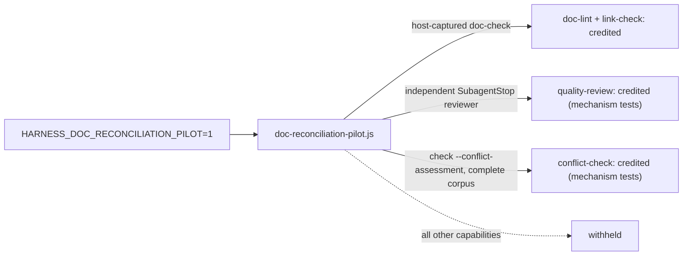

# DOCS-006 — Doc reconciliation pilot (S1 default-OFF, F4 limited credit)

## Decision

- The S1 runtime is default OFF. It runs only when `HARNESS_DOC_RECONCILIATION_PILOT=1`.
- Fail-closed: evidence that is not trusted is withheld, not credited.
- F4 gives positive credit for `doc-lint` and `link-check`, from a host-captured run of the installed doc-check. The contract limits positive credit to Claude Code ([F4 contract](../doc-workflow-reconciliation.md#f4-credited-reconciliation-claude-only-pilot-on), line 1158).
- F4 also gives credit for `quality-review` from an independent host reviewer (`SubagentStop`).
- `conflict-check` (PR #385): `doc-check.js check --conflict-assessment` requires an exact `--base` SHA and runs lifecycle lint with `--all`. It credits only a complete corpus with no lint error diagnostics, and checks recorded and structural conflicts only. Prose contradictions stay with `quality-review`. Plain `check` earns no conflict credit.
- The observed live runs (Claude Code 2.1.309, runs 4–5) credited only `doc-lint` and `link-check`. `quality-review` and `conflict-check` have mechanism tests only.
- Other capabilities stay withheld. Expansion beyond the limited pilot is gated on #341 E1.

## Context

| Issue | Subject | State |
| --- | --- | --- |
| #341 | Phased snapshot boundary, conformance suite, obligation contract | OPEN |
| #350 | Docuvia pilot limitations (code-to-doc dependency edge, derivation hygiene) | OPEN |
| #358 | Credit host-captured doc evidence on Claude Code (#325) | MERGED |
| #375 | Retain adjudicated E1 blockers and Phase 3c handoff | MERGED |
| #385 | Conflict-check producer from a full-corpus assessment | MERGED |

- #375 records zero qualifying E1 cycles, so expansion stays gated.
- Contract: [doc-workflow-reconciliation.md § S1 switch](../doc-workflow-reconciliation.md#s1--switch-trusted-scope-and-fail-closed-no-credit-gate).

## Evidence

- Implementation: [doc-reconciliation-pilot.js](../../hooks/scripts/lib/doc-reconciliation-pilot.js) (env gate at line 8; `doc-lint` / `link-check` credit at line 246; `quality-review` collection from `SubagentStop` at lines 244 and 254; `conflict-check` collection at lines 251–252), [doc-check.js](../../harness-everything/scripts/doc-check.js) (flag parse at lines 86–88; `--base` required at line 102; `--all` lint at line 108; assessment at lines 468–498; credit at line 501), [doc-reconciliation-provider.js](../../hooks/scripts/lib/doc-reconciliation-provider.js) (corpus binding check at lines 763–785), [doc-reconciliation-core.js](../../hooks/scripts/lib/doc-reconciliation-core.js), [doc-reconciliation-producer.js](../../hooks/scripts/lib/doc-reconciliation-producer.js), [doc-reconciliation-events.js](../../hooks/scripts/lib/doc-reconciliation-events.js).
- F4 contract: [doc-workflow-reconciliation.md § F4](../doc-workflow-reconciliation.md#f4-credited-reconciliation-claude-only-pilot-on). `conflict-check` row: [doc-workflow-reconciliation.md](../doc-workflow-reconciliation.md) line 1174.
- Tests: [mechanism-pr-a-conflict-check.test.js](../../ci/mechanism-pr-a-conflict-check.test.js) (17/17 PASS at this SHA; mechanism only, no live-host run), [mechanism-325-3b-preparation.test.js](../../ci/mechanism-325-3b-preparation.test.js), [mechanism-325-3b-s1-review.test.js](../../ci/mechanism-325-3b-s1-review.test.js), [mechanism-325-3b-s2a-core.test.js](../../ci/mechanism-325-3b-s2a-core.test.js), [mechanism-325-3b-s2b-wiring.test.js](../../ci/mechanism-325-3b-s2b-wiring.test.js), [mechanism-341-opencode-lane.test.js](../../ci/mechanism-341-opencode-lane.test.js).

## Open gates

- #341 OPEN: E1 GO / REVISE / NO-GO gates any expansion beyond the limited pilot.
- #350 OPEN: Docuvia pilot limitations.
- #325 OPEN as the documentation-family umbrella (see DOCS-001).
