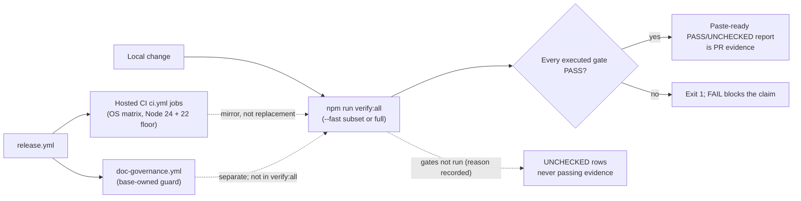

# EVID-001 — `verify:all` gate: verification-evidence record (row 17)

> Outline only (cycle A, step 1 of 2). Decision text is drafted after outline review.
> Inventory row 17, owner-approved: [#325](https://github.com/dyphn1/Harness-everything/issues/325).
> Cycle definition: [#421 comment 6785927033](https://github.com/dyphn1/Harness-everything/issues/421#issuecomment-6785927033) §5.
> This is a **retrospective** ADR for the **shipped** `verify:all` gate; it records observed evidence and exact limits, it does not change the gate.

## Decision

To be drafted after outline review. The Decision section will state, each bullet resting on the source named:

- The gate's identity and purpose: `npm run verify:all` is the local CI-mirror gate runner (`scripts/verify-all.js`, module docblock "Local CI-mirror gate runner"; `package.json` script `"verify:all": "node scripts/verify-all.js"`). To be drafted after outline review.
- The full gate plan: the 12 `FULL_PLAN` entries in CI order with their `fast` classification (`scripts/verify-all.js`, `FULL_PLAN`, lines 43–56). To be drafted after outline review.
- The exact `--fast` limit: `--fast` runs only the four `fast: true` gates (`npm test`, `test:mutations`, `test:consistency`, `test:portability`); the other eight `FULL_PLAN` gates, the Node 22 lanes and the waza entry are reported `UNCHECKED` with their reasons and never count as passing evidence (`scripts/verify-all.js`, `buildPlan`, `run`, `main`; `renderReport` UNCHECKED handling). To be drafted after outline review.
- UNCHECKED discipline: every known gate always appears in the report; a gate that did not run is `UNCHECKED` with its reason and is never passing evidence (`scripts/verify-all.js`, docblock lines 14–16; `renderReport`). To be drafted after outline review.
- The Node 22 runtime-floor lane, described accurately: locally `--node22` runs only two execution smoke tests under `npx node@22` using the host's `node_modules`; the `npm ci` dependency-install under Node 22 stays `UNCHECKED` ("covered by the CI runtime-floor job; not replicated locally") and is covered by the CI `runtime-floor` job (Node 22: `npm ci`, `npm test`, `ci/installer-roundtrip.test.js`) (`scripts/verify-all.js`, `NODE22_PLAN` + `NODE22_UNVERIFIED` + comment lines 63–70; `.github/workflows/ci.yml`, job `runtime-floor`). To be drafted after outline review.
- What `verify:all` does **not** run: the hosted, base-owned document-governance guard is a separate workflow, not part of the local gate set (`scripts/verify-all.js`, `FULL_PLAN`; `.github/workflows/doc-governance.yml`, job `doc-governance` running `scripts/doc-governance-guard.js`). To be drafted after outline review.
- Optional gates and flags: `--clean` (fresh detached worktree of HEAD), `--no-install`, `--no-waza`, waza readiness probed on PATH or `~/bin` and `UNCHECKED` when the tool is absent (`scripts/verify-all.js`, `parseArgs`, `prepareCleanRoot`, `wazaEnv`, `WAZA_ENTRY`; `AGENTS.md` § Verification, waza bullet). To be drafted after outline review.
- Exit contract: exit 1 when any executed gate fails; `PASS`/`FAIL`/`UNCHECKED` summary is paste-ready PR evidence (`scripts/verify-all.js`, `renderReport`, `main` exit handling). To be drafted after outline review.

## Context

- Why the gate exists: local runs skipped gate categories and failures surfaced only after push — PR #301 consistency/runtime-floor, PR #327 Windows self-regression (`scripts/verify-all.js`, docblock lines 7–11). To be drafted after outline review.
- Where the gate sits in the evidence rules: "Never report 'it works' from code reading"; verification includes the CI-equivalent gates, not only unit tests (`AGENTS.md`, § Verification Before You Claim Done, lines 86–98; shared agent standard "Work order" verification clause). To be drafted after outline review.
- How the gate relates to hosted CI: hosted CI (`.github/workflows/ci.yml`) runs the equivalent gate categories as discrete jobs across OS matrixes (Node 24 + Node 22 `runtime-floor`), and `release.yml` blocks on both `ci.yml` and `doc-governance.yml` via `workflow_call` (`.github/workflows/release.yml`, `gate` and `doc-governance` jobs). To be drafted after outline review.
- The runtime floor: minimum Node 22 (`package.json#engines.node`), primary dev/CI Node 24 (`.nvmrc`, `Dockerfile`) (`docs/repository-contract.md`, § Runtime — generated by `scripts/repository-contract.js`). To be drafted after outline review.
- Doc-governance placement of this ADR: ADRs are T1-strict; ordinary content revisions need no U5 review, but lifecycle, conflict and link checks apply; a new governed ADR triggers update-over-create and outline confirmation (MUST for ADR) (`docs/document-lifecycle.md`, § Governance tiers and placement (#401), T1 row; § D6.5 fact table, "New governed file" row). To be drafted after outline review.

## Evidence

The Decision text will report **only observed results**, each with its exact run, SHA and output; no claim from code reading. Candidate evidence items, each resting on its named source:

- Local gate runs already recorded in the repository: `verify:all` 13 PASS / 0 FAIL at `4899fbb` (executed) (`.agents/harness-everything/errors/E-0001-doc-check-identity-split-decision.md`, episode `325-f4-checker-identity` round 3 evidence bullet). To be drafted after outline review.
- Fast-subset runs and their UNCHECKED rows as recorded in packet reports and plans, e.g. "Windows CI and full `verify:all` were not run", "Node 22 install/platform lanes not run locally remain UNCHECKED" (`docs/own-repo-governance-e1-plan-2026-10-25-2139.md`, lines 184, 225; #376 verification bullet at line 246). To be drafted after outline review.
- Hosted CI evidence: the full-gate CI run for `e5d22584` ([run 39374474269](https://github.com/dyphn1/Harness-everything/actions/runs/39374474269), every job succeeded) and the resident-teardown retry on `main@75e0435` ([run 39175240370](https://github.com/dyphn1/Harness-everything/actions/runs/39175240370)) (`docs/document-lifecycle.md`, § Scope of this slice, lines 28). To be drafted after outline review.
- Evidence-layer honesty rule: each recorded claim names its layer — package, deterministic mechanism, live host or behavior (`AGENTS.md`, § Verification, last bullet; § Behavioral & Benchmark Evidence table). To be drafted after outline review.
- Each Evidence bullet must cite a durable reference — a public issue/PR comment URL or a repository-relative path; packet-local paths are notes, not provenance (`.agents/harness-everything/errors/E-0010-packet-local-provenance-reference.md`, Lesson). To be drafted after outline review.

## Open gates

- #325 (documentation family umbrella) is OPEN; shipped slices do not close it (`docs/adr/DOCS-001-project-docs-config.md`, § Open gates). To be drafted after outline review.
- #341 E1 remains OPEN: qualifying cycles not established; D1/D2 non-qualifying; E1 GO/REVISE/NO-GO gates expansion beyond the limited pilot (`docs/document-lifecycle.md`, § Phase 3b row 3b, and Phase 3b entry-gates bullet). To be drafted after outline review.
- This ADR's own status stays `proposed` until outline review and Decision drafting complete; ADR status vocabulary is `proposed`/`accepted`/`rejected`/`superseded` (`docs/document-lifecycle.md`, § Roles and status (D6.1, D6.3)). To be drafted after outline review.

## Reading list

Every doc and source path that describes the `verify:all` mechanism, with one line on what it says about the gate.

| Source | What it says about the gate |
| --- | --- |
| `scripts/verify-all.js` (`FULL_PLAN`, `NODE22_PLAN`, `NODE22_UNVERIFIED`, `WAZA_ENTRY`, `buildPlan`, `parseArgs`, `renderReport`, `main`) | The mechanism itself: 12-gate CI-order plan, `--fast` = the four `fast: true` gates, `--clean` fresh detached worktree, `--node22` two execution smoke tests via `npx node@22`, Node 22 `npm ci` always UNCHECKED locally, optional waza entry probed then UNCHECKED if absent, every unrun gate reported UNCHECKED with its reason, exit 1 on any FAIL |
| `package.json` (script `verify:all`; scripts it invokes) | `verify:all` maps to `node scripts/verify-all.js`; names each individual gate script (`test`, `test:mutations`, `test:consistency` (chains `consistency-check.js`, `doc-capability-consistency.test.js`, `repository-contract.test.js`, `mechanism-2ao-plugin-sync.test.js`, `prompt-contract-regressions.test.js`), `test:references`, `test:release`, `test:collision`, `test:routing:skills`, `test:routing:invariants`, `test:plugin:openai`, `test:plugin:submission`, `test:platform:compatibility`, `test:portability`, `test:mechanism`, `test:repo-contract`, `test:docs:capabilities`) |
| `AGENTS.md` § Verification Before You Claim Done (lines 86–98) | `verify:all` "runs every CI gate category and prints paste-ready evidence"; lists 15 individual gates including `test:mechanism`, `test:repo-contract`, `test:docs:capabilities`; `--fast` is the pre-push subset; Node 22 install compatibility stays UNCHECKED locally |
| `docs/repository-contract.md` (§ Runtime, § Active workflows, § Drift prevention; generated by `scripts/repository-contract.js`) | Node 22 minimum / Node 24 primary; `ci.yml` runs the 12 npm quality gates (matching `FULL_PLAN`); `test:repo-contract` fails when runtime sources disagree, the Node 22 floor is no longer exercised, or this generated doc is stale |
| `.github/workflows/ci.yml` (jobs: `self-regression`, `consistency`, `runtime-floor`, `pilot-offline-evidence`, `system-one-windows-node24-patched`, `system-one-windows-node-legacy-policy`, `release-semantics`, `skill-quality`, `installer-e2e`) | Hosted CI runs the gate categories as discrete jobs on Node 24 across ubuntu/windows/macos; `runtime-floor` installs and runs the suite on Node 22 (`npm ci`, `npm test`, `ci/installer-roundtrip.test.js`) |
| `.github/workflows/doc-governance.yml` (job `doc-governance`; runs `scripts/doc-governance-guard.js` from the validated base SHA) | The hosted document-governance guard is base-owned and runs as a separate workflow; it is not part of the `verify:all` gate set |
| `.github/workflows/release.yml` (jobs `gate`, `doc-governance`, `release`) | Release waits for the full CI matrix and document governance via `workflow_call` before publishing |
| `.nvmrc` (`24`) | Primary development/CI Node.js is 24; the 22 floor is a compatibility lane, not the dev runtime |
| `self-evolve/scripts/self-regression.js` (line 122: runs `ci/mechanism-test.js`) | `npm test` (the first `FULL_PLAN` gate) executes the mechanism suite, so `test:mechanism` is exercised inside `verify:all` through `npm test` |
| `docs/doc-workflow-reconciliation.md` (line 520) | Requires the relevant deterministic gates plus `npm run verify:all -- --fast` for parity claims in the doc-reconciliation workflow |
| `docs/own-repo-governance-e1-plan-2026-10-25-2139.md` (lines 141, 184, 225, 236, 246, 254) | Usage protocol: focused command per packet, `verify:all -- --fast` after a packet set, coordinator runs full `verify:all` once after the final candidate is frozen; "Node 22 install/platform lanes not run locally remain UNCHECKED"; recorded instances where full `verify:all` was not run stay explicit |
| `.agents/harness-everything/errors/E-0001-doc-check-identity-split-decision.md` (episode `325-f4-checker-identity` round 3) | Recorded executed evidence: `verify:all` 13 PASS / 0 FAIL at `4899fbb` (historical run at a pinned SHA) |
| `.agents/harness-everything/errors/E-0009-one-shot-sandbox-environment.md` (episodes `341-e1-kit-repin-and-425-w6`) | `verify:all` (fast and full) does not run inside `codex exec -s workspace-write` sandboxes (loopback bind, npm cache, workflow-state EPERM); the coordinator runs it outside the sandbox and workers report the UNCHECKED/BLOCKED disposition |

### Contradictions and tensions (listed, not resolved)

- "Runs every CI gate category" (`AGENTS.md` § Verification, line 95) vs. the actual plan: `FULL_PLAN` (`scripts/verify-all.js`, lines 43–56) has 12 npm gates, while hosted `ci.yml` also runs `pilot-offline-evidence` (a Python benchmark check), the System One Windows runtime jobs, `release-semantics`, `skill-quality` (waza) and `installer-e2e` — none of which appear in `FULL_PLAN`.
- Gate-list wording: `AGENTS.md` line 95 names `test:mechanism`, `test:repo-contract` and `test:docs:capabilities` as "individual gates" of `verify:all`; `FULL_PLAN` has no such entries (`test:repo-contract` and `test:docs:capabilities` are components of the `test:consistency` chain per `package.json` line 22; `self-regression.js` line 122 runs `ci/mechanism-test.js` inside `npm test`). Which framing is authoritative is not resolved here.
- Historical row count: E-0001 records a `verify:all` run of "13 PASS" at `4899fbb`; the current `FULL_PLAN` has 12 gates. The count reflects the plan at that pinned SHA; not reconciled here.
- Local vs hosted coverage: locally `--node22` runs only the two execution smoke tests; the Node 22 dependency-install (`npm ci`) is always UNCHECKED locally (`NODE22_UNVERIFIED`) and is only covered by the hosted `runtime-floor` job — the ADR must keep these two dispositions separate.
- Dispatch environment: E-0009 records that `verify:all` cannot complete inside some sandboxed worker environments; the gate's evidence therefore depends on where it is executed. Stated as a limit, not resolved.
