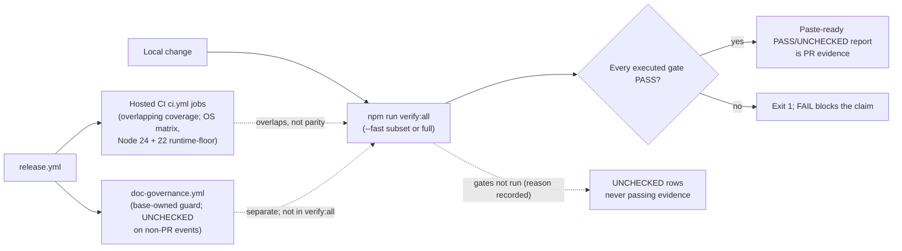

# EVID-001 — `verify:all` gate: verification-evidence record (row 17)

> Inventory row 17, owner-approved: [#325](https://github.com/dyphn1/Harness-everything/issues/325).
> Cycle definition: [#421 comment 6785927033](https://github.com/dyphn1/Harness-everything/issues/421#issuecomment-6785927033) §5.
> This is a **retrospective** ADR for the **shipped** `verify:all` gate; it records observed evidence and exact limits, it does not change the gate. Every behavioural claim below is bound to `scripts/verify-all.js` or the direct contract test at repository state `52fb8098326bf1b4f9dca812320959eccd13ee89`.

## Decision

- **Identity and purpose.** `npm run verify:all` maps to `node scripts/verify-all.js` (`package.json`). The module docblock names it "Local CI-mirror gate runner": it runs the local gate set in CI order, from the working tree or a clean detached checkout of HEAD, and prints a Markdown table that is paste-ready for PR evidence (`scripts/verify-all.js`, docblock).
- **The full gate plan.** `FULL_PLAN` (`scripts/verify-all.js`) has 12 top-level rows, in CI order, each command being an npm script; four are marked `fast: true`:

| # | Row label | Command | `fast` |
| --- | --- | --- | --- |
| 1 | self-regression (hermetic + mechanism + routing contracts) | `npm test` | yes |
| 2 | mutation checks | `npm run test:mutations` | yes |
| 3 | consistency (docs, manifests, repo contract, prompt contracts) | `npm run test:consistency` | yes |
| 4 | references resolve | `npm run test:references` | no |
| 5 | release consistency | `npm run test:release` | no |
| 6 | skill description collision | `npm run test:collision` | no |
| 7 | skill routing coverage | `npm run test:routing:skills` | no |
| 8 | routing invariants | `npm run test:routing:invariants` | no |
| 9 | openai plugin package | `npm run test:plugin:openai` | no |
| 10 | openai public submission | `npm run test:plugin:submission` | no |
| 11 | platform compatibility matrix | `npm run test:platform:compatibility` | no |
| 12 | test-source portability | `npm run test:portability` | yes |

- **Aggregate commands and nested checks.** `npm test` and `test:consistency` are aggregate commands; the 12 rows above are the runner's top-level rows. `test:mechanism` is reached inside `npm test` (`self-evolve/scripts/self-regression.js` line 122 runs `ci/mechanism-test.js`), and `test:repo-contract` / `test:docs:capabilities` are components of the `test:consistency` chain (`package.json`). `ci/mechanism-38-verify-all.test.js` is the direct contract test for the runner itself: plan membership in every mode, UNCHECKED reasons and reporting, waza in fast mode, and the launcher policy.
- **Exact `--fast` behaviour.** With `--fast`, the four `fast: true` rows run; each of the other eight `FULL_PLAN` rows is reported `UNCHECKED (not in the --fast subset)`. Waza is **independent of `--fast`**: `buildPlan` leaves it enabled regardless of the fast flag, so with defaults and waza available, fast mode runs five commands (the four `fast` rows plus waza). The contract test asserts "waza runs by default in fast mode too" (`ci/mechanism-38-verify-all.test.js`). Waza is `UNCHECKED` only when skipped with `--no-waza` (`skipped by --no-waza`) or when the tool is absent (`waza not found on PATH or ~/bin` — probed via `waza --version`, then `~/bin/waza`). `--no-waza` is the only way to force the four-row fast subset.
- **UNCHECKED reasons, exactly as implemented** (`scripts/verify-all.js`, `buildPlan` + `probeWazaEntry`):

| Row | UNCHECKED reason string |
| --- | --- |
| Non-fast `FULL_PLAN` rows under `--fast` | `not in the --fast subset` |
| Node 22 execution smoke tests without `--node22` | `not requested; add --node22` |
| Node 22 dependency install (always, locally) | `covered by the CI runtime-floor job; not replicated locally` |
| Waza with `--no-waza` | `skipped by --no-waza` |
| Waza when the tool is absent | `waza not found on PATH or ~/bin` |

- **Node 22 runtime-floor lanes, kept separate.** Locally, `--node22` adds only two execution smoke tests run under `npx -y node@22` (`self-evolve/scripts/self-regression.js`, `ci/installer-roundtrip.test.js`) using the host's existing `node_modules`. The Node 22 dependency install (`npm ci` under Node 22) never runs locally and is always `UNCHECKED` with the reason above (`NODE22_UNVERIFIED`). The hosted `runtime-floor` job (`.github/workflows/ci.yml`, Ubuntu, Node 22) runs `npm ci`, `npm test` and `ci/installer-roundtrip.test.js` under Node 22 — that is where install compatibility is actually exercised. The local smoke lane and the hosted install lane are different dispositions and the report keeps them separate.
- **Flags.** `--fast`, `--clean` (all gates in a fresh detached worktree of HEAD, with `npm ci --ignore-scripts` in the worktree unless `--no-install`), `--node22`, `--no-install`, `--no-waza`. The report header lists the exact flags, or `(defaults)` (`formatFlags`).
- **Exit and report contract for completed runs.** A completed run renders one row per known gate — `PASS`, `FAIL`, or `UNCHECKED (<reason>)` — plus a `Summary: N PASS, N FAIL, N UNCHECKED.` line (`renderReport`). A gate that did not run is `UNCHECKED` with its reason and never counts as passing evidence. The process exits 1 when any executed gate fails; `UNCHECKED` rows do not force exit 1. Separately: `--help` / `-h` prints usage and exits 0; an unknown argument prints `Unknown argument: <arg>` and exits 2 (`parseArgs`).
- **The report exists only for completed runs.** "Every known gate always appears in the report" holds once the run reaches the report stage. With `--clean`, a failed worktree creation or a failed `npm ci` in the worktree throws (`prepareCleanRoot`) before the row loop and report rendering, so no report and no summary are produced (`scripts/verify-all.js`).
- **What `verify:all` does not run.**
  - Hosted-only jobs outside the plan: the `ci.yml` pilot, System One Windows, `release-semantics`, `skill-quality` and `installer-e2e` jobs are not `FULL_PLAN` rows (see Context).
  - The hosted, base-owned document-governance guard is a separate workflow, not part of the local gate set (`FULL_PLAN`; `.github/workflows/doc-governance.yml` running `scripts/doc-governance-guard.js` from the validated base SHA). Its own UNCHECKED states: on any non-`pull_request` event (push, `workflow_call`), the wrapper reports `UNCHECKED` — "No externally selected PR base/head is available for event <event>; the base-owned guard was not executed." — and does not execute the guard; on a PR whose base tree has no `scripts/doc-governance-guard.js` it reports `BOOTSTRAP_UNCHECKED`. Only a PR with a full base/head SHA and a guard in the base tree executes the frozen base guard. Because `release.yml` triggers on push and calls the guard workflow via `workflow_call`, its `doc-governance` dependency alone does not prove the guard ran; the event makes the guard report `UNCHECKED`.

## Context

- Why the gate exists: local runs skipped gate categories and failures surfaced only after push — PR #301 consistency/runtime-floor, PR #327 Windows self-regression (`scripts/verify-all.js`, docblock lines 7–11).
- Where the gate sits in the evidence rules: "Never report 'it works' from code reading"; verification includes the CI-equivalent gates, not only unit tests (`AGENTS.md`, § Verification Before You Claim Done; shared agent standard "Work order" verification clause).
- How the gate relates to hosted CI: **overlapping coverage, not parity.** The hosted workflow (`.github/workflows/ci.yml`) runs many of the same npm commands (`npm test`, `test:mutations`, `test:consistency`, `test:references`, `test:release`, `test:collision`, `test:plugin:openai`, `test:plugin:submission`, `test:platform:compatibility`, `test:portability`) but as discrete jobs — some across the ubuntu/windows/macos matrix (Node 24), some single-OS — and it also runs jobs with no `FULL_PLAN` row: `pilot-offline-evidence` (Python benchmark check), the System One Windows jobs, `release-semantics`, `skill-quality` (waza) and `installer-e2e`. The lists also differ at command level: the generated workflow table (`docs/repository-contract.md`, § Active workflows) names `test:release:semantics` and `waza:check` for `ci.yml`, while `FULL_PLAN` instead has `test:routing:skills` and `test:routing:invariants` as top-level rows. `release.yml` blocks on both `ci.yml` and `doc-governance.yml` via `workflow_call` (`.github/workflows/release.yml`, `gate` and `doc-governance` jobs).
- The runtime floor: minimum Node 22 (`package.json#engines.node`), primary dev/CI Node 24 (`.nvmrc`, `Dockerfile`) (`docs/repository-contract.md`, § Runtime — generated by `scripts/repository-contract.js`).
- Doc-governance placement of this ADR: ADRs are T1-strict; ordinary content revisions need no U5 review, but lifecycle, conflict and link checks apply; a new governed ADR triggers update-over-create and outline confirmation (MUST for ADR) (`docs/document-lifecycle.md`, § Governance tiers and placement (#401), T1 row; § D6.5 fact table, "New governed file" row).

## Evidence

Only observed results bound to an exact SHA and output are evidence; each names its layer. Local runner results and hosted CI are separate layers. Anything not run is stated as `UNCHECKED`, not inferred from plans.

- **Local full-gate run (observed, recorded).** `npm run verify:all` at HEAD `c170a96cf856295200d2d1a62c15a552c3cb2b37`, node v24.22.1, darwin, mode "full gate set", flags `(defaults)`: **13 PASS, 0 FAIL, 3 UNCHECKED** — the 12 `FULL_PLAN` rows all PASS, waza readiness PASS (7.0s), and the three Node 22 rows UNCHECKED with the reasons in the Decision. Full log SHA-256 `630159501b19d1d0178683262f0bfe7c0ec9cacb29a336057bb95094481129f4` (`benchmarks/results/codex-pr-metadata-2026-10-26/verification.md`). This record also shows how 13 passes arise from 12 plan rows plus the default-enabled waza row.
- **Historical recorded result (repository-recorded).** `verify:all` 13 PASS / 0 FAIL at `4899fbb7cb60783117983772cb6ae3d1a2e2500c` (`.agents/harness-everything/errors/E-0001-doc-check-identity-split-decision.md`, episode `325-f4-checker-identity` round 4). The record does not retain that run's row table or flags, so the exact row composition of that particular run is not asserted here.
- **Fast-subset runs: not run, stated UNCHECKED.** No observed fast-subset `verify:all` run bound to an exact SHA and output exists in the repository. The retained plan/report excerpts record a usage protocol ("after the H1–H4 set, run `npm run verify:all -- --fast`"), a later verification-limits row stating "Windows CI and full `verify:all` were not run", and a #376 verification instruction to freeze a candidate SHA and run the full gate (`docs/own-repo-governance-e1-plan-2026-10-25-2139.md`, lines 184, 225, 246). These establish that full `verify:all` was not run at that stage; they are not fast-run results and no fast-run result is claimed.
- **Hosted CI (separate evidence layer).** The full-gate CI run for `e5d22584e243d5b5e587ee0279625e97a9033160` ([run 39374474269](https://github.com/dyphn1/Harness-everything/actions/runs/39374474269), every job succeeded) and the resident-teardown retry on `main@75e04359ae5bf11a41739f8eb04d25a76ee8f3a7` ([run 39175240370](https://github.com/dyphn1/Harness-everything/actions/runs/39175240370); attempt 1 observed the historical Windows System One resident teardown, the run completed on attempt 2) (`docs/document-lifecycle.md`, § Scope of this slice).
- **Bounded environment note.** E-0009 records that `verify:all` (fast and full) could not complete inside some `codex exec -s workspace-write` sandboxes (loopback bind EPERM in System One suites, npm cache EPERM, workflow-state writes outside the writable roots), with the coordinator running the gate outside the sandbox (`5 PASS / 0 FAIL` fast run). This is a dispatch-environment limit of specific sandboxes, not an intrinsic limit of `verify:all`; it is not generalised to all sandboxes (`.agents/harness-everything/errors/E-0009-one-shot-sandbox-env.md`).
- **Evidence-layer honesty rule.** Each recorded claim names its layer — package, deterministic mechanism, live host or behaviour (`AGENTS.md`, § Verification, last bullet; § Behavioral & Benchmark Evidence table). Every Evidence bullet cites a durable reference — a public issue/PR URL or a repository-relative path; working-packet paths are notes, not provenance (`.agents/harness-everything/errors/E-0010-packet-local-provenance-reference.md`, Lesson).
- Not run at this ADR's own state `52fb8098`: no fresh `verify:all` run is recorded for it, and this ADR does not claim that tree is green.

## Open gates

- #325 (documentation family umbrella) is OPEN; shipped slices do not close it (`docs/adr/DOCS-001-project-docs-config.md`, § Open gates).
- #341 E1 remains OPEN: qualifying cycles not established; D1/D2 non-qualifying; E1 GO/REVISE/NO-GO gates expansion beyond the limited pilot (`docs/document-lifecycle.md`, § Phase 3b row 3b, and Phase 3b entry-gates bullet).
- This ADR's own status stays `proposed` until the owner accepts it; ADR status vocabulary is `proposed`/`accepted`/`rejected`/`superseded` (`docs/document-lifecycle.md`, § Roles and status (D6.1, D6.3)).

## Related sources

Every doc and source path that describes the `verify:all` mechanism, with one line on what it says about the gate.

| Source | What it says about the gate |
| --- | --- |
| `scripts/verify-all.js` (`FULL_PLAN`, `NODE22_PLAN`, `NODE22_UNVERIFIED`, `WAZA_ENTRY`, `buildPlan`, `parseArgs`, `renderReport`, `main`) | The mechanism itself: 12-row CI-order plan, `--fast` = the four `fast: true` rows, waza independent of `--fast`, `--clean` fresh detached worktree, `--node22` two execution smoke tests via `npx node@22`, Node 22 `npm ci` always UNCHECKED locally, waza probed then UNCHECKED if absent, every unrun gate reported UNCHECKED with its reason, exit 1 on any FAIL, `--help` exit 0, unknown argument exit 2 |
| `ci/mechanism-38-verify-all.test.js` | Direct contract test: plan rows retained in every mode, `--fast` subset membership, waza runs by default in fast mode, `--no-waza` reason, UNCHECKED reasons, report self-describing (mode, flags, HEAD, runtime, OS), launcher policy (git shell-free; Windows `.cmd` shims via shell), spaced worktree paths survive |
| `package.json` (script `verify:all`; scripts it invokes) | `verify:all` maps to `node scripts/verify-all.js`; names each individual gate script (`test`, `test:mutations`, `test:consistency` (chains `consistency-check.js`, `doc-capability-consistency.test.js`, `repository-contract.test.js`, `mechanism-2ao-plugin-sync.test.js`, `prompt-contract-regressions.test.js`), `test:references`, `test:release`, `test:collision`, `test:routing:skills`, `test:routing:invariants`, `test:plugin:openai`, `test:plugin:submission`, `test:platform:compatibility`, `test:portability`, `test:mechanism`, `test:repo-contract`, `test:docs:capabilities`) |
| `AGENTS.md` § Verification Before You Claim Done | `verify:all` "runs every CI gate category and prints paste-ready evidence"; lists 15 individual gates including `test:mechanism`, `test:repo-contract`, `test:docs:capabilities`; `--fast` is the pre-push subset; Node 22 install compatibility stays UNCHECKED locally |
| `docs/repository-contract.md` (§ Runtime, § Active workflows, § Drift prevention; generated by `scripts/repository-contract.js`) | Node 22 minimum / Node 24 primary; its `ci.yml` workflow row names `test:release:semantics` and `waza:check` among the npm commands CI runs — a list that differs from `FULL_PLAN` (which has `test:routing:skills`/`test:routing:invariants` instead); `test:repo-contract` fails when runtime sources disagree, the Node 22 floor is no longer exercised, or this generated doc is stale |
| `.github/workflows/ci.yml` (jobs: `pilot-offline-evidence`, `self-regression`, `system-one-windows-node24-patched`, `system-one-windows-node-legacy-policy`, `runtime-floor`, `release-semantics`, `skill-quality`, `consistency`, `installer-e2e`) | Hosted CI runs gate-category commands as discrete jobs — `self-regression` and `consistency` across the ubuntu/windows/macos matrix on Node 24, others single-OS; also hosted-only jobs (`pilot-offline-evidence`, System One, `release-semantics`, `skill-quality` incl. waza, `installer-e2e`); `runtime-floor` (Ubuntu) installs on Node 22 (`npm ci`) and runs `npm test` + `ci/installer-roundtrip.test.js` |
| `.github/workflows/doc-governance.yml` (job `doc-governance`; runs `scripts/doc-governance-guard.js` from the validated base SHA) | The hosted document-governance guard is base-owned and runs as a separate workflow; on non-`pull_request` events it reports `UNCHECKED`, on a guard-less base `BOOTSTRAP_UNCHECKED`; it is not part of the `verify:all` gate set |
| `.github/workflows/release.yml` (jobs `gate`, `doc-governance`, `release`) | Release waits for the full CI matrix and document governance via `workflow_call` before publishing; because release runs on push, the guard dependency does not by itself prove the guard executed |
| `.nvmrc` (`24`) | Primary development/CI Node.js is 24; the 22 floor is a compatibility lane, not the dev runtime |
| `self-evolve/scripts/self-regression.js` (line 122: runs `ci/mechanism-test.js`) | `npm test` (the first `FULL_PLAN` row) executes the mechanism suite, so `test:mechanism` is exercised inside `verify:all` through `npm test` |
| `docs/doc-workflow-reconciliation.md` (line 520) | Requires the relevant deterministic gates plus `npm run verify:all -- --fast` for parity claims in the doc-reconciliation workflow |
| `docs/own-repo-governance-e1-plan-2026-10-25-2139.md` (lines 141, 184, 225, 236, 246, 254) | Usage protocol: focused command per packet, `verify:all -- --fast` after a packet set, coordinator runs full `verify:all` once after the final candidate is frozen; "Node 22 install/platform lanes not run locally remain UNCHECKED"; recorded instances where full `verify:all` was not run stay explicit |
| `benchmarks/results/codex-pr-metadata-2026-10-26/verification.md` | Observed full-gate local run bound to HEAD `c170a96` with command, environment, row-by-row results, summary and full-log SHA-256 |
| `docs/document-lifecycle.md` (§ Scope of this slice) | Hosted CI evidence: full-gate CI run for `e5d22584` (run 39374474269) and the resident-teardown retry on `main@75e0435` (run 39175240370) |
| `.agents/harness-everything/errors/E-0001-doc-check-identity-split-decision.md` (episode `325-f4-checker-identity` round 4) | Recorded executed evidence: `verify:all` 13 PASS / 0 FAIL at `4899fbb` (historical run at a pinned SHA; row table not retained) |
| `.agents/harness-everything/errors/E-0009-one-shot-sandbox-env.md` (episodes `341-e1-kit-repin-and-425-w6`) | `verify:all` (fast and full) did not complete inside some `codex exec -s workspace-write` sandboxes (loopback bind, npm cache, workflow-state EPERM); the coordinator ran it outside the sandbox and workers report the UNCHECKED/BLOCKED disposition |

## Known inconsistencies

Each is stated as fact and left unresolved here.

- `AGENTS.md` § Verification says `verify:all` "runs every CI gate category", but `FULL_PLAN` has 12 npm gates while hosted `ci.yml` also runs `pilot-offline-evidence` (a Python benchmark check), the System One Windows runtime jobs, `release-semantics`, `skill-quality` (waza) and `installer-e2e` — none of which appear in `FULL_PLAN`. The wording issue is tracked in [#429](https://github.com/dyphn1/Harness-everything/issues/429); this ADR does not edit `AGENTS.md`.
- `AGENTS.md` names `test:mechanism`, `test:repo-contract` and `test:docs:capabilities` as "individual gates" of `verify:all`; `FULL_PLAN` has no such entries (`test:repo-contract` and `test:docs:capabilities` are components of the `test:consistency` chain per `package.json`; `self-regression.js` line 122 runs `ci/mechanism-test.js` inside `npm test`). Also tracked in [#429](https://github.com/dyphn1/Harness-everything/issues/429).
- Historical row count: E-0001 records a `verify:all` run of "13 PASS" at `4899fbb7cb60783117983772cb6ae3d1a2e2500c`; the current `FULL_PLAN` has 12 rows. The record lacks the run's row table, so whether that run's 13th pass was the waza row (as in the `c170a96` record) or an earlier plan shape is not reconciled here.
- Local vs hosted Node 22 coverage: locally `--node22` runs only the two execution smoke tests; the Node 22 dependency install (`npm ci`) is always UNCHECKED locally (`NODE22_UNVERIFIED`) and is only covered by the hosted `runtime-floor` job — two separate dispositions.
- Gate-list wording in generated docs: the `docs/repository-contract.md` `ci.yml` row lists `test:release:semantics` and `waza:check`, which have no `FULL_PLAN` row, while `FULL_PLAN` has `test:routing:skills` and `test:routing:invariants`, which have no row in that generated list. Overlapping, not matching.
- Dispatch environment: E-0009 records that `verify:all` could not complete inside some sandboxed worker environments; the gate's evidence therefore depends on where it is executed. Stated as a limit, not resolved.
