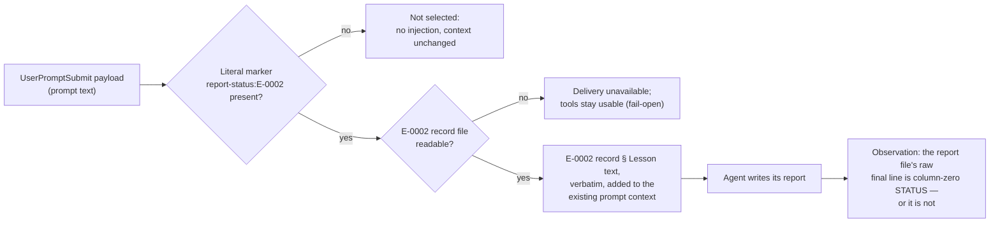

# ROUTE-001 — Error lesson delivery into active-step context

**This is a design ADR for a mechanism that is not shipped.** Nothing in this repository is modified
by this document; the follow-up implementation it defines does not exist yet. This ADR does **not** claim:

- that error handling improved, or that any behavior changed (no paired evidence exists);
- that the chosen error class is closed or its recurrence prevented;
- that any hook, skill, template or script named here has been, or will be, modified — no engine rewrite
  ([#402 comment 6785928296](https://github.com/dyphn1/Harness-everything/issues/402#issuecomment-6785928296));
- that this is a retrospective record of past incidents: it is a forward-looking design ADR; the existing
  error-ledger record inventory stays untouched
  ([#402 comment 6786069987](https://github.com/dyphn1/Harness-everything/issues/402#issuecomment-6786069987));
- that injecting one record replaces the owner's standard of reading the full ledger before dispatched work.

## Decision

- **Chosen error class: `E-0002` (`report-protocol` — reports ending without a plain column-zero
  terminal `STATUS` line).** The generated ledger index has no rank field; E-0002 is not the most
  frequent class (E-0009 has 7 episodes, E-0002 and E-0003 have 5 each — counts freshly verified by
  `node scripts/errors-sync.js --check` at this SHA). E-0002 is chosen because it fits #402's stated
  concern — "invalid commit/report formats, and missing review/packet outcomes" — and because its lesson
  was followed by later recurrences: episodes `412-review13-label-after-status` (2026-11-08) and
  `425-review2-label-after-status` (2026-11-11) occurred *after* the lesson existed, in packets that did
  not state the terminal-line condition. Sources:
  [#402 comment 6785928296](https://github.com/dyphn1/Harness-everything/issues/402#issuecomment-6785928296);
  `.agents/harness-everything/errors/E-0002-report-missing-terminal-status.md`.
- **The existing ledger lesson (carried verbatim, not restated):** every report ends with one plain
  column-zero `STATUS: DONE` or `STATUS: BLOCKED: <reason>` line; when a host rule also requires a
  trailing line, the packet must state which line is terminal. The E-0002 record file is the content
  authority for delivery; the generated index is only a locator and is never injected.
- **Domain: `ROUTE`.** This ADR decides how a relevant ledger lesson is *selected and delivered* into
  active-step context. Declared in `.agents/harness-everything/project-docs.json`. Alternatives not chosen:

| Domain | Why not chosen |
| --- | --- |
| `GATE` | Implies a decision/lock; the A2 scope is a context carrier, not a decision maker ([#402](https://github.com/dyphn1/Harness-everything/issues/402), [#394](https://github.com/dyphn1/Harness-everything/issues/394)) |
| `EVID` | Fits only if the primary decision were the observation contract; here the primary decision is delivery |
| `DOCS` | Would classify the report format itself, not the delivery mechanism |
| `SONE` | System One domain; this decision does not change System One provider or routing internals |
| `DIST` | Distribution domain; this decision changes no packaging or distribution behavior |

- **Delivery channel: prompt context at `UserPromptSubmit`, through the existing `additionalContext`
  seam (owner ruling A7.1).** No new hook file, no second router. On Claude Code the router already runs
  at `UserPromptSubmit` (`hooks/hooks.json`, id `harness:pre:kernel-router`); on Codex,
  `hooks/scripts/codex-user-prompt.js` pipes the whole hook payload to the router and wraps its stdout as
  JSON `hookSpecificOutput.additionalContext` (`plugins/harness-everything/hooks/hooks.json`), because
  Codex adds prompt-time context to the model only from that JSON field
  ([system-one-observations.md](../system-one-observations.md#hosts)). The lesson rides in the context the
  seam already sends; the hook stays a **context carrier, not a decision maker** (A2).

- **Relevance: an explicit report-required signal selects the E-0002 record only (owner ruling A7.2).**
  The signal is defined concretely:
  - *Source:* the prompt text of the `UserPromptSubmit` payload — `payload.prompt`, which the router
    already reads (`harness-everything/scripts/kernel-router.js`: `const prompt = promptArg ||
    (typeof payload?.prompt === 'string' ? payload.prompt : '')`). On Codex the full payload reaches the
    router through `hooks/scripts/codex-user-prompt.js` `finish` (`spawnSync(process.execPath, [ROUTER],
    { input, ... })`); on Claude Code the router is invoked directly with the same payload. The signal is
    therefore really available at `UserPromptSubmit` on both wired hosts, before any routing output.
  - *Format:* the literal marker string `report-status:E-0002` appearing anywhere in the prompt text.
    A literal substring test only — no semantic classifier, no second router, no forcing every task to
    produce a report.
  - *Selection rule:* marker present **and** the E-0002 record file readable ⇒ the record's lesson text
    is added once to the existing context. Marker absent ⇒ not selected, nothing delivered, no fallback.
  - *Plain limit:* the marker is written by whoever authors the dispatch prompt or packet (a fixed
    one-string convention). Prompts without it are not selected and are not delivered; the hook does not
    infer report-requiredness from task content.
  - Alternatives not chosen: matching the active step's recorded obligations
    (`activeExecutionFor` → `activeStepSnapshot`) — defined only when a retained workflow with a loaded
    obligation set exists, so it covers a subset of report work through a second selection surface; and
    agent-side grep of the index at task start — no code change but depends on agent discipline, the
    failure mode the ledger README already records.

- **Label vs STATUS (owner ruling A7.4), stated as decided:**
  - A report **file** ends with its raw column-zero `STATUS:` line and carries no harness-label; the
    **turn's** final message summarises or links the report and ends with the hidden harness-label line
    (`docs/routing.md` § Turn label line).
  - When the report *is* the turn's final message, the rule is a **report-turn exception to
    label-last**. That exception is owned by `AGENTS.md` (applicability) and `docs/routing.md` (label
    contract); making it is a follow-up change, **not made here** — those files are not edited by this ADR.
  - E-0002's recorded episodes (including the label-after-status ones) stay as history; a
    provenance-carrying correction of the lesson text is **#359's** follow-up. This ADR does not rewrite
    the ledger record.
- **Success / failure observation, in three layers that are never merged into one PASS:**

| Layer | What is recorded | What is not claimed |
| --- | --- | --- |
| Delivered / received | Which task or step, which E-0002 record version, that the signal matched, and what context was actually sent. "Received" is stated only with host-side evidence that the context reached the model | Adapter stdout or a passing mechanism test is not a live receipt |
| Considered | Stated as **not directly observed**; no private reasoning is required or requested, no reflection token or report | Any acknowledgement the agent volunteers may be recorded as anecdote, never as the acceptance criterion |
| Used / output | The report file's raw final line under the A7.4 grammar (`STATUS: DONE` / `STATUS: BLOCKED: <reason>` at column zero, nothing after it): conformant or not. A one-run outcome | A conformant line does not prove the injection caused it, that recurrence fell, or that the error class is closed |

  - Mixed cases stay separate: output conformant with delivery UNCHECKED; delivery observed with output
    nonconformant. Neither is recorded as a single PASS.
  - Any later behavior-improvement claim requires paired baseline/treatment evidence; this ADR's
    observation contract does not provide it.
- **Smallest follow-up implementation acceptance (design only; nothing is implemented here):** one seam
  (the `UserPromptSubmit` context assembly above), one minimal change (signal match ⇒ read
  `.agents/harness-everything/errors/E-0002-report-missing-terminal-status.md` § Lesson and append it
  verbatim to the existing context), with these controls:

| Control | Expected result | Evidence layer the check gives |
| --- | --- | --- |
| No marker in the prompt | No injection; context identical to today | Deterministic mechanism test |
| Marker present, record readable | The exact E-0002 lesson text delivered in context | Deterministic mechanism test, then one real-host task for receipt |
| Marker present, record unreadable or source stale | Delivery unavailable; tools stay usable; no fallback to the whole ledger | Deterministic mechanism test |
| Report produced | Final line conformant or not, recorded per the observation table | One real-host task (one-run outcome) |

  - Explicitly forbidden: no fallback to the whole ledger, no fabricated receipt, no automatic rewrite of
    the report, no error counter, no fixed recurrence threshold, no reflection tokens, no forced report,
    no mutation lock, no automatic escalation or reset ritual (A2).
  - Host evidence boundary: only the host seam chosen here (`UserPromptSubmit` context on Claude Code and
    Codex) is covered by future checks. Other hosts and other lifecycle events are unverified; a file
    existing in a package proves no host loaded it ([platform-capabilities.md](../platform-capabilities.md)).
- **Rule-of-3 boundary (owner ruling A7.5), stated exactly:** this cycle's lesson delivery adds, extends,
  calls or depends on **no counter, lock or forced reflection**; the existing Rule-of-3 breaker
  (`hooks/scripts/rule-of-3.js` `isTripped`/`blockForReflection`, `hooks/scripts/rule-of-3-tracker.js`,
  `hooks/scripts/reset-circuit-breaker.js`, [docs/enforcement-locks.md](../enforcement-locks.md)) is not
  modified in this cycle. Owner direction: no counting (that was tried and failed before); a hook hint is
  enough. This ADR does **not** claim the existing breaker conforms to A2; whether A2 requires a separate
  change to it is a separate item outside this ADR, unresolved for its owner.
- **Non-goals (from A2 and the ownership boundary):** the hook stays a context carrier, not a decision
  maker; this ADR does not duplicate #359 (Error Ledger), #394 (ledger context injection and
  agent-initiated zoom-out) or #141 (candidate creation/evaluation); candidate creation/evaluation
  (`hooks/scripts/lib/learning-opportunity.js` `createLearningOpportunity`,
  `self-evolve/scripts/lesson-candidate.js`) and index generation (`scripts/errors-sync.js`) are not
  delivery points; no claim that error handling improved without paired evidence.

## Context

- **The problem:** agent mistakes recur even when a lesson is already recorded in the ledger — the
  recording-to-application gap [#402 comment 6785928296](https://github.com/dyphn1/Harness-everything/issues/402#issuecomment-6785928296).
- **What exists today (each verified in this repository):**
  - the ledger and generated index (`.agents/harness-everything/errors/README.md`, `index.jsonl`,
    `E-*.md`) with a lookup convention (grep by write-set or signature); a convention, not a gate;
  - hook context seams that carry *policy and routing* context but do not retrieve ledger records:
    Claude Code runs `harness-everything/scripts/kernel-router.js` directly at `UserPromptSubmit`
    (`hooks/hooks.json`); Codex wraps the same router through `hooks/scripts/codex-user-prompt.js`
    (`plugins/harness-everything/hooks/hooks.json`); `hooks/scripts/openai-session-start.js` sends static
    `POLICY` and failed-session `handoffContext` at session start;
  - the generic Rule-of-3 tracker and blocker, which read session state, not the ledger
    (`hooks/scripts/rule-of-3.js`, `hooks/scripts/rule-of-3-tracker.js`);
  - candidate creation/evaluation machinery (`hooks/scripts/lib/learning-opportunity.js`,
    `self-evolve/scripts/lesson-candidate.js`);
  - zoom-out and self-evolve skills as agent-initiated reflection/evaluation paths (`zoom-out/SKILL.md`,
    `self-evolve/SKILL.md`).
  - No ledger-aware delivery seam exists today.
- **What zoom-out carries today (correction):** when an agent enters a repair-loop reflection, the
  carried material is the acceptance anchor, links to the previous comparable report, prior finding IDs
  and dispositions, the fix made since, and round counts per class in the error ledger
  (`zoom-out/references/circuit-breaker.md`). It does **not** carry the static ledger lesson text; no
  current seam delivers the E-0002 record.
- **Ownership boundary:** #359 owns the Error Ledger; #394 owns ledger context injection and
  agent-initiated zoom-out; #141 owns candidate creation/evaluation
  ([#402 comment 6785928296](https://github.com/dyphn1/Harness-everything/issues/402#issuecomment-6785928296)).
  **Unverified:** current tracker state of #394 (no #394-specific implementation found on local `main`).

## Evidence

- **E-0002 episode table** (counts freshly verified by `node scripts/errors-sync.js --check`, exit 0, at
  this SHA) drawn from `.agents/harness-everything/errors/E-0002-report-missing-terminal-status.md` and
  its index row:

| Episode | Date | Rounds | Closed |
| --- | --- | --- | --- |
| `325-f4-report-status` | 2026-10-22 | unknown | no |
| `341-e1-verdict-addendum` | 2026-10-29 | 1 | yes |
| `341-e1-writer-contract-review11` | 2026-11-07 | 0 | no |
| `412-review13-label-after-status` | 2026-11-08 | 1 | yes |
| `425-review2-label-after-status` | 2026-11-11 | 0 | no |

- **Seam inventory:** `hooks/hooks.json` (Claude Code `UserPromptSubmit` → `kernel-router.js`, id
  `harness:pre:kernel-router`); `plugins/harness-everything/hooks/hooks.json` (Codex `UserPromptSubmit` →
  `codex-user-prompt.js`); `hooks/scripts/codex-user-prompt.js` `finish` (wraps router stdout as JSON
  `hookSpecificOutput.additionalContext`); `harness-everything/scripts/kernel-router.js` `route`,
  `persistWorkflow`, `activeExecutionFor` (reads `payload.prompt`). Live-host receipt evidence exists for
  the Codex user-hook `additionalContext` path on one retained Windows host
  ([system-one-observations.md](../system-one-observations.md#hosts),
  [platform-capabilities.md](../platform-capabilities.md)); the Claude Code `UserPromptSubmit` wiring is
  mechanism-verified, with no live receipt for a lesson injection.
- **The rule conflict witness:** episode `412-review13-label-after-status` (a column-zero
  `STATUS: DONE` followed by a hidden harness-label line) as the concrete observation that motivates the
  label/STATUS decision above.
- **Candidate-class context:** the index has 14 records; only E-0003 carries a non-null `mechanism_ref`
  (`.husky/commit-msg`). E-0002 has `mechanism_ref: null`.

## Open gates

- **Owner acceptance of this ADR** (`status: proposed`); the follow-up implementation and its
  verification (deterministic mechanism tests, then one real-host task) are not started.
- **`AGENTS.md` / `docs/routing.md` wording change** for the report-turn exception to label-last (A7.4)
  is a follow-up owned by those files; not made here.
- **A provenance-carrying correction of the E-0002 lesson text** is a #359 follow-up.
- **Whether A2 requires a separate change to the existing Rule-of-3 breaker** — separate item outside
  this ADR, unresolved for its owner (A7.5).
- **#394 tracker state** is unverified against the tracker; no #394-specific implementation exists on
  local `main`.

## Reading list

Every source describing error handling, the ledger, lesson delivery, zoom-out or self-evolve that this
Decision rests on. One line each.

| Source | What it says |
| --- | --- |
| `.agents/harness-everything/errors/README.md` | Ledger workflow: grep `index.jsonl` by signature or write-set, write/update records at failure time, `npm run errors:sync`; a convention, not a gate. |
| `.agents/harness-everything/errors/index.jsonl` | Generated per-class inventory: 14 records; E-0002 has 5 episodes and no mechanism. Locator only, never injected. |
| `.agents/harness-everything/errors/E-0002-report-missing-terminal-status.md` | The target lesson and content authority: plain column-zero terminal STATUS; packet must state the terminal line when a host rule adds a trailing line. |
| `.agents/harness-everything/errors/E-0001-doc-check-identity-split-decision.md` … `E-0014-lossy-cleanup.md` | The other 13 ledger records (classes, lessons, mechanism status). |
| `AGENTS.md` (rule 14) | Turn label line mandatory on every final message — the rule whose report-turn exception is a follow-up change. |
| `docs/routing.md` | Owns the label contract: the hidden label is the final line of every turn's final message, records post-work judgement, never gates routing; separates semantic contract, mechanism and live evidence. |
| `docs/system-one-observations.md` | Specification of the label line and turn observation; documents that Codex adds prompt-time context to the model only from JSON `hookSpecificOutput.additionalContext`, verified live on codex-cli 0.157.1. |
| `harness-everything/scripts/kernel-router.js` | The router the hooks run at `UserPromptSubmit`: `route`, `persistWorkflow`, `activeExecutionFor`; reads `payload.prompt`; prints the label contract last. |
| `hooks/scripts/codex-user-prompt.js` | Codex `UserPromptSubmit` adapter: `finish` pipes the whole hook payload into the router and wraps its stdout as `additionalContext`. |
| `scripts/sync-openai-plugin.js` | Packages `hooks/scripts` into `plugins/harness-everything/hooks/scripts`, so a change at the seam ships with the plugin — a packaging fact, not live-host evidence. |
| `docs/mechanism-first-skill-mesh.md` | Anti-goal: no mandatory response-template system; mechanisms are short, failable, bounded — the delivery adds context, not a template obligation. |
| `docs/platform-capabilities.md` | Repository-wide evidence boundary: statuses `Mechanism verified` vs `Live verified`; Codex user-hook capture live-verified for `UserPromptSubmit`/`Stop` on one Windows host only; a package file proves no host loaded it. |
| `docs/troubleshooting.md` | Operator view of the existing Rule-of-3: its session state file and manual `hooks/scripts/rule-of-3.js` runs — context for the A7.5 boundary. |
| `hooks/hooks.json` | Claude Code SessionStart, `UserPromptSubmit` (`harness:pre:kernel-router`, `harness:obs:observation-userpromptsubmit`) and PostToolUseFailure wiring; Rule-of-3 hooks live here; no ledger reference. |
| `plugins/harness-everything/hooks/hooks.json` | Packaged Codex hook wiring, including the `codex-user-prompt.js` entries. |
| `hooks/scripts/openai-session-start.js` | Session-start context seam: static `POLICY` plus failed-session `handoffContext`; no ledger retrieval. |
| `hooks/scripts/rule-of-3.js` | The existing generic three-failure blocker (`isTripped`, `blockForReflection`): a counter/lock this ADR must not extend or depend on. |
| `hooks/scripts/rule-of-3-tracker.js` | Tracks session tool-error signatures; may create a learning candidate after recovery; reads session state, not the ledger. |
| `hooks/scripts/reset-circuit-breaker.js` | The existing reset ritual for the generic breaker; kept out of scope by A2. |
| `hooks/scripts/lib/learning-opportunity.js` | `createLearningOpportunity`: session-local candidate creation for `rule-of-3-recovery` and `verifier-fail-pass` (#141). |
| `hooks/scripts/lib/telemetry.js` | Event recording used by the candidate/tracking machinery. |
| `scripts/errors-sync.js` | Builds `index.jsonl`; `--check` compares without writing; not wired into CI or hooks. |
| `scripts/lib/advisory-text.js` | Static advisory text delivery, including Rule-of-3 policy — precedent for context-only delivery. |
| `zoom-out/SKILL.md` | Agent-initiated zoom-out skill; treats repair-loop history and ledger rounds as reflection signals. |
| `zoom-out/references/circuit-breaker.md` | What zoom-out carries today: acceptance anchor, prior findings and dispositions, ledger round counts — not the static ledger lesson. |
| `zoom-out/templates/zoom-out-report.template.md` | Reflection-report template; not a delivery carrier in this design. |
| `docs/workflows/zoom-out.md` | Zoom-out workflow and packet-history requirements; its breaker is `hooks/scripts/rule-of-3.js`. |
| `docs/workflows/fable-mode.md`, `docs/workflows/fable-discipline.md`, `docs/workflows/tdd.md` | Workflow docs referencing Rule-of-3 as the mandatory reflection owner for three same-signature failures. |
| `self-evolve/SKILL.md` | Agents list, evaluate and promote lesson candidates; governed promotion, not automatic retrieval. |
| `self-evolve/references/memory-resolution.md` | Candidate evaluation and memory-resolution rules. |
| `self-evolve/scripts/lesson-candidate.js` | Candidate lifecycle implementation (#141). |
| `self-evolve/scripts/persist-memory.js` | Persistence of promoted lessons. |
| `docs/workflows/self-evolve.md` | The self-evolve workflow contract. |
| `docs/reflection.md` | Reflection/memory boundaries. |
| `docs/philosophy.md` | Contract strength (MUST/SHOULD/MAY) and mechanisms-over-mandates philosophy. |
| `docs/enforcement-locks.md` | Documents the existing generic lock behavior — the contradiction with A2 recorded below. |
| `fable-discipline/SKILL.md`, `tdd/SKILL.md`, `tdd/references/core-discipline.md` | Workflow disciplines that reference zoom-out on repetition. |
| `ci/mechanism-2a-rule-of-3.test.js` | Deterministic coverage of the existing Rule-of-3 mechanism. |
| `ci/self-evolve-loop.test.js`, `ci/mechanism-379-self-evolve-workspace.test.js` | Deterministic coverage of the self-evolve loop (#141/#379). |
| `evals/zoom-out/`, `evals/self-evolve/` | Routing evals for the two agent-initiated paths. |
| `behavioral-evals/cases/baseline-error-handling.yaml`, `pressure-skip-error-handling.yaml`, `breaker-zoom-out-after-3.yaml`, `self-evolve-retrieval-recurrence.yaml` | Behavior cases covering error handling and retrieval recurrence. |
| `plugins/harness-everything/skills/zoom-out/`, `plugins/harness-everything/skills/self-evolve/`, `plugins/harness-everything/hooks/hooks.json` | Packaged copies that must stay consistent with canonical sources if delivery ships. |
| [#402](https://github.com/dyphn1/Harness-everything/issues/402) (comments 6785928296, 6786069987) | Scope anchor A1–A6: problem statement, context-carrier rule, ownership, cycle-B scope, design-not-retrospective; comment 6790477633 records the A7 rulings. |
| [#394](https://github.com/dyphn1/Harness-everything/issues/394) | Ledger context injection and agent-initiated zoom-out ownership. |
| [#359](https://github.com/dyphn1/Harness-everything/issues/359) | Error Ledger ownership. |
| [#141](https://github.com/dyphn1/Harness-everything/issues/141) | Candidate creation/evaluation ownership. |
| [#421 comment 6785927033](https://github.com/dyphn1/Harness-everything/issues/421#issuecomment-6785927033) | Cycle definition for this work. |

### Known inconsistencies (stated as facts, not resolved by this ADR)

- **`AGENTS.md` rule 14 / `docs/routing.md` vs the E-0002 terminal rule:** the repository requires a
  trailing hidden harness-label line on every final message; the ledger lesson requires `STATUS:` to be
  the last line at column zero. Episode `412-review13-label-after-status` records the conflict. This ADR
  states the A7.4 decision and its report-turn exception, but the wording change in `AGENTS.md` and
  `docs/routing.md` is a follow-up; until it lands, the conflict stands as written.
- **Existing generic Rule-of-3 lock vs A2:** `hooks/scripts/rule-of-3.js` and
  [docs/enforcement-locks.md](../enforcement-locks.md) describe a generic three-failure mutation lock with
  a required reflection report; #402 prohibits exactly such mechanisms for ledger lesson handling. This
  ADR adds, extends, calls or depends on none of them and does not modify the breaker; whether A2 requires
  a separate change to the existing breaker stays unresolved for its owner.
- **Ledger README lookup rule vs the owner's full-read standard:** the README says grep `index.jsonl` for
  the packet's write-set; the owner standard requires reading every record. Injecting one record does not
  change that operational standard for packets.
- **#394 point-of-action proposals vs shipped code:** E-0002 and E-0003 propose point-of-action injection
  in #394, but no #394-specific implementation exists on local `main` (**unverified** against the tracker).
- **Index freshness:** `scripts/errors-sync.js` is not wired into CI or hooks (its own source comment), so
  the index can be stale; this design never injects index content — the E-0002 record file is the content
  authority and the index is a locator. Counts cited in this ADR were verified by
  `node scripts/errors-sync.js --check` at this SHA.
