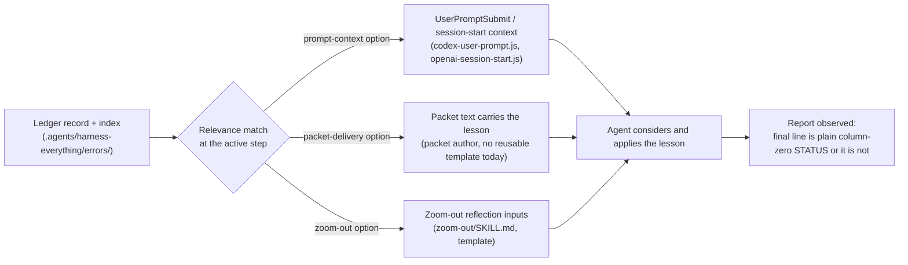

# ROUTE-001 — Error lesson delivery into active-step context (outline)

**This is a design ADR for a mechanism that is not shipped.** This file is currently an
*outline only*: it fixes the shape of the Decision and its sources, not the Decision text.
Per the cycle definition ([#421 comment 6785927033](https://github.com/dyphn1/Harness-everything/issues/421#issuecomment-6785927033)),
the substantive Decision text is drafted after outline review. The outline does **not** claim:

- that error handling improved, or that any behavior changed (no paired evidence exists);
- that the chosen error class is closed or its recurrence prevented;
- that any hook, skill, template or script named here has been, or will be, modified — no engine rewrite
  ([#402 comment 6785928296](https://github.com/dyphn1/Harness-everything/issues/402#issuecomment-6785928296));
- that this is a retrospective record of past incidents: it is a forward-looking design ADR; the existing
  error-ledger record inventory stays untouched
  ([#402 comment 6786069987](https://github.com/dyphn1/Harness-everything/issues/402#issuecomment-6786069987)).

**Domain proposal.** Domain `ROUTE` is the coordinator's proposal: this ADR decides how a relevant
ledger lesson is *selected and delivered* into active-step context. Reviewers and the owner may overrule.
Alternatives not chosen:

| Domain | Why not chosen |
| --- | --- |
| `GATE` | Implies a decision/lock; the A2 scope is a context carrier, not a decision maker ([#402](https://github.com/dyphn1/Harness-everything/issues/402), [#394](https://github.com/dyphn1/Harness-everything/issues/394)) |
| `EVID` | Fits only if the primary decision were the observation contract; here the primary decision is delivery |
| `DOCS` | Would classify the report format itself, not the delivery mechanism |
| `SONE` | System One domain; this decision does not change System One provider or routing internals |
| `DIST` | Distribution domain; this decision changes no packaging or distribution behavior |

## Decision (outline — every bullet below is to be drafted after outline review)

- **Chosen error class: `E-0002` (`report-protocol` — reports ending without a plain column-zero
  terminal `STATUS` line), unless the repository contradicts this ranking at drafting time.**
  It is the top-ranked class in the generated ledger index (5 episodes, `status: lesson`,
  `mechanism_ref: null`) and the lesson was followed by later recurrences, including two 2026-11
  label-after-status episodes. Source: `.agents/harness-everything/errors/index.jsonl` (E-0002 row) and
  `.agents/harness-everything/errors/E-0002-report-missing-terminal-status.md`.
- **Why this class:** it matches #402's stated concern — "invalid commit/report formats, and missing
  review/packet outcomes" — and #402's core framing: recording an error is insufficient unless the agent
  actually receives, considers and uses the lesson; E-0002 episodes recurred *after* the lesson existed,
  in packets that did not state the terminal-line condition.
  Sources: [#402 comment 6785928296](https://github.com/dyphn1/Harness-everything/issues/402#issuecomment-6785928296);
  E-0002 episodes `412-review13-label-after-status` and `425-review2-label-after-status`.
- **The existing ledger lesson (carried, not restated):** every report ends with one plain column-zero
  `STATUS: DONE` or `STATUS: BLOCKED: <reason>` line; when a host rule also requires a trailing line, the
  packet must state which line is terminal. Source:
  `.agents/harness-everything/errors/E-0002-report-missing-terminal-status.md` (§ Lesson).
- **Intervention point(s) — existing seams only, one owning issue each:** the Decision will pick among
  these verified seams (all read in this repository; no new hook file):

  - *Prompt-time context injection* — `hooks/scripts/codex-user-prompt.js` (`finish` wraps router output as
    `additionalContext`; wired in `plugins/harness-everything/hooks/hooks.json`) and
    `hooks/scripts/openai-session-start.js` (`POLICY`, `handoffContext`). The hook carries the lesson as
    context and decides nothing (A2). Owner: **#394** (injection), **#359** (ledger content).
  - *Zoom-out reflection flow* — when an agent initiates a repair-loop reflection, the relevant lesson is
    carried with the acceptance anchor and prior findings:
    `zoom-out/SKILL.md`, `zoom-out/templates/zoom-out-report.template.md`,
    `zoom-out/references/circuit-breaker.md`. Owner: **#394**.
  - *Packet content* — the packet states the terminal-line condition, as the E-0002 round-1 fix did
    (episode `412-review13-label-after-status`); no reusable ledger-aware packet template was found in
    `multi-agent-workspace/templates/`. Owner: **#394** (delivery), **#359** (ledger).
  - *Explicitly not intervention points:* candidate creation/evaluation
    (`hooks/scripts/lib/learning-opportunity.js` `createLearningOpportunity`,
    `self-evolve/scripts/lesson-candidate.js` — session-local candidates, owned by **#141**, not static-ledger
    retrieval) and index generation (`scripts/errors-sync.js` — owned by **#359**, not a delivery point).
- **Genuinely open choices (options with trade-offs, not picked silently in the outline):**
  - *Delivery channel:* prompt-context (automatic, but relevance matching runs at prompt time and may
    inject unneeded lessons) vs packet delivery (precise, but every packet author must remember; today
    nothing generates packets from the ledger) vs zoom-out-carried (narrow, only inside repair loops).
  - *Relevance determination:* match the active task's write-set/signature against
    `.agents/harness-everything/errors/index.jsonl` (narrow, may miss) vs carrying the full lesson set for
    report-requiring work (complete, noisier) vs agent-side grep of the index at task start (no code change,
    depends on agent discipline — the failure mode the ledger README already records).
- **Success / failure observation:** for report-requiring work, observe whether the report's actual final
  line is a plain column-zero `STATUS: DONE` or `STATUS: BLOCKED: <reason>`. Failure: line missing,
  formatted (backticks, prose), mid-report, or followed by another line. This is observation only — the
  observer reports; nothing forces or rewrites the report. Sources: E-0002 episodes
  `341-e1-verdict-addendum`, `341-e1-writer-contract-review11`, `412-review13-label-after-status`,
  `425-review2-label-after-status`.
- **Smallest follow-up implementation acceptance:** for report-requiring work, make the matching E-0002
  lesson available in existing prompt or packet context (one seam, one minimal change), and observe the
  terminal STATUS line per the contract above. Explicitly no: error counter, fixed recurrence threshold,
  reflection tokens, forced report, mutation lock, automatic escalation or reset ritual.
  Source: [#402](https://github.com/dyphn1/Harness-everything/issues/402) (A2, shared with
  [#394](https://github.com/dyphn1/Harness-everything/issues/394)); observation contract per E-0002 record.
- **Non-goals (from A2 and the ownership boundary):** the hook stays a **context carrier, not a decision
  maker**; this ADR must not duplicate #359 (Error Ledger), #394 (ledger context injection and
  agent-initiated zoom-out) or #141 (candidate creation/evaluation); the existing generic Rule-of-3
  counter/lock (`hooks/scripts/rule-of-3.js` `isTripped`/`blockForReflection`,
  `hooks/scripts/reset-circuit-breaker.js`, `docs/enforcement-locks.md`) stays separate from ledger lesson
  delivery and is not extended here; no claim that error handling improved without paired evidence.

## Context (outline)

- **The problem:** agent mistakes recur even when a lesson is already recorded in the ledger — the
  recording-to-application gap [#402 comment 6785928296](https://github.com/dyphn1/Harness-everything/issues/402#issuecomment-6785928296).
- **What exists today (each verified in this repository):** the ledger and generated index
  (`.agents/harness-everything/errors/README.md`, `index.jsonl`, `E-*.md`) with a lookup convention
  (grep by write-set or signature); hook context seams that carry *policy and routing* context but do not
  retrieve ledger records (`hooks/hooks.json` SessionStart/UserPromptSubmit/PostToolUseFailure wiring,
  `hooks/scripts/codex-user-prompt.js`, `hooks/scripts/openai-session-start.js`); the generic Rule-of-3
  tracker and blocker, which read session state, not the ledger (`hooks/scripts/rule-of-3.js`,
  `hooks/scripts/rule-of-3-tracker.js`); candidate creation/evaluation machinery
  (`hooks/scripts/lib/learning-opportunity.js`, `self-evolve/scripts/lesson-candidate.js`); zoom-out and
  self-evolve skills as agent-initiated reflection/evaluation paths (`zoom-out/SKILL.md`,
  `self-evolve/SKILL.md`). No ledger-aware delivery seam exists today.
- **Ownership boundary:** #359 owns the Error Ledger; #394 owns ledger context injection and
  agent-initiated zoom-out; #141 owns candidate creation/evaluation
  ([#402 comment 6785928296](https://github.com/dyphn1/Harness-everything/issues/402#issuecomment-6785928296)).
  **Unverified:** current tracker state of #394 (no #394-specific implementation found on local `main`).

## Evidence (outline)

- **E-0002 episode table** (5 episodes, dates, rounds, the two label-after-status recurrences) drawn from
  `.agents/harness-everything/errors/E-0002-report-missing-terminal-status.md` and the E-0002 row of
  `.agents/harness-everything/errors/index.jsonl`.
- **Seam inventory:** the hook/context files listed under Decision, each cited with the path and the
  function or wiring that makes it a seam.
- **The rule conflict witness:** episode `412-review13-label-after-status` (a column-zero
  `STATUS: DONE` followed by a hidden harness-label line) as the concrete observation that motivates the
  delivery design.
- **Candidate-class ranking:** episode counts and mechanism status per class from
  `.agents/harness-everything/errors/index.jsonl` (only E-0003 carries a non-null `mechanism_ref`).

## Open gates (outline)

- **Owner decisions required before drafting:** confirm E-0002 as the target class; choose the delivery
  channel (prompt-context vs packet vs zoom-out-carried); choose how task relevance is determined; confirm
  which observable signals demonstrate the agent considered and used the lesson, without claiming behavior
  improved.
- **Outline review gate:** this outline must be reviewed (cycle-B review) before the Decision text is
  drafted ([#421 comment 6785927033](https://github.com/dyphn1/Harness-everything/issues/421#issuecomment-6785927033)).
- **Rule conflict needs an owner ruling:** repository `AGENTS.md` rule 14 (end each final message with the
  hidden `<!-- harness-label -->` line) versus the E-0002 terminal-STATUS rule; the packet-level fix
  ("its last line must be the column-zero STATUS line, nothing after it") resolves it per packet but not
  repository-wide.
- **Index freshness:** `scripts/errors-sync.js` is not wired into CI or hooks (its own source comment), so
  the index can be stale at delivery time; the ADR must decide whether delivery reads records directly or
  trusts the index.
- **Verification boundary:** observation of report status is an agent-behavior observation; any later
  behavior-improvement claim requires paired baseline/treatment evidence, not this ADR.

## Reading list

Every source describing error handling, the ledger, lesson delivery, zoom-out or self-evolve that the
Decision will rest on. One line each.

| Source | What it says |
| --- | --- |
| `.agents/harness-everything/errors/README.md` | Ledger workflow: grep `index.jsonl` by signature or write-set, write/update records at failure time, `npm run errors:sync`; a convention, not a gate. |
| `.agents/harness-everything/errors/index.jsonl` | Generated per-class inventory: 14 records; E-0002 has 5 episodes and no mechanism. |
| `.agents/harness-everything/errors/E-0002-report-missing-terminal-status.md` | The target lesson: plain column-zero terminal STATUS; packet must state the terminal line when a host rule adds a trailing line. |
| `.agents/harness-everything/errors/E-0001-doc-check-identity-split-decision.md` … `E-0014-lossy-cleanup.md` | The other 13 ledger records (classes, lessons, mechanism status); context for class ranking. |
| `AGENTS.md` (rule 14) | Turn label line mandatory on every final message — the rule that conflicts with the terminal-STATUS rule. |
| `hooks/hooks.json` | SessionStart, UserPromptSubmit and PostToolUseFailure wiring; Rule-of-3 hooks live here; no ledger reference. |
| `hooks/scripts/codex-user-prompt.js` | Prompt-time context seam: wraps router output as `additionalContext`. |
| `hooks/scripts/openai-session-start.js` | Session-start context seam: static `POLICY` plus failed-session `handoffContext`; no ledger retrieval. |
| `hooks/scripts/rule-of-3.js` | The existing generic three-failure blocker (`isTripped`, `blockForReflection`): a counter/lock this ADR must not extend or duplicate. |
| `hooks/scripts/rule-of-3-tracker.js` | Tracks session tool-error signatures; may create a learning candidate after recovery; reads session state, not the ledger. |
| `hooks/scripts/reset-circuit-breaker.js` | The existing reset ritual for the generic breaker; kept out of scope by A2. |
| `hooks/scripts/lib/learning-opportunity.js` | `createLearningOpportunity`: session-local candidate creation for `rule-of-3-recovery` and `verifier-fail-pass` (#141). |
| `hooks/scripts/lib/telemetry.js` | Event recording used by the candidate/tracking machinery. |
| `scripts/errors-sync.js` | Builds `index.jsonl`; `--check` compares without writing; not wired into CI or hooks. |
| `scripts/lib/advisory-text.js` | Static advisory text delivery, including Rule-of-3 policy — precedent for context-only delivery. |
| `zoom-out/SKILL.md` | Agent-initiated zoom-out skill; treats repair-loop history and ledger rounds as reflection signals. |
| `zoom-out/references/circuit-breaker.md` | The repair-loop signal prompts reflection rather than locking. |
| `zoom-out/templates/zoom-out-report.template.md` | Reflection-report template; a possible carrier for a relevant lesson. |
| `docs/workflows/zoom-out.md` | Zoom-out workflow and packet-history requirements. |
| `self-evolve/SKILL.md` | Agents list, evaluate and promote lesson candidates; governed promotion, not automatic retrieval. |
| `self-evolve/references/memory-resolution.md` | Candidate evaluation and memory-resolution rules. |
| `self-evolve/scripts/lesson-candidate.js` | Candidate lifecycle implementation (#141). |
| `self-evolve/scripts/persist-memory.js` | Persistence of promoted lessons. |
| `docs/workflows/self-evolve.md` | The self-evolve workflow contract. |
| `docs/reflection.md` | Reflection/memory boundaries. |
| `docs/philosophy.md` | Contract strength (MUST/SHOULD/MAY) and mechanisms-over-mandates philosophy. |
| `docs/enforcement-locks.md` | Documents the existing generic lock behavior — the contradiction with A2 below. |
| `docs/workflows/harness-everything.md`, `docs/workflows/fable-mode.md` | Cross-workflow repetition and zoom-out references. |
| `fable-discipline/SKILL.md`, `tdd/SKILL.md`, `tdd/references/core-discipline.md` | Workflow disciplines that reference zoom-out on repetition. |
| `ci/mechanism-2a-rule-of-3.test.js` | Deterministic coverage of the existing Rule-of-3 mechanism. |
| `ci/self-evolve-loop.test.js`, `ci/mechanism-379-self-evolve-workspace.test.js` | Deterministic coverage of the self-evolve loop (#141/#379). |
| `evals/zoom-out/`, `evals/self-evolve/` | Routing evals for the two agent-initiated paths. |
| `behavioral-evals/cases/baseline-error-handling.yaml`, `pressure-skip-error-handling.yaml`, `breaker-zoom-out-after-3.yaml`, `self-evolve-retrieval-recurrence.yaml` | Behavior cases covering error handling and retrieval recurrence. |
| `plugins/harness-everything/skills/zoom-out/`, `plugins/harness-everything/skills/self-evolve/`, `plugins/harness-everything/hooks/hooks.json` | Packaged copies that must stay consistent with canonical sources if delivery ships. |
| [#402](https://github.com/dyphn1/Harness-everything/issues/402) (comments 6785928296, 6786069987) | Scope anchor A1–A6: problem statement, context-carrier rule, ownership, cycle-B scope, design-not-retrospective. |
| [#394](https://github.com/dyphn1/Harness-everything/issues/394) | Ledger context injection and agent-initiated zoom-out ownership. |
| [#359](https://github.com/dyphn1/Harness-everything/issues/359) | Error Ledger ownership. |
| [#141](https://github.com/dyphn1/Harness-everything/issues/141) | Candidate creation/evaluation ownership. |
| [#421 comment 6785927033](https://github.com/dyphn1/Harness-everything/issues/421#issuecomment-6785927033) | Cycle definition: this packet produces only the outline and reading list. |

### Contradictions (listed, not resolved here)

- **`AGENTS.md` rule 14 vs the E-0002 terminal rule:** the repository requires a trailing hidden
  harness-label line on every final message; the ledger lesson requires `STATUS:` to be the last line at
  column zero. E-0002 episode `412-review13-label-after-status` records the conflict; the per-packet fix
  (state which line is terminal) works but nothing resolves it repository-wide.
- **Existing generic Rule-of-3 lock vs A2:** `hooks/scripts/rule-of-3.js` and `docs/enforcement-locks.md`
  describe a generic three-failure mutation lock with a required reflection report; #402 prohibits exactly
  such mechanisms for ledger lesson handling. This ADR keeps them separate; it does not reconcile the
  philosophy tension.
- **Ledger README lookup rule vs the owner's full-read standard:** the README says grep
  `index.jsonl` for the packet's write-set; the owner standard requires reading every record. Compatible
  but different coverage; the ADR's relevance-determination choice sits in this gap.
- **#394 point-of-action proposals vs shipped code:** E-0002 and E-0003 propose point-of-action injection
  in #394, but no #394-specific implementation exists on local `main` (**unverified** against the tracker).
- **Index freshness:** `scripts/errors-sync.js` is not CI/hook-wired, so `index.jsonl` may be stale at
  delivery time; unresolved until the ADR decides the delivery source.
