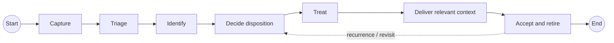
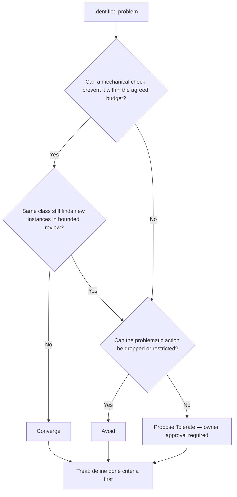

# Error Handling — activity concept (discussion draft)

> **Proposal only.** This is a concrete discussion sketch for [#437](https://github.com/dyphn1/Harness-everything/issues/437), using the current Error Handling direction in [#402](https://github.com/dyphn1/Harness-everything/issues/402). It is not an approved contract or an implemented workflow. No CLI, hook, ledger, routing, or verification policy is changed.

## Level 1 — activity flow

This is deliberately **simple UML Activity-style control flow**, with actions and an ordinary recurrence path. The Mermaid block is a GitHub-native preview; [activity.puml](./activity.puml) is the corresponding PlantUML activity-diagram source. Neither adds custom edge types.

| Action | Intent | Existing ownership / boundary |
| --- | --- | --- |
| A — Capture | Collect observed failure, review finding, or later error; facts before judgment | Error capture; existing ledger in #359 |
| B — Triage | Real problem? Already-approved tolerate class? Blocks the current main path? | Reviewer judges; owner resolves unclear cases |
| C — Identify | Root-cause class and signature; reuse or define a record | Reuse existing Error Ledger, do not build a second registry |
| D — Decide disposition | Choose **Converge**, **Avoid**, or owner-approved **Tolerate** | Strategy, not an additional router/lock |
| E — Treat | Define done criteria first; apply bounded fix or avoid/retry policy | Do not widen the task into unrelated fixes |
| F — Deliver | Supply only relevant and not-already-mechanically-enforced lessons | Reuse #394's scoped delivery, not a second hook mechanism |
| G — Accept and retire | Check objective completion, stop delivering retired lessons; later recurrence returns to D | One PR review for the implemented slice; not proof of zero future recurrence |

**Main-path simplifications:** B may dismiss a non-problem, apply an approved tolerate/retry policy (at most three retries for that operation), or send non-blocking findings through C for record-only/deferred treatment. Unknown classifications and new tolerate classes require owner decisions. These exceptions are **not** drawn as additional permanent actions at Level 1.

## Level 2 — D: decide disposition (example of an action decomposition)

The budget in the current #437 proposal is **one correction plus one review**. A tolerate-class retry cap is **not** a global recurrence counter, automatic Zoom-out trigger, or permission to mark mandatory verification PASS. If the required check cannot run, retain **UNVERIFIED** and continue only independent work.

## Action identity prototype

See [nodes.yaml](./nodes.yaml) for the seven **proposed** Action identities.

- `identifier` = `ERR-YYYYMMDD-UUIDv4`, generated for this draft; immutable once accepted, not derived from name, diagram order, or location.
- `name` is human/agent-readable and may change independently; display names are shown in the diagram.
- `status` is separate metadata, currently `proposed` for every Action. Lifecycle vocabulary is **not yet approved**.
- `A`–`G` are only **diagram-local aliases** for reading the drawing, not the persistent identifiers.
- Ordinary UML control-flow and guard semantics are sufficient; no custom contains/depends_on/references/supersedes edge ontology is introduced.
- Only Actions that need document identity receive persistent identifiers in this prototype; decision diamonds, start/end, and arrows do not.

**Not decided here:** whether a major Action split/merge reuses an ID, final status transitions, CLI commands, the map-to-diagram generator, or any implementation scope. Avoid adding those contracts until this diagram has been reviewed.

## Discussion checkpoints

1. Are A–G the correct process boundaries? Is any Action missing, duplicated, or too broad?
2. Is the recurrence path back to D correct, or should some cases return to C?
3. Which node deserves the next Level-2 diagram after D?
4. Is `Category + creation date + UUID` readable enough without showing long IDs on the graph?
