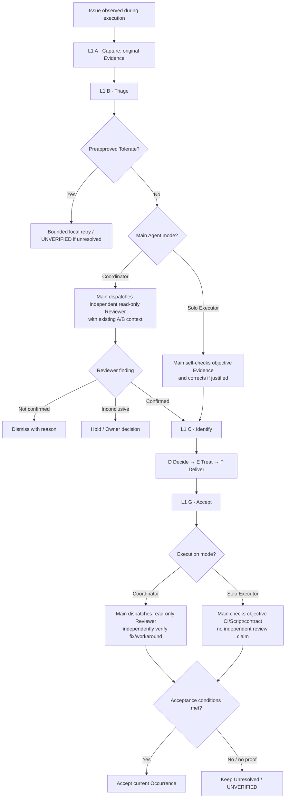
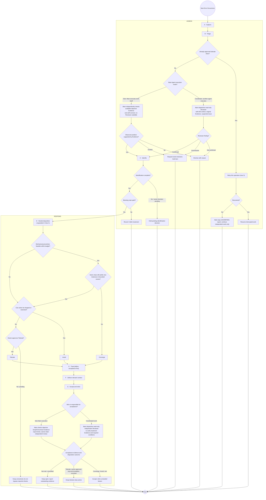
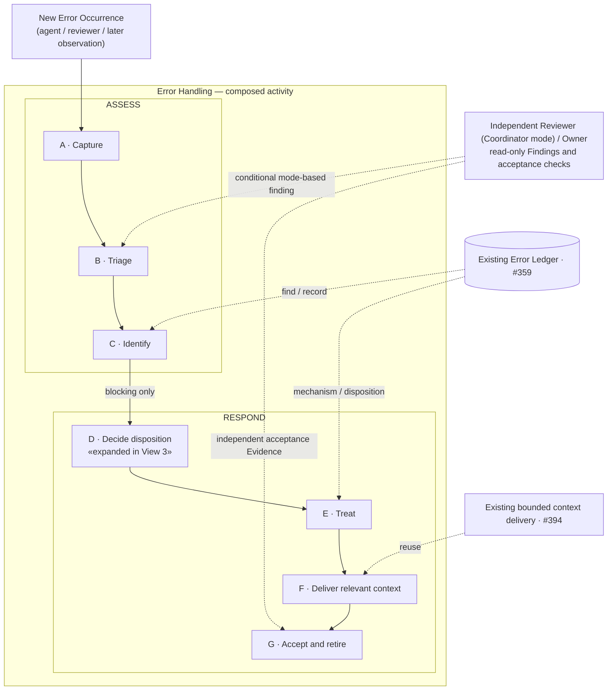
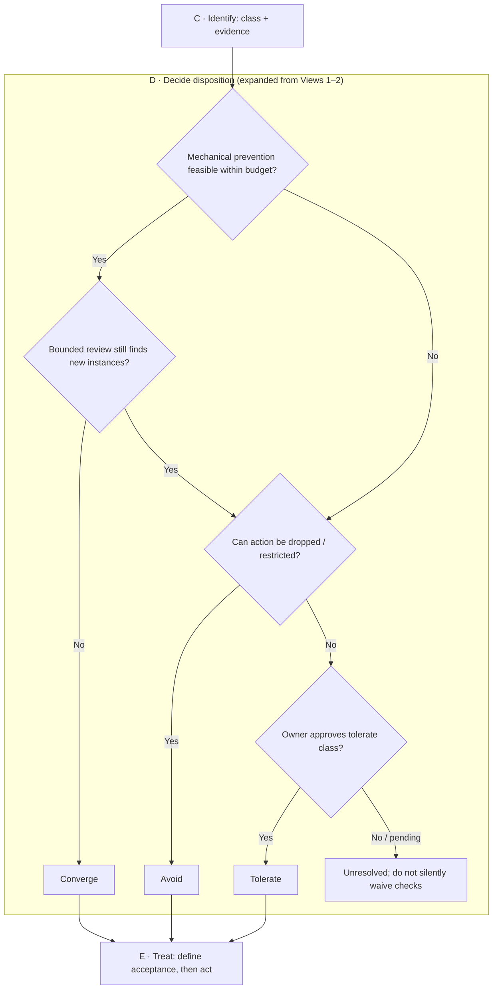

# Error Handling — three-view overview (discussion draft)

> **Discussion only.** This updates the conceptual sketch for [#437](https://github.com/dyphn1/Harness-everything/issues/437) and the first Error Handling subtree [#402](https://github.com/dyphn1/Harness-everything/issues/402). No implementation, CLI, governance policy, hook, or ledger behavior is changed. **The user-confirmed sequence of seven Actions remains unchanged.**

An Overview contains **three distinct views**. Their responsibilities must not be merged into a single linear picture:

| View | Purpose | What it must show |
| --- | --- | --- |
| **1. Overall UML Activity Diagram** | Explain one Error Occurrence’s decision process | Actions, guards, early exits, branches and within-occurrence control flow |
| **2. System architecture / composition** | Explain how Actions, sub-activities and existing capabilities fit together | Process grouping, owner/reviewer authority, reuse of existing ledger and delivery |
| **3. Action Flowchart / Timeline** | Explain how one Action actually works | Inputs, decisions, outcomes, and handoff to the next Action |

**Cross-view convention:** **ASSESS** and **RESPOND** group the same Actions in Views 1 and 2; Action **D · Decide disposition** is expanded in View 3. Node IDs are local to each diagram, and A–G are drawing-local aliases, not persistent identifiers. The seven Action IDs in `nodes.yaml` remain the only proposed persistent identities.

## Final P2 decisions — preserve tested diagrams, use lightweight references

- **P2-1 · View vs Level:** no confirmed defect. The diagram text was previously tested, and separate layered documents are intended to be read on demand. **Owner will verify agent comprehension experimentally.** Do not change Level 1 View labels, definitions, or control flow solely based on a hypothetical misunderstanding.
- **P2-2 · Registry mapping:** use [the lightweight document/relationship registry](./registry.md) to relate Layer → Document → relevant detail while keeping the existing [Action identities](./nodes.yaml). Registry references are for **lookup/lazy loading**, not a second set of workflow arrows or Action IDs.
- **P2-3 · Action handoff:** do **not** impose mandatory input/output schemas on general Actions or behavior blocks. An Action guides what to do and keeps legitimate Agent discretion; concrete Script/CLI/API boundaries document inputs, outputs and return codes only when required (see the E-0002 [Level 3 report writer contract](./details/e0002-report-writer.md)).

This is a **discussion-only** mapping. No evidence yet establishes View/Level confusion; no new global validation gate, loader, governance process or runtime Script exists. Measure Error Handling effectiveness only after the full mechanism including Hook/Skill delivery is integrated.

## Level 2 — magnified behavior blocks (E-0002 example)

**Read [E-0002 — Level 2 behavior-block map](./actions/e0002-action-map.md) after Level 1.** Level 2 zooms into whichever **part of the Level 1 process** currently needs explanation: a single Action, a connected group of Actions, or a particular scenario. It is **not required** to reproduce each Level 1 Action as an independent mini-workflow or add a global rule for every local correction.

The E-0002 example expands two blocks: **ASSESS (A Capture, B Triage, C Identify)** and **RESPOND (D Decide, E Treat, F Deliver, G Accept)**. It retains Level 1's branching authority, including the distinction **unidentified → Hold** versus **identified/non-blocking → Defer**. Script/CLI return codes let Agent handle unmet constraints **inside the relevant block**; no extra Level 1 control loop is introduced. The Level 1 Action sequence and recurrence boundary remain authoritative.

**Action priority:** tell Agent what to do, not just how to document the last mistake. Here a proposed scoped writer/checker would take truthful content/status, consume `codex exec -o` **as script-mediated raw input**, write/check the final report, and return actionable failure codes. A failed treatment result still reaches the **Deliver and Accept** outcome for the current occurrence. Delivering a reusable command now and exposing it through Hook/Skill in a future relevant task are **different time contexts**, not contradictory Action ordering.

## Level 3 — optional procedure, CLI/Script contract and evidence

Read only the details required for the current Action/block:
- [Capture evidence and artifact provenance](./details/e0002-capture-evidence.md): raw report vs final turn, source and unknowns.
- [Treat report writer and `-o` script contract](./details/e0002-report-writer.md): candidate commands, deterministic validation, return codes, negative cases and host-boundary handling.
- [Existing E-0002 ledger](../../../.agents/harness-everything/errors/E-0002-report-missing-terminal-status.md) and [ROUTE-001](../../adr/ROUTE-001-error-lesson-delivery.md): existing evidence and delivery background, not duplicated as another store.

**Status:** this is a discussion draft. Level 1 activity / Action identity / Error Ledger / live Hooks are **unchanged**; the proposed CLI has **not** been implemented. A structural PASS from a script is not a substantive task PASS. The integrated Error Handling + Hook system must exist before measuring recurrence and total cost.

## Decision — Error occurrence and recurrence boundary

- **One activity execution handles one Error Occurrence.** A later recurrence, including one with the same root-cause class, is a **new Error Occurrence** starting at **Capture**, not a return from G to D or G to Capture.
- **Level 1 controls the overall route only.** The decision about blocking versus deferring stays at the overall activity boundary; repeated-class detection, reuse of class/signature, association to past occurrences, and reuse of treatment history belong inside the relevant Action details (for example Identify and Decide disposition).
- **Revisit is different from recurrence.** Resuming an unresolved or pending item is continuation of its original work, governed by the Action's own detail and status; it is not automatically a new Error Occurrence.
- **Retry** remains operation-local inside the relevant Action; it is not a cross-occurrence return path and never implies that an UNVERIFIED result passed.
- **No new graph edge taxonomy, persistent link, identifier, CLI action, or enforcement mechanism** is introduced by this decision.

These rules settle the conceptual recurrence question raised in [Round 1](./evaluation/results/round-1/README.md) and [Round 2](./evaluation/results/round-2/README.md). Those evaluation artifacts are **historical frozen stimuli/results** and are intentionally **not edited** to retroactively match this updated design.

## Final owner decisions — execution mode, Reviewer role and acceptance (2026-11-13)

**Q1 — Main execution mode determines the path.** When Main acts as **Coordinator** of other execution Agents, Main **must dispatch an independent Reviewer** for error investigation. When Main **executes alone** and no independent Agent is available, it may **self-correct** based on Host Hook cues and objective Evidence. An executing Worker in coordinated mode does not substitute its own assessment for the Coordinator's independent Reviewer requirement. The distinction is role/mode per execution, **not a new Level 1 Action**.

**Q2 — Reviewer is read-only by default.** It receives prior Action progress and observed Evidence, independently inspects/reproduces/checks as permitted, and returns a Finding and related Evidence. **Do not modify source or execute Treat by default.** Trivial/minor errors are not a standing permission exemption. A future class-scoped exception would need separate explicit owner authorization; no current Hook/Reviewer feature grants it.

**Q3 — Coordinated acceptance requires independent review.** After a fix/workaround, Main dispatches read-only Reviewer verification of the outcome and obligations before G Accept can conclude. Main remains responsible for work assignment, disposition and acceptance; the Reviewer supplies independent Evidence, not permissions. In **solo Main mode**, objective Script/CI/contract checks remain required and Main must disclose that independent review was unavailable, without inventing a reviewer PASS. Failure or missing proof remains UNVERIFIED/Unresolved.

This is a **role/acceptance overlay** on the same Level 1, not a second controller or replacement for View 1's exhaustive Hold/Defer/Converge/Avoid/Tolerate guards. For Reviewer handoff, preserve prior Action state, do not mechanically recreate accepted Capture Evidence; Reviewer re-checks independently as required.

## View 1 — Overall UML Activity Diagram

**This is the first, large diagram**, not just an A→G list. Its **ASSESS / RESPOND** groups contain the same Actions as the composition view (View 2); the D Action is visibly the point expanded in View 3. The Mermaid flowchart is a GitHub-renderable representation using normal UML Activity concepts (Action, Decision, Guard and control flow). The corresponding **PlantUML activity source** is [activity.puml](./activity.puml). Decisions are not additional persistent Actions.

A–G are drawing-local aliases, not persistent identifiers; node ids are local to each diagram.

Reading notes:

- **Diagram-level traceability**: Views 1 and 2 group the same Actions under `ASSESS` and `RESPOND`; `D · Decide disposition` in both diagrams is expanded in View 3. These groupings are organizational and do not change control flow.

- The **primary blocking path** keeps exactly `Capture → Triage → Identify → Decide disposition → Treat → Deliver relevant context → Accept and retire`. A non-blocking item completes identification and is recorded/deferred, without opening an immediate fix cycle.
- **B / Triage, mode-dependent:** an already-approved tolerate class retains bounded per-operation retry (up to three); failure leaves the step UNVERIFIED. Otherwise **Coordinator Main** dispatches an independent **read-only Reviewer** with prior A/B Evidence; **Solo executing Main** can identify/correct its own evident error when no separate Reviewer is available, using objective Evidence without claiming independent review. A disputed/inconclusive finding goes to Hold/Owner. This is one L1 activity, not an extra gate or new Occurrence.
- **C / Identify**: Level 1 asks only whether identification is complete; unresolved cases are held for the required decision. Searching/reusing Error Class and recording a new occurrence are **Action-level responsibilities**, not extra Level 1 branches. Any new class still requires owner approval in the Identify detail.
- **D / Decide**: Converge / Avoid / Tolerate. Reusing prior disposition history belongs inside the Action detail, not the top-level activity. The existing #437 budget suggestion is one correction plus one review; there is no global recurrence counter or forced Zoom-out.
- **G / Accept, mode-dependent:** for coordinated work, **Main dispatches independent read-only Reviewer verification of the proposed outcome**; the execution owner provides Evidence and implements any subsequent correction. For solo Main, objective Script/CI/contract checks may support acceptance where permitted, but **independent review is not claimed** and missing mandatory evidence cannot become PASS. Converge/Avoid are accepted only when defined conditions are met; Tolerate stays active and is not claimed rooted out. G ends **this occurrence**, never a cross-occurrence return arrow.

## View 2 — System architecture / composition

This is deliberately a **structure/composition view, not a second executable flow specification**. Its two blocks have the **same names and action membership** as the regions in View 1. It shows the two process groupings and where existing components or authorities participate. Dotted lines to external actors or existing capabilities are explanatory associations, not a second execution path or a new edge type.

Early exits and decisions are omitted in this view; see View 1.

Each Action may later be detailed by its own Activity Diagram, Flowchart or Timeline. This Overview only shows which parts are composed together. Existing Error Ledger [#359](https://github.com/dyphn1/Harness-everything/issues/359) and bounded context delivery [#394](https://github.com/dyphn1/Harness-everything/issues/394) remain existing design/implementation context; this discussion does not add machinery. Every **new** error observation enters through Capture. The diagram does not draw a feedback edge from G because one completed occurrence does not resume another occurrence.

## View 3 — Action working example (D: Decide disposition)

This **Flowchart is an Action-detail example**, not a replacement for View 1. The `D · Decide disposition` block here **refines the D Action** inside View 1's `RESPOND` partition and View 2's corresponding block. A different Action may use a Timeline when timing / actor handoff is more important than decision branching.

Inputs: an identified error class, evidence, current step, and budget. Output: the selected treatment direction (Converge / Avoid / owner-approved Tolerate) or unresolved decision. `Treat` owns the actual intervention and predeclared acceptance conditions; `Decide` does not silently implement fixes.

## Action identity prototype (unchanged)

See [nodes.yaml](./nodes.yaml) for the same seven identities as in the initial branch commit. **No existing identifier or name is regenerated by redrawing the diagrams.**

- `identifier`: `ERR-YYYYMMDD-UUIDv4` (category at creation / creation date / UUID). Immutable once accepted; GUID supplies collision resistance; date and category are descriptive, not each a uniqueness guarantee.
- `name`: separate human/agent-readable meaning; the diagrams show this instead of UUIDs.
- `status`: separate metadata (`proposed` in this draft), without yet locking a lifecycle transition specification.
- Drawing-local `A`–`G` labels are not persistent identifiers. Ordinary start/end, decision diamonds and arrows do not receive document identities.

## Existing boundaries and decisions

| Action | Responsibility |
| --- | --- |
| A Capture | Collect facts from agent failure, reviewer finding or later discovery |
| B Triage | Judge whether the observation is real or already covered by an approved tolerate path; route unclear cases for owner decision |
| C Identify | Establish the error classification and occurrence record; class lookup/reuse and approval are internal to this Action |
| D Decide disposition | Select Converge / Avoid / owner-approved Tolerate, informed by history as needed inside the Action |
| E Treat | Define completion conditions, apply bounded response |
| F Deliver relevant context | Deliver only relevant lessons that are not already mechanically prevented |
| G Accept and retire | Check the current occurrence outcome; retire lessons that are no longer required, without creating a cross-occurrence loop |

No extra UML relation or `viewRef` field is introduced to represent the three views: they describe **one action hierarchy**, with grouping and the Action's existing name/identifier used for correlation.

Open for discussion rather than implemented here: final UML notation/rendering choice, whether remaining decision branches/early exits are located correctly, what to expand next, and final ID/status lifecycle rules. Recurrence as a new occurrence and non-looping Level 1 execution are decided. Do not expand the CLI/schema/governance surface before these diagrams are accepted.
