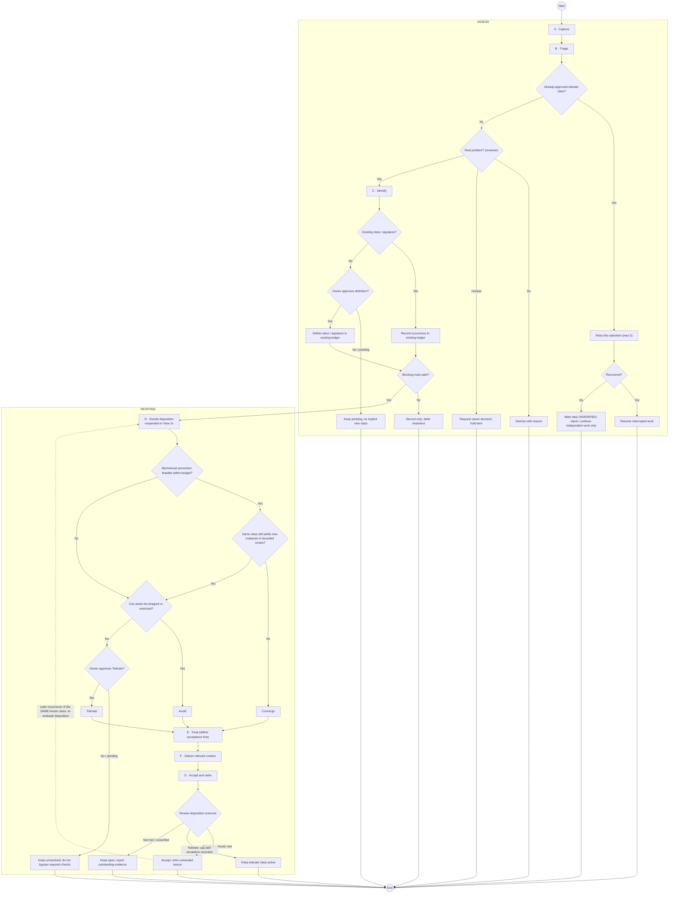
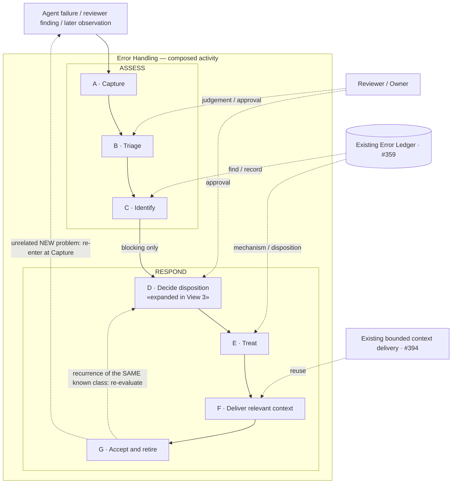
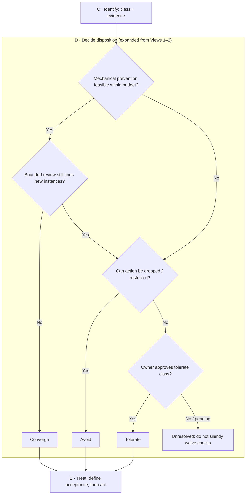

# Error Handling — three-view overview (discussion draft)

> **Discussion only.** This updates the conceptual sketch for [#437](https://github.com/dyphn1/Harness-everything/issues/437) and the first Error Handling subtree [#402](https://github.com/dyphn1/Harness-everything/issues/402). No implementation, CLI, governance policy, hook, or ledger behavior is changed. **The user-confirmed sequence of seven Actions remains unchanged.**

An Overview contains **three distinct views**. Their responsibilities must not be merged into a single linear picture:

| View | Purpose | What it must show |
| --- | --- | --- |
| **1. Overall UML Activity Diagram** | Explain the full Error Handling decision process | Actions, guards, early exits, branches, recurrence and return paths |
| **2. System architecture / composition** | Explain how Actions, sub-activities and existing capabilities fit together | Process grouping, owner/reviewer authority, reuse of existing ledger and delivery |
| **3. Action Flowchart / Timeline** | Explain how one Action actually works | Inputs, decisions, outcomes, and handoff to the next Action |

**Cross-view convention:** **ASSESS** and **RESPOND** group the same Actions in Views 1 and 2; Action **D · Decide disposition** is expanded in View 3. Node IDs are local to each diagram, and A–G are drawing-local aliases, not persistent identifiers. The seven Action IDs in `nodes.yaml` remain the only proposed persistent identities.

## View 1 — Overall UML Activity Diagram

**This is the first, large diagram**, not just an A→G list. Its **ASSESS / RESPOND** groups contain the same Actions as the composition view (View 2); the D Action is visibly the point expanded in View 3. The Mermaid flowchart is a GitHub-renderable representation using normal UML Activity concepts (Action, Decision, Guard and control flow). The corresponding **PlantUML activity source** is [activity.puml](./activity.puml). Decisions are not additional persistent Actions.

A–G are drawing-local aliases, not persistent identifiers; node ids are local to each diagram.

Reading notes:

- **Diagram-level traceability**: Views 1 and 2 group the same Actions under `ASSESS` and `RESPOND`; `D · Decide disposition` in both diagrams is expanded in View 3. These groupings are organizational and do not change control flow.

- The **primary blocking path** keeps exactly `Capture → Triage → Identify → Decide disposition → Treat → Deliver relevant context → Accept and retire`. A non-blocking item is identified/recorded, then deferred; it does not open an immediate fix cycle.
- **B / Triage**: an already-approved tolerate class can have a bounded per-operation retry (up to three); failure leaves that step UNVERIFIED and does not convert mandatory evidence into PASS. A reviewer decides whether a different finding is real; an unclear item goes to the owner.
- **C / Identify**: reuse the existing root-cause class/signature when present. Creating an unknown class requires owner approval. Recording an occurrence is not a new ledger.
- **D / Decide**: Converge / Avoid / Tolerate. The existing #437 budget suggestion is one correction plus one review; there is no global recurrence counter or forced Zoom-out.
- **G / Accept**: Converge or Avoid can be accepted against defined conditions; a Tolerate class records retry/escalation conditions but is **not claimed to be rooted out**. A later observation may trigger re-evaluation. This is conceptual return flow, not an automatic additional PR review round.

## View 2 — System architecture / composition

This is deliberately a **structure/composition view, not a second executable flow specification**. Its two blocks have the **same names and action membership** as the regions in View 1. It shows the two process groupings and where existing components or authorities participate. Dotted lines are explanatory associations, not new graph edge types or a second dependency language.

Early exits and decisions are omitted in this view; see View 1.

Each Action may later be detailed by its own Activity Diagram, Flowchart or Timeline. This Overview only shows which parts are composed together. Existing Error Ledger [#359](https://github.com/dyphn1/Harness-everything/issues/359) and bounded context delivery [#394](https://github.com/dyphn1/Harness-everything/issues/394) remain the established mechanisms; no new implementations are implied. An unrelated new problem re-enters at Capture, while a recognized recurrence may resume review of the existing disposition.

## View 3 — Action working example (D: Decide disposition)

This **Flowchart is an Action-detail example**, not a replacement for View 1. The `D · Decide disposition` block here **refines the D Action** inside View 1's `RESPOND` partition and View 2's corresponding block. A different Action may use a Timeline when timing / actor handoff is more important than decision branching.

Inputs: an identified error class, evidence, current step, and budget. Output: the selected treatment direction (Converge / Avoid / owner-approved Tolerate) or unresolved decision. `Treat` owns the actual intervention and predeclared acceptance conditions; `Decide` does not silently implement fixes.

## Action identity prototype (unchanged)

See [nodes.yaml](./nodes.yaml) for the same seven identities as in the initial branch commit. **No existing identifier or name is regenerated by redrawing the diagrams.**

- `identifier`: `ERR-YYYYMMDD-UUIDv4` (category at creation / creation date / UUID). Immutable once accepted; GUID supplies collision resistance; date and category are descriptive, not each a uniqueness guarantee.
- `name`: separate human/agent-readable meaning; the diagrams show this instead of UUIDs.
- `status`: separate metadata (`proposed` in this draft), without yet locking a lifecycle transition specification.
- Drawing-local `A`–`G` labels are not persistent identifiers. Ordinary start/end, decision diamonds and arrows do not receive document identities.

## Existing boundaries and decisions

| Action | Responsibility |
| --- | --- |
| A Capture | Collect facts from agent failure, reviewer finding or later discovery |
| B Triage | Judge real issue, permitted tolerance and whether main path is blocked |
| C Identify | Classify root cause and find/create its ledger record |
| D Decide disposition | Select Converge / Avoid / owner-approved Tolerate |
| E Treat | Define completion conditions, apply bounded response |
| F Deliver relevant context | Deliver only relevant lessons that are not already mechanically prevented |
| G Accept and retire | Check outcomes and retire lessons that are no longer required; observe recurrences |

No extra UML relation or `viewRef` field is introduced to represent the three views: they describe **one action hierarchy**, with grouping and the Action's existing name/identifier used for correlation.

Open for discussion rather than implemented here: final UML notation/rendering choice, whether decision branches/early exits are located correctly, whether the two groupings are useful, what to expand next, and final ID/status lifecycle rules. Do not expand the CLI/schema/governance surface before these diagrams are accepted.
