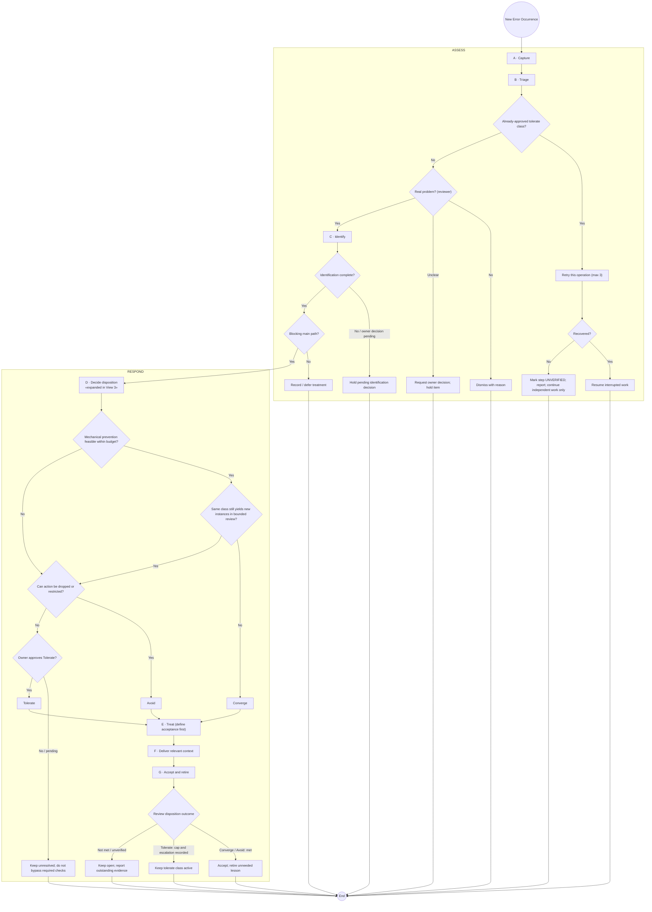
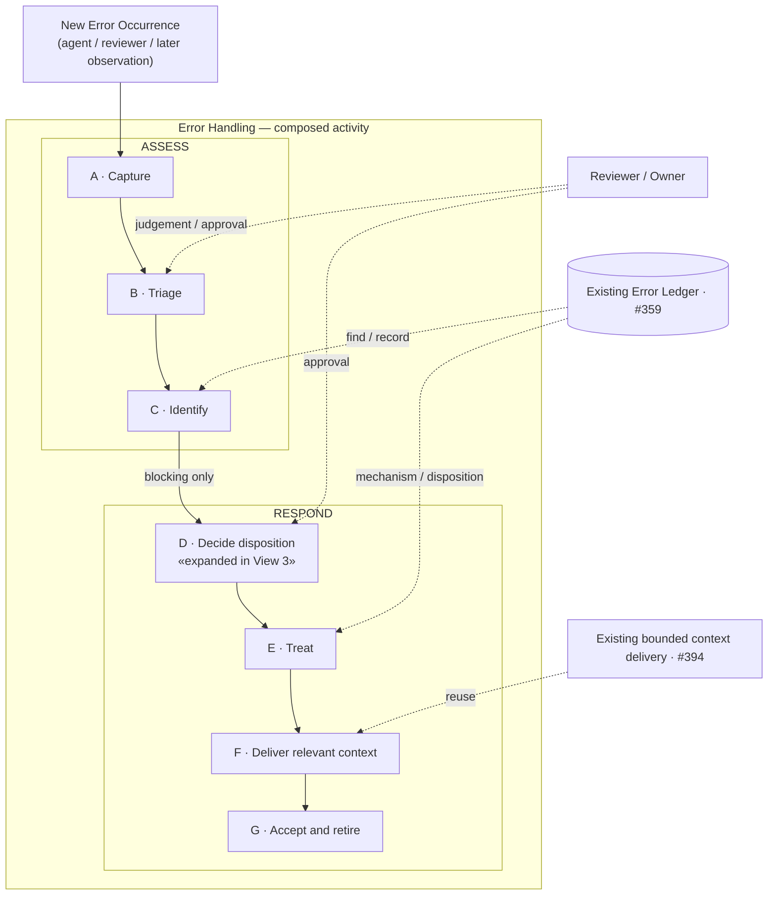
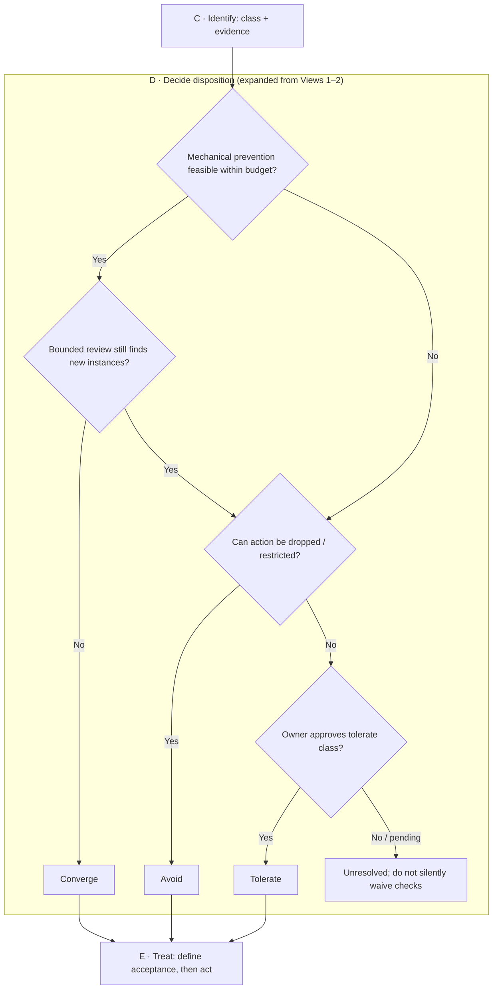

# Error Handling — three-view overview (discussion draft)

> **Discussion only.** This updates the conceptual sketch for [#437](https://github.com/dyphn1/Harness-everything/issues/437) and the first Error Handling subtree [#402](https://github.com/dyphn1/Harness-everything/issues/402). No implementation, CLI, governance policy, hook, or ledger behavior is changed. **The user-confirmed sequence of seven Actions remains unchanged.**

An Overview contains **three distinct views**. Their responsibilities must not be merged into a single linear picture:

| View | Purpose | What it must show |
| --- | --- | --- |
| **1. Overall UML Activity Diagram** | Explain one Error Occurrence’s decision process | Actions, guards, early exits, branches and within-occurrence control flow |
| **2. System architecture / composition** | Explain how Actions, sub-activities and existing capabilities fit together | Process grouping, owner/reviewer authority, reuse of existing ledger and delivery |
| **3. Action Flowchart / Timeline** | Explain how one Action actually works | Inputs, decisions, outcomes, and handoff to the next Action |

**Cross-view convention:** **ASSESS** and **RESPOND** group the same Actions in Views 1 and 2; Action **D · Decide disposition** is expanded in View 3. Node IDs are local to each diagram, and A–G are drawing-local aliases, not persistent identifiers. The seven Action IDs in `nodes.yaml` remain the only proposed persistent identities.

## Level 2 — E-0002 magnified Action Map (what the agent must do)

**Read [E-0002 — cross-action Level 2 map](./actions/e0002-action-map.md) after Level 1.** It zooms into the **same A–G lifecycle** instead of creating a separate Capture-only or Treat-only Level 2. For this example, detailed, distinctive actions are **A Capture → D Decide → E Treat → F Deliver → G Accept**; B Triage and C Identify reuse their existing decisions and remain visible in the sequence.

The Action Map tells the agent **what to do**, including using a proposed scoped report writer/checker to prevent hand-authored terminal-STATUS errors. It never claims the tool already exists, that a clean report proves a correct task result, or that one correct run proves recurrence is eliminated.

## Level 3 — supporting procedure, implementation contract and evidence

Read these **only if the relevant Action requires the detail**:
- [Capture evidence and artifact provenance](./details/e0002-capture-evidence.md) — report file vs final turn, raw endings, missing evidence.
- [Treat report-writer CLI and validation contract](./details/e0002-report-writer.md) — candidate commands, atomic write/check, negatives, host `-o` boundaries.
- [Existing E-0002 ledger](../../.agents/harness-everything/errors/E-0002-report-missing-terminal-status.md) and [ROUTE-001](../../adr/ROUTE-001-error-lesson-delivery.md) — existing evidence and delivery decision; not copied into the Action Map.

**Hierarchy:** Level 1 = general route/Action ownership; Level 2 = case-specific **Action operations across the route**; Level 3 = detailed documents, tool contracts and evidence. Only the diagram/documentation hierarchy is adjusted here: the Level 1 flow, immutable Action identities, Error Ledger, hooks and runtime are unchanged.

## Decision — Error occurrence and recurrence boundary

- **One activity execution handles one Error Occurrence.** A later recurrence, including one with the same root-cause class, is a **new Error Occurrence** starting at **Capture**, not a return from G to D or G to Capture.
- **Level 1 controls the overall route only.** The decision about blocking versus deferring stays at the overall activity boundary; repeated-class detection, reuse of class/signature, association to past occurrences, and reuse of treatment history belong inside the relevant Action details (for example Identify and Decide disposition).
- **Revisit is different from recurrence.** Resuming an unresolved or pending item is continuation of its original work, governed by the Action's own detail and status; it is not automatically a new Error Occurrence.
- **Retry** remains operation-local inside the relevant Action; it is not a cross-occurrence return path and never implies that an UNVERIFIED result passed.
- **No new graph edge taxonomy, persistent link, identifier, CLI action, or enforcement mechanism** is introduced by this decision.

These rules settle the conceptual recurrence question raised in [Round 1](./evaluation/results/round-1/README.md) and [Round 2](./evaluation/results/round-2/README.md). Those evaluation artifacts are **historical frozen stimuli/results** and are intentionally **not edited** to retroactively match this updated design.

## View 1 — Overall UML Activity Diagram

**This is the first, large diagram**, not just an A→G list. Its **ASSESS / RESPOND** groups contain the same Actions as the composition view (View 2); the D Action is visibly the point expanded in View 3. The Mermaid flowchart is a GitHub-renderable representation using normal UML Activity concepts (Action, Decision, Guard and control flow). The corresponding **PlantUML activity source** is [activity.puml](./activity.puml). Decisions are not additional persistent Actions.

A–G are drawing-local aliases, not persistent identifiers; node ids are local to each diagram.

Reading notes:

- **Diagram-level traceability**: Views 1 and 2 group the same Actions under `ASSESS` and `RESPOND`; `D · Decide disposition` in both diagrams is expanded in View 3. These groupings are organizational and do not change control flow.

- The **primary blocking path** keeps exactly `Capture → Triage → Identify → Decide disposition → Treat → Deliver relevant context → Accept and retire`. A non-blocking item completes identification and is recorded/deferred, without opening an immediate fix cycle.
- **B / Triage**: an already-approved tolerate class can have a bounded per-operation retry (up to three); failure leaves that step UNVERIFIED and does not convert mandatory evidence into PASS. A reviewer decides whether a different finding is real; an unclear item goes to the owner.
- **C / Identify**: Level 1 asks only whether identification is complete; unresolved cases are held for the required decision. Searching/reusing Error Class and recording a new occurrence are **Action-level responsibilities**, not extra Level 1 branches. Any new class still requires owner approval in the Identify detail.
- **D / Decide**: Converge / Avoid / Tolerate. Reusing prior disposition history belongs inside the Action detail, not the top-level activity. The existing #437 budget suggestion is one correction plus one review; there is no global recurrence counter or forced Zoom-out.
- **G / Accept**: Converge or Avoid can be accepted against defined conditions; a Tolerate class records retry/escalation conditions but is **not claimed to be rooted out**. G ends **this occurrence**; it never emits a cross-occurrence return arrow.

## View 2 — System architecture / composition

This is deliberately a **structure/composition view, not a second executable flow specification**. Its two blocks have the **same names and action membership** as the regions in View 1. It shows the two process groupings and where existing components or authorities participate. Dotted lines to external actors or existing capabilities are explanatory associations, not a second execution path or a new edge type.

Early exits and decisions are omitted in this view; see View 1.

Each Action may later be detailed by its own Activity Diagram, Flowchart or Timeline. This Overview only shows which parts are composed together. Existing Error Ledger [#359](https://github.com/dyphn1/Harness-everything/issues/359) and bounded context delivery [#394](https://github.com/dyphn1/Harness-everything/issues/394) remain existing design/implementation context; this discussion does not add machinery. Every **new** error observation enters through Capture. The diagram does not draw a feedback edge from G because one completed occurrence does not resume another occurrence.

## View 3 — Action working example (D: Decide disposition)

This **Flowchart is an Action-detail example**, not a replacement for View 1. The `D · Decide disposition` block here **refines the D Action** inside View 1's `RESPOND` partition and View 2's corresponding block. A different Action may use a Timeline when timing / actor handoff is more important than decision branching.

Inputs: an identified error class, evidence, current step, and budget. Output: the selected treatment direction (Converge / Avoid / owner-approved Tolerate) or unresolved decision. `Treat` owns the actual intervention and predeclared acceptance conditions; `Decide` does not silently implement fixes.

## Action identity prototype (unchanged)

See [nodes.yaml](./nodes.yaml) for the same seven identities as in the initial branch commit. **No existing identifier or name is regenerated by redrawing the diagrams.**

- `identifier`: `ERR-YYYYMMDD-UUIDv4` (category at creation / creation date / UUID). Immutable once accepted; GUID supplies collision resistance; date and category are descriptive, not each a uniqueness guarantee.
- `name`: separate human/agent-readable meaning; the diagrams show this instead of UUIDs.
- `status`: separate metadata (`proposed` in this draft), without yet locking a lifecycle transition specification.
- Drawing-local `A`–`G` labels are not persistent identifiers. Ordinary start/end, decision diamonds and arrows do not receive document identities.

## Existing boundaries and decisions

| Action | Responsibility |
| --- | --- |
| A Capture | Collect facts from agent failure, reviewer finding or later discovery |
| B Triage | Judge whether the observation is real or already covered by an approved tolerate path; route unclear cases for owner decision |
| C Identify | Establish the error classification and occurrence record; class lookup/reuse and approval are internal to this Action |
| D Decide disposition | Select Converge / Avoid / owner-approved Tolerate, informed by history as needed inside the Action |
| E Treat | Define completion conditions, apply bounded response |
| F Deliver relevant context | Deliver only relevant lessons that are not already mechanically prevented |
| G Accept and retire | Check the current occurrence outcome; retire lessons that are no longer required, without creating a cross-occurrence loop |

No extra UML relation or `viewRef` field is introduced to represent the three views: they describe **one action hierarchy**, with grouping and the Action's existing name/identifier used for correlation.

Open for discussion rather than implemented here: final UML notation/rendering choice, whether remaining decision branches/early exits are located correctly, what to expand next, and final ID/status lifecycle rules. Recurrence as a new occurrence and non-looping Level 1 execution are decided. Do not expand the CLI/schema/governance surface before these diagrams are accepted.
