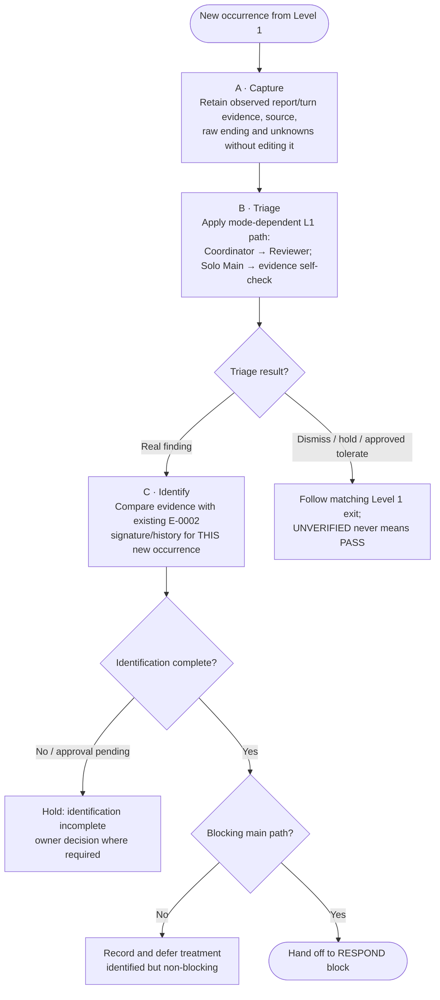
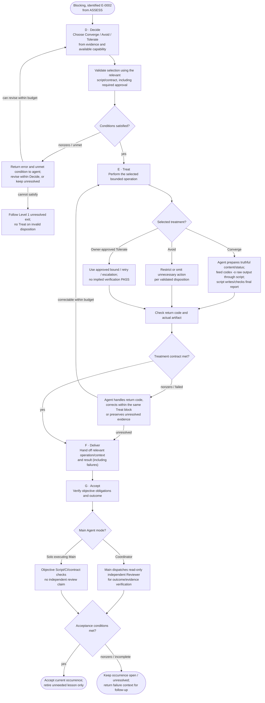
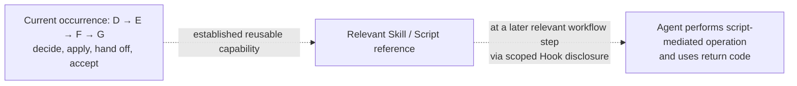

# E-0002 — Level 2 Action Map (magnifying Level 1 behavior blocks)

> **Diagram-first design draft; not implemented.** This is the E-0002 lens over the [Level 1 Error Handling process](../README.md) for [#437](https://github.com/dyphn1/Harness-everything/issues/437) / [#402](https://github.com/dyphn1/Harness-everything/issues/402). Level 1 remains the authority for Action sequence, guards, exits, authority and one-Error-Occurrence boundary. A–G are drawing-local aliases, not new identities.
>
> **Level 2 describes WHAT THE AGENT SHOULD DO within the magnified behavior block.** It can expand one Action or a connected group of Actions; it need not reproduce each internal step as a new global rule. Level 3 holds HOW (scripts, return-code details, evidence and document format). Agent discretion over tactics stays intact if the Level 1 contract is met.

**Lookup:** [Registry table](../registry.md) locates this Level 2 behavior block and its Level 3 references. It maps *documents*, not control-flow arrows. The Level 1 Views are unchanged; whether their relationship to Levels confuses Agents will be tested by the owner rather than assumed.

**Action-contract scope:** this map defines what to do, **not** a mandatory per-Action I/O schema. Only a concrete machine interface (such as the proposed Report Script/CLI in Level 3) requires explicit parameters, outputs and return-code behavior. Agent-chosen tactics are valid when Level 1's necessary conditions are met.

## Block 1 — ASSESS: capture, triage and identify this occurrence

**P1-1 boundary:** *unidentified / pending class approval* leads to **Hold**, whereas *identified but non-blocking* leads to **Defer**. They are distinct Level 1 outcomes. Recognizing E-0002-like evidence at Capture does not automatically classify the case: formal classification and reusing history belong to Identify. A future recurrence is a new occurrence starting at Capture.

## Block 2 — RESPOND: decide, act, deliver and accept

**Reading rules:** This is a magnification of the **RESPOND behavior block**, not a new global controller. G inherits the same execution-mode distinction as Level 1: coordinated Main **must dispatch read-only independent Reviewer outcome verification**, while Solo Main uses objective checks and explicitly does not claim independent review. Reviewer is investigative by default and does not edit artifacts or run Treat; minor/trivial errors are not an automatic exemption. In D, a script can reject unmet conditions using a nonzero return code; the agent can revise the decision locally rather than creating a new Level 1 approval/retry workflow. An Owner-required authorization still has to exist to pass validation; a script must never manufacture permission.

In E, scripts verify deterministic conditions and return actionable diagnostics; the agent chooses a suitable correction, constrained by the currently accepted disposition and budget. A failure that cannot be corrected still reaches **F (deliver result/evidence)** and **G (open/unresolved acceptance outcome)**, not an orphan endpoint. G's nonzero/incomplete outcome does **not** retire a needed instruction or silently claim success. Neither this path nor future recurrence creates a G → D or G → Capture loop.

## E-0002 instructions by behavior block

| Scope from Level 1 | What the agent should do (Level 2) | Handoff/condition |
| --- | --- | --- |
| **A Capture** | Preserve original report/turn data, the exact terminal lines and whether `-o` is involved; do not modify evidence. | Give B evidence plus explicit unknowns. |
| **B Triage → C Identify** | Apply common Triage guards, then identify using actual evidence and the existing E-0002 class. **Unidentified → Hold; identified non-blocking → Defer.** | Only identified, blocking observations proceed to D. |
| **D Decide (response block)** | Choose an applicable disposition. Validate approval, feasibility and required conditions through the applicable script/contract; a rejected choice returns to Agent for correction or unresolved handling. | Do not start E with an invalid choice. |
| **E Treat (response block)** | Execute the accepted treatment, with agent-selected tactics. For **Converge**, Agent determines the truthful status and prepares content; script/CLI owns atomic report writing and structural validation. For **Avoid/Tolerate**, execute their distinct approved operations. | Nonzero return code returns control to Agent inside this block; if still unresolved, preserve result for F/G. |
| **F Deliver (response block)** | Hand off the chosen procedure/available command and current outcome. Later, at **relevant** workflow steps, the Hook/Skill mechanism may expose the appropriate command; that future contextual exposure is *not another occurrence transition*. | No unsupported CLI is presented as installed; deliver failure evidence when unresolved. |
| **G Accept (response block)** | Use deterministic checks for mechanical obligations and assess substantive Evidence. In Coordinator mode, Main dispatches independent read-only Reviewer for the treatment outcome before acceptance; in Solo Main mode use objective checks and disclose lack of independent review. If verification fails, return explicit unmet conditions and keep open; retire only obsolete lesson prose, not a command still needed for routine work. | Only accepted outcomes may be reported as accepted; Tolerate remains bounded, not “fixed.” |

## Mechanism and time boundary (the one-time response vs future use)

The dotted relations are **reuse/context**, not control-flow links between occurrences. Level 1 remains the only occurrence lifecycle. Future agents need to know **the action to perform at the current step**, not reload every past error report. Mechanism correctness and eventual recurrence reduction remain separate questions.

### Script-first contract (Level 2 only)

- The **agent** determines content, substantive truth and how to react to failures; the **script** performs bounded write/check and returns exit code + clear unmet condition. A zero exit code proves only the specific script contract.
- For `codex exec -o`, `-o` is a **script-mediated raw output/input artifact**, not a report finalized by manual editing. Route raw output through the report script, which must validate/extract only under a specified host-aware contract and then write/check the designated report. If the transformation cannot satisfy that contract, return nonzero and preserve raw evidence; do not silently strip metadata or fabricate success.
- **No extra Level 1 branches or hard-coded retry counter** are added to make the script work. Agent correction after a failure is local to the magnified block and subject to existing constraints.
- Script contracts and actual commands are **proposals** (not currently shipped). Missing scripts cannot satisfy a required mechanical check; keep that outcome open, rather than pretending a command exists.

## Level 3 — optional details consulted only when needed

- [Capture evidence and producer/artifact details](../details/e0002-capture-evidence.md)
- [Report writing / `-o` transformation / return-code contract](../details/e0002-report-writer.md)
- [Existing E-0002 Error Ledger](../../../../.agents/harness-everything/errors/E-0002-report-missing-terminal-status.md): existing class/history, not duplicated here
- [ROUTE-001 delivery decision](../../../adr/ROUTE-001-error-lesson-delivery.md): scoped delivery background, not proof of deployed writer

**Acceptance of this draft:** Level 1 alignment and Action guidance only. No end-to-end recurrence/cost conclusion until Error Handling, Script and Hook/Skill Delivery are actually integrated and exercised.
