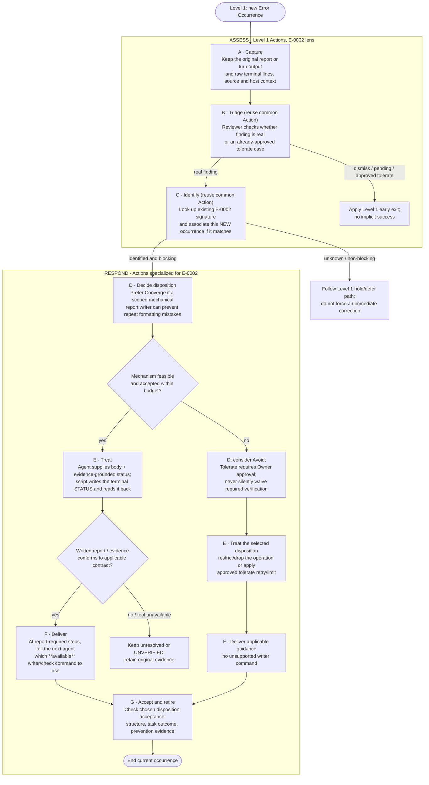
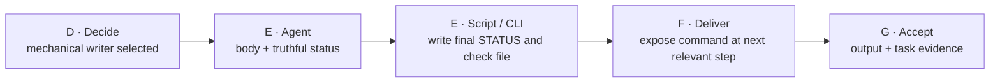

# E-0002 — Level 2 Action Map (magnified Level 1)

> **Diagram-first discussion draft — not implemented.** This is the **E-0002 lens** over the accepted [Level 1 Error Handling](../README.md) process for [#437](https://github.com/dyphn1/Harness-everything/issues/437) / [#402](https://github.com/dyphn1/Harness-everything/issues/402). The Level 1 Action identities, order, early exits, and recurrence boundary remain authoritative.
>
> **Level 2 answers: What must the agent do at each Action for this concrete case?** Optional procedural details, CLI interface and evidence/reference documentation belong to Level 3. This is not a second standalone lifecycle, and no CLI or host change is claimed as shipped.

## Zoom in: E-0002 across the Level 1 Actions

**Important reading notes:** In the Converge path, the proposed writer is the intended prevention mechanism; Avoid and owner-approved Tolerate are **different dispositions with different treatments**. Tolerate is not a claim that the class has been rooted out. (1) B and C retain their existing Level 1/common-Action decision rules; they are not skipped because this diagram is an E-0002 example. (2) A records an *E-0002-like finding* without pre-deciding its Error Class; **C** establishes the ledger association. (3) The diagram follows the **blocking** path; detailed alternative exits belong to Level 1 and the relevant Action details. (4) A later recurrence is **another occurrence beginning at Capture**, never a G feedback edge.

## What the agent actually does (action obligations, not a report template)

| Level 1 Action | E-0002-specific instruction | Handoff or observable result |
| --- | --- | --- |
| **A · Capture** | Retain actual report bytes / final lines and distinguish **report file**, **turn message**, or a shared `-o` artifact. Preserve evidence unchanged. | Evidence + source and unknowns; **no classification** |
| **B · Triage** | Reviewer checks whether the observation is a real failure or an approved tolerate case; do not equate unreadable report with PASS. | Continue / defer / hold per Level 1 |
| **C · Identify** | Match `E-0002` (`report-missing-terminal-status`) with the existing ledger by evidence and signature. Attach a **new** occurrence; if not a match, use normal class-approval path. | Identified occurrence and relevance/blocking context |
| **D · Decide** | Select a treatment, preferably **Converge via mechanical report write/check** when feasible. Decide whether the output role (report vs final turn) is separable; leave unapproved alternatives unresolved. | Explicit treatment direction; no assumed CLI deployment |
| **E · Treat** | For the **Converge** treatment, **Agent produces content and selects DONE/BLOCKED from task evidence**. Use a scoped writer/check operation to create terminal STATUS and verify the resulting file; do **not** hand-append. If host `-o` captures a final turn, stage raw output separately. For a different authorized disposition, follow its bounded operation instead. | Format-correct artifact **or** explicit unresolved/unverified evidence |
| **F · Deliver** | Provide the agent at its actual report-writing step with **the available command and required parameters**, not merely a reminder that E-0002 happened. If no tool is deployed, label the operation *proposed*, not executable. | Step-relevant executable instruction or explicit capability gap |
| **G · Accept** | Confirm report structure from the actual file, separately confirm the task/packet result, and observe whether the correct operation was used. Do not infer long-term prevention from a single clean report. | Accepted treatment outcome or open finding; lesson retired only if conditions are met |

## Mechanical-prevention handoff (Level 2 only)

The **script is a proposed prevention mechanism**; the hook/context carrier may point to it but does not write reports or declare success. The tool owns **formatting**, while the agent/reviewer retain responsibility for substantive evidence and decision quality. If the same `codex exec -o` output serves as report and final turn, **do not claim the unimplemented report-turn exception exists**: preserve the raw output, stage it, and treat the host boundary as unresolved until an accepted contract makes the separation valid.

## Level 3: documentation, contracts, and evidence (follow the action link only when needed)

- [Capture evidence / producer and artifact detail](../details/e0002-capture-evidence.md): how to preserve the original error observation, including report-file vs turn-message distinctions.
- [Report writer / CLI operational contract](../details/e0002-report-writer.md): candidate `write`/`check` commands, atomicity, negative cases and handling `-o` outputs.
- [Existing E-0002 Error Ledger](../../../../.agents/harness-everything/errors/E-0002-report-missing-terminal-status.md): canonical class/signature, historical episodes and lesson (not duplicated here).
- [ROUTE-001 delivery decision](../../../adr/ROUTE-001-error-lesson-delivery.md): existing proposed context-selection design. Not evidence that an executable writer or report-turn exception has shipped.

**Separation rule:** Level 1 owns *which* Action and the lifecycle; **Level 2 owns *what the agent must do* for E-0002**; **Level 3 owns *how to document, implement, validate, and reference* the chosen operation**. Do not turn Level 2 into a second ledger, a giant implementation spec, or a new Action type for each error class.

**Acceptance of this draft is diagram comprehension only**, not E-0002 prevention in production. A future implementation needs independent tests of the script and at least one real reporting task; only evidence of later correct use can support reduced recurrence.
