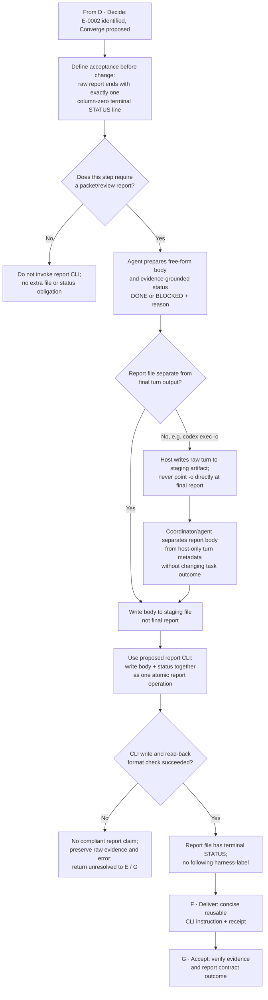
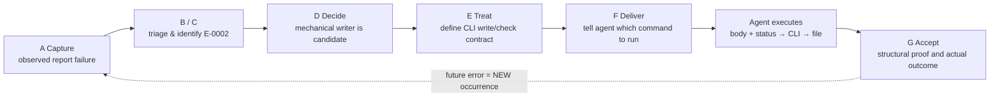

# E · Treat — Level 2 actionable example: E-0002

> **Proposed design, NOT an implemented CLI.** A discussion companion to [Level 1](../README.md) in [#437](https://github.com/dyphn1/Harness-everything/issues/437) and the Error Handling subtree [#402](https://github.com/dyphn1/Harness-everything/issues/402). This specifies **what the agent should do next time** and **which mechanical operation should prevent a repeat**. The proposed commands below do not exist yet; this document does not change production hooks, report rules or ledger state.

## Problem to prevent

**E-0002** (`report-protocol`) recurs when a report lacks its required **raw, column-zero, terminal** `STATUS: DONE` or `STATUS: BLOCKED: <reason>` line, or when a harness-label appears after it. Some failures happen in `codex exec -o` outputs where the report is also the final turn text. Previous instructions and reminders were not enough: the next agent can make the same mistake again.

**Treatment direction (proposal):** stop using free-form report editing for the terminal protocol. The **agent supplies report content and an evidence-grounded status**, while one **scoped CLI/script writes and verifies the final report file**. Preserve free-form content authoring; restrict only the structured output operation. Do not add a global document governor, second Error Ledger, automatic report generation for unrelated tasks, or a count-driven lock.

**Action ownership:** A Capture records facts; B Triage and C Identify establish the case; D Decide chooses treatment. **E Treat defines/applies the mechanical report-writing method**; F Deliver gives the agent a concise instruction and the available CLI; G Accept checks its result. This is an **E-0002-specific Action detail**, not a second Level 1 flow or a claim that all classes have the same treatment.

## Level 2 · E Treat (how to operate and how to prevent recurrence)



**Why this prevents the known error:** The agent no longer hand-places the terminal STATUS line, re-appends after STATUS or tries to reconcile a trailing host label by prose alone. The writer owns the report envelope and the mechanical postcondition. **CLI success proves structural compliance only, not that the underlying task passed.**

## Agent-facing procedure — proposed operational contract

For a step **explicitly required to produce a report**:

1. **Perform the work and collect evidence.** The agent must decide the true task/packet status based on observed results. `DONE` is not inferred by the CLI from a successful invocation; `BLOCKED` requires an actual reason. A completed RED experiment is not automatically product GREEN.
2. **Prepare only the free-form body** in a staging file. Do not add a terminal STATUS line or a harness-label to that body. If the host's `-o` captures the turn's final text, capture it to a **raw staging file**, never the final report target.
3. **Call the report writer** with the body path, final output path, and explicit status; the writer adds exactly one terminal STATUS line and writes the complete report atomically.
4. **Check the written file**, not merely the CLI stdout, and retain the result as evidence. Do not append to the finalized report; to revise, change the body and call the writer again.
5. **Return the report reference and verified result** to the caller. A separate turn message follows its own harness-label contract; the report file does not. If a single host artifact must serve both roles, keep the case unresolved until the designated report-turn rule is actually updated.

### Proposed command interface — design examples, NOT currently executable

```bash
# Positive result: content is provided by the agent; STATUS is written by the tool
harness report write --body-file work/report-body.md --output reports/review.md --status DONE
harness report check --file reports/review.md

# Blocked result: same writer; explicit failure reason is required
harness report write --body-file work/report-body.md --output reports/review.md --status BLOCKED --reason "required verification unavailable"
harness report check --file reports/review.md
```

These are **candidate CLI verbs**, not a mandate to create a global `harness` binary. A small repository-local Node.js script with equivalent `write` / `check` operations is sufficient for the first vertical slice. The agent-facing instruction should reference the **actual installed command and version**, not copy these placeholders as if working already.

### Minimal writer and checker contract

| Responsibility | Expected behavior |
| --- | --- |
| `write` input | Existing body file, designated report output path, explicit `DONE` / `BLOCKED`, mandatory non-empty reason for `BLOCKED` |
| `write` output | Preserve body content, add a single newline-separated terminal control line at **column zero**, write atomically, fail without corrupting the previous target |
| Structural validation | On the finished output, check exactly one terminal protocol line, nothing after it (including hidden label), and read-back matches what was written |
| Containing structured fields | Reject conflicting column-zero terminal STATUS lines and harness-label metadata in the submitted body; make the conflict explicit rather than silently discarding unknown content |
| Artifact roles | Report file and turn-final message remain separate when possible; host `-o` raw capture is **input evidence/staging**, not the final report |
| Failure outcome | Non-zero exit; **unverified/unresolved**, never automatically `DONE`; preserve prior target and raw source |
| Scope | Operate on explicitly designated report output only; do not rewrite unrelated files, judge semantic success, touch the Ledger, or automatically change permissions |
| Revision | Re-run `write` using the edited body + true status; never mutate the terminal report with ordinary append commands |

**Design constraint:** If a host produces an inseparable final-turn artifact containing a required label, **do not claim that the report-turn exception has shipped**. Final output must be produced through a host-aware separation/approved contract first; otherwise preserve evidence and report the unresolved conflict.

## Interaction with other Actions and existing facilities



The dotted future arrow depicts a **different future occurrence**, not a control-flow loop inside this occurrence. This is an explanatory relationship, not a change to Level 1.

- **#359:** existing E-0002 ledger remains the error/evidence authority; do not create a second database.
- **#394 / ROUTE-001:** relevance-scoped delivery can point agents at the operation, but a hint alone does **not** prevent malformed report writing. The CLI is the **mechanism**; the hook is a **context carrier**. Delivery behavior remains a separate implementation decision.
- **#437:** a small, explicit `write`/`check` command is consistent with the stated goal of reducing free-form status/date/link/number mistakes. It is not permission to apply the CLI to every document.

## Proposed acceptance before implementation

| Test case | Expected observable result |
| --- | --- |
| Valid body + DONE | Final file ends in exactly `STATUS: DONE`; CLI `check` passes |
| Valid body + BLOCKED + reason | Final file ends in `STATUS: BLOCKED: <reason>`; check passes |
| BLOCKED without reason | Write rejected; existing report left untouched |
| Body contains conflicting terminal STATUS or harness-label | Write rejected with useful explanation, no silent normalization |
| Agent revises body after earlier report | A new `write` replaces the report atomically; one terminal STATUS remains |
| `codex exec -o` emits trailing harness-label | Raw turn stays in staging; never treated as already-valid final report; conversion/contract unresolved until defined |
| Tool unavailable, bad path or read-back fails | No success claim; recorded as UNVERIFIED / unresolved, original evidence retained |
| Report not required | No invocation, no forced report |
| Writer produces compliant format but underlying result is wrong | Structural PASS only; review/behavior acceptance stays separate |

**What to measure:** E-0002 recurrence in later **real report-writing tasks**, whether the agent actually invoked the designated writer, structural violations after invocation, and elapsed/tool/review cost relative to hand-writing. Do not declare E-0002 rooted out merely because a diagram or a one-off check exists.

## Owner discussion items

1. Should the first implementation be a small Node.js `report write/check` script under the existing repository, rather than a new global CLI? **Recommended: yes.**
2. For `codex exec -o`, should the coordinator be the final report writer after host output completes, with the raw output retained as evidence? **Recommended: yes**, until an explicit host-aware extraction contract is accepted.
3. What is the approved way to separate host-owned label metadata from report body in a shared artifact? **Keep unresolved** until specified. Never silently strip arbitrary text.

This design leaves A Capture focused on facts while making **E Treat operational**: the next agent receives a repeatable action, not merely an explanation of the last mistake.
