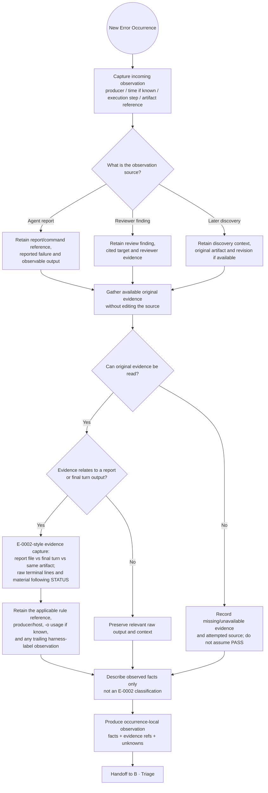
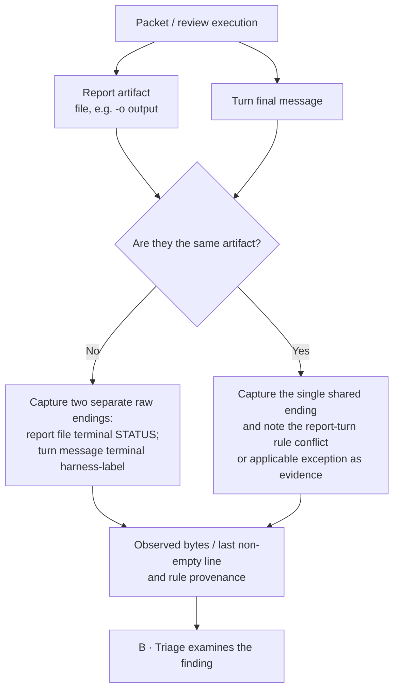

# E-0002 Capture — Level 3 evidence and provenance reference

> **Discussion-only / proposed; Level 3 reference.** Child of the [E-0002 Action Map](../actions/e0002-action-map.md) and [Level 1 overview](../README.md) for [#437](https://github.com/dyphn1/Harness-everything/issues/437) / [#402](https://github.com/dyphn1/Harness-everything/issues/402). No change to runtime, hooks, CLI, ledger schema, acceptance policy, or the Level 1 flow.
>
> **Action identity:** Capture is the existing A Action from [nodes.yaml](../nodes.yaml); A is a *diagram-local alias*, not a stable identifier. **E-0002 is a worked example, not the identity or mandatory type of this Action.**

**Level 3 scope:** This reference explains the evidence/provenance detail for the [E-0002 Level 2 Action Map](../actions/e0002-action-map.md). Capture alone does not solve the error; the actual prevention proposal and CLI contract are in [E · Treat — report writer](./e0002-report-writer.md).

## Purpose and boundaries

Capture opens **one new Error Occurrence** and records *what was actually observed* with enough provenance for **B · Triage** to examine it. Capture may adapt its evidence-collection steps to the producer, artifact, or a known example such as E-0002. It **does not** decide whether the finding is real, approve a tolerate class, identify the canonical Error Class/signature, choose a disposition, repair an artifact, or declare a check passed.

A later recurrence starts a **new** Capture execution. Continuation of a pending occurrence is **not** a new one. The existing Error Ledger ([#359](https://github.com/dyphn1/Harness-everything/issues/359)) remains the system of record for class/episode association *after* Identify; this draft does not create a parallel ledger or allocate persistent IDs.

## Level 2 · Capture activity (common path and E-0002 specialization)

**Reading rule:** The E-0002 box is a *conditional example of evidence capture*, not a branch that declares E-0002. Report-related evidence can enter via any of the three source types. Capture records an unreadable artifact as **unknown/unavailable**, never as a compliant report.

## E-0002 · Artifact boundary (two outputs are not always the same)

The [existing E-0002 ledger record](../../../../.agents/harness-everything/errors/E-0002-report-missing-terminal-status.md) describes a report protocol failure: a report must end with a plain column-zero `STATUS: DONE` or `STATUS: BLOCKED: <reason>` line. Some later observations involve a hidden harness-label *after* that line, especially in `codex exec -o` outputs. [ROUTE-001](../../../adr/ROUTE-001-error-lesson-delivery.md) distinguishes report-file and turn-message obligations; its proposed report-turn exception is **not yet implemented**.

### E-0002 evidence checklist (example, not a new schema)

| Field to observe | Why it matters |
| --- | --- |
| Observation source, producer, execution/PR/step and time **if known** | Keep actor and provenance; do not invent missing time |
| Report artifact location/revision and whether its full content was readable | Permit independent review of the original |
| Report file vs turn message vs shared artifact; host and `-o` use **if known** | Avoid comparing the wrong output against the wrong rule |
| Exact raw final lines, column-zero STATUS candidate, and any following line/label | Preserve whether a STATUS line was truly terminal; no normalization or silent repair |
| Applicable packet/report and harness-label rule reference **if known** | Make a possible rule conflict observable without deciding its validity |
| What is unavailable or ambiguous | Carry uncertainty into Triage instead of promoting it to PASS |

**No fields above imply a production schema, a new CLI verb or persistent storage.** An observation may be represented by existing review/task evidence until an owner-approved mechanism exists.

## Worked observation cases

| Input case | Capture result (facts only) | What Capture must **not** infer |
| --- | --- | --- |
| Agent report ends with ordinary prose after `STATUS: DONE` | Preserve report tail, report path and producer | Do not auto-classify as E-0002 or edit the file |
| Reviewer finds `STATUS: DONE` followed by a harness-label in a `-o` file | Capture both raw lines, file/turn identity, review source and relevant rule references | Do not decide whether the reviewer is right or mark verification PASS |
| Report file ends at STATUS; a **separate** final turn ends with harness-label | Capture each artifact and its distinct ending | Do not assume a violation merely because the turn has a label |
| Report is also the final turn | Capture one artifact and the applicable/conflicting rule references | Do not assert that the proposed exception was shipped |
| Report content cannot be read | Record evidence as unavailable and cite the attempted source | Do not fabricate a valid terminal STATUS |
| A similar failure is discovered in a later PR | Start a new occurrence with its own evidence | Do not jump from G to D or reuse an occurrence implicitly |

## Handoff and discussion acceptance

**Output:** one occurrence-local observation of what happened, with source/provenance, accessible raw evidence, unavailable evidence, and the active execution context needed by **B · Triage**. The source facts are not a verdict. **Next:** B decides approved-tolerate handling and whether a finding is real; **C · Identify** later maps the observation to an existing class/signature or proposes a new class.

A useful first-level review asks: (1) can a reviewer distinguish *report file* from *turn message*? (2) can the finding be independently checked without modifying evidence? (3) does a later recurrence start at Capture? (4) are missing facts left explicit? (5) can B make a decision without Capture pre-classifying E-0002?

**Out of scope for this draft:** code changes; E-0002 repair; automatic status inspection or enforcement; new CLI/state transitions; defining all specialized Capture paths; editing the historical blind-evaluation stimuli.
