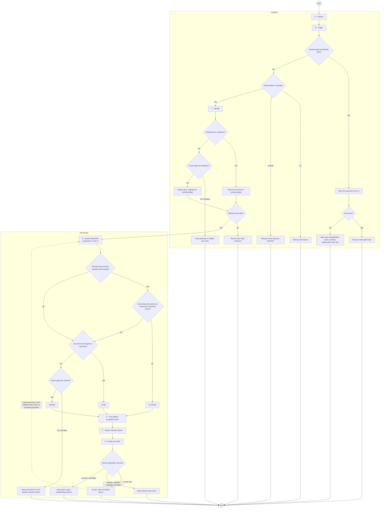
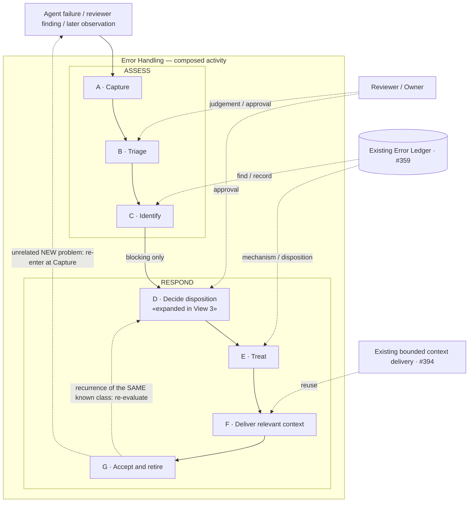
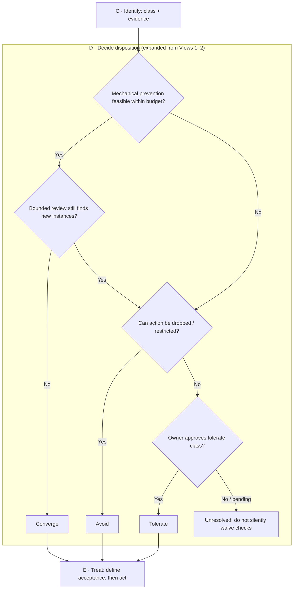

# Error Handling — blind diagram stimulus

> Read **only the diagrams** below on your first pass. Do not read the parent README, Issue #437 / #402, previous comments, the evaluation rubric, or the other reviewer assignments. Diagrams are round 2, revised after round 1; source diagrams frozen at `8e76b8d24688148145437034a7995f3454837db1`.

## View 1 (Diagram 1)

A–G are drawing-local aliases, not persistent identifiers; node ids are local to each diagram.

## View 2 (Diagram 2)

Early exits and decisions are omitted in this view; see View 1.

## View 3 (Diagram 3)

