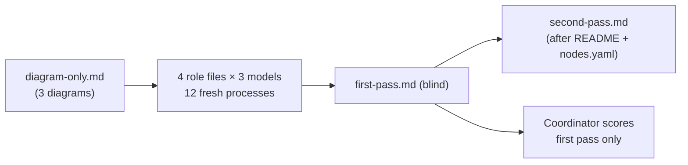

# Blind readability evaluation — round 1 results

> Evidence layer: **behaviour of one-shot agents reading the diagrams**, one run per cell (n=1). Scores are the coordinator's reading against [rubric.md](../../rubric.md) acceptance items 1–8; there was no second scorer. Only the first pass is scored.

- Stimulus: [diagram-only.md](../../diagram-only.md) at `33e1ef7842d1fdaf4aad29d7e8b38eb53cb17d31` (branch head `1c76c661`).
- Date: 2026-11-12. Each cell is a fresh process in its own directory outside the repository, containing only its role file, `diagram-only.md`, `README.md` and `nodes.yaml`. `rubric.md`, the other role files and `activity.puml` were not present.
- Runners: `codex exec -m gpt-6-luna` (xhigh), `claude -p --model haiku --effort high`, `opencode run -m opencode/glm-5.3-flash-free`.
- Blindness: Luna logs confirm the first pass was written before the README was opened. Haiku and OpenCode are confirmed only by file times and their own statements.

## Scores (0–5, first pass)

| Role | Luna | Haiku | OpenCode (GLM) |
|---|---|---|---|
| operator | 4 | 4 | 4 |
| architect | 4 | 3 | 4 |
| maintainer | 3 | 3 | 3 |
| reviewer | 4 | 4 | 4 |

All three models chose the intended branch for all four operator cases. None declared an UNVERIFIED step as passed or treated an unapproved Tolerate as approved.

## False readings induced by the diagrams

| # | False reading | Label that induced it | Who | Smallest edit |
|---|---|---|---|---|
| 1 | View numbering inverted: Diagram 1 read as "View 2", Diagram 2 as "View 1" | subgraph titles `ASSESS · View 2 composition`, `composed activity (View 1)` | Haiku ×4, OpenCode ×4 | remove cross-view references from subgraph titles |
| 2 | A–G letters taken as stable cross-view identifiers that must survive a rename | nothing in the diagrams marks them as drawing-local | maintainer ×3 | one line under the diagram |
| 3 | Triage gate `Approved tolerate class?` read as mislabelled (expected to lead to Tolerate) | two gates share the word "tolerate" | Haiku architect misread it; 5 other cells flagged it | `Already-approved tolerate class?` |
| 4 | View 2 `C → D` read as "every item reaches disposition", in conflict with View 1's `NOW` gate | View 2 is drawn as a straight line with no exits | nearly every cell | label the edge `blocking only`; say exits are omitted |
| 5 | Recurrence target unclear: back to `D` or back to Capture | View 1 `RETIRE → D` vs View 2 `G → INPUT` | nearly every cell | label both edges (same class vs new problem) |

Flagged by most cells without causing a wrong branch: the `BLOCK` decision is a no-op (both branches go to `C`); View 3 node ids `A`, `C`, `T`, `R` collide with View 1.

Rubric cautions: #1 (recurrence) and #4 (View 2 looks like a flow) were confirmed. #3 (View 1 too large to scan) was not raised by any cell. #2 (PlantUML source) was not tested.

## Design questions raised (recorded only, not readability)

- The already-approved-tolerate retry path never writes to the ledger (observed). Whether a cross-operation cap needs such a record is **unresolved**: the retry bound is operation-local and no owner requirement asks for a ledger counter.
- `RETIRE → D` skips `C`: no occurrence record and no owner approval of a definition on that path.
- HOLD / PENDING / DEFER / OPEN have no drawn re-entry.

## Run notes

- `luna-architect` attempt 1 reported `STATUS: BLOCKED` itself: its start-up command printed `README.md` before the first pass ([attempt-1-blocked](./luna-architect.attempt-1-blocked.md)). It was re-dispatched fresh with the second-pass material in a subdirectory; that run is the scored one.
- OpenCode ran without auto-approve permissions.

## Files

`<model>-<role>.first-pass.md` and `<model>-<role>.second-pass.md` for each of the 12 cells, unedited.
