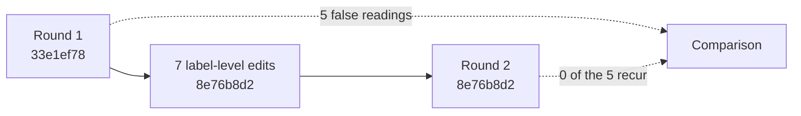

# Blind readability evaluation — round 2 results and comparison

> Evidence layer: **behaviour of one-shot agents reading the diagrams**, one run per cell (n=1) per round. Scores are the coordinator's reading against [rubric.md](../../rubric.md); there was no second scorer, so the count of false readings is firmer evidence than the scores. Only the first pass is scored.

- Stimulus: [diagram-only.md](../../diagram-only.md) at `8e76b8d24688148145437034a7995f3454837db1` (text-only revision of the round 1 diagrams; no node was split out).
- Same 4 role files × 3 runners as [round 1](../round-1/README.md), fresh processes, 2026-11-12.
- One set-up difference from round 1: `README.md` and `nodes.yaml` sat in a `second-pass-material/` subdirectory, because a round 1 Luna run opened the README at start-up. Luna logs confirm first pass before second-pass material in all four cells.

## Scores (0–5, first pass)

| Role | Luna r1 → r2 | Haiku r1 → r2 | OpenCode r1 → r2 |
|---|---|---|---|
| operator | 4 → 5 | 4 → 4 | 4 → 4 |
| architect | 4 → 5 | 3 → 4 | 4 → 4 |
| maintainer | 3 → 4 | 3 → 4 | 3 → 4 |
| reviewer | 4 → 4 | 4 → 4 | 4 → 4 |

All three models again chose the intended branch for all four operator cases.

## The five round 1 false readings

| # | Round 1 false reading | Edit | Round 1 cells | Round 2 cells |
|---|---|---|---|---|
| 1 | View numbering inverted | cross-view wording removed from subgraph titles; stimulus headings say `View N (Diagram N)` | 8 | 0 |
| 2 | A–G taken as stable identifiers | one line under View 1 | 3 (all maintainers) | 0 — every maintainer and architect now states they are drawing-local |
| 3 | Triage tolerate gate read as mislabelled | `Already-approved tolerate class?` | 1 misread, 5 flagged | 0 misread; 6 still note the two uses of "tolerate" are not related to each other in the drawings |
| 4 | View 2 `C → D` read as unconditional | `blocking only` edge label + "exits omitted" note | nearly all | 0 read it as a conflict; several note View 2 still *looks* linear when read alone |
| 5 | Recurrence target unclear (D or Capture) | both edges labelled: same known class → D, unrelated new problem → Capture | nearly all | 0 unclear about the target |

Also gone: the no-op `BLOCK` decision and the View 3 node-id collisions (no cell mentions either).

## What round 2 readers still flag

| Residual | Cells | Kind |
|---|---|---|
| Same-class recurrence leaves from `RETIRE` in View 1 but from `G` in View 2 | 3 as a mismatch, 2 more note it | label-level; introduced by the round 1 edit |
| View 2's `G → INPUT` (new problem) has no counterpart in View 1 | 4 | label-level |
| The recurrence edge to `D` skips the `blocking only` / `NOW` gate | 1 | design question |
| View 3 starts at `C` without showing the blocking condition | 2 | label-level |
| "max 3": three attempts or three retries; scope of the count | most | undefined term |
| `budget`, `bounded review`, `cap`, `met`, `main path` are not defined | most | undefined terms |
| HOLD / PENDING / DEFER / OPEN / KEEP have no drawn re-entry | most | design question |
| Retry path and recurrence path never write to the ledger | 3 | design question |

Self-reported confidence did not rise with the scores (range 2–4 in both rounds). In round 2 the stated reasons are the undefined terms and missing re-entry paths above, not cross-view contradictions.

## Reading of the result

- Clarifying text was enough for the label-induced misreadings; no diagram was split.
- What remains is mostly content the Level 1 diagrams do not yet define. That belongs to the next level of detail, not to another wording round.

## Files

`<model>-<role>.first-pass.md` and `<model>-<role>.second-pass.md` for each of the 12 cells, unedited.
