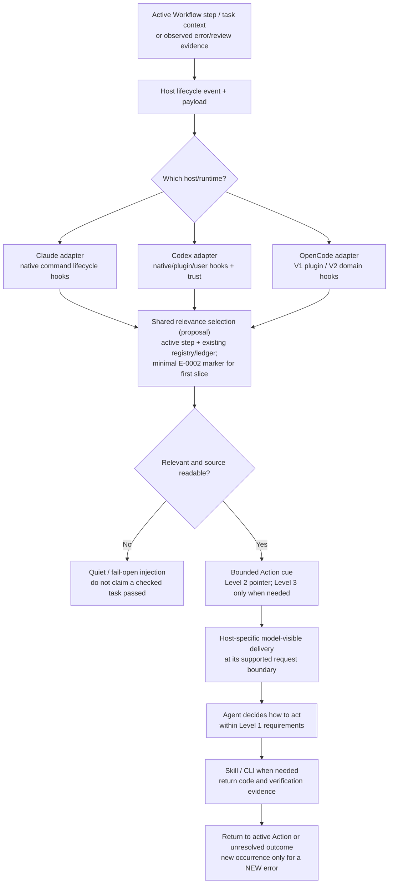
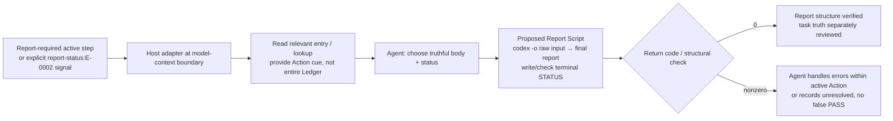

> **Current interpretation (2026-11-13):** This is a host-stage draft; the [latest cross-host semantic audit](https://github.com/dyphn1/Harness-everything/blob/discussion/439-opencode-v2-error-hook-context/docs/discussions/error-hook-framework/semantics-review-2026-11-13.md) and [#439](https://github.com/dyphn1/Harness-everything/issues/439) supersede any diagram implying mandatory Reviewer dispatch, a new Level 1 on Reviewer handoff, or a universal independent-acceptance gate. **Executing Agent may self-correct; independently dispatched Reviewer uses the same L1 Action semantics with prior Evidence/Action context.** Three authority questions remain pending; #437's Action flow is not altered by this notice.

# Error Hook Framework — three-host architecture draft

> **Discussion draft for [#439](https://github.com/dyphn1/Harness-everything/issues/439), not an implementation or an approved host capability claim.** This branch is **independent of #437** (based on `main`) to avoid coupling its document changes to the ongoing E-0002 diagram revisions. Read the [E-0002 Level 2 Action Map on its discussion branch](https://github.com/dyphn1/Harness-everything/blob/discussion/437-e0002-capture-level2/docs/discussions/error-handling/actions/e0002-action-map.md) when the behavior example is relevant.

## Owner-accepted Claude Code closure (2026-11-13)

**[Claude Code event timing, reviewer-gated Error Handling, scoped Avoid/workaround and unresolved reporting](./claude-code.md)** is the authoritative Claude-specific draft for this discussion branch. **Reviewer independently judges whether the Main Agent's suspected error is real**; Hook supplies bounded evidence/context, not a verdict. Main Agent can fix the affected Workflow segment, or when direct repair is infeasible, **replan only the affected segment using a valid workaround**, preserving the task's mandatory checks. If neither works or proof is missing, explicitly report **Unresolved**. All treatment paths require independent verification; no "player as referee". Claude native timing design is **closed**; host adapter delivery and behavioral validation remain **unchecked** under #394. Codex and OpenCode are not decided here.

## Ownership and architectural fit

- [#403](https://github.com/dyphn1/Harness-everything/issues/403): long-term Graph Engineering, hierarchy/funnel, progressive disclosure, cost-aware modularity.
- [#402](https://github.com/dyphn1/Harness-everything/issues/402): Error Handling lifecycle, agent-directed treatment and decisions.
- [#437](https://github.com/dyphn1/Harness-everything/issues/437): Level 1 overall process, Level 2 magnified behavior blocks, Level 3 on-demand Skill/Script/reference.
- [#394](https://github.com/dyphn1/Harness-everything/issues/394): **owns actual Hook / Error Ledger lesson injection, removal of superseded Rule-of-3 enforcement, and three-host verification**. This document must not replace that scope or become a second hook controller.
- [#359](https://github.com/dyphn1/Harness-everything/issues/359): existing Error Ledger is the record authority; no second memory store.

**Goal:** At the point a model makes a relevant decision, it receives the *smallest useful* Error Handling Action cue and, only when needed, the Skill/CLI entry to perform it. **A Hook delivers context, not decisions, permission or the execution of Error Handling itself.** Suspected errors require independent Reviewer findings; Main Agent owns actions inside Level 1, including scoped Avoid/workaround if direct repair is infeasible. A script is responsible for only its deterministic contract and return codes.

## Common logical design — one selector, distinct host transports



**This diagram is an architecture relationship, not a timing promise.** The same tool event can be **too late to change a tool already chosen**; only receipt at a *model-decision boundary* can steer that decision. Transport, invocation, actual injection, model receipt and subsequent behavior must be measured separately.

## The temporal trap — interception is not prior model knowledge

```mermaid
sequenceDiagram
    autonumber
    participant W as Workflow / task
    participant H as Host hook
    participant R as Shared selector / Ledger / Registry
    participant M as Agent model
    participant T as Tool / Script
    W->>H: Prompt or model-context boundary
    H->>R: Relevance query (bounded)
    alt Matching lesson/Action
      R-->>H: Small cue + optional Skill reference
      H-->>M: Host-supported model-visible context
    else No match / unavailable
      R-->>H: No cue; fail-open
    end
    M->>T: Select tool and invoke operation
    opt PreToolUse (already selected tool)
      H->>R: Inspect planned tool/args
      Note over H,M: An added cue may reach a later model turn;<br/>do not assume the pending tool will be replanned
    end
    T-->>H: Completed tool result / error
    H->>R: Match failure class, if available
    H-->>M: Failure lesson at a supported next model point
    M->>W: Continue current Action, or disclose unresolved
```

Therefore the **preferred prevention opportunity** for E-0002 is the model-context boundary **before report-writing selection** (when available). Tool/failure hooks are valuable **observers and later corrections**, not a replacement for this early cue. Host access differs and cannot be flattened into a single assumed hook event.

## Host-specific transport and guarantees

See **[the three-host detailed Hook diagrams and matrix](./hosts.md)**. Keep these host details out of the shared policy:

| Host | Early relevance disclosure candidate | Failure observation candidate | Explicit limitation |
| --- | --- | --- | --- |
| Claude Code | `UserPromptSubmit` / `SessionStart` where relevant; `SubagentStart` for Reviewer context | `PostToolUseFailure`, conditional `PostToolUse`; `PostToolBatch` once per batch before next model request | **[Claude closure](./claude-code.md):** Hook is cue only, Reviewer judges truth; direct repair or scoped workaround; no live-host receipt yet |
| Codex CLI | `UserPromptSubmit` `hookSpecificOutput.additionalContext`, possibly `SubagentStart` | `PostToolUse` for tool results / nonzero | `PreModelRequest` is diagnostic-only in current docs; hook trust, plugin-vs-user source and tool coverage vary |
| OpenCode | V2 `ctx.session.hook("context")` before agent model request; V1 transformation needs separate proof | V2 `ctx.tool.hook("execute.after")`, V1 tool hook | V1/V2 are **distinct APIs**, V2 context registration is **not currently present** in the repo adapter |

**Do not equate** official Host API support, code configured, packaging tests, real Host hook invocation, model-visible receipt or behavioral improvement. Retain separate status for each.

## E-0002 vertical slice — minimum useful behavior



The Report Writer interface is **still a proposal** in [#437's Level 3 draft](https://github.com/dyphn1/Harness-everything/blob/discussion/437-e0002-capture-level2/docs/discussions/error-handling/details/e0002-report-writer.md). The existing [ROUTE-001 ADR](../../adr/ROUTE-001-error-lesson-delivery.md) describes the `UserPromptSubmit` explicit marker proposal, but it is **not an installed lesson-injection mechanism**. Do not promote this logical path to deployed/verified.

## Failure policy and constraints

- **Selective, deterministic, bounded and fail-open** as **advisory context injection**. Silence for unrelated operations; no context flood, duplicate-lesson spam, second ledger or global always-on learning.
- **No count/threshold, forced Zoom-out, token, mutation lock, mandatory reflection report or automatic escalation.** This does not relax pre-existing *user/host permission checks*, and deterministic Script/CLI checks may legitimately return a nonzero exit.
- **Unknown/absent Workflow state:** an explicit agreed marker can serve as a first-slice relevance input when present; lack of evidence is not grounds to fabricate E-0002 classification or to load every ledger entry.
- **Subagents, compaction, resume, background tasks and tool result shape** are Host/Version-sensitive. Do not assume initial context propagates automatically; test the required actor and model request.
- **Progressive disclosure:** first a short instruction about the current Action; Level 3 command details only if required and available. Relevance should not be inferred from a generic code edit alone.
- **Evidence:** hook fired ≠ injected output ≠ model-visible receipt ≠ Agent action ≠ Script check ≠ fewer recurrences. Keep each distinction explicit.

## Implementation/evaluation boundary

This is a **conceptual draft**. [#394](https://github.com/dyphn1/Harness-everything/issues/394) remains the owner of any real code/Hook work. Do not add new Host adapters, monkeypatch model contexts or remove old policies from this discussion branch. Define one E-0002 end-to-end slice and verify **the actual model receipt and Action use** separately on Claude, Codex and OpenCode before calling the mechanism integrated. Compare recurrence/total cost **only after** Error Handling + Hook + Script + Ledger/Skill delivery work as a system.

**Next design question:** choose which evidence-backed model-decision event each Host can use for **pre-action** Action disclosure, and which Host-specific event surfaces should be reserved for **post-failure** observations. Do not add a new universal hook event abstraction until the three concrete mappings are understood.
