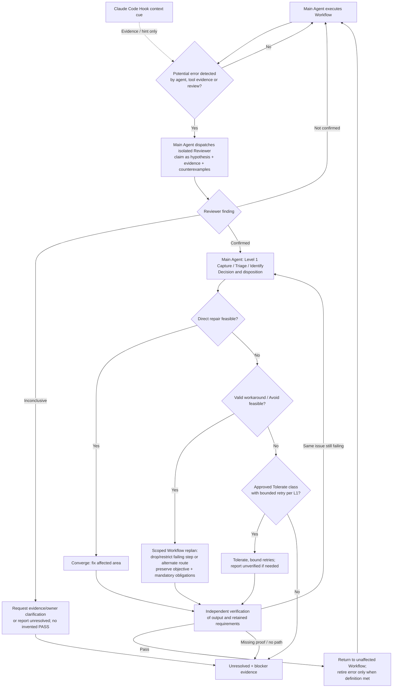

# Claude Code — Error Hook timing and reviewer-gated treatment (owner-aligned draft)

> **#439 Claude Code architecture/timing: CLOSED FOR DISCUSSION; host/runtime behavior: NOT YET VERIFIED.** This is a draft artifact, **not** code, configuration, an approved rollout, a passing real-host test or a permission bypass. Based on [Claude Code Hooks reference](https://code.claude.com/docs/en/hooks), checked 2026-11-13. The overall [#439](https://github.com/dyphn1/Harness-everything/issues/439) body is authoritative for owner decisions; runtime changes are under [#394](https://github.com/dyphn1/Harness-everything/issues/394).

## Design closure: who decides what

**Do not make the player also the referee.** An Error Hook is an observer and bounded context carrier. A Main Agent notices potentially wrong behavior, delegates **independent verification** to a Reviewer Subagent, and acts on the verified finding. The Reviewer, not the Main Agent (nor Hook), judges whether the suspected error is real; the Main Agent owns Workflow decisions inside Level 1. This does not authorize every tool error to spawn a Reviewer automatically.

- **Hook**: sees an officially supported event/payload, identifies relevance conservatively, optionally returns a *suspicion/evidence cue*; no automated verdict, correction, escalation, repeat counter or subagent dispatch.
- **Main Agent**: detects a potential problem from evidence (including its own reasoning), asks independent Reviewer to establish a finding, and handles confirmed problems within existing L1.
- **Reviewer Subagent**: fresh, bounded, preferably read-only verification; inspect evidence and counterexamples; produce `Confirmed`, `Not confirmed` or `Inconclusive` with rationale. A reviewer cannot be a copy of the Main Agent's diagnosis; initial instructions should avoid asserting the suspicion as fact.
- **Level 1**: Capture → Triage → Identify → Decide disposition → Treat → Deliver → Accept/retire. **Level 2** is the relevant Action diagram; **Level 3** is Skill/Script/CLI only when needed. Existing ledger/registry are the authority.
- **Evidence gate**: repair **and** workaround outputs require independent verification; failing, missing or contradictory evidence is never reported as success.



**Do not confuse `Avoid` with simply skipping verification.** For an irreparable failing operation, adjust **only the affected Workflow segment** and preserve original goals, dependencies, previously accepted outputs and mandatory checks. If no valid alternative exists, leave it `Unresolved`. Under [#437](https://github.com/dyphn1/Harness-everything/issues/437), `Converge` / `Avoid` / approved `Tolerate` are distinct dispositions; approved bounded retries for a tolerate class are **not** permission to reinstate legacy Rule-of-3 lock/counter/automatic reflection.

## Host event points — documented versus selected

```mermaid
sequenceDiagram
    autonumber
    participant W as Workflow / user task
    participant H as Claude Code hooks
    participant M as Main Agent
    participant T as Tool batch
    participant R as Independent Reviewer subagent
    W->>H: SessionStart / UserPromptSubmit (when relevant)
    H-->>M: Minimal relevant context only
    M->>T: Chosen tool calls
    opt PreToolUse (tool already selected)
      H->>H: Observe requested tool and args
      Note over H,M: Cannot assume it changes the pending decision
    end
    T-->>H: PostToolUse or PostToolUseFailure per call
    H->>H: Record/match bounded observable failure cues
    H->>M: PostToolBatch once at end of batch, if needed
    Note over H,M: Before next model request; do not duplicate every tool cue
    M->>M: Suspect problem? Not yet a verified error
    opt Main Agent chooses independent review
      M->>R: Dispatch suspected claim and evidence
      H-->>R: SubagentStart context only (not a verdict)
      R-->>M: Confirmed / Not confirmed / Inconclusive + evidence
    end
    M->>M: L1 → direct repair OR scoped Avoid/workaround OR Unresolved
```

| Event | Official relative timing | #439 role | Decision |
| --- | --- | --- | --- |
| `UserPromptSubmit` | Prompt submission before model processing | Small, already-relevant initial Action/Reviewer cue | **Core context entry** where evidence is available |
| `SessionStart` | New/resumed/compacted session context | Restore necessary current Action references; never flood all lessons | **Optional continuity** |
| `PreToolUse` | After tool selected, before execution | May observe planned operation; cue may arrive too late to change that tool choice | **Not primary** prevention/injection point |
| `PostToolUseFailure` | A tool call fails | Precise failure input/evidence to invite independent verification | **Core observation** |
| `PostToolUse` | Successful tool execution | Detect only objectively checkable anomalies in returned data; semantic doubt remains Main Agent / Reviewer work | **Conditional observation** |
| `PostToolBatch` | Once after **all tools in the batch resolve**, before next model request | Optionally coalesce multiple outcomes into one bounded context hint | **Core coalescing candidate**; no compulsory duplicate injection |
| `SubagentStart` | Reviewer/other child starts | Task-specific evidence, scope, and verification criteria; avoid confirmation bias | **Reviewer continuity** |
| `Stop` | Agent about to finish response | Can observe termination, but too late for primary detection/replanning | **Not primary** |

### Host constraints and unresolved behavior

1. **Hook timing is not model receipt**. Capture independently: hook invoked → matching cue generated → context accepted → Main Agent/Reviewer actually received it → Reviewer finding → treatment → verified result. Do not report an implementation PASS solely from hook stdout.
2. **Batch versus per-call**. `PostToolUseFailure` provides explicit per-tool failure data; `PostToolBatch` receives the batch in a **different** result representation. A single batch context may avoid repetitive hints, but do not assume both payloads are interchangeable or introduce a duplicate cross-event store. Prefer deterministic extraction from the event currently observed; proof of exact fields is part of host tests.
3. **No hook-controlled reviewer**. A failed tool does **not** automatically mean an error class is confirmed, or demand an immediate Reviewer. Reviewer is dispatched by the Main Agent once it suspects an actual problem. Non-tool reasoning errors may not have a corresponding native failure event.
4. **Reviewer isolation**. `SubagentStart` can inject child-scoped additional context, but *technical transport* is not proof of independent reasoning. Child input should contain falsifiable claims/evidence, not pre-committed verdicts.
5. **Scope and incidence**. Repair attempts and alternate-route validation remain in the current treatment while they address the same occurrence; a later independent failure/recurrence starts a new occurrence, reusing existing class/history as relevant.
6. **Fail-open applies to contextual delivery**. A disabled/unreadable hook does not produce a false approval for required checks or authorization; underlying verification and permissions remain intact. Avoid legacy `rule-of-3.js` and `rule-of-3-tracker.js` logic, whose retirement is owned by #394.
7. **No live-host claim**. Registration, supported version, actual payload, `PostToolBatch` interaction with per-tool failure events, batch deduplication, resumed session and subagent context receipt are *untested*. Validate later in #394; do not reopen the conceptual timing decision merely because testing remains.

## Minimum scoped host validation (later, owned by #394)

| Probe | Expected observation |
| --- | --- |
| One failing tool | Native failure event observed; Main Agent receives only bounded suspicion evidence; Reviewer makes the truth judgement |
| Two parallel calls, one failure | Batch fires once at supported boundary; no duplicated lesson spam; distinguish failure payload from batch payload |
| Tool succeeds but violates a machine-checkable invariant | Conditional observation only; Reviewer confirms or rejects with evidence |
| Review finding with no failed tool | Main Agent can initiate Reviewer/Error Handling without relying on `PostToolUseFailure` |
| Rejected or inconclusive suspicion | No fabricated confirmed error / PASS |
| Irreparable operation with valid alternate route | Only affected Workflow segment changes; independent review verifies maintained obligations |
| No viable workaround or missing proof | Unresolved and explicit report; never silently skip mandatory checks |
| Reviewer subagent / resume / compact | Evidence travels to the right child/turn, without cloning Main Agent conclusions |

### Disposition / links

- **Claude Code lifecycle point selection: discussion closed.** No need to invent additional Host hook timings.
- **Implementation status: UNVERIFIED**; any adapter, Hook JSON, routing/ledger lookup and removal of obsolete behavior belong to [#394](https://github.com/dyphn1/Harness-everything/issues/394).
- This document is a **branch draft**. Codex and OpenCode V1/V2 timing remain separately open in [#439](https://github.com/dyphn1/Harness-everything/issues/439).
- Official: [Claude Code Hooks reference](https://code.claude.com/docs/en/hooks), including `PostToolUseFailure`, `PostToolBatch`, and `SubagentStart`.
