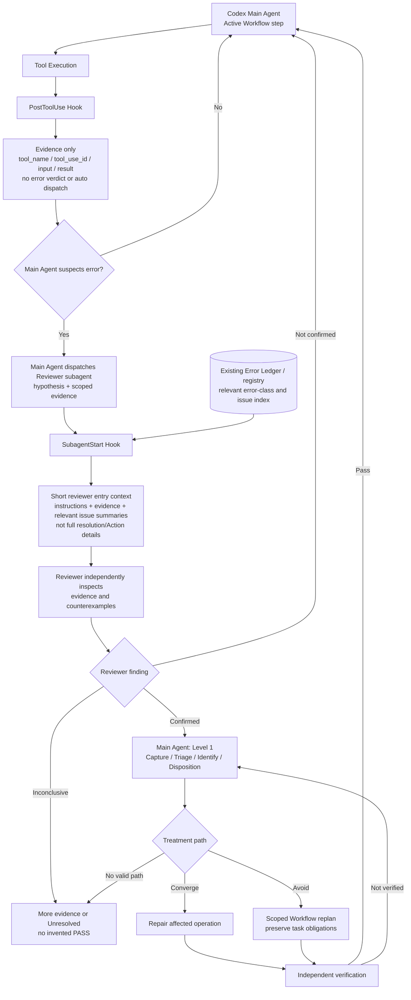
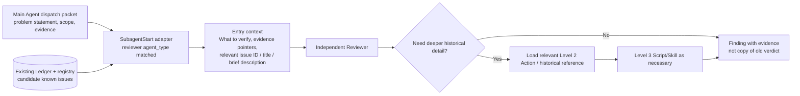

# Codex CLI — evidence-only tool hook and Reviewer awareness (owner adjudication)

> **#439 / 2026-11-13: the two design choices below are adjudicated; production integration remains UNVERIFIED.** Discussion-only artifact, no change to installed Hooks, Error Ledger, permissions or runtime. [Overall discussion #439](https://github.com/dyphn1/Harness-everything/issues/439) · [Claude Code closure](./claude-code.md) · [#394 implementation owner](https://github.com/dyphn1/Harness-everything/issues/394).

## Owner decisions

1. **`PostToolUse` = Evidence only.** Hook does not classify an Error Occurrence, announce a verified Error Class, prescribe correction, dispatch reviewers or modify the completed tool result. Provide only objectively available tool outcome evidence (or no duplicate cue if the original model-visible result is already sufficient). A failed tool is *a suspicion signal*, not proof that an Error Handling issue exists.
2. **`SubagentStart` = reviewer instructions AND relevant historical error index.** At the Reviewer entry, supply task/verification scope, the suspected claim and available evidence, and **a readable summary/list of related known error classes/problems** (IDs, names, one-line symptom/constraint, reference). Do not front-load complete issue bodies, prior solution steps, previous verdicts, full ledger entries or Level 2/3. The incremental tokens spent on useful orientation are preferable to a nearly empty pointer. Reviewer can open full references **on demand**.
3. **Reviewer remains independent.** The historical issue list is a *candidate check list*, not a conclusion. Reviewer must evaluate the new evidence and counterexamples independently; `Confirmed`, `Not confirmed`, and `Inconclusive` are reviewer findings, not Hook decisions. Main Agent implements Level 1 after confirmed finding.
4. **Recovery includes Avoid.** Attempt to converge where feasible; when direct resolution is not viable, replan **only the affected Workflow segment** using a valid workaround/avoidance while preserving original requirements and mandatory checks, then independently verify. If none works or proof is unavailable, report `Unresolved`. Approved `Tolerate` policy from #437 remains distinct from forcing Rule-of-3 runtime gates.

## Main process / hook boundaries



**Note:** The graph is the approved *logical behavior*, not a claim that the current Codex host automatically wires the `SubagentStart` event to a particular review request or the corresponding ledger item. Treatability, reviewer dispatch, Workaround and independent verification belong to Workflow/Agent decisions, not Hook control.

## Reviewer entry — progressive disclosure, without losing cognition



Example **illustrative only** (not a mandated schema or a confirmed matching result):

```text
Role: Independent Reviewer — treat the Main Agent's suspicion as unverified.
Scope: Verify whether the generated report violates its terminal-status rule.
Evidence: tool result reference <tool_use_id> + target file path + reproduction.
Related historical issues (orientation, NOT findings):
  - E-0002: Report must terminate with the expected STATUS line; check the actual last line.
  - E-0003: Commit message format failures; consider only if the task involves commit creation.
Details: Open the referenced ledger entry/Level 2 diagram only if needed.
Return: Confirmed / Not confirmed / Inconclusive + evidence and counterexamples.
```

**Relevance filter:** The example shows what *a candidate summary* might look like; the real hook should include only items relevant to the Reviewer's task/step and the available index. No match → instructions and task evidence only, not all known issues or fabricated classifications. These summaries are **not trusted verdicts**; quoted history may be incomplete or stale. A simple ID/title/one-line description is enough to raise awareness without preloading solutions.

## Codex event/output contract (official reference verified 2026-11-13)

| Event | Host contract | Design use | Boundary |
| --- | --- | --- | --- |
| `PostToolUse` | After supported local tool results including nonzero Bash; has `tool_name`, `tool_use_id`, `tool_input`, `tool_response`; model-visible output through JSON `hookSpecificOutput.additionalContext`; plain stdout ignored | Observation + Evidence (not diagnosis) | Output payload is tool-specific; there is no universal exit-status field; don't claim all tools or hosted tool coverage |
| `SubagentStart` | At child start; `matcher` filters `agent_type`; output supports plain stdout developer context or JSON `hookSpecificOutput.additionalContext` scoped to child | Reviewer instructions + relevant issue index | Native hook input does **not** include the Reviewer dispatch task, Error Occurrence ID or ledger match by default: acquire only through an existing reliable scoped packet/state contract; no transcript-format assumption |
| `UserPromptSubmit` / `SessionStart` | Prompt/entry and session/resume/compact context | Context continuity when needed | No need to inject the entire ledger/solutions; prompt event matcher is ignored |
| `PreModelRequest` | Runs before each model request, diagnostic output only | Observability, **not** context injection | Cannot implement missing `PostToolBatch` with it |
| `SubagentStop` | At child exit, Hook event available | Optional evidence/diagnostic | Cannot replace the Reviewer verdict or independent verification |
| `PreToolUse` | After model has chosen the tool, before execution | Not the primary post-error path | May be too late to change already chosen tool |

Use **nonblocking advisory output**. For `PostToolUse`, avoid `decision: "block"`, `continue: false`, or status/error replacement as the Error Hook is not a policy gate. Hook `additionalContext` is bounded and scoped; a redundant tool-result echo should be suppressed. Host trust/installation/version and child availability must be tested before claiming live receipt.

Official: https://learn.chatgpt.com/docs/hooks

## Important operational trap: how does `SubagentStart` locate this review?

The official Codex input for `SubagentStart` has `agent_id`, `agent_type`, `turn_id`, `permission_mode`, plus common session information; **it does not document a native `review_task` / `problem_id` field**. Therefore an adapter must not pretend the event itself identifies the current disputed evidence or selected known issues.

- Main Agent supplies the **review task and evidence references** as part of its normal child dispatch.
- If an **existing trustworthy task-scoped context/packet** is available to the Hook, use it to retrieve **candidate issue summaries** from the existing ledger/registry; otherwise give only generic reviewer instructions and let the Reviewer resolve the references itself.
- No additional persistent error memory or global scratch file is authorized here. The exact scoped context handoff mechanism needs implementation/real-host proof under #394.
- The Hook may filter by `agent_type`, but do not claim that every Codex agent type called `reviewer` exists on every installed host/version. Test actual child profiles and inherited context.
- Main Agent may suspect a non-tool error (review finding, wrong reasoning, stale fixture). `PostToolUse` is not a prerequisite for dispatching a Reviewer.

## Proposed test evidence, not pass claims

| Probe | What would count as evidence |
| --- | --- |
| Failed local tool | `PostToolUse` fires with reproducible tool data; Hook output contains only evidence and no verdict |
| Duplicate tool output | No extra model context when original tool result already provides sufficient evidence |
| Reviewer handoff | Live `SubagentStart` receives scope, evidence and related known issue summaries; child input actually shows the summary |
| Historical issue cross-check | Reviewer can challenge a historical entry, inspect counterevidence and return `Not confirmed` |
| No matching issue | No unrelated problem list, false classification or wasted deep loading |
| Workaround | Main Agent replans affected segment only, preserved obligations are independently verified |
| No viable route | `Unresolved` reported, no false PASS |
| Trust / async / multi-tool | Distinguish hook fired, emitted output, model receipt, reviewer used cue and outcome; no false assumption of global ordering |

**Status:** Choices (1) and (2) are *owner-decided*. Codex host event capability is *officially documented*. Hook installation, child review dispatch linkage, model-visible history list and actual behavior are *unchecked*. [#394](https://github.com/dyphn1/Harness-everything/issues/394) owns implementation/validation. OpenCode V1 and V2 remain open in #439.
