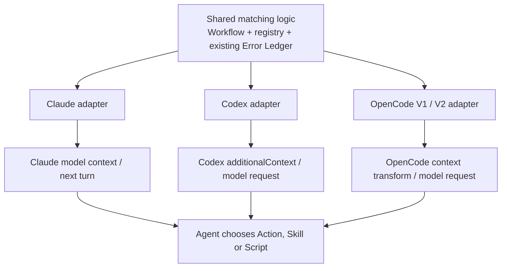
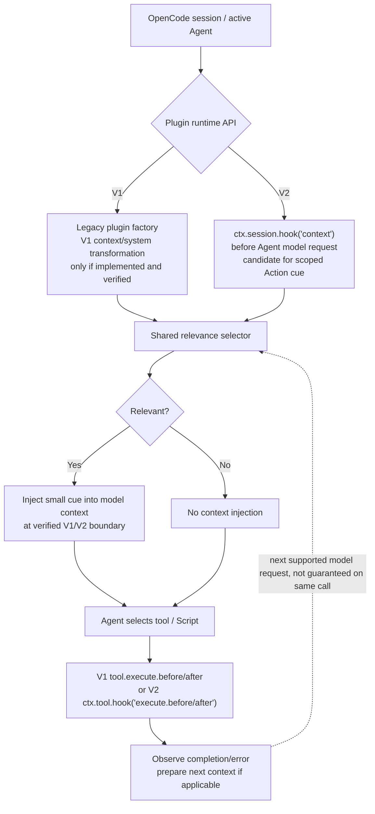

# Host Adapter Study — Claude Code, Codex CLI, OpenCode

> **Discussion-only host contract study for [#439](https://github.com/dyphn1/Harness-everything/issues/439).** [Back to the shared framework](./README.md). Native APIs, current repository wiring and real host receipt are separate dimensions. No claim that the design is installed or that any Host is fully verified. Names and timing refer to a specific Host/version; verify again when it changes.

## Host-neutral invariant, host-specific timing

The *shared selection decision* may be reusable: **given active workflow step + bounded evidence, which Action cue/Skill reference is relevant?** The **hook that discovers the information, the point at which the Agent can read it, the tool result shape and the adapter** are **not shared**.



**Critical rule:** A tool-selection-time hook cannot be casually called *pre-agent-action context*. The Agent may already have chosen the tool. A Hook return is only evidence of **delivery attempt** until an actual model-visible context capture establishes what the model received.

## 1. Claude Code — lifecycle command hooks

> **Owner closure, 2026-11-13:** This section remains a preliminary host map. The newer [Claude-specific closure](./claude-code.md) supersedes its simplified single-Agent recovery sequence: Main Agent suspects → independent Reviewer confirms/rejects → Main Agent L1 treats → direct fix OR scoped Avoid/workaround → independent verification or Unresolved. `PostToolBatch` is an additional documented before-next-model batch context candidate. No automatic Reviewer dispatch by Hook. **Timing discussion closed, host implementation unverified.**

```mermaid
sequenceDiagram
    autonumber
    participant U as Task / dispatch
    participant C as Claude native hooks
    participant R as Shared relevance selector
    participant M as Claude Agent
    participant T as Tool / Script
    U->>C: SessionStart or UserPromptSubmit
    C->>R: Workspace/step/marker
    alt Relevant record
      R-->>C: Compact lesson / Level 2 Action cue
      C-->>M: Supported model-visible hook context
    else No match / unavailable
      R-->>C: No cue (fail open)
    end
    M->>T: Selected operation
    opt PreToolUse for selected tool
      C->>R: Tool name, args, context
      Note over C,M: After selection; do not assume pre-call cue<br/>makes Agent replan the tool already chosen
    end
    alt Tool fails
      T-->>C: PostToolUseFailure / supported failure result
      C->>R: Failure signature / evidence
      C-->>M: Lesson on a supported subsequent model turn
    else Tool succeeds
      T-->>M: Ordinary result
    end
    M->>U: Continue Action, evidence or unresolved
```

| Responsibility | Candidate Host event / existing repo evidence | Boundary |
| --- | --- | --- |
| Initial cue | `SessionStart`, `UserPromptSubmit`; `hooks/hooks.json` already routes `UserPromptSubmit` through `harness-everything/scripts/kernel-router.js` | Router presence does **not** mean E-0002 lesson selection is implemented |
| Planned tool observation | `PreToolUse` with tool-name matcher | Tool is **already chosen**; may not change current call's decision context |
| Error observation | `PostToolUseFailure` where native Host exposes it; `PostToolUse` other results | Correct model-visible feedback timing and actual fields require capture |
| Child / continuation | `SubagentStart` or host-supported child context; compaction / session resume lifecycle | Parent cue receipt **does not prove** child receipt |

**Current repository constraint:** The Claude `hooks/hooks.json` still registers `rule-of-3.js` and `rule-of-3-tracker.js`. Those enforce obsolete count/lock behavior and conflict with the current #394 owner direction; **#394 owns retirement**. Do not represent them as a new Error Hook capability.

## 2. Codex CLI — config/plugin hooks and additionalContext

```mermaid
sequenceDiagram
    autonumber
    participant U as Task / dispatch
    participant C as Codex native hook + adapter
    participant R as Shared relevance selector
    participant M as Codex Agent
    participant T as Tool / Script
    U->>C: UserPromptSubmit (trusted hook)
    C->>R: Active step / explicit marker
    alt Match
      R-->>C: Action cue / supported Skill reference
      C-->>M: hookSpecificOutput.additionalContext
    else No match / not trusted
      R-->>C: Absent/unavailable; do not claim receipt
    end
    M->>T: Tool selected and invoked
    opt PreToolUse
      C->>R: Tool/arguments observation
      Note over C,M: This is after tool selection
    end
    T-->>C: PostToolUse result (including nonzero)
    C->>R: Match failure, if observable
    C-->>M: PostToolUse additionalContext at supported next model step
    opt SubagentStart
      C-->>M: Child-scoped context where supported
    end
    M->>U: Continue / correction / unresolved
```

| Responsibility | Candidate Host event / repo evidence | Boundary |
| --- | --- | --- |
| First cue | `UserPromptSubmit` + JSON `hookSpecificOutput.additionalContext` | **Correction (official spec, 2026-11-13):** plain stdout for `UserPromptSubmit` **is also added as extra developer context**; structured `hookSpecificOutput.additionalContext` is another supported form. Which output the current adapter produces and what the model actually receives remain unverified. See https://learn.chatgpt.com/docs/hooks |
| Child cue | `SubagentStart` additional context if that event is actually delivered | `SubagentStart` does not guarantee all nested contexts inherit prior instructions |
| Tool/failure observation | `PreToolUse`, `PostToolUse` | **No distinct `PostToolUseFailure`** documented for current Codex; parse nonzero/errors through `PostToolUse` |
| Model-request events | `PreModelRequest`, `PostModelRequest` | **Diagnostic-only** in current official docs: not a model-context injection surface |
| Host trust and installation | User config and packaged plugin hooks can co-exist; `plugins/harness-everything/hooks/hooks.json` contains candidate wiring | Non-managed hooks require review/trust; multiple matched hooks can run concurrently; packaged hook JSON is not live receipt |
| Tool coverage | Local tools, shell, many MCP tools can fire tool hooks | Hosted tools/specialized paths may bypass; **not** a complete security enforcement boundary |

**Current evidence limit:** `docs/platform-capabilities.md` and `docs/system-one-observations.md` record a **bounded Windows Codex user-hook live observation** for `UserPromptSubmit` / `Stop`, but not native packaged plugin E-0002 injection, every tool event or model-visible use of a lesson. A successful adapter test is not a Host/Agent proof.

## 3. OpenCode — V1 and V2 are different plugin contracts



| Responsibility | V1 path | V2 path / caveat |
| --- | --- | --- |
| Model-visible cue | `experimental.chat.system.transform` / related V1 transform **only when host/version supports and repo registers it** | `ctx.session.hook("context")` on Agent model requests, including tool continuations |
| Admission vs request | V1 `chat.message` / `chat.params` not necessarily request-every-time | V2 `ctx.session.hook("prompt")` is **prompt admission**, while `context` is **each relevant Agent model request**; not interchangeable |
| Tool observation | `tool.execute.before` / `tool.execute.after` | `ctx.tool.hook("execute.before/after")` with V2 event shape; including error status |
| Host integration | Legacy factory `HarnessEnforcement` | `opencode-plugin/index.mjs` currently provides `setup(ctx)` adapter for tool and event subscriptions but **does not register** `ctx.session.hook("context")` |
| Superseded behavior | Existing source has `reflectionPending`, reflection report and tool-edit refusal | V2 adapter forwards these V1-enforcement semantics; remove under #394 rather than reproducing them in a new context hook |
| Delivery mechanics | Do not use `session.prompt` to simulate a lesson when a context transformation is available | Do not call `ctx.session.prompt` merely to nudge; it can re-enter the Agent and differ from passive context disclosure |

**No forced V1→V2 equivalence.** The V2 migration guide explicitly distinguishes the prompt admission and pre-model-request context hook, and warns some V1 experimental hooks have no direct analogue. Host version, export shape, events, and Plugin load success must be recorded separately.

## Delivery status is multi-dimensional

| Evidence level | What it actually proves |
| --- | --- |
| **API documented** | Native event/field exists in the referenced Host documentation |
| **Repo wired** | Source file or plugin configuration registers a handler |
| **Mechanism verified** | Local deterministic adapter, selection and return-format tests pass |
| **Hook triggered on real Host** | Live Host executed that handler, including trust/installation/version |
| **Model-visible receipt** | Captured model input contains the selected context, on the intended Agent/child turn |
| **Agent used the guidance** | Tool/Skill/Script action is traceably linked to supplied cue |
| **Behavior improved** | Independent comparison across real tasks; not inferred from one clean report |

Never collapse these into one `PASS`. A tool hook firing alone does not establish the subsequent model read the lesson.

## Focused tests before deciding implementation

| Scenario | Claude Code | Codex CLI | OpenCode V1 / V2 |
| --- | --- | --- | --- |
| E-0002 report-required at task/model entry | Native model-visible `UserPromptSubmit` cue | Trusted `additionalContext` receipt | V1 context transform / V2 `context` receipt, separately |
| E-0002 reported after tool failure | PostToolUseFailure/available result → next Agent | PostToolUse nonzero → next Agent | Tool after/error → next model context |
| Unrelated task or no matching ledger | Quiet and fail-open | Quiet and fail-open | Quiet and fail-open |
| Missing ledger / bad registry path | No invented cue; no block | No invented cue; no block | No invented cue; no block |
| Compaction or session resume | Relevance restored only when needed | Retained state + trusted host event | Model request / session boundary behavior tested |
| Subagent handoff | Child receives relevant context, not assumed from parent | `SubagentStart` delivery to actual child | Verify child session/model request independently |
| Legacy Rule-of-3 retired | No counter, report lock, forced reflection | Same across plugin and user-hook routes | No `reflectionPending` editing denial |
| E-0002 script error | Agent receives nonzero diagnosis; remains unresolved if necessary | Same | Same |

**Not a test campaign in this branch:** these are proposed experimental questions for scoped implementation ownership #394/#402. No live-host command was run and no positive delivery claim is made.

## References

- [#439 — framework discussion](https://github.com/dyphn1/Harness-everything/issues/439)
- [#394 — hook implementation boundary](https://github.com/dyphn1/Harness-everything/issues/394)
- [Claude Code hooks](https://code.claude.com/docs/en/hooks)
- [Codex hook specification](https://learn.chatgpt.com/docs/hooks)
- [OpenCode V2 domain hooks](https://opencode.ai/docs/build/plugins/server/)
- [OpenCode V1 migration guide](https://opencode.ai/docs/build/plugins/migrate-v1)
- [Repo host evidence matrix](../../platform-capabilities.md)
