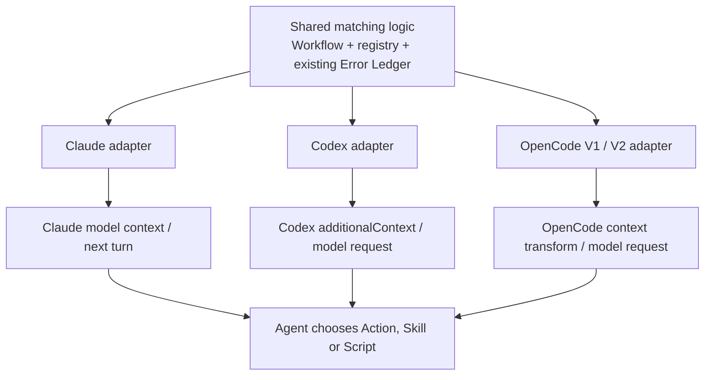
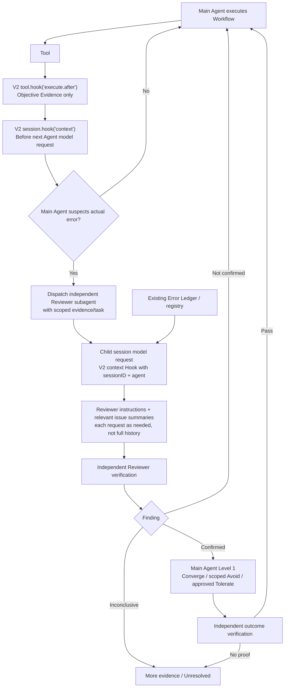

# Host Adapter Study — Claude Code, Codex CLI, OpenCode

> **Discussion-only host contract study for [#439](https://github.com/dyphn1/Harness-everything/issues/439).** [Back to the shared framework](./README.md). Native APIs, current repository wiring and real host receipt are separate dimensions. No claim that the design is installed or that any Host is fully verified. Names and timing refer to a specific Host/version; verify again when it changes.

## Host-neutral invariant, host-specific timing

The *shared selection decision* may be reusable: **given active workflow step + bounded evidence, which Action cue/Skill reference is relevant?** The **hook that discovers the information, the point at which the Agent can read it, the tool result shape and the adapter** are **not shared**.



**Critical rule:** A tool-selection-time hook cannot be casually called *pre-agent-action context*. The Agent may already have chosen the tool. A Hook return is only evidence of **delivery attempt** until an actual model-visible context capture establishes what the model received.

## 1. Claude Code — lifecycle command hooks

> **Owner closure, 2026-11-13:** This section remains a preliminary host map. The newer [Claude-specific closure](./claude-code.md) supersedes its simplified single-Agent recovery sequence: Main Agent suspects → independent Reviewer confirms/rejects → Main Agent L1 treats → direct fix OR scoped Avoid/workaround → independent verification or Unresolved. `PostToolBatch` is an additional documented before-next-model batch context candidate. No automatic Reviewer dispatch by Hook. **Timing discussion closed, host implementation unverified.**

```mermaid
sequenceDiagram
    autonumber
    participant U as Task / dispatch
    participant C as Claude native hooks
    participant R as Shared relevance selector
    participant M as Claude Agent
    participant T as Tool / Script
    U->>C: SessionStart or UserPromptSubmit
    C->>R: Workspace/step/marker
    alt Relevant record
      R-->>C: Compact lesson / Level 2 Action cue
      C-->>M: Supported model-visible hook context
    else No match / unavailable
      R-->>C: No cue (fail open)
    end
    M->>T: Selected operation
    opt PreToolUse for selected tool
      C->>R: Tool name, args, context
      Note over C,M: After selection; do not assume pre-call cue<br/>makes Agent replan the tool already chosen
    end
    alt Tool fails
      T-->>C: PostToolUseFailure / supported failure result
      C->>R: Failure signature / evidence
      C-->>M: Lesson on a supported subsequent model turn
    else Tool succeeds
      T-->>M: Ordinary result
    end
    M->>U: Continue Action, evidence or unresolved
```

| Responsibility | Candidate Host event / existing repo evidence | Boundary |
| --- | --- | --- |
| Initial cue | `SessionStart`, `UserPromptSubmit`; `hooks/hooks.json` already routes `UserPromptSubmit` through `harness-everything/scripts/kernel-router.js` | Router presence does **not** mean E-0002 lesson selection is implemented |
| Planned tool observation | `PreToolUse` with tool-name matcher | Tool is **already chosen**; may not change current call's decision context |
| Error observation | `PostToolUseFailure` where native Host exposes it; `PostToolUse` other results | Correct model-visible feedback timing and actual fields require capture |
| Child / continuation | `SubagentStart` or host-supported child context; compaction / session resume lifecycle | Parent cue receipt **does not prove** child receipt |

**Current repository constraint:** The Claude `hooks/hooks.json` still registers `rule-of-3.js` and `rule-of-3-tracker.js`. Those enforce obsolete count/lock behavior and conflict with the current #394 owner direction; **#394 owns retirement**. Do not represent them as a new Error Hook capability.

## 2. Codex CLI — evidence-only / Reviewer awareness (owner adjudication)

> **2026-11-13 design decisions:** [Authoritative Codex-specific draft and two diagrams](./codex.md). `PostToolUse` is **Evidence only**; `SubagentStart` provides Reviewer instructions, scoped case evidence and a related **historical issue summary/list**, never full remedies or a pre-certified verdict. Reviewer independent confirmation precedes Main Agent L1 treatment; Converge / scoped Avoid and Unresolved remain available. Native Hook contract is documented; actual installation/dispatch correlation/child receipt is unverified.

```mermaid
sequenceDiagram
    autonumber
    participant M as Codex Main Agent
    participant T as Tool
    participant H as Codex Hook adapter
    participant L as Existing Error Ledger
    participant R as Reviewer Subagent
    M->>T: Execute chosen tool
    T-->>H: PostToolUse (tool-specific result)
    H-->>M: Evidence only; no Error Class verdict
    M->>M: Suspected actual problem?
    opt Main Agent chooses to dispatch independent review
      M->>R: Review task and observed evidence
      R->>H: SubagentStart
      H->>L: Query only relevant known issues when scoped task reference is available
      L-->>H: IDs / titles / short descriptions / references
      H-->>R: Reviewer instructions + candidate issue index
      R-->>M: Confirmed / Not confirmed / Inconclusive + evidence
    end
    M->>M: On confirmed finding: L1 direct fix OR scoped Avoid OR Unresolved
```

| Responsibility | Official event contract | Boundary |
| --- | --- | --- |
| First entry / resume | `UserPromptSubmit` (plain stdout or structured developer context), `SessionStart` | Only small applicable reminders, not the full ledger |
| Failure/evidence | `PostToolUse` includes tool-specific input and response, including nonzero shell results; **plain stdout ignored**, JSON `hookSpecificOutput.additionalContext` supported | Evidence-only and no hook-side diagnosis, `decision: "block"` or result replacement; tool response does not have a universal exit status field |
| Independent Reviewer | `SubagentStart` supports child developer context; `matcher` uses `agent_type` | **No native task/problem ID field in the Hook input**; a trustworthy existing scoped dispatch packet/context is needed for relevant ledger selection. Without it, emit generic reviewer guidance, not fabricated matches |
| Model request | `PreModelRequest`, `PostModelRequest` | Diagnostic-only, not context injection |
| Trust and coverage | Repo/user/plugin hook sources may co-exist; supports many local tools | Trust and actual model/child receipt need real host capture; hosted tools can bypass the tool Hook path |

**Status:** Codex logical payload split and progressive-disclosure decision are recorded; implemented delivery and independent Reviewer outcomes remain **UNTESTED**. Current repo hook wiring is not proof of receipt. Reference: https://learn.chatgpt.com/docs/hooks.

## 3. OpenCode V2 — current target; V1 legacy maintenance only

> **2026-11-13:** [Authoritative OpenCode V2 draft with Mermaid timing/Context diagrams](./opencode-v2.md). V1 receives critical fixes only per OpenCode maintainers; no V1 new Error Hook feature or parity gate. Keep legacy code compatibility notes and migration hazards in the existing repository. **Host timing is documented; V2 integration and child receipt are not live-verified.**



| Responsibility | Official V2 Host contract | Design boundary |
| --- | --- | --- |
| Observe Tool outcome | `ctx.tool.hook("execute.after")` receives `status: "completed" | "error"`, plus result or error | Evidence only: completed Tool ≠ verified task PASS. Never replace result or decide Error Class |
| Model-visible context | `ctx.session.hook("context")` before **each Agent loop request**, including tool continuations; `event.system` is mutable | **Request-scoped, not persistent.** Send necessary small context per relevant request; dedup only within the current assembled request |
| Reviewer-specific instruction | Hook exposes `sessionID`, `agent`, `messages` with stored metadata | Native event does not guarantee access to full child dispatch packet/features. Match only trustworthy scoped references; otherwise generic Reviewer guidance |
| Prompt/fork/compaction | Distinct `prompt`, `fork`, `compaction` lifecycle events | Do not treat fork/prompt as native SubagentStart. `context` does not cover auxiliary compaction/generate/title calls |
| Optional session-keyed instruction | `ctx.session.instructions.entry` API | Possible update-on-change optimization; **different from** request-scoped `context` Hook, not required now |
| Future System One | Feature scoring can rank Context candidates / abstain | Future only, deterministic fallback; never overrides Reviewer verdict / Kernel contract |
| Current repo | V2 `setup(ctx)` adapter registers tool hooks + event subscription | No `ctx.session.hook("context")` registration yet; old forced-reflection behavior carried through V2 adapter requires separate #394 retirement |

**V1 evidence:** legacy `HarnessEnforcement` factory/Hook map remains as a source/compatibility concern; V2 `setup(ctx)` is not an automatic alias. Official [Plugin migration guide](https://opencode.ai/docs/build/plugins/migrate-v1), [V2 server Hook reference](https://opencode.ai/docs/build/plugins/server/), and [maintainer critical-only statement](https://github.com/anomalyco/opencode/issues/47018).

## Delivery status is multi-dimensional

| Evidence level | What it actually proves |
| --- | --- |
| **API documented** | Native event/field exists in the referenced Host documentation |
| **Repo wired** | Source file or plugin configuration registers a handler |
| **Mechanism verified** | Local deterministic adapter, selection and return-format tests pass |
| **Hook triggered on real Host** | Live Host executed that handler, including trust/installation/version |
| **Model-visible receipt** | Captured model input contains the selected context, on the intended Agent/child turn |
| **Agent used the guidance** | Tool/Skill/Script action is traceably linked to supplied cue |
| **Behavior improved** | Independent comparison across real tasks; not inferred from one clean report |

Never collapse these into one `PASS`. A tool hook firing alone does not establish the subsequent model read the lesson.

## Focused tests before deciding implementation

| Scenario | Claude Code | Codex CLI | OpenCode V1 / V2 |
| --- | --- | --- | --- |
| E-0002 report-required at task/model entry | Native model-visible `UserPromptSubmit` cue | Trusted `additionalContext` receipt | V1 context transform / V2 `context` receipt, separately |
| E-0002 reported after tool failure | PostToolUseFailure/available result → next Agent | PostToolUse nonzero → next Agent | Tool after/error → next model context |
| Unrelated task or no matching ledger | Quiet and fail-open | Quiet and fail-open | Quiet and fail-open |
| Missing ledger / bad registry path | No invented cue; no block | No invented cue; no block | No invented cue; no block |
| Compaction or session resume | Relevance restored only when needed | Retained state + trusted host event | Model request / session boundary behavior tested |
| Subagent handoff | Child receives relevant context, not assumed from parent | `SubagentStart` delivery to actual child | Verify child session/model request independently |
| Legacy Rule-of-3 retired | No counter, report lock, forced reflection | Same across plugin and user-hook routes | No `reflectionPending` editing denial |
| E-0002 script error | Agent receives nonzero diagnosis; remains unresolved if necessary | Same | Same |

**Not a test campaign in this branch:** these are proposed experimental questions for scoped implementation ownership #394/#402. No live-host command was run and no positive delivery claim is made.

## References

- [#439 — framework discussion](https://github.com/dyphn1/Harness-everything/issues/439)
- [#394 — hook implementation boundary](https://github.com/dyphn1/Harness-everything/issues/394)
- [Claude Code hooks](https://code.claude.com/docs/en/hooks)
- [Codex hook specification](https://learn.chatgpt.com/docs/hooks)
- [OpenCode V2 domain hooks](https://opencode.ai/docs/build/plugins/server/)
- [OpenCode V1 migration guide](https://opencode.ai/docs/build/plugins/migrate-v1)
- [Repo host evidence matrix](../../platform-capabilities.md)
