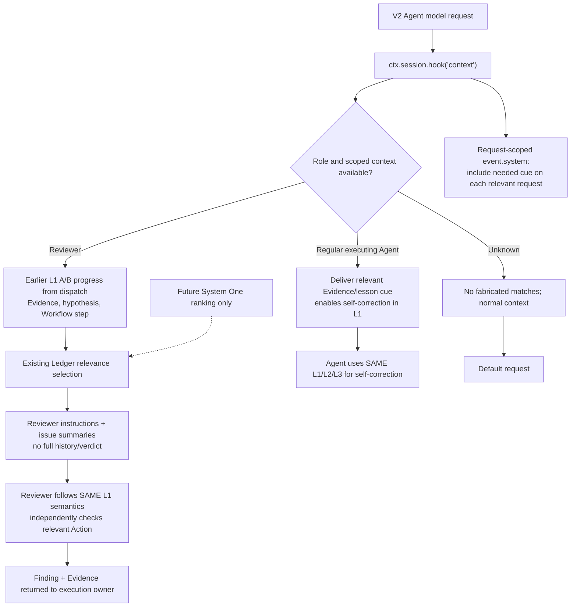

# OpenCode V2 Error Hook — Evidence, model-request Context and independent Reviewer

> **#439 owner-aligned architecture draft (2026-11-13). OpenCode V2-only for new Error Hook capability; no runtime deployment or live-host PASS.** The Claude and Codex design decisions remain applicable. Read [#439](https://github.com/dyphn1/Harness-everything/issues/439), [shared framework](./README.md), [Claude closure](./claude-code.md), [Codex closure](./codex.md). Runtime/legacy Rule-of-3 retirement is owned by [#394](https://github.com/dyphn1/Harness-everything/issues/394).

## Scope / support version decision

OpenCode V1 is in **critical-fix-only** maintenance (security, data loss and severe crashes without workaround) according to the maintainers' public response to [#47018](https://github.com/anomalyco/opencode/issues/47018). New #439 implementation and acceptance target **V2 only**. Do **not** delete existing V1 support or change its behavior incidentally in this discussion. Track pre-existing compatibility/retirement separately; no V1 feature parity gate. V2 `setup(ctx)` must register domain hooks and is not a transparent alias for V1's returned hook map. Sources:
- [OpenCode V2 Plugin Server Hooks reference](https://opencode.ai/docs/build/plugins/server/)
- [Migrate plugins from V1](https://opencode.ai/docs/build/plugins/migrate-v1)
- [Maintainer V1 maintenance scope](https://github.com/anomalyco/opencode/issues/47018)

## Decision: two principal V2 Hook surfaces

| Event | Actual documented lifecycle | #439 responsibility | Constraint |
| --- | --- | --- | --- |
| `ctx.tool.hook("execute.after", ...)` | After each supported tool completion or failure; `status === "completed"` has `result`, `status === "error"` has `error` | **Evidence only** — observe objective outputs and error status; do not declare current Error Class or dispatch a Reviewer | Tool status "completed" does **not** prove task success / test PASS; tool outcome and actual command exit details must be interpreted from the result if provided. No result mutation/replacement in the Error Hook |
| `ctx.session.hook("context", ...)` | Immediately **before each Agent-loop model request**, including tool-continuation requests | **Role/step-scoped Reviewer instructions + case evidence references + related known issue summaries** (ID, title, short description/reference); minimal useful Main Agent context when relevant | Changes to `event.system` affect **only that model request**, not persistent history. If necessary, include essential reminders on **every relevant request**; never infer durable delivery from one prior call |
| `ctx.session.hook("prompt", ...)` | Once before admission of an incoming prompt, not each model request | Optional place to recognize bounded dispatch features/metadata if actually available | No assumption that every subagent creation flows through this surface. Prompt metadata is not automatically model-visible |
| `ctx.session.hook("compaction", ...)` | Before a compaction model request | Optional continuity check / mechanism verification | The agent-loop `context` Hook does not cover compaction or `generate`/`title`. No blanket hook needed without demonstrated need |
| `ctx.session.hook("fork", ...)` | After copying session history, before fork returns | Optional correlation only if fork is actually used | A fork is **not necessarily the native subagent** lifecycle |
| `ctx.session.instructions.entry.put/list/remove` | API for keyed session instruction entries, rendered at session step boundary | Optional **later** optimization to update role/step instructions only when they change | This is a session instruction mechanism, **not** the same as the request-scoped `context` Hook. Do not add storage/mutation by default |

**Important correction to an earlier draft suggestion:** "invoke context on every request, but inject only when the information changed" is **incorrect** when using request-scoped `event.system`. Unchanged required guidance may need to be sent on the next Agent model request too. Instead: **evaluate on every relevant request, construct a small stable cue once per request, do not duplicate within that same request**. If request-to-request repetition is expensive, consider a separately tested *keyed session instruction* strategy, not pretending that a prior `event.system.push` survives.

## Main Agent / Reviewer timing diagram

```mermaid
sequenceDiagram
  autonumber
  participant X as Executing Agent
  participant T as V2 Tool
  participant AH as execute.after
  participant CH as context
  participant M as Main Agent
  participant R as Reviewer child
  participant L as Existing Error Ledger
  X->>T: Execute Workflow step
  T-->>AH: completed(result) or error(error)
  AH-->>X: Evidence only
  X->>CH: Next model request
  CH-->>X: Request-scoped relevant guidance
  X->>X: Error observed → L1 A Capture + B Triage
  alt Executing Agent recognizes own error
    X->>X: Self-correct through SAME L1/L2/L3
    X->>X: Local E Treat correction; F Deliver → G Accept
  else Main requests independent investigation
    X-->>M: Raw Evidence + earlier L1 Action progress
    M->>R: Dispatch hypothesis + prior context + scope
    R->>CH: Reviewer model request (sessionID/agent)
    CH->>L: Lookup task-relevant historical issue summaries
    L-->>CH: Issue IDs / titles / descriptions / refs
    CH-->>R: Bounded request-scoped Reviewer context
    R->>R: Resume SAME L1 Action flow; independently verify
    R-->>M: Confirmed / Not confirmed / Inconclusive + Evidence
    M-->>X: Finding and updated context
    X->>X: Continue same occurrence as warranted
  end
```

**The above is logical order, not an automatic event-to-child mapping.** OpenCode V2's native `subagent` tool creates a child session using an agent ID, description and complete prompt; the parent obtains a child `sessionID`. Verify that `event.agent` matches the chosen reviewer agent definition, and whether dispatch features (or trustworthy task-scoped references) reach the child context. No unverified assumption that `fork`, the prompt hook or `setup(ctx)` automatically provide a complete Reviewer dispatch packet.

## Context selection and information boundary



### Dispatch/context features

An illustrative **feature envelope** may include `role`, `intent`, `workflowStep`, `errorCandidates` (hypotheses only), `evidenceRefs`, `constraints` and an opaque task-scoped correlation key. **None is guaranteed by native `context` event alone.**

V2 `context` provides `sessionID`, `agent`, `messages`, `system`, `tools`, `model`, `options`. Stored message `metadata` can be read in request Hooks but is **not model-visible by itself**. `prompt` can add admission `metadata` to incoming prompts, but whether/how the subagent dispatch populates such data must be tested on the real Host. Do not scan arbitrary prompt text, guess based on worktree, or read a global current-Agent variable to infer which child is being reviewed.

**Role and record trust**: only attach summaries from the approved local existing Error Ledger/registry, respecting task relevance and source validity. Historical issues are **candidate tests** for the reviewer and must never be copied as a pre-determined current finding. Do not leak unrelated project/session data across concurrent children.

### No repeated context inflation

- The `context` Hook runs per relevant model request. It can use a bounded, deterministic selector; no extra inference is necessary for the first slice.
- A fresh request-scoped `event.system.push(...)` is not, by itself, duplicate accumulation across prior requests; it is a new outgoing request. Avoid adding the same text twice **within one request** if several hooks/plugins or existing instructions already provide it.
- Prefer compact task-relevant summaries and an on-demand L2/L3 reference over full historical resolution. **Do not omit necessary content solely because it was delivered on the previous request.**
- If the initial main task/dispatch already supplies the same reviewer instructions, avoid redundant injection based on **observable current request**. Changes made by different plugins run in registration order, so duplicate detection should be limited to text/markers actually visible on the current request, not assumed hidden state.
- A future variant may use `ctx.session.instructions.entry` with a stable scoped key and only update/remove on task/role changes, but must prove correct lifecycle, independent child scope, cleanup, compaction/resume, concurrency and no stale instructions. No new second Error Ledger.

### Evidence → treatment boundary

- `execute.after` gives **evidence**; status `error` is an execution failure signal, not proof of an Error Occurrence. Status `completed` can still include a test failure, policy failure or invalid report — A Main-dispatched Reviewer remains responsible for independent findings; the executing Agent may still self-correct from objective evidence without a compulsory review.
- After a problem is observed, Main Agent preserves Evidence at **Level 1 A Capture** and, during **B Triage**, dispatches Reviewer unless an approved Tolerate route applies. Reviewer independently confirms/rejects/inconclusive; on confirmation the Main Agent continues the **same Level 1 activity at C Identify** and loads L2/L3 only when needed.
- If direct correction is infeasible, **Avoid** adjusts only the affected Workflow segment, retains original objectives and mandatory checks; independently verify. Approved **Tolerate** is a distinct L1 case. Otherwise remain **Unresolved**; no fabricated PASS.
- Error Hook must **not** use V2 `execute.before` to block edits, alter `event.tools` permissions, synthesize extra prompts via `ctx.session.prompt`, run a forced review, force Zoom-out, count failures or reintroduce `reflectionPending` / lock. #394 owns retirement of obsolete Rule-of-3 paths.
- If Hooks are absent, fail-open **advisory** context only; do not mark required verification/authorization as passed.

## Current Harness repo assessment (not implementation)

In [`opencode-plugin/index.mjs`](https://github.com/dyphn1/Harness-everything/blob/main/opencode-plugin/index.mjs), an existing V2 default export `{ id: "harness.enforcement", async setup(ctx) }` adapts the legacy `HarnessEnforcement` factory. It registers `ctx.tool.hook("execute.before")` and `ctx.tool.hook("execute.after")`, plus `ctx.event.subscribe`. It **does not register** `ctx.session.hook("context")`. Some legacy `reflectionPending`/forced verification/stop behavior remains inside the shared factory and can be exposed through V2; **#394 owns its replacement/removal**, not this draft.

Do **not** interpret a V2 wrapper over a legacy Hook as verified new Error Hook behavior; V1 and V2 differ in event shapes, error statuses, request scopes and session semantics.

## Targeted tests (later, under #394)

| Test | Required evidence |
| --- | --- |
| Supported tool succeeds vs errors | `execute.after` sees documented `completed`/`error` structure; delivers only objective evidence, not verdict |
| Tool completed but command/test failed | Return field inspection does not equate `completed` with PASS |
| Reviewer first model request | `context` sees expected `sessionID`/`agent`; child sees reviewer instructions + relevant historical issue list with evidence references |
| Reviewer subsequent request / tool continuation | Essential request-scoped cue remains available when relevant, despite no change in underlying issue list |
| Non-reviewer agent / unrelated step | Silent or only step-relevant context; no full-ledger flood |
| Multiple plugins, repeated request, compaction | No duplicate within same request; no accidental persistence or loss of necessary instructions |
| Parallel Reviewer children | Each gets the correct task evidence and issue candidates; no global state leakage |
| Incomplete/missing child feature packet | Fail-open to general reviewer guidance, no fabricated ledger matches |
| Reviewer rejects historic hypothesis | `Not confirmed` allowed with counterevidence; no Hook-forced class |
| Unsolvable error / alternative action | Scoped Avoid then independent verification; or Unresolved without false success |
| Model scoring unavailable | Deterministic selection works without System One; do not fail the task because model unavailable |

**Status:** V2 event choice is **architecture-ready, draft**, official event timing verified in docs; V1 is excluded from new feature scope; actual dispatch correlation, Hook registration, model-visible receipt, child independence, outcomes and performance remain **UNVERIFIED**. No implementation is claimed. Scope any future runtime work under #394 and evaluate before promotion.
