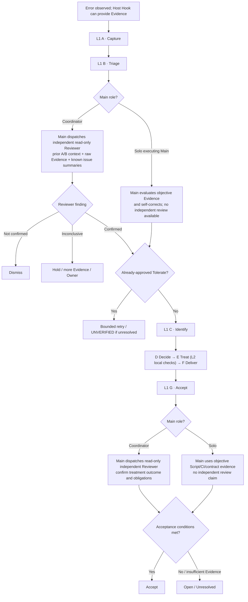

# Error Handling semantic audit — 2026-11-13

> **Review artifact, not a new controller/contract.** Compares [#437 Level 1 discussion branch](https://github.com/dyphn1/Harness-everything/blob/discussion/437-e0002-capture-level2/docs/discussions/error-handling/README.md), [#437 original issue](https://github.com/dyphn1/Harness-everything/issues/437), and [#439 host discussion](https://github.com/dyphn1/Harness-everything/issues/439). Only **unambiguous wording/diagram errors** are fixed under #439. Decision questions below require owner confirmation; this document does **not** revise #437 Action authority.

## Readable semantics — one L1/2/3, two operating situations

**Solo executing Main self-corrects:** if Main is working alone without an independent Reviewer, it can recognize errors from observed or Hook-delivered Evidence and use the existing L1 A–G Actions with on-demand L2/3. Objective checks are mandatory, and Main does not claim independent Reviewer acceptance. Mechanical/contract checks still require objective evidence. An already owner-approved Tolerate class uses the existing B Triage bounded route.

**Coordinator Main MUST dispatch independent Reviewer:** in delegated execution Main sends the **available previous Action state, original Evidence, active Workflow step, hypothesis and relevant known issue summaries**. Reviewer uses the **same L1 Action semantics**, independently re-checks evidence and resumes at the applicable Action. This is a context/role handoff, **not a second error occurrence or a separate Review/Error Handling controller**. Reviewer findings can be Confirmed / Not confirmed / Inconclusive; the exact authorization to execute treatment and final acceptance remains an owner question below.

**Treat-level retries:** one correction/recheck within the same E Treat behavior block does not start another L1 invocation; subsequent genuinely independent errors/recurrences do, at A. Do not add a G→D/G→A loop to Level 1.

The drawing is intentionally **simplified**. Nonblocking **Defer**, unidentified **Hold**, Converge / scoped Avoid / approved Tolerate outcomes, and genuine L2 localized correction are governed by #437; a simplified participation diagram must not override those guards.

## Clear wording corrections, not new architectural decisions

| Prior ambiguous shorthand | Correct interpretation |
| --- | --- |
| "Reviewer-gated Error Handling" | Reviewer is **mandatory when Main is a Coordinator**, and unavailable in Solo Main self-correction. The guard is part of the existing L1 B Triage, not a new Action |
| "Confirmed → start Level 1" | Evidence is first Captured; the **same** L1 Action state is passed along; confirmed Reviewer findings resume at the applicable Action |
| "Every repair/workaround requires independent verification" | **Coordinator must arrange independent read-only Reviewer outcome verification at G**; Solo Main must use objective acceptance checks and cannot claim independent review |
| "Main Agent receives every Tool failure" | The **executing Agent** receives the observable Host Tool result/context when its Host supports delivery; it may be Main or a child. Main dispatches Reviewers when warranted |
| "Only inject when the context changed" (OpenCode V2) | Context Hook modifies the **current model request**; include still-relevant guidance per request and dedup **within** that request |
| "#437 G loops to D on recurrence" (historic issue body) | Updated #437 draft distinguishes **new later Occurrence at A** from same-Treat local correction; no G→D or G→A edge |
| "Codex UserPromptSubmit stdout is ignored" (historic #439 comparison) | That statement is stale for `UserPromptSubmit`; unlike Codex `PostToolUse`, plain stdout may become developer context in the documented current contract |
| "OpenCode V1/V2 new feature parity" | #439 new Error Hook target is **V2**; V1 is a legacy critical-maintenance compatibility concern only |

## Resolved owner decisions — Q1/Q2/Q3 (2026-11-13)

**Q1 — Mode-based, not Error-Class-based Reviewer requirement.** If Main Agent is **Coordinator** supervising delegated execution, it **must dispatch independent Reviewer** to inspect error Evidence before carrying out the L1 treatment path. If Main is **the only executing Agent** (no independent Reviewer available), it may recognize and self-correct errors using Hook cues and objective Evidence. Both use the **same** existing Level 1 A–G Actions. Existing preapproved Tolerate bounded retry remains, after the Coordinator Reviewer check where applicable. [#437 L1 draft](https://github.com/dyphn1/Harness-everything/blob/discussion/437-e0002-capture-level2/docs/discussions/error-handling/README.md) now shows this role split.

**Q2 — Reviewer default is read-only.** Reviewer uses prior Action context and original Evidence to independently investigate, returning Findings and checks. It **does not modify source, own Treat, or perform direct corrections by default**. Even tiny/obvious errors are not a standing permission exception. A future class-specific correction delegation needs **separate explicit owner approval**, not merely an L1/Hook branch.

**Q3 — Coordinator also needs independent outcome verification.** After the Worker/assigned executor corrects a problem, **Main Coordinator dispatches a read-only Reviewer** to verify the treatment outcome/required task invariants before G Accept. Solo executing Main uses required Script/CI/contract checks, discloses independent Review was unavailable, and cannot manufacture independent PASS. Unverified work remains open/unresolved.

These are **resolved design choices**, not pending questions. #437's seven Action identities, Level 2 local correction vs. new Occurrence and immutable approval/permission checks remain unchanged.

## Source-status warning

The **#437 original issue body** is a historical discussion snapshot containing a G→D recurrence loop; the **updated #437 branch** now also includes the owner-adjudicated Coordinator/Solo Reviewer and G-Accept branch. Treat the old issue diagram as historical, not as the current executable graph.

## Verification scope

This review checks **diagram/wording consistency** only. No live Claude, Codex or OpenCode session was run, no Hook context receipt/Reviewer isolation was proven, and no Error Ledger, runtime, #437 Action diagram or user approval contract was modified. Evidence of functional effectiveness still belongs to #394 + the full Error Handling integration.
