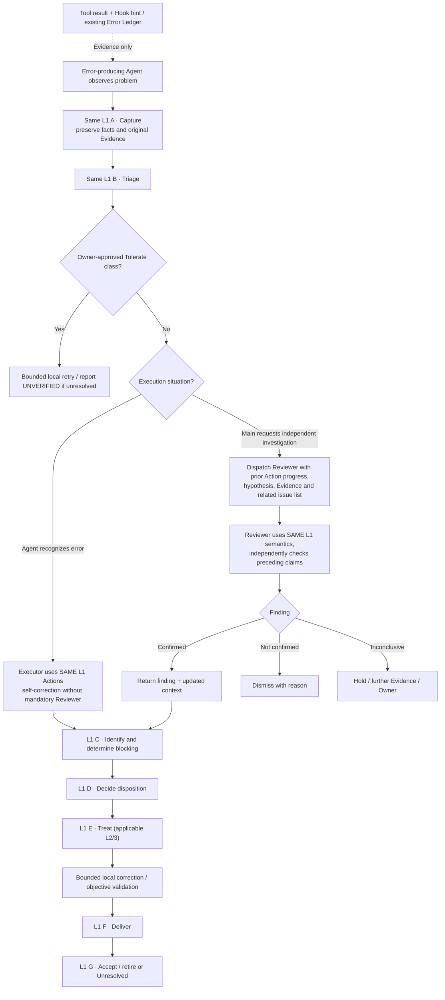

# Error Handling semantic audit — 2026-11-13

> **Review artifact, not a new controller/contract.** Compares [#437 Level 1 discussion branch](https://github.com/dyphn1/Harness-everything/blob/discussion/437-e0002-capture-level2/docs/discussions/error-handling/README.md), [#437 original issue](https://github.com/dyphn1/Harness-everything/issues/437), and [#439 host discussion](https://github.com/dyphn1/Harness-everything/issues/439). Only **unambiguous wording/diagram errors** are fixed under #439. Decision questions below require owner confirmation; this document does **not** revise #437 Action authority.

## Readable semantics — one L1/2/3, two operating situations

**Executing Agent self-corrects:** a real observable error, or a Hook-delivered observation/context reminder, can make the executing Agent recognize a mistake. It applies the **existing** A Capture → B Triage → C Identify → D Decide → E Treat → F Deliver → G Accept flow, selecting L2/3 on demand. No automatic Reviewer is created and no independent-review verdict can be claimed solely from self-correction. Mechanical/contract checks still require objective evidence. An already owner-approved Tolerate class uses the existing B Triage bounded route.

**Main requests an independent Reviewer:** Main finds a questionable outcome and delegates with the **available previous Action state, original Evidence, active Workflow step, hypothesis and relevant known issue summaries**. Reviewer uses the **same L1 Action semantics**, independently re-checks evidence and resumes at the applicable Action. This is a context/role handoff, **not a second error occurrence or a separate Review/Error Handling controller**. Reviewer findings can be Confirmed / Not confirmed / Inconclusive; the exact authorization to execute treatment and final acceptance remains an owner question below.

**Treat-level retries:** one correction/recheck within the same E Treat behavior block does not start another L1 invocation; subsequent genuinely independent errors/recurrences do, at A. Do not add a G→D/G→A loop to Level 1.

The drawing is intentionally **simplified**. Nonblocking **Defer**, unidentified **Hold**, Converge / scoped Avoid / approved Tolerate outcomes, and genuine L2 localized correction are governed by #437; a simplified participation diagram must not override those guards.

## Clear wording corrections, not new architectural decisions

| Prior ambiguous shorthand | Correct interpretation |
| --- | --- |
| "Reviewer-gated Error Handling" | Reviewer is a **conditional independent investigation**, not a universal front door |
| "Confirmed → start Level 1" | Evidence is first Captured; the **same** L1 Action state is passed along; confirmed Reviewer findings resume at the applicable Action |
| "Every repair/workaround requires independent verification" | Every required result needs **objective acceptance evidence**; an independent Reviewer is used when the agreed review contract/task calls for one. Do not call self-check an independent review |
| "Main Agent receives every Tool failure" | The **executing Agent** receives the observable Host Tool result/context when its Host supports delivery; it may be Main or a child. Main dispatches Reviewers when warranted |
| "Only inject when the context changed" (OpenCode V2) | Context Hook modifies the **current model request**; include still-relevant guidance per request and dedup **within** that request |
| "#437 G loops to D on recurrence" (historic issue body) | Updated #437 draft distinguishes **new later Occurrence at A** from same-Treat local correction; no G→D or G→A edge |
| "Codex UserPromptSubmit stdout is ignored" (historic #439 comparison) | That statement is stale for `UserPromptSubmit`; unlike Codex `PostToolUse`, plain stdout may become developer context in the documented current contract |
| "OpenCode V1/V2 new feature parity" | #439 new Error Hook target is **V2**; V1 is a legacy critical-maintenance compatibility concern only |

## Actual questions for owner confirmation (do not silently change #437)

### Q1 — Triage's `Real problem? (reviewer)` guard vs autonomous self-correction

In the [current #437 Level 1 Activity draft](https://github.com/dyphn1/Harness-everything/blob/discussion/437-e0002-capture-level2/docs/discussions/error-handling/README.md), **non-Tolerate B Triage** explicitly labels the `Real problem?` decision as `(reviewer)`. Yet the current #439 owner clarification permits the error-producing Agent to recognize and correct its own error based on Hook Evidence **without mandatory Reviewer dispatch**.

**Decision required:** Should the #437 Triage branch be refined to allow **executing-Agent evidence-based recognition**, with *independent Reviewer adjudication only when Main dispatches*, while keeping the seven Action identities and all other guards unchanged? Or does an already-defined narrower category still require Reviewer every time?

This is **cross-document authority conflict**, not proof of a missing eighth Action. **Do not modify the #437 Level 1 guards until owner decides.**

### Q2 — What may an independent Reviewer do after it resumes the same Action flow?

Latest owner direction says Reviewer uses **the same Error Handling workflow**, with previously completed Context. Current #439 prose tends to describe Reviewer as **read-only investigation returning a finding**, then responsible Agent applies Treat and Accept. These are not necessarily equivalent to a Reviewer executing **D/E/F/G** on its own.

**Decision required:** Is Reviewer generally **investigation/findings-only**, or may a dispatched Reviewer also perform *bounded corrective Actions* when expressly delegated? If it may modify, independent **acceptance** must not be claimed merely because that same Reviewer applied the fix. Keep existing permissions/owner-authorized scope.

### Q3 — Acceptance authority after successful self-correction

"Agent can self-correct" and "do not be player and referee" are compatible if we distinguish **mechanical/objective checks** from **independent judgment of disputed semantic truth**. Current docs still mix those terms.

**Decision required:** For ordinary self-correction, is a **successful deterministic Script/CI/contract result plus existing evidence** sufficient for Level 1 G Accept, with independent Reviewer reserved for disputed/high-risk findings or explicitly review-required work? Or should an independent Reviewer still be required in another defined subset?

Do not add a universal Reviewer gate or silently weaken already-required review/permission checks.

## Source-status warning

The **#437 original issue body** is a historical discussion snapshot. It includes a G→D recurrence loop and original one-diagram-per-action rules, whereas the **updated #437 branch** uses the three-view Level 1 draft, magnified behavior blocks and new-occurrence boundaries. Preserve historical decisions but mark that issue-body snapshot **superseded** where contradicted, so Agents do not treat the old issue content as the current executable graph.

## Verification scope

This review checks **diagram/wording consistency** only. No live Claude, Codex or OpenCode session was run, no Hook context receipt/Reviewer isolation was proven, and no Error Ledger, runtime, #437 Action diagram or user approval contract was modified. Evidence of functional effectiveness still belongs to #394 + the full Error Handling integration.
