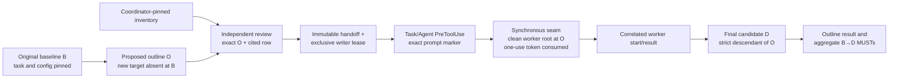

# Document workflow reconciliation — Phase 3b S1 runtime

**Status: the runtime ships default OFF; opt in with `HARNESS_DOC_RECONCILIATION_PILOT=1`.
With the pilot ON, F4 ([#358](https://github.com/dyphn1/Harness-everything/pull/358)) grants limited positive credit for exactly `doc-lint` and `link-check`, from a host-captured run of the installed doc-check on Claude Code 2.1.309 (live runs 4–5). S3 provider integration is pending; E1 remains OPEN with insufficient qualifying exposure. The recorded OpenCode [D1/D2 attempts](../benchmarks/results/live-host/opencode-d1-d2-2026-10-25/README.md) do not qualify as E1 cycles.**
This document refines the [document lifecycle contract](document-lifecycle.md#phase-3b--narrow-integration-contract-s1-default-off-f4-limited-credit).
The [accepted E0](https://github.com/dyphn1/Harness-everything/issues/341#issuecomment-6308604128)
permits this limited, reversible consumer under the
[owner's E0/E1 decision](https://github.com/dyphn1/Harness-everything/issues/325#issuecomment-6283237637).
Current evidence establishes deterministic mechanism/package behavior and bounded Claude Code 2.1.309 live credit runs; it is not E1 GO.

## Entry gates and ownership

| Gate | Permitted scope |
| --- | --- |
| Preparation, before E0 | This design, provider/trust data contracts, RED fixtures and legacy compatibility controls |
| Accepted #341 E0 | Limited, opt-in, reversible consumer on the existing non-Fable typed workflow path, including the minimum trusted producer |
| #341 E1 GO | Expansion beyond that limited consumer, after sufficient genuine development/review exposure; initial target 2–3 cycles is not a time-only gate |
| #325 H1–H4 and paired-task architectural evidence | Inputs to separately owner-approved #320 promotion; neither E0 nor E1 alone approves a registry/CDG |

Shared read/binding/decision defects return to #341 with fixture-first correction and affected
re-observation. Documentation policy and host/VCS provenance belong to #325. The existing
checker API and result schema remain unchanged. This consumer adds no router, provider requirement,
automatic step insertion, tool/Stop lock, generator execution during discovery, or auto-commit.

## Existing seams and planned credit order

These source anchors describe the preparation baseline, `dba470813cb383945d405686cc6a65bd969b57ec`.
They are source-traced behavior, not live-host evidence.

| Boundary | Current implementation | Post-E0 integration requirement |
| --- | --- | --- |
| Authored step | `hooks/scripts/lib/workflow-obligations.js:updateStep()` (lines 617–645) validates active step/bindings and text, then persists pass | An authored `doc-change` step MAY advance under this existing contract; that grants no verified document-MUST credit |
| Aggregate derivation | `syncTypedAggregateObligations()` (586–614) derives execute/verify from step statuses | Authored execute may reflect completed authored steps; verification PASS requires current document reconciliation |
| Verification write | `hooks/scripts/workflow-disposition.js:279–296` delegates to `updateStep()` | After existing authorization/binding checks, reconcile before writing verification-step or aggregate verify PASS |
| Direct aggregate write | `updateObligation()` (520–537) accepts nonempty evidence text and persists disposition | Guard direct `obligation execute\|verify --disposition pass` on doc-governed typed scope; text cannot bypass derived/reconciled evidence |
| Unresolved calculation | `unresolvedObligations()` (648–682) checks generic obligations and active bindings | Include missing/unknown/unavailable/failed document evidence and current identity freshness |
| Final completion | `hooks/scripts/workflow-stop-gate.js:36–64` calls unresolved calculation before writing `state = 'satisfied'` | Recollect identities and reconcile immediately before completion credit, including already-persisted PASS |

An ordered `doc-change → review → verification` remains reachable. Authored work does not need
to invent evidence that a later reviewer or authorized verification will produce. At verification,
missing evidence leaves verification unresolved; later valid evidence permits a retry. A direct
aggregate PASS attempt with unsatisfied document MUSTs MUST be rejected or ignored, including
`execute` as well as `verify`; this does not prohibit internally derived authored execute status.

Scope comes from trusted task/config/diff facts. Existing typed plans that acquire doc-governed
scope MUST be checked against that current scope; their old aggregate PASS is not completion
proof. Omitting a document result or authored step cannot erase a diff-derived expected MUST.
Non-document typed plans retain existing bindings, authorization and disposition behavior.

Supported reconciliation requires `stepBindingsEnabled === true` and a non-Fable strategy.
Fable stage paths (`fable-staged`, `fable-parallel`, `fable-multi-agent-workspace`) and untyped
workflows are explicitly unavailable for pilot credit. Loaded stage bindings are not document
verification. Existing unsupported-path lifecycle behavior remains; unavailable pilot status
does not add a host lock. Both Stop reminder surfaces continue to return success to the host.

## Expected obligations and evidence

The future adapter obtains trusted inputs, calls existing `deriveDocFacts()` and
`deriveDocObligations()`, then `checkDocObligations()`, and reconciles against the **expected**
obligation set. It MUST NOT treat a returned subset, empty results, or loaded skill as completion.
Every expected applicable MUST needs a matching scope/identity-bound `observed` + `pass` result
supported by independently accepted producer records. Missing, duplicate/conflicting, stale or
untrusted results leave the MUST unsatisfied. Unknown applicability remains unresolved; N/A
requires its derivation reason. SHOULD reminders do not become new gates.

The checker's observation values remain `observed`, `not-observed`, `unavailable`, `unresolved`;
its outcome values remain `pass`, `fail`, `none`. Adapter reason states such as `unknown` are
separate from those enums. A structured pilot report is separate from the checker result.
No timestamps, free text or result field can establish independent provenance on its own.

## Minimum trusted producer

The [trust data contract](../ci/fixtures/doc-obligations/reconciliation-prep/trust-contract.json)
defines the exact identity tuple and fixture/report fields. Its positive examples are simulated
test data, not runtime attestations. Production MUST derive or verify origins from host/VCS state;
a caller cannot gain trust by copying these JSON fields or supplying different actor names.

| Input | Required binding | Unknown/unavailable condition |
| --- | --- | --- |
| Baseline | Recorded baseline tree, whole identity and per-path SHA256 from the same repository-stored bytes | Missing history, unmatched snapshot origin, contradictory tree/path values |
| Candidate | Actual candidate under review, complete inventory including new/untracked/deleted/rename paths and stored-byte semantics | Partial inventory, unsupported export, or only a PRD-set digest offered as whole candidate identity |
| Config | Resolver-selected validated value, source/active-host selection and exact bytes parsed, bound to configDigest | Invalid/ambiguous selection, presence-only digest, substituted or changed bytes |
| Task | Workspace/session/workflow identity and revision, task ID, effective scope digest and PRD root | Replayed task, narrowed/substituted scope or unsupported custom PRD root |
| Execution/verification | Exact command, integer exit code, event/report reference, producer/principal identity, scope and complete identity tuple | Text-only claim, uncorrelated event, missing verifier, contradiction or replay |
| Review | Host-validated independent human/cold-verifier principal, current reviewed scope/artifacts, approve verdict, summary and reference | Missing/mismatched reviewer, self-review by author/executor or stale approval |

Preserve the checker's current `docs/prd/` envelope boundary; an unsupported custom root is
unavailable, not silently generalized. The PRD-set digest and whole-candidate identity are distinct.
Existing `state-persist.js:25–47` and `lib/observations.js:258,436` are potential event seams,
not evidence that today's timestamps/counters already carry the required provenance tuple.
Unavailable host capabilities remain visible and cannot earn PASS. A host export must establish
repository-stored bytes across line endings; raw checkout-byte equality alone does not prove it.

At verification and completion, recollect the tuple and validate relevant execution/review
bindings. Later candidate/config/task/plan changes invalidate old credit despite persisted PASS.
Collection never implicitly runs a verifier, generator or network fetch; new executions require
the existing authorized verification path. Snapshot consistency is not VCS or reviewer attestation.

## Advisory provider contract

**S3 implements the pure suggestion function below; it is not wired into workflow authorization,
bindings or reconciliation.** This Docs-stage contract precedes RED/GREEN and is not a claim of
completed runtime implementation. The
[provider data contract](../ci/fixtures/doc-obligations/reconciliation-prep/provider-contract.json)
specifies its interface:

```text
suggestDocProviders({ activeStep, neededCapabilities, availableProviderMetadata, hostCapabilities })
  → { suggestions: [{ capability, providerId, availability, reason }], unavailable: [...] }
```

Only metadata relevant to the active step may be exposed. Candidate metadata supplies declared
capabilities, host requirements and existing binding/tool locators; it does not execute commands
or load SKILL.md content. Candidates are optional. Swapping or omitting a provider cannot alter
expected obligations, authorize a tool, or convert missing evidence to PASS. Existing binding
resolution handles a chosen provider; independent valid evidence can satisfy a MUST without it.
An unsupported host reports unavailable capability/reason. S3 provider integration and its H1/H2 runtime proof remain pending.

## S3 — advisory provider suggestions

S3 delivers the pure named export `suggestDocProviders(input)` in
`harness-everything/scripts/doc-providers.js`, with the installed copy generated by
`npm run plugin:sync`. This is an independent slice from S1: it imports no S1 hook or pilot code
and changes no workflow disposition. The
[approved S3 row](https://github.com/dyphn1/Harness-everything/issues/325#issuecomment-6308606462),
[suggestion signature](https://github.com/dyphn1/Harness-everything/issues/325#issuecomment-6230246088)
and [H1/H2 boundary](https://github.com/dyphn1/Harness-everything/issues/325#issuecomment-6230191562)
are the scope; the provider data contract supplies the schema and examples.

### Purity and validation

Identical inputs produce identical output, including ordering and reason strings. The function
MUST NOT mutate input or retained caller objects, read files/SKILL.md, access the network,
spawn processes, execute tools/generators, discover host state or load future-step content.
All decisions use supplied metadata only; importing the module has no such side effects either.

Validate the complete input before producing suggestions. Required records are non-null objects,
not arrays; required strings must be strings with non-whitespace content, without coercion.
Matching uses exact, case-sensitive values; validation does not normalize identifiers.

| Input | Required shape |
| --- | --- |
| `input` | Object containing all four required fields below |
| `activeStep` | Object with nonempty `id` and `stepType`; identifies the caller's current authorized active step, not an instruction to authorize it |
| `neededCapabilities` | Array of distinct, nonempty capability strings; empty is valid |
| `availableProviderMetadata` | Array of metadata objects; empty is valid |
| Each metadata record | Nonempty stable `providerId`; `capabilities` is an array of distinct nonempty strings; `stepTypes` and `requiresHostCapabilities` are arrays of nonempty strings; empty host requirements means none |
| `locator` in each record | Object with `kind` exactly `binding` or `tool`, and nonempty `id`; a lookup locator, never an executable command |
| `hostCapabilities` | Required array of distinct, nonempty supported-host capability strings; empty means no supported capabilities are declared |

Extra fields confer no capability or authority and are not copied into suggestions. Validate
metadata structurally without exposing unrelated record values in diagnostics. This slice adds
no provider registry, skill-content parser or host-capability probe.

**Invalid input returns a structured result, not a validation exception.** Use
`{ suggestions: [], unavailable: [...], diagnostics: [{ code: "invalid-input", path, message }] }`.
Each diagnostic has nonempty string `path`/`message`; order diagnostics by field path, then
message. Emit no suggestions from a partly valid input. If `neededCapabilities` is structurally
valid, retain every needed capability exactly once in `unavailable`, with reason `invalid-input`;
otherwise leave that array empty and diagnose the malformed needed set. Empty error arrays are
not evidence that no obligations exist. Normal valid output has only the canonical
`suggestions` and `unavailable` arrays; diagnostics are the validation-error extension only.

This follows the data-result convention of `deriveDocFacts` (`doc-obligations.js:1375`, invalid
inputs yield `inputKnown: false`) and `deriveDocObligations` (`:1508`, invalid facts retain unknown
checks), plus the checker's structured diagnostics (`doc-evidence.js:88–127`). It does not copy
invalid evidence into a positive result or modify any of those APIs.

**Host uncertainty decision:** retain strict validation. Missing, null or malformed
`hostCapabilities` is an invalid input, not an alternate unknown-host encoding. For a valid
supported-capability array, a required capability absent from the array is unavailable. The
contract's `unknown` availability enum remains reserved: current inputs have no representation
of unknown host support, so S3 does not invent one or emit `unknown` from malformed input.
Any future unknown-host representation must preserve unknown as unknown rather than available.

### Filtering, results and ordering

For valid input, apply these rules without loading provider content:

1. A record is eligible only if its `stepTypes` contains `activeStep.stepType` and its
   `capabilities` intersects `neededCapabilities`. Future/unrelated-step records and unrelated
   capabilities do not appear in output; an eligible multi-capability record contributes one
   suggestion for each matched needed capability.
2. A suggestion contains exactly `capability`, `providerId`, `availability`, `reason`, with
   nonempty strings and availability from the contract enum. Locator values and other metadata
   are not returned. If all `requiresHostCapabilities` are present in `hostCapabilities`, report
   `available` with reason `active-step capability and host requirements match`.
3. If host requirements are unmet, keep the eligible suggestion as `unavailable`, with reason
   `host lacks <missing capabilities>`. Sort missing names and join them with `, `; no missing
   requirement may be treated as supported. Empty requirements always pass this host check.
4. For every needed capability with **no available suggestion**, emit exactly one
   `{ capability, reason }` in `unavailable`. With no eligible metadata, use
   `no available provider metadata for the active-step capability`. Otherwise join the distinct
   blocking suggestion reasons in sorted order with `; `. An unavailable candidate remains
   visible even if a different candidate is available; that capability is then absent from the
   top-level `unavailable` list. This list reports capability gaps and never removes a MUST.
5. Output is a candidate set with **no ranking or default selection**. For deterministic display,
   sort suggestions by capability, then providerId, then availability and reason; sort
   `unavailable` by capability. Use case-sensitive text comparison, independent of locale.
   Tests compare candidate sets; ordering grants no preference, authorization or binding.

The three provider-contract examples are executable acceptance inputs: two active alternatives
are available while the future outline provider is absent; omitting candidates retains a needed
capability as unavailable; a missing independent-review host capability keeps both the blocked
candidate and the top-level gap with reason `host lacks independent-review-events`.

### RED boundary and deferred integration

Independent RED covers the contract examples, active-step and capability intersection, multiple
host requirements, empty arrays, missing/null/wrong-type fields, invalid strings/locators and
explicit distinct-array violations. Assert complete output shape, stable order/reasons, input
non-mutation (including frozen inputs), no file/network/process/skill-content activity and
source/package parity. Unsupported host capabilities produce reasons rather than a silent empty
list; malformed inputs follow the structured-error contract above. No runtime host support is
inferred from a provider ID, locator, loaded skill or success-looking free text.

S3 is not wired into authorization, binding selection or evidence reconciliation. Obligations
still come exclusively from unchanged `deriveDocObligations`; swapping or omitting suggestions
cannot change their identity, strength, applicability, scope or acceptance. The suggestion module
neither invokes the checker nor grants PASS. Existing binding resolution applies only when a
caller later chooses a provider through its already-authorized workflow.

H1/H2 **workflow integration proof remains S2/close-out**, per the reviewed acceptance boundary:
provider swap/omission leaves expected obligations identical; independent qualifying alternate
evidence can satisfy a MUST without the suggestion; missing evidence stays unresolved; capture
active-step metadata and file-read behavior plus unsupported-host reasons. S3's pure-function
and package tests establish only that local mechanism, not reconciled-workflow H1/H2 proof,
live-host loading, E1 GO or #320 promotion. No S1 implementation is a dependency of this slice.

## One switch and rollback

S1 reads `HARNESS_DOC_RECONCILIATION_PILOT=1`; missing, `0`, or any other value is OFF.
OFF returns before pilot collection or state/report writes. Test children explicitly set or remove
the variable; ON invokes the S1 runtime's scope assessment and no-credit gate.

OFF preserves legacy disposition and grants zero pilot verification credit. Legacy
`pass` or `satisfied` is not relabeled as document verification. Rollback removes the opt-in,
records that pilot credit is disabled, and preserves session/evidence history. ON→OFF→ON MUST
recollect/reconcile rather than trust any persisted pilot or legacy PASS. Withholding pilot
credit never rejects Stop or changes host authorization. Accepted E0 permits the limited S1 opt-in;
the switch does not authorize expansion or replace E1 GO.

## Preparation harness handoff

[provider-contract.json](../ci/fixtures/doc-obligations/reconciliation-prep/provider-contract.json)
and [trust-contract.json](../ci/fixtures/doc-obligations/reconciliation-prep/trust-contract.json)
are versioned plain-data specifications consumed by the preparation harness, not a production
schema registry. Required shape and enums are validated before replay. Negative recipes remain
inside their declared fixture payloads; assertions use stable IDs and explicit paths into captured
replay reports.

The executable source of the current case inventory is
[cases.json](../ci/fixtures/doc-obligations/reconciliation-prep/cases.json). It contains 16
replay cases:

| Family | Executable case IDs | Coverage |
| --- | --- | --- |
| P01 | `P01` | Binding and free text without document evidence |
| P02 | `P02a`, `P02b`, `P02c`, `P02d`, `P02e`, `P02f`, `P02g` | Missing result, failed execution, unknown observation, unavailable verifier control, self-review, forged identity, partial MUST coverage |
| P03 | `P03` | Ordered work with evidence arriving before a later verification retry |
| P04 | `P04` | Direct aggregate execute/verify PASS bypass |
| P05 | `P05` | Candidate/config freshness, including ON→OFF→ON |
| P06 | `P06` | Non-document typed-plan compatibility control |
| P07 | `P07-fable-staged`, `P07-fable-parallel`, `P07-fable-multi-agent-workspace`, `P07u` | Three Fable strategies and the untyped compatibility control |

P08 is the suite-level source/package parity check across every replay and the shared runtime bytes;
it is not a separate `cases.json` record. The 16 prep cases currently produce 13 `CONTROL_PASS`
cases and three `EXPECTED_RED` cases (`P02e`, `P03`, and `P05`); all replay legs must agree. These
statuses qualify the preparation harness only and do not grant document credit.

The [pending-red.json registry](../ci/fixtures/doc-obligations/reconciliation-prep/pending-red.json)
records 10 exact source/packaged S2 gaps (five assertion IDs × two distributions), after 52 S1 entries were retired. Its root records `schemaVersion`, `phase`, `baselineSha`,
`runtimeFingerprint`, and `entries`. The runner validates schema version, a 40-hex capture
`baselineSha`, a 64-hex `runtimeFingerprint`, and the entry array. Each entry has exactly
`caseId`, `assertionId`, `distribution`, `baselineSha`, `actual`, `desired`, `blocker`, and
`reasonCode`; `assertionId` names an ON assertion as
`<caseId>.on.<expectation-id>`, `distribution` is `source` or `packaged`, and each entry's
`baselineSha` must equal the registry capture. Missing JSON values use the explicit
`{ "kind": "absent" }` marker.

`baselineSha` records the capture commit for provenance; it is not compared with the current
checkout and does not qualify a gap by itself. Qualification uses `runtimeFingerprint`: the
runner hashes the ordered paths and exact bytes in its `FINGERPRINT_FILES` list, framing each
path and file content with NUL bytes. The current list is
`hooks/scripts/lib/workflow-obligations.js`, `hooks/scripts/workflow-disposition.js`, and
`hooks/scripts/workflow-stop-gate.js`; `doc-evidence.js` is excluded because the P01–P08 replays
do not load it. A changed fingerprint fails qualification. To refresh deliberately, the runner
prints an explicit command such as
`node ci/archive/325-prep/doc-reconciliation-red.js --recapture-candidate ci/fixtures/doc-obligations/reconciliation-prep/pending-red.candidate.json --baseline-sha <40-hex-commit>` (historical).
It writes a separate candidate; review its actual/desired values and reason codes before replacing
the committed registry, then remove the candidate. Nothing is auto-accepted.

The [archived preparation runner](../ci/archive/325-prep/doc-reconciliation-red.js) is historical T2 evidence, not a current gate. It has two replay modes:
`--strict` exits 1 when a desired-contract gap remains; historical `--expect-red` exits 0 only when every
current mismatch matches an exact case/assertion/distribution/actual/desired registry entry and
all controls and parity checks pass. A stale fingerprint, unexpected PASS, unqualified mismatch,
wrong assertion, crash, missing fixture, import error, or other infrastructure failure fails
qualification. Infrastructure/registry errors exit 2. Expected RED is never a mutation kill or
document verification credit.

Each action may declare `expectExit` per mode (`off` and `on`; an exit code or array of exit codes,
default `0`) for an intentional rejection. Before registry matching or parity, a replay action with a
spawn error, a signal, no exit status, an exit outside its policy, or missing required output (the
routing checkpoint on `route`, a JSON envelope with a string `state` on controller operations) makes
the case `INFRASTRUCTURE`. That exits 2 and never qualifies as a gap, even when the other legs or
later assertions still match.

Every replay child has a 10 s deadline, a 4 MiB output bound and a SIGKILL on expiry. A child that
times out (`ETIMEDOUT`), exceeds the output bound (`ENOBUFS`) or is force-terminated is an
`INFRASTRUCTURE` fault. A test copy of the corpus may only shorten the deadline and substitute a
fixture script; the committed corpus carries neither.

The runner fails fast at three levels, so one shared fault costs one deadline, not one per replay. A
replay stops at its first infrastructure fault and runs no later action. The case's remaining
replays (both legs, both modes) are not run. The first `INFRASTRUCTURE` case ends the run. Each case
not reached is reported `NOT_RUN` with its reason, so the report never looks complete. An
`INFRASTRUCTURE` case names its `offending` leg, mode, action and fault, and `replaysRun` counts the
replays actually started. `--recapture-candidate` refuses at the first infrastructure case.

The discovered [preparation suite](../ci/mechanism-325-3b-preparation.test.js) validates the
inventory, green OFF controls, exact pending-gap qualification and parity. Its report root contains
`schemaVersion`, `mode`, `baselineSha`, `runtimeFingerprintMatches`, `pilotCredit`, and `cases`.
Each case reports `caseId`, `status`, `qualifiedGaps`, `parity`, and `assertions`; each assertion
identifies its `leg` (`source` or `packaged`), `mode` (`off` or `on`), full assertion `id`,
classification `status`, and `actual`, with `desired`/`registered` values when applicable. Case
statuses are `EXPECTED_RED`, `CONTROL_PASS`, `INFRASTRUCTURE`, `NOT_RUN`, or `FAIL`; assertion statuses distinguish
passing controls, unexpected passes, qualified gaps, unqualified gaps, and registry mismatches.
`pilotCredit` is always false. The replay records origin in `pilotReportOrigin`
(`runtime` only for an actual runtime report, otherwise `harness` for a synthesized marker).
Preparation assertion rows do not carry `reportOrigin`; the S1 runtime report carries its own origin. A harness-synthesized unavailable
marker is never presented as a production report.
## S1 — switch, trusted scope and fail-closed no-credit gate

**S1 runtime ships default OFF (`HARNESS_DOC_RECONCILIATION_PILOT=1` opts in). With the pilot ON, F4 (#358) grants limited positive credit for `doc-lint` and `link-check` only; S3 provider integration is pending; E1 remains OPEN with insufficient qualifying exposure, and D1/D2 are non-qualifying.**
The [accepted E0](https://github.com/dyphn1/Harness-everything/issues/341#issuecomment-6308604128)
permits this limited implementation; the [posted execution plan](https://github.com/dyphn1/Harness-everything/issues/325)
orders Docs → RED → GREEN → independent review → green CI for each slice. S1 was the temporary
negative-credit slice; F4 added the limited positive credit. The S2 requirements (trusted producer records, independent review provenance,
positive reconciliation and freshness) gate E1 observation. S3 adds optional
provider suggestions. None of these slices authorizes wider #320 integration.

### Switch and scope decision

Only the exact string `1` enables `HARNESS_DOC_RECONCILIATION_PILOT`. Unset, `0`, `true`,
whitespace and every other value are OFF. OFF MUST return before any pilot collection or
report mutation and preserve ordinary output, status and evidence history. Legacy PASS earns
zero pilot credit. Each ON assessment recollects current scope, including ON→OFF→ON; persisted
pilot reports or legacy PASS cannot substitute for collection. No discovery runs a generator,
verifier or network fetch.

On supported non-Fable typed workflows (`stepBindingsEnabled === true`), doc-governed means
current trusted task/config/baseline/candidate facts establish an applicable document MUST,
or cannot exclude one. Governed/legacy paths and document roles are evaluated at both old and
new endpoints, so deletion or rename cannot erase scope. D6.5 facts also include declared derived
sources, normative content and REQ-citing tests. Use the union of derived obligations; a path
suffix or an authored step name alone is not a scope assessment. A declared `doc-change` MAY
request assessment but is neither sufficient nor required for governed applicability. Omitted,
unknown, incomplete or unavailable scope MUST be treated as governed for withholding credit;
it cannot establish an empty expected set or opt out. Only a trusted non-document assessment
retains legacy behavior (P06). Unknown applicability remains unresolved, N/A needs its derivation
reason, and SHOULD is not a gate.

- **Config authority (PR #351 review P1).** Derivation uses the current config, so a candidate config edit could de-scope a baseline-governed path. Before deriving, S1 compares the exact bytes of every config source the resolver can select (`.agents/harness-everything/project-docs.json` and each host `harness-everything/manifest.json`) at the recorded baseline commit and in the candidate, including additions and removals. Any difference fails closed with reason `config-scope-changed`; it never establishes trusted non-document scope. S2 replaces this with a full `configDigest` binding.
- A code-only diff (changed code with no changed REQ-citing test) yields `requirement-sync` applicability `unknown` (a MUST), so it is withheld under ON. This is the unknown-applicability cost the Docuvia pilot measures in E1; see [#350](https://github.com/dyphn1/Harness-everything/issues/350) for the false-rejection measurement.

The following anchors are **source-traced at S1 base `5f9726c`**, not runtime or live-host proof:

| Input / boundary | Existing seam and limit | S1 requirement |
| --- | --- | --- |
| Config selection | `harness-everything/scripts/project-docs-resolver.js:352` (`resolveDocsConfig`) selects/validates project or host config; active-host, absent and ambiguous branches at `:395–447`. `resolveProjectDocs` at `:607` resolves project paths, not a complete evidence identity | Reuse resolver authority and diagnostics; invalid/ambiguous config, or absent config with governed-scope uncertainty, cannot establish trusted non-doc scope. Parsed config and the bytes selected must agree |
| Baseline / candidate collection | `harness-everything/scripts/doc-lifecycle.js:1534` (`readGitBaseInventory`) reads Git base blobs/config scope; candidate stored-byte walk at `:1398–1425`; lifecycle baseline consumption at `:1971`. These are lifecycle internals, not an exported workflow scope collector (`:2399`) | Reuse existing stored-byte semantics, but establish current task scope and complete baseline/candidate inventories, including untracked, deletion and rename endpoints; no caller-supplied fixture map is runtime authority |
| Facts / obligations | `harness-everything/scripts/doc-obligations.js:1375` (`deriveDocFacts`) accepts snapshots/config, not host/VCS collection; `:1065` classifies governed paths; `:1390–1420` evaluates both endpoints; `:1508–1543` (`deriveDocObligations`) handles applicable/unknown capabilities | Reuse these pure APIs unchanged after trusted collection. Input shape validity is not provenance or inventory completeness |
| Verification-step PASS | `hooks/scripts/workflow-disposition.js:279–296` delegates to `updateStep`; `hooks/scripts/lib/workflow-obligations.js:617–645` validates active step/bindings then writes status | Collect current config and diff scope after ordinary validation, before writing verification PASS |
| Direct aggregate PASS | `hooks/scripts/workflow-disposition.js:240–258` delegates to `updateObligation`; `hooks/scripts/lib/workflow-obligations.js:513–539` accepts evidence text and writes the aggregate | Assess scope before direct `execute` or `verify` PASS, even after every authored step has passed |
| Completion | `hooks/scripts/lib/workflow-obligations.js:648–682` reports only current active-step evidence; `hooks/scripts/workflow-stop-gate.js:36–64` checks unresolved items then may persist satisfied | Recollect config and diff scope before every completion decision, including already-satisfied and all-PASS plans |

### S1 pilot-local scope collector

The minimal collector ships in S1 at the seams above, enabled only by the opt-in switch.
Its deterministic mechanism/package coverage does not establish live-host loading or positive credit.

| Input / decision | S1 contract |
| --- | --- |
| Baseline capture | With the switch ON at workflow `plan`, record the repository top-level and the `git rev-parse HEAD` commit in workflow state; ON `start` captures them if the plan lacked a baseline. OFF returns early and records nothing |
| Baseline unavailable | Not a Git repository, a Git failure or a missing baseline record means baseline `unavailable`; scope cannot be excluded and is treated as governed, withholding credit. An OFF-planned workflow first assessed ON at a credit boundary therefore withholds, including OFF-seeded legacy PASS→ON |
| Candidate | Collect the current working tree, including non-ignored untracked files, deletions and renames against the recorded baseline commit. Reuse the existing `doc-lifecycle.js` readers / `readGitBaseInventory` and stored-byte semantics; do not re-implement byte normalization. Incomplete inventory means unknown scope, treated as governed |
| Config | Use existing `resolveDocsConfig` at the candidate. Invalid or ambiguous selection, or absent config with governed-scope uncertainty, cannot establish trusted non-document scope. S1 does not yet bind `configDigest` or the task identity tuple; freshness/provenance binding belongs to S2 |
| Decision | Feed collected snapshots/config into unchanged `deriveDocFacts` → `deriveDocObligations`. Doc-governed means any applicable or unknown document MUST. Trusted non-document scope requires complete collection and no applicable or unknown document MUST |

Do not use HEAD at assessment as the baseline: a commit during the workflow could erase the
governed diff and bypass withholding by appearing non-document.

After baseline capture at plan/start, scope collection runs only at verification PASS writes,
direct aggregate PASS writes and completion. It never runs generators, verifiers or network
operations. Each boundary recollects candidate/config against the recorded baseline; ON→OFF→ON
cannot replace that baseline with the latest HEAD or trust a persisted PASS.

**Harness materialization:** prep replays create a temporary workspace, materialize non-empty
`input.baseFiles` as a committed Git baseline before `plan`, then materialize
`input.candidateFiles` as the working tree. This lets P06 establish trusted non-document scope
and governed cases exercise actual diffs. Fixtures without `baseFiles` remain non-Git, so their
baseline is unavailable and credit is withheld. Fixture maps alone are not runtime authority.

- **Accepted S1 residual (gitignored paths):** ignored, untracked candidate content is outside the non-ignored inventory. S1 grants no positive credit either way; the S2 producer must close this gap or explicitly re-accept it.

### Refusal and completion contract

| Attempt with ON + supported governed/unknown scope | Required S1 result |
| --- | --- |
| Authored `doc-change` or review PASS | Remains reachable under existing binding/authorization rules; later missing verification does not reject earlier authored work |
| Verification-step PASS | Exit `2`; verification status remains pending; no positive document credit |
| Direct aggregate `obligation --obligation-id execute\|verify --disposition pass` | Exit `2`; requested aggregate stays pending; direct text cannot bypass the gate |
| Stop / completion, including persisted or legacy PASS | Withhold current completion credit; report `step:<verify>:pending` for the verification step even if no step is active; aggregate verify is effectively pending and workflow cannot remain credited as satisfied |

**Persistence failure (PR #351 review P2).** The withholding decision is applied in memory first: aggregate
verify becomes pending, a `satisfied` workflow becomes `running`, and `step:<verify>:pending` is reported.
Persisting that state is best-effort afterwards. A write failure adds the diagnostic `withhold-persist-failed`
and a reminder; it never leaves the credit decision unapplied, never lets a persisted `satisfied`/PASS count as
credit, and never makes Stop exit non-zero. Every later ON assessment recollects regardless of what is on disk.

**Unwritable session store (PR #351 follow-up).** S1 cannot durably downgrade a store it cannot write: if both the
obligations write and Stop's `saveWorkflow()` fail, the files on disk may still say `satisfied` / `verify: pass`.
S1 therefore guarantees the following **read/credit contract** rather than durable invalidation:

| Guarantee | S1 behaviour when every session write fails |
| --- | --- |
| Persisted state is never credit under ON | Every ON verification, direct aggregate and Stop assessment recollects scope and re-derives the decision; a stored `satisfied`, `verify: pass` or old pilot report is never read as document credit. `pilotCredit` is always `false` in S1. |
| The decision is still emitted | Stop still prints the `Unresolved workflow evidence: … step:<verify>:pending` reminder and a `withhold-persist-failed` diagnostic, after the failed `saveWorkflow()` rather than instead of it. |
| Stop stays non-blocking | Stop exits `0`; no lock, no retry loop. |
| Not claimed | A durable on-disk downgrade, or that a non-pilot reader (OFF, or another tool) will see `running`. With the switch OFF, stored legacy state is legacy state. |

A successful in-memory downgrade is **not** counted as durable invalidation.

**Scope of the recovery (PR #351 re-review).** Stop's local persistence recovery and the `withhold-persist-failed`
diagnostic apply **only** when this Stop run made an actual ON, supported, withheld pilot decision. With the switch
OFF, and for Fable or persisted untyped workflows, a failing `saveWorkflow()` keeps the pre-S1 path unchanged: the
error reaches Stop's outer handler, exactly as legacy behaviour, and no pilot diagnostic is emitted.

Withholding persisted credit MUST NOT reset authored `doc-change`, review, bindings or evidence
history merely to manufacture an active step. Compute current unresolved verification independently
of saved PASS; do not trust old aggregate status. Test OFF-completed→ON and an all-PASS typed plan
that acquires governed scope. Both `hooks/scripts/workflow-stop-gate.js:12–65` and
`hooks/scripts/stop-gate.js:14–47` MUST still exit `0`, including collector errors. Reminders never
reject Stop, authorize a tool or introduce a tool lock. Only disposition PASS attempts return `2`.
Existing binding/authorization diagnostics precede pilot refusal (P02d).

### Runtime pilot report and unsupported paths

The S1 runtime report uses the shape specified in
[trust-contract.json](../ci/fixtures/doc-obligations/reconciliation-prep/trust-contract.json):
`schemaVersion`, `pilotStatus`, `pilotCredit`, `identity`, `expectedMustIds`, `results`,
`unsatisfied`, `diagnostics`. Each unsatisfied item contains `obligationId`, `state`, `reasonCode`.
S1 always reports `pilotCredit: false`; it cannot emit `verified`. Missing producer identity is
`null`; unknown expected scope stays diagnostic/unresolved, never an inferred empty-set PASS.
`results` retain checker observation/outcome enums unchanged. Supported withheld scope reports
`unavailable` when collection/producer support is absent, otherwise `unresolved`; known MUSTs
remain listed without pretending that producer evidence exists. S1 reason codes are
`unknown-applicability` for an unknown MUST, `producer-unavailable` for an applicable MUST
without the S2 producer, `baseline-unavailable`, `config-unavailable`, `scope-unavailable`
for missing baseline/config or incomplete inventory, and `collector-unavailable` for other
collector failures. Unsupported paths diagnose `unsupported-workflow`; a complete assessment
with no applicable/unknown MUST diagnoses `trusted-non-document-scope`.

An actual runtime report MUST carry `reportOrigin: runtime`; replay extraction sets
`pilotReportOrigin: runtime` only for that captured report. The helper's
`ci/lib/doc-reconciliation-prep-fixtures.js:runtimePilotOf()` reads the emitted report;
missing reports retain `pilot: null` and origin `harness`, never a synthesized runtime marker.
OFF does not produce or mutate a pilot report.

With ON, loaded `fable-staged`, `fable-parallel`, `fable-multi-agent-workspace` and persisted
untyped workflows report `unavailable`, with no credit and a reason. Fable stage bindings,
including a correlated loaded stage binding, cannot become document verification; preserve
existing stage lifecycle rather than entering generic typed-step reconciliation. A **new invalid
untyped plan** is different: P07u still rejects plan creation with exit `2` and `pilot === null`.
The separate persisted-untyped fixture covers loaded records. Unsupported paths add no Stop lock.

### Registry staging and independent RED handoff

S1 has **52 entries retired / 10 kept**, each assertion ID counted separately for
`source` and `packaged`. Strict runtime assertions cover the retired entries; the reviewed prep
registry retains these five S2 assertion IDs × two distributions:

| S1 retire: 26 IDs × 2 | Assertion suffixes under `<case>.on.` |
| --- | --- |
| P01 | `verify-exit-refused`, `verify-obligation-pending`, `stop-unsatisfied`, `stop-reports-verification` |
| P04 | `direct-execute-refused`, `direct-verify-refused`, `verify-obligation-pending` |
| Each of P02a, P02b, P02c, P02f, P02g | `verify-pass-exit`, `stop-state`, `stop-reports` |
| P03 | `verify-pass-exit` |
| Each of the three P07 Fable cases | `pilot-status-unavailable` |
| **S2 keep: 5 IDs × 2** | **Assertion suffixes under `<case>.on.`** |
| P02e | `review-pass-exit`, `stop-reports` |
| P03 | `verify-retry-exit` |
| P05 | `stop-on-2-withheld`, `stop-on-3-withheld` |

- Move retired gaps into strict runtime assertions. Declare intentional ON exit `2` in each
  action's `expectExit`; do not weaken crash, output, deadline or other infrastructure policies
  (`ci/lib/doc-reconciliation-prep-fixtures.js:298–352`). Preserve explicit Stop exit `0` checks.
- P02e independent review provenance belongs to S2. Do not reject review by matching self-review
  prose or because later verifier evidence is absent. P03 first review remains reachable; its
  first verification is refused, and retry remains RED in S1. S2 changes retry ON `expectExit`
  from `2` to `0` when real evidence can earn credit.
- P05's initial ON positive verification and `stop-on-1` cannot pass in S1. Preserve a distinct S2
  positive-credit case and its approved desired outcomes; add a separate OFF-seeded legacy PASS→ON
  withholding case for S1. Merely changing exit policy introduces an unregistered initial-state gap.
- Deliberately review/recapture the changed baseline and registry actual/desired qualification;
  include the newly imported pilot module in the ordered runtime fingerprint. Then exactly the
  targeted entries retire and the remaining historical `--expect-red` run must qualify on that reviewed S1
  baseline. Deleting registry rows alone proves nothing.
- Additional strict S1 cases: governed diff without authored `doc-change`, direct aggregate PASS
  after authored completion, correlated Fable stage binding, persisted untyped workflow, legacy
  PASS and ON→OFF→ON recollection. These additions are not part of the 52 existing entries.
- Preserve P06 with trusted non-doc scope, P07u, P02d ordering, OFF controls and source/package
  parity. Require the relevant deterministic gates plus `npm run verify:all -- --fast`, independent
  review with no open P1/P2, and full green CI including Windows on the PR head.

S1 proves only its tested no-credit mechanism. It does not prove positive reconciliation,
independent producer provenance, live-host loading, H1–H4 effectiveness or E1 GO. Registry empty
is a later strict-prep gate, not proof of any of those evidence layers.

## S2a — producer and reconciliation core

**Docs-stage contract for the deterministic core; not workflow integration or deployed origin
proof.** S2a is stacked on S1 at `8903435`, under the
[approved S2 scope](https://github.com/dyphn1/Harness-everything/issues/325#issuecomment-6308606462).
S1 remains default OFF and no-credit; S2a does not change disposition/review/Stop wiring, write a
credit-bearing session report or retire the ten prep gaps. Tests inject explicitly fake origin
providers. A successful fake-origin vector proves the acceptance/decision algorithm only, never
authentic host provenance, reviewer independence in deployment, live-host loading or E1 readiness.

### Private core interfaces

Use pilot-local modules under `hooks/scripts/lib/`, generated into the installed package by
`plugin:sync`. These are module contracts for independent RED tests, not a new public CLI,
workflow strategy or generic provider registry. No discovery call executes a verifier, generator
or network operation. Invalid/unavailable inputs return structured diagnostics and no eligibility,
never a fabricated empty expected set.

```text
# doc-reconciliation-producer.js
produceDocSnapshot({ workspaceRoot, baseline, workflow, task, scope, activeHost,
                     prdRoot = "docs/prd/" }, { originProvider })
  -> { state: "ready" | "unavailable", snapshot: Snapshot | null, diagnostics: [...] }

# doc-reconciliation-events.js
acceptDocEvents({ snapshot, eventRefs }, { originProvider })
  -> { state: "ready" | "unavailable" | "unresolved", checkerInputs,
       acceptedIndex, rejected: [...], diagnostics: [...] }

# doc-reconciliation-core.js
checkAcceptedDocEvidence({ snapshot, accepted, mode = "verification" })
  -> { decision: "eligible" | "legacy" | "unresolved" | "unavailable",
       eligible: boolean, expectedMustIds: [...], checkedMustIds: [...],
       results: [...], unsatisfied: [...], diagnostics: [...] }

reconcileDocResults({ snapshot, accepted, checkerOutput, mode = "verification" })
  -> same decision shape
```

`checkAcceptedDocEvidence` calls unchanged `checkDocObligations()` with the producer-derived
obligations and adapted accepted records, then delegates to `reconcileDocResults`. The latter
is the pure decision seam for missing/duplicate/conflicting-result RED vectors. Caller result
IDs do not define the expected set. Results are retained unchanged; side indexes establish
identity/scope/origin, rather than adding trusted fields to checker results. `eligible: true`
means only that this core evaluation met its declared mode's requirements. It never persists
PASS, sets runtime `pilotCredit`, or authorizes a workflow transition in S2a.

`Snapshot` has these required fields: `identity`; `baseline` with `commit`, `treeRef`, `records`,
`digest`; `candidate` with `records`, `coverage`, `digest`; `config` with `resolution`, `capture`,
`digest`; `originContext`; `taskSemantics`; `facts`; `obligations`; and `derivationReasons`.
`records` retain canonical path, presence, type, mode, stored bytes and their per-path digest.
`derivationReasons[id]` contains `applicability`, a nonempty `reason` and `factRefs` identifying
captured facts; it is derived alongside, not added to, the unchanged obligation schema. Baseline,
candidate and config digest fields equal their corresponding identity tuple fields. This detached
capture contains the full inventory and immutable baseline references, not path names for later rereads. Byte buffers and scalar metadata must come from the same capture; later
reads of caller objects or paths cannot silently change that capture. The producer correlates
workspace/worktree, pinned baseline and task/workflow context through the injected origin
provider; command-line IDs, environment hints and copied context JSON alone are not origin.
Capture after start's workflow revision increment. Reject a replaced baseline record that does
not match the provider's correlated workflow-start reference; never substitute current HEAD.
The provider context MUST carry the concrete pinned `baseline: { commit, root }` (a bare `baselineReference`
is not enough); a missing pin or any mismatch with the input baseline is `baseline-unavailable`, so a
baseline re-anchored to a moved HEAD can never return `ready` (PR #353 review P1).
Capture canonicalizes the pinned root and workspace root to the same native filesystem identity.
The detached snapshot MUST retain a pin whose commit equals the hashed baseline commit and whose
canonical root equals the captured workspace root. Snapshot validation reports these violations as `baseline-unavailable`; an invalid snapshot stops
event adaptation, and both reconciliation modes withhold credit. The commit check rejects joint
provider/captured-pin replacement against an unchanged hashed baseline. Root comparison proves only
snapshot-internal consistency: jointly replacing the pin root, captured workspace root and provider
root is not detected by this detached check. Root metadata is not included in the hashed identity;
external worktree authentication remains outside this S2a guarantee. The core performs no filesystem
reads to establish the invariant. Provider-only pin changes remain diagnostic and block credit at
reconciliation; they do not short-circuit event adaptation.
The captured origin context is the snapshot's only origin-correlated identity. Snapshot validation
compares its `workspaceId`, `sessionId`, `workflowId`, `workflowRevision` and `taskId` with the claimed
`identity`, compares the captured plan (`workflowId`, `workflowRevision`, `sessionId`, `taskId`,
`prdRoot`, `configDigest`) with that identity, and compares the captured `activeHost` with the host the
captured config was selected for. A joint substitution of the captured origin context and the provider
context therefore cannot pass validation: the provider half and the event half of the trust contract stay
connected through the identity. Both reconciliation modes withhold credit for such a snapshot, and a
cached acceptance produced for the substituted tuple does not bypass the same check (PR #353 review P1).
The captured config bytes must also be the bytes the captured inventory holds for the same path; a config
digest that binds bytes the whole-project capture contradicts is `config-capture-mismatch`.
Progress-field exclusions in `taskScopeDigest` apply only at their defined schema locations (per-step and
per-binding status/evidence records), never to every nested key with the same name; nested scope,
requirement or binding semantics always change the digest (PR #353 review P2).
In verification mode only rejected evidence for an expected applicable/unknown MUST, or a global
origin/identity fault, blocks eligibility; a rejected SHOULD or N/A event stays a visible diagnostic and
never gates (PR #353 review P2).

`checkerInputs` has exactly the existing checker inputs: `obligations`, `artifacts`, `baseline`,
`executionRecords`, `reviewRecords`. `artifacts[path].digest` and
`baseline.{digest,artifacts[path].digest}` come from the captured bytes. The checker PRD-set
envelope is distinct from the whole-candidate identity. `acceptedIndex` maps each checker
record reference back to accepted event identity, capability, scope, artifacts and origin;
`rejected` retains targeted invalid/contradictory records so a failing applicable record cannot
be filtered away to leave a passing subset. Missing acceptance produces empty record lists,
not accepted records with invented principals or zero exits.

Decision diagnostics use `{ code, message, ...context }`; unsatisfied items use the existing
`{ obligationId, state, reasonCode }` states pending/unknown/unavailable/failed. Unavailable
collection/origin support yields `unavailable`; a known unmet or unknown MUST yields
`unresolved`. Only complete trusted derivation with no applicable/unknown document MUST yields
`legacy`, `eligible: false`,
never verified credit. SHOULD results remain visible and never gate.

### Snapshot identity and completeness

Every comparison uses all ten fields from the existing trust contract:

| Field | S2a binding |
| --- | --- |
| `workspaceId`, `sessionId` | Origin-provider-correlated actual repository/worktree and host session; validate against the collected root, not a supplied label alone |
| `workflowId`, `workflowRevision` | Correlated persisted workflow and nonnegative integer revision, collected after start |
| `taskId` | Actual active task identity from correlated context; any workflow-local mapping must be explicit and validated against the host task lifecycle |
| `taskScopeDigest` | Stable plan semantics plus effective task/config/diff coverage and PRD root; include requirement IDs/order, summaries, acceptance, dependencies, binding declarations/locators and scope changes; exclude progress statuses, loaded flags, timestamps and derived reports |
| `baselineDigest` | Whole pinned tree/capture identity and per-path SHA256 from the same stored blob bytes, retaining path/type/mode information |
| `candidateDigest` | Whole effective candidate capture, including new/untracked/ignored-relevant content, deletions, rename endpoints and type/mode changes; not merely the PRD-set digest |
| `configDigest` | Exact captured bytes actually parsed/validated plus resolver selection context, described below |
| `prdRoot` | Exactly `docs/prd/`; another requested root is unavailable, not silently redirected or generalized |

Define byte framing once: `F(bytes) = ASCII(decimal byteLength) + ":" + bytes`. Strings use
UTF-8; digests use lowercase SHA256 hex. Snapshot hashing is domain-separated and framed:
`SHA256(F("doc-snapshot-v1") || F(kind) || F(baselineCommit) || F(baselineTreeRef) ||
F(coverageDigest) || F(recordCount) || records)`, where kind is baseline or candidate and the
pinned commit/tree remain unchanged for both and recordCount is the decimal ASCII count.
Each sorted record contributes
`F(path) || F(presence) || F(type) || F(mode) || F(storedBytes)`; sort canonical repository-relative
UTF-8 paths by byte order. Candidate records cover the union of baseline and current effective
inventory, with explicit deleted tombstones (empty type/mode/content); new paths have present
records. Presence is exactly `present` or `deleted`; supported regular-file type is `file` with
Git-normalized mode `100644` or `100755`; unsupported types/modes fail unavailable. Rename
source/destination must both be covered. Deleted tombstones participate only in identity framing:
**omit deleted paths entirely from candidate checker artifacts**, retaining their baseline artifact
and the paired rename destination where applicable. An empty candidate artifact is not absence.
Per-path content digests hash those same owned byte buffers, not a second file read. This framing distinguishes concatenation
collisions, path boundaries, deletion vs empty files and mode/type changes.

`coverageDigest` and `taskScopeDigest` use framed canonical structured semantics: recursively
sort object keys, retain semantically ordered arrays, sort declared sets, and hash the resulting
UTF-8 representation: `coverageDigest = SHA256(F("doc-coverage-v1") || F(canonicalCoverage))`
and `taskScopeDigest = SHA256(F("doc-task-scope-v1") || F(canonicalTaskSemantics))`.
Excluding mutable progress means passing
review does not stale its own evidence; a changed requirement/acceptance/binding/scope still does.
No invented task ID or timestamp can replace correlated identity. The checker-compatible
PRD-set digest remains SHA256 of its existing JSON sorted `[path, artifactDigest]` pairs under
`docs/prd/` (`doc-evidence-capture.js:62–67`), computed separately and never substituted for
`candidateDigest`.

Reuse lifecycle stored-byte handling; collect bytes before UTF-8 conversion for fact derivation.
A whole-project inventory contains binary records. Every stored byte stays in the identity framing, so a
changed binary asset changes `candidateDigest`, but semantic derivation needs decoded text. A record whose
bytes are not valid UTF-8 is omitted from derivation only when the derive contract cannot observe it:
outside the configured governed/legacy/derived globs, outside the derive contract's code and REQ-test path
rules, and without a frontmatter block (including one after a leading UTF-8 BOM). Otherwise it fails closed as `inventory-unsupported`, so a
governed, derived, code or test record is never silently dropped and applicability is never weakened.
Producer and core re-derivation apply the same rule, so irrelevant binary assets remain usable
while the identity still covers their bytes (PR #353 review P2).
Inventory includes trusted task scope, governed/legacy documents, derived sources/outputs,
config-selection sources and any code/REQ-test paths affecting applicability. Default to a full
project capture apart from Git administrative storage. A narrower effective inventory requires
an explicit justified scope/completeness proof and identity binding; an authored doc step alone
cannot narrow it. Never call a governed-Markdown-only inventory a whole project snapshot.
Unsupported encodings/filters, symlinks/submodules, path/case collisions, read failures or
oversized traversal that prevent faithful identity yield unavailable. Bound resources by refusing
unsupported capture, not silently omitting paths. Detect mutation/mixed reads during capture;
a capture whose before/after context or inventories disagree is unusable, not current evidence.

**F4 is a producer requirement, not an inherited S1 exemption.** Include ignored paths intersecting
governed/derived/task scope, including parent-directory ignore rules, ignored rename destinations,
config and relevant code/REQ facts. A file removed from the index is not therefore absent. Include
its bytes in candidate identity or return inventory unsupported/unavailable. Even ignored paths
outside document globs must be covered if they affect whole-candidate completeness/applicability.
An ignored irrelevant-path control must show either inclusion with no new MUST or a justified
excluded scope; uncertainty cannot establish non-document status. No silent residual re-acceptance.

### Captured-config resolver seam

Add only `resolveDocsConfigCaptured(workspaceRoot, options = {})` alongside the existing resolver:

```text
resolveDocsConfigCaptured(root, { activeHost, ...existingOptions })
  -> { resolution, capture: { activeHost, sources: [...], selectionInputs: [...] } }
```

`resolution` is byte-for-byte-equivalent in serialized values, shape, ordering, diagnostics and
precedence to existing `resolveDocsConfig(root, options)`. Existing callers keep their old result
shape and behavior. Both entry points share the same internal captured-read selection logic;
do not resolve first and later reread/hash filenames. Preserve project-overrides-host, known
active-host selection, equal-host handling, invalid/absent/ambiguous behavior and host normalization.
An unknown host cannot arbitrarily choose differing manifests. Keep canonical resolver copies
under `to-spec/scripts/` and `multi-agent-workspace/scripts/` synchronized in implementation.

Each capture source retains its canonical path, presence/read disposition, exact owned bytes
actually parsed, byte SHA256 and selected normalized value when applicable. Host manifests bind
the complete parsed manifest bytes as well as selected `projectDocs` and its normalization.
`selectionInputs` records selection-affecting path presence/absence, selection status/source paths
and active-host context. Define `canonicalSelection` as canonical JSON of that selection metadata,
including selected normalized config. Compute `configDigest = SHA256(F("doc-config-v1") ||
F(canonicalSelection) || F(sourceCount) || sourceRecords)`, where sourceCount is decimal ASCII
and each path-sorted source record is `F(path) || F(presence) || F(exactBytes)`; absence has empty
bytes and a distinct presence marker. Never presence-check a digest or hash only normalized config. Equivalent parsed configs with changed bytes or host selection
must differ. If trustworthy capture cannot be established, do not return a usable producer identity.
Source replacement between parse and hash cannot bind B's bytes to A's validated value; mutation
beyond the captured snapshot is caught by a later capture, not silently promoted as freshness.

### Injected origin and accepted-event boundary

The origin provider is an injected dependency, not an object loaded from a journal or a record's
`trusted` field. S2a tests explicitly name their fake. Define this narrow interface:

```text
originProvider.resolveContext({ workspaceRoot, workflowId, sessionId })
  -> { status: "accepted", context, originRef } | { status: "unavailable" | "rejected", diagnostics }
originProvider.resolveEvent({ reference, identity })
  -> { status: "accepted", event, originRef, correlation } |
     { status: "unavailable" | "rejected", diagnostics }
```

An accepted context binds actual workspace/session/task, author and relevant executor principals,
active-host context and the workflow-start baseline reference. An accepted event binds the common
trust-contract fields `eventId`, `kind`, `producerId`, `originRef`, full `identity`, `principalId`,
`paths`, `provenance`. Execution/verification also retain exact authorized command/argv, cwd,
integer exit, signal, tool/event correlation ID, actual capability/scope, start/end identity captures
and immutable result reference. Missing/null/noninteger exit is never converted to zero; nonzero
exit/signal or a command with unrelated semantics cannot satisfy a document check.

Review requires approve verdict, nonempty summary, reviewed artifact digests, current identity/scope
and independently correlated reviewer provenance. The reviewer differs from the current author
and all relevant executors; `independentOf` strings, distinct filenames/session labels or different
actor strings alone are insufficient. These principals and role relationships also come from the
provider. Provider acceptance must be invoked for current references, not inferred from an old
pilot report, copied local journal, filesystem permissions, hash agreement or self-asserted JSON.
Missing/expired origins remain unavailable; conflicting/replayed/stale records never earn credit.

Adapt only accepted records into the unchanged checker schema. Keep a separate binding from
checker record IDs/`recordRefs` to the accepted origin index; every contributing reference must
resolve and cover its expected scope/current tuple/artifacts, including baseline-only and paired
rename endpoints. Retain relevant rejection/conflict diagnostics; do not discard observed failures
and submit only passing records. An unrelated extra event cannot replace a missing MUST; an
extra/misattributed result cannot invent one. Fake providers may simulate acceptance/rejection for
these deterministic tests; there is no environment/CLI fixture trust switch, and production code
must not read `prep-host-events` as an authority.

### Expected-set and review-mode decisions

The binding reconciliation rule (A2 §1.5) is:

> Reconcile by expected ID/scope/identity, not `results.every(...)`: every applicable MUST needs exactly one unambiguous matching observed/pass decision backed by accepted records covering its scope. Missing, duplicate/conflicting, extra/misattributed, stale or untrusted evidence cannot provide credit; unknown remains unresolved; N/A requires trusted derivation; SHOULD never gates. Extra evidence is not a substitute for a missing MUST. No document MUSTs means legacy non-document handling, not fabricated `verified` credit.

Retain all producer-derived obligations, including unknown, N/A derivation reasons and SHOULD
reminders. The full expected credit set comes from applicable/unknown MUSTs, with or without an
authored doc step. Every applicable MUST needs exactly one matching result with
`observation: observed`, `outcome: pass`, current scope/artifact binding and accepted supporting
references. Never use a passing returned subset or empty list as completion. Unknown MUSTs are
unresolved even with a passing-looking result; N/A without trusted derivation is unresolved,
not an excuse to shrink the set. Duplicate/conflicting decisions or extra/misattributed result
IDs cannot provide credit. Known SHOULD outcomes remain diagnostic-only and do not gate.

`mode: verification` checks the full expected set. `mode: review` evaluates only the current
quality-review MUST for the governed normative review, preserves the full set in expectedMustIds,
and reports its selected subset in checkedMustIds. It requires independent current review, not
later execution/verification evidence; missing or failed later verifier records do not gate review
eligibility, though their diagnostics remain visible. If no review MUST is required, use legacy review behavior
without granting full verification credit. No authored step is advanced by either core call.
This provides a testable review → missing verifier → later valid retry progression without wiring
updateStep in S2a, matching P02e/P03's intended S2b transition.

Reason codes below are deterministic core diagnostics, not extensions to checker observation or
outcome enums; report all applicable failures rather than hiding one behind a successful result:

| Code | Trigger / no-credit interpretation |
| --- | --- |
| `invalid-input` | Malformed core/provider/record shape; no inferred empty successful set |
| `baseline-unavailable` | Missing/tampered/unreadable pinned baseline or Git failure; retain S1 F5 meaning |
| `inventory-incomplete`, `inventory-unsupported` | Missing new/deleted/rename/ignored scope, read failure or unsupported traversal/type/filter semantics |
| `snapshot-changed` | Mixed capture or changed current snapshot/identity across a core evaluation boundary |
| `config-unavailable`, `config-capture-mismatch` | Invalid/ambiguous/absent config or capture bytes/selection not bound to parsed value |
| `unsupported-prd-root` | Requested root differs from supported docs/prd/ |
| `identity-mismatch` | Any tuple field/task/plan/scope substitution or wrong baseline/candidate identity |
| `origin-unavailable`, `origin-untrusted` | Missing/expired/unsupported authentic origin, or rejected copied/forged/self-asserted evidence |
| `event-stale`, `event-duplicate`, `event-conflict` | Replay, duplicate/conflicting relevant event or stale review |
| `event-invalid`, `capability-mismatch`, `scope-mismatch`, `artifact-mismatch` | Incomplete command/exit/signal/verdict/summary, unrelated command capability, path coverage or stored-byte/destination digest mismatch |
| `review-not-independent` | Reviewer provenance missing or principal equals author/relevant executor |
| `checker-unavailable` | Checker evaluation cannot complete; do not fabricate results |
| `result-missing`, `result-duplicate`, `result-misattributed`, `result-not-pass`, `result-untrusted` | Expected-set result absent, repeated/conflicting, assigned to another obligation, not observed/pass or not backed by accepted refs |
| `unknown-applicability`, `na-reason-missing` | Unknown MUST remains unresolved, or N/A lacks trusted derivation |
| `no-document-musts` | Diagnostic for legacy decision only; never a verified result |

### Exact S2a RED handoff

All positive origins here are **explicit test fakes**; run real read-only collector/resolver fixtures
alongside pure adapter/reconciliation tests. No ten-entry prep retirement or CLI completion is
claimed by these core assertions.

| ID | Positive control and strict negative pair reachable in S2a |
| --- | --- |
| A01 | Complete normative lint/link/review/conflict vector: exact producer-derived IDs, actual unchanged checker call/results, current identity, accepted refs, eligible core decision; nonnormative positive proves review is not globally forced |
| A02 | Same evidence/task succeeds; task A→B, narrowed scope, changed requirements/acceptance/bindings or workflow revision rejects. Same bytes alone never prove same task |
| A03 | Bound config capture succeeds; parse A then replace with B, same parsed value/different source bytes, or changed active-host selection rejects/stales. Preserve project-overrides-host and equal-host positives |
| A04 | docs/prd/ positive; otherwise-identical custom-root request is unavailable with no fallback |
| A05 | Whole baseline/candidate and paired deletion/rename bytes agree; another tree's path bytes, omitted new/deleted paths, wrong destination, mode/type drift or PRD-set digest substituted for whole candidate rejects |
| A06 | Independent current review eligible before any verifier event; verification stays unresolved; later accepted execution for same tuple makes core retry eligible. Self-review/unknown independent provenance rejects without prose matching |
| A07 | With/without authored doc-change derives the same MUSTs; omit one/all/subset checker results and lose eligibility even when every returned result passes |
| A08 | Previously non-document snapshot is legacy; new governed scope produces current MUSTs and rejects old tuple/results, retaining supplied authored history. S2b alone must prove persisted Stop revocation/exit 0 |
| A09 | Pinned-baseline capture remains pinned after fixture commit; rename old/new endpoints and repeated captures remain bound. Re-anchoring to current HEAD loses the intended governed obligations and must be detected |
| A10 | Git timeout/corruption/command failure retains baseline-unavailable and zero eligibility; normal Git capture succeeds |
| A11 | New ignored normative PRD/ADR, nonignored→ignored rename, index removal with file remaining, ignored config/derived source, tracked files matched by ignore patterns, unreadable ignored subtree: include faithfully or unavailable. Include justified ignored-irrelevant control |
| A12 | Fake context/event provider accepts valid correlation and independent principal; identical copied journal/tuple/actor labels without current provider acceptance reject. Missing, expired and forged origins do not become trusted via flags |
| A13 | Applicable/unknown/N/A/SHOULD matrix: unknown unresolved, N/A needs reason, SHOULD never gates; no applicable/unknown document MUST => legacy, never verified |
| A14 | Current captures match; mutate bytes/config/task during capture or modeled before/after-check boundary and reject mixed/stale identity. Status/timestamp-only progress does not stale its own review |

Flip exactly one property from a previously eligible vector for each of: every tuple field; source
bytes/selection; author/reviewer identity; exit type/null/nonzero/signal; actual capability mapping;
path coverage; baseline/destination digest; approve verdict/summary; duplicate/conflicting event or
result; stale review; expired/missing origin; forged copied journal/report; omitted MUST. Each test
must name the failed field/reason and demonstrate loss of the prior valid path. An arbitrary
passing command cannot satisfy lint/link/REQ synchronization. If shared checker decision/read
behavior is wrong, return it to #341 fixture-first; do not patch that API in this consumer.

Non-vacuity mutations must kill: disable origin validation, skip reviewer independence, iterate
only returned results, trust a previous core report/PASS, re-anchor baseline to HEAD, hash only
PRDs, drop config-byte binding, and exclude ignored governed paths. A mutation may not count as
killed merely because the untouched S1 runtime still refuses everything. The completion-recollection
mutation and actual after-satisfied freshness/persist race belong to S2b, where completion is wired.
Core modeled stale-snapshot mutations remain S2a requirements.

### S2b dependency and close-out boundary

S2b MUST name at least one actual supported host capture/export path, retain command/task/session
correlation and independent author/executor/reviewer evidence, and reject copied/altered local
records against that path. Existing timestamps, counters, append-only-looking JSON, permissions
and hashes do not by themselves establish origin. If any required origin/input is unavailable for
a host, that host retains S1 withholding and reports positive capability unavailable. Reviewer
independence is not weakened to make a host pass.

S2b, not S2a, wires review/verification/direct aggregate/completion and recollects every tuple and
accepted binding before credit, including persisted satisfied state. It must bracket authorized
evidence operations and recheck after checker evaluation before persistence, rejecting concurrent
mutation rather than introducing a lock. S2a supplies coherent captures and deterministic decisions;
it cannot prove that the real host collects them at the required boundaries.

S2b RED additionally proves P02e review refusal/pending/Stop 0, P03 actual review→verify→retry→
satisfied completion (restore its S1-staged final running assertion), initial P05 positive verify/
completion followed by its separate stale-credit/ON→OFF→ON negatives, actual task/host substitution,
old typed PASS acquiring governed scope, and genuinely active correlated Fable/unsupported-untyped
reporting independent of generic completion. Preserve OFF/P06/P07u/P02d, required bindings,
source/package parity, exact intentional-refusal exits and both Stop surfaces exiting 0. No Fable
credit or automatic generator/verifier is introduced. Retire the ten registry entries only in S2b
when corresponding strict assertions genuinely pass; recapture new runtime-module fingerprints
and review actual/desired/reasons deliberately. Registry empty is a mechanism gate, not authentic
host loading or E1 GO. E1 begins only after a creditable S2.

Outside this contract: attestation service/PKI, a new command runner/authorization boundary, forced
review provider, PRD-root/schema generalization, automatic verifier/generator, code→doc graph
(#350) and new locks. S2a does not change the public derive/check APIs or weaken reviewer independence.

## S2b — host capture, wiring and freshness

**Docs-stage contract; host wiring and positive runtime credit are not claimed as shipped.**
This section implements the existing [S2 row](https://github.com/dyphn1/Harness-everything/issues/325#issuecomment-6308606462)
using the [owner-approved host-origin decisions](https://github.com/dyphn1/Harness-everything/issues/325#issuecomment-6312323110).
S2a supplies the producer, accepted-event adapter and expected-set core; S2b supplies the actual
Claude Code origin provider and workflow boundaries. Default OFF, unsupported-host withholding,
unchanged checker APIs and the separate E1/3c/promotion gates remain binding.

### Activation and pilot-only scope

The pilot MUST establish an actual ON + supported decision before any pilot capture or changed
workflow disposition: exact switch value `1`, a loaded non-Fable typed contract, and correlated
Claude Code host context. A process environment hint, authored doc step or caller host label alone
cannot establish support. OFF MUST return to the existing legacy path before pilot collection,
journal writes, report mutation or principal checks. This restriction includes helper functions
and review handling, not only the final credit branch.

OpenCode and Codex MUST report positive capability `unavailable` when ON: OpenCode has no supported
shell-result/subagent capture here; Codex tool-level hooks are not live-verified. Fable and loaded
untyped workflows likewise remain unsupported. Their ON unavailable report is a diagnostic surface,
not permission to capture or change their lifecycle; OFF emits no new pilot report. Unsupported
hosts MUST NOT borrow Claude's exit mapping. On supported Claude paths, absence of any required
origin/input or the live qualification below retains S1 withholding. The live gate controls credit,
not the ON + supported capture needed to gather the qualifying evidence.

### Claude capture and origin-provider contract

Capture MUST be pilot-only and fail-open to the host: missing fields, storage failure and collector
exceptions produce no accepted evidence and never block a tool or Stop. Existing handoff behavior
in `state-persist.js` remains intact. Capture does not execute a command, verifier or generator.

| Capture seam | Retained fields and required binding |
| --- | --- |
| Existing PreToolUse identity seam | Correlate the authorized invocation's `tool_use_id`, session/turn/task/workflow and start snapshot before execution. Retain the S2a identity tuple and reference; a Post-only current snapshot cannot be relabeled as the invocation's start identity. Missing start correlation is unavailable |
| `state-persist.js` on PostToolUse / PostToolUseFailure | Retain event name, exact command, cwd, `tool_use_id`, `session_id`, `prompt_id` when supplied, `agent_id`/`agent_type` when supplied, `duration_ms`, success `interrupted` or failure `is_interrupt`, failure disposition and response digest/reference. Bind end snapshot, actual capability/scope and event/result refs to the same invocation; absent optional fields remain absent, never invented |
| Agent/Task result capture | Add Claude matcher coverage for the spawning tool's actual name. Retain parent invocation/session correlation, host result principal fields and review-result digest/reference. A background launch is not a completed review; a caller-supplied name or review prose is not an agent identity |
| Claude SubagentStart / SubagentStop manifest entries | Record host-issued `agent_id`/`agent_type`, parent session/task correlation and start/stop event refs. SubagentStop or completed Agent/Task result supplies the reviewer principal and bound final review artifact; inconsistent identities between surfaces are rejected |

For shell-form input, adaptation MAY use `argv = [command]` to satisfy the existing command/argv
consistency check; this records the shell form, not an invented parsed argv. Preserve cwd, invocation
identity and immutable response reference. A digest binds captured bytes; it does not authenticate
their origin. Failure errors/interruption are retained even without a successful tool_response.
An absent numeric exit is handled only by the exact approved mapping below; absent or ambiguous
interruption/success/failure correlation cannot be treated as success. A numeric failure or other
contradictory captured outcome MUST NOT be overridden by the success mapping.

The following trust-contract rows reproduce the owner decision verbatim. They specialize the S2a
origin adapter for Claude; they do not change the checker schema or introduce generic null→0
conversion. The reviewer row defines the bounded claim for this host, including its forgery limit.

| # | Decision | Bound |
|---|---|---|
| 1 | **Exit mapping.** Claude Code's `PostToolUse` success payload has no numeric exit code. For a given `tool_use_id`, the S2b origin provider treats "`PostToolUse` received, `interrupted` is false, and no `PostToolUseFailure` arrived" as exit `0`. This is a named mapping of the host's own success/failure classification, not a null→0 conversion. | A `PostToolUseFailure` is never credited. Its `Exit code N` text is used for diagnostics only. The mapping is written verbatim as a row in the trust contract. |
| 2 | **Reviewer independence uses the host-issued subagent principal.** The reviewer is identified by the subagent's `agent_id`/`agent_type`, taken from `SubagentStop` or the Agent/Task result payload. It must differ from the author's `session_id` and from every executor principal. S2b adds `SubagentStart`/`SubagentStop` and Task-result capture to the Claude manifest. | The claim is bounded. The agent can run arbitrary code, so it can forge local journals. The guarantee is that host payload fields are re-validated at assessment time, and copied-record replay tests are required negatives. **Cryptographic unforgeability is not claimed.** Human approval is not available as a reviewer principal. |

The origin provider MUST implement the existing `resolveContext` / `resolveEvent` seam and
re-validate captured host payload fields against current workspace/session/task/workflow, pinned
baseline, requested event reference, invocation and principal relationships on every assessment.
It MUST reject copied records from another session, task, invocation, workflow revision or snapshot,
changed payload/result digests, conflicting success/failure records and fabricated principal labels.
An exact duplicate or altered record cannot become a new accepted event by changing its filename.
A failure arriving for a previously mapped invocation invalidates that invocation's current credit
on reassessment. Missing origins remain unavailable; writable local journals, permissions and
hash agreement alone cannot upgrade them. These replay checks do not promise protection from an
agent replacing all local state or invoking hook code with fabricated input.

Review approval still needs approve verdict, nonempty summary, current identity, reviewed artifact
digests and scope. The host principal is derived from capture, never `independentOf` prose.
Author and executor relationships MUST also be correlated; unknown relationships cannot prove
independence. Host result aliases such as `agentId` require a demonstrated capture mapping to the
same subagent identity; never guess it from text. Human approval is unavailable for this S2b path.
The provider MUST validate what a successful command actually checked: an arbitrary exit-0 command
cannot claim document lint, link, conflict or requirement-sync capability.

### Retained live-capture gate

Positive credit MUST stay disabled until one retained live Claude Code capture contains populated
`tool_use_id` for an actual tool outcome and `agent_id` for its correlated reviewer-subagent path.
Use `benchmarks/results/live-host/claude-325-3b-s2b/` as the retained evidence location, with
`capture.sanitized.jsonl` for hook payloads and `README.md` for host/version, plugin/revision,
capture procedure, event references, digests and bounded conclusions. These are required future
artifacts, not claims that files or a live capture already exist. Preserve the required correlation
fields through sanitization; a transcript alone, synthetic payload or screenshot of a name is not
this hook-capture evidence.

The origin provider's qualification check MUST resolve that retained evidence reference (or its
verified export), validate captured host/event kinds, nonempty tool/subagent IDs, session/tool-use
correlation and recorded digests, and match the supported host/capture implementation being used.
Missing, malformed, mismatched or unresolvable qualification evidence returns unavailable and no
credit. Do not enable qualification from a caller `trusted` flag, environment toggle, populated
fields in the current journal or a fake provider. Tests may inject an explicitly fake qualification
through dependency injection; production has no fixture trust switch. Qualification proves this
host capture path exposed the fields; every later event still needs current origin/identity checks.
A retained capture does not authenticate arbitrary local journals or imply E1 GO. Record the live
gate as unmet until this check actually passes; do not label the docs or deterministic tests as live.

For PR-B outline dispatches, the versioned mapping contract is
`claude-outline-dispatch-mapping/2`. A Task/Agent `PreToolUse` anchor requires `session_id` plus
`tool_use_id`, one valid marker in `tool_input.prompt`, explicit
`tool_input.run_in_background === false`, and no `tool_input.isolation` property. Exactly one
Task/Agent `PostToolUse` with that key must report `tool_response.status === 'completed'` and a
nonempty `tool_response.agentId`; that observed ID must match exactly one `SubagentStart` and one
`SubagentStop` with the same session. Journal order requires PreToolUse before SubagentStart before
SubagentStop; the completed PostToolUse may appear before or after SubagentStop. The Start and Stop
must each report a canonical `cwd` equal to the marker's worker root. `prompt_id` is shared across
dispatches, and neither `parent_tool_use_id` nor `interrupted` is an outline dispatch key or
completion signal. Captured records retain `tool_response.status` as `tool_response_status`, the
explicit `run_in_background` value, and whether `isolation` was present; absent status or background
fields remain absent. Async launches and ambiguous or contradictory matches stay unresolved.
The retained qualification export still has no outline mapping, so production remains
`outline-live-gate-unmet` and this contract does not enable positive credit.

### Workflow credit, review progression and freshness

Every ON + supported credit attempt MUST invoke the following current chain, with the same
correlated origin provider: `produceDocSnapshot` → `acceptDocEvents` →
`checkAcceptedDocEvidence`. Only the current adapter output may feed the core; neither CLI JSON,
a caller-fabricated `accepted` object nor a previously persisted report may bypass that chain.
S2a core `eligible` is mode-specific, never by itself full workflow verification.

| Boundary | Required decision and persisted behavior |
| --- | --- |
| Authored doc-change | Existing authorized/binding-checked advance is allowed; it grants no document-MUST verification credit |
| Governed normative review PASS | After existing active-step/binding validation, use review mode. Current independent quality-review evidence can pass before later verifier records exist. Missing or self-reviewed approval leaves review pending, refuses the PASS with exit 2, and Stop reports the review step. Review eligibility never sets full pilotCredit |
| Verification-step PASS | Live qualification plus verification mode must credit every expected applicable MUST, with unknown MUSTs unresolved, N/A reasoned and SHOULD diagnostic-only. Otherwise retain S1 withholding, no verification-step PASS and exit 2 |
| Direct aggregate execute / verify PASS | Apply the same current full evidence guard even when authored steps are already complete. Text is not a bypass. Internal derived authored execute may still reflect completed authored work; document verification cannot be derived from loaded skills |
| Completion, including persisted satisfied / all-PASS | Recollect all ten identity fields and re-resolve accepted origins/review bindings immediately before completion credit. Any stale/unavailable/unresolved MUST revokes current aggregate completion credit, retains authored history, and uses S1 running/pending diagnostics. Both Stop surfaces return success to the host |

At verification and completion, bracket collection/checking and the credit write with identity
rechecks. A mutation of candidate/config/task/plan/baseline or accepted bindings between collection,
checker evaluation and persistence MUST withhold rather than persist a stale PASS. The pinned
baseline cannot advance after a commit; passing a step or changing a timestamp cannot alter stable
task semantics. ON→OFF→ON rechecks current evidence instead of trusting legacy PASS. No host lock
or command execution is introduced at these boundaries. A complete trusted non-document decision
retains P06 legacy behavior and never fabricates verified document credit.

A positive runtime report MUST identify the current tuple, full expected MUST IDs, unchanged
checker results, accepted record refs and diagnostics; verified pilotCredit requires the current
full verification decision and live gate. Unknown/unavailable/failed evidence stays visible.
Recollection or report-persistence failure cannot earn credit. The report and workflow state must
agree about withholding; a stale positive report cannot remain the authority after revocation.

### S2b GREEN implementation decisions (coordinator, HOW only)

| Question raised at RED | Decision |
| --- | --- |
| How do tests hand origin evidence to the wired CLI/Stop? | Only through the session capture journal that ON `state-persist` writes (content discovery, as in the capture contract) plus a simulated live-capture artifact in the documented form. No other input channel reaches the wired runtime. |
| Where does `taskId` come from? | A workflow-local task identity: the workflow id, recorded at ON `plan`/`start` next to `docReconciliationBaseline` and validated against the current workflow at every assessment. A changed or missing task identity is `identity-mismatch`, never a new task. |
| What is the credit seam? | `assess(context, set, options)` / `updateStep(..., options)` accept `options.originProvider` for in-process tests only. Production always builds `createClaudeOriginProvider` from the session journal. No CLI argument, environment value or host payload can inject a provider or an `accepted` object (closes carry-over N1 at the wiring boundary). |

### Exact S2b RED handoff and registry retirement

The following five IDs each have `source` and `packaged` entries: exactly ten pending gaps.
All GREEN claims MUST exercise the actual host-provider/wiring path with declared test-origin
fixtures, not a hardcoded eligible result. Deterministic fake-host evidence remains mechanism
proof; authentic host claims additionally require the retained live gate.

| Assertion ID (both legs) | Required GREEN condition |
| --- | --- |
| `P02e.on.review-pass-exit` | Current self/unknown reviewer provenance refuses review PASS with exit 2; an otherwise-valid distinct host subagent approval passes |
| `P02e.on.stop-reports` | Rejected review remains active/pending and Stop includes `step:req-review:pending`, exit 0 |
| `P03.on.verify-retry-exit` | Valid independent review remains reachable; first verification is refused without verifier events; later fresh accepted events for the same tuple make retry exit 0. Set retry ON expectExit to exactly 0 and restore final satisfied completion from S1's staged running assertion |
| `P05.on.stop-on-2-withheld` | Despite the historical suffix, this ID currently asserts initial `verify-pass.exitCode === 0`; provide complete positive producer/events before mutation |
| `P05.on.stop-on-3-withheld` | This ID currently asserts initial `stop-on-1.workflow.state === satisfied`; establish positive completion, then retain the separate candidate/config stale-credit and ON→OFF→ON negatives |

Materialize real Git baseline/candidate/config fixtures for the positive P02e/P03/P05 paths and
correlate their host-origin test records. Empty/non-Git maps and arbitrary `prep-host-events` JSON
cannot become positive runtime authority. Keep all S1 refusal/compatibility coverage with its
intended evidence absence. An empty registry is the strict-prep mechanism gate, not live-host
proof, E1 GO or permission for wider rollout.

S2a's pure A01–A14 vectors remain required. S2b MUST additionally execute these wired strict cases:

| Case | Required runtime assertion |
| --- | --- |
| Task/host substitution | Reuse otherwise-valid evidence after task/scope/requirements/bindings/revision or host changes; current origin/tuple mismatch rejects credit, while unchanged context succeeds |
| Config/root/inventory | Parse/hash substitution, equal parsed config with different bytes/host selection, unsupported custom PRD root, baseline/candidate disagreement, omitted new/deleted/rename paths and PRD-only whole-identity substitution remain no-credit through actual disposition/Stop |
| Omitted authored step/result | Same governed diff derives the same MUSTs without doc-change; missing/empty/subset results cannot pass merely because every returned result passes |
| Old typed PASS gains governed scope | Start genuinely non-document and satisfied, then change governed content without changing authored steps; Stop revokes current credit, retains history and exits 0 |
| Commit/rename freshness | Commit mid-workflow and move content across rename endpoints; current HEAD never replaces the pinned baseline and all current stored-byte bindings are checked |
| Capture/check/persist race | Mutate candidate/config/task or accepted binding at each boundary after a previously valid positive evaluation; no stale report/PASS survives |
| Live qualification and replay | Missing/invalid qualification, copied or altered journal/result, same ID with failure/interruption, self reviewer or principal alias substitution all remove the prior positive path; fresh valid captures pass |
| Ignored-path producer coverage | Exercise S2a's closed F4 case through disposition/completion: ignored governed/derived/config/relevant code content is included or unavailable, never silently non-document |
| Actual unsupported topology | Exercise a genuinely active correlated Fable branch and persisted untyped workflow separately from fallback-generic fixtures; report unavailable independently of generic completion without Fable credit or a new lock |

### Carry-over dispositions and non-vacuity

| Review item | S2b disposition |
| --- | --- |
| V2a-N1: fabricated accepted structure | Close in wiring: only current `acceptDocEvents` output, after actual provider resolution, enters the core. Injecting an internally consistent forged accepted/checker object at a public boundary MUST fail; test that bypassing acceptance changes a successful-origin negative |
| V2a-N2: final origin outage labeled snapshot-changed | Preserve existing S2a frozen diagnostic and no-credit behavior. Add a final-only provider-outage case at the wired boundary and retain phase/origin context in runtime diagnostics; reason-code refinement is optional and must not weaken A14 or change the checker API |
| V2a-N3: candidate Git failure labeled baseline-unavailable | Preserve the conservative existing code; assert candidate check-attr failure is no-credit, with operation context identifying the candidate phase. Do not relabel it successful or change evidence semantics to improve wording |
| V2a-N4: rejected capability marked seen | Preserve conservative rejection for a batch containing invalid/duplicate/conflicting evidence; a new assessment with fresh valid refs can recover. Do not filter relevant failures out of a batch to manufacture PASS; add mixed-invalid/valid and fresh-retry cases |
| S1 F4: ignored paths | Closed by S2a producer, not re-accepted as an S2b exemption; verify through wired positive-then-ignored-change tests |
| S1 F6: unsupported-path coupling | Execute the actual Fable branch rather than counting generic fallback reporting as its coverage; assert unsupported diagnostics and Stop success independently |

Non-vacuity MUST begin with a successful full-credit wired vector and a successful review-only
progression. Then require targeted mutations to fail the intended assertions: bypass current
provider/acceptDocEvents resolution; skip reviewer independence; apply Claude success mapping to
failure/interruption/missing ID; trust copied result/journal or old pilot report; bypass the live
gate; iterate only returned results; re-anchor baseline to HEAD; hash only PRDs; drop config-byte
binding; exclude ignored relevant paths; skip verification/completion recollection; and skip the
last recheck before persistence. A mutant is not killed merely because S1 still refuses everything,
a fixture cannot start, a dependency is missing or a test crashes. Assert exact reason/state and
loss of a previously valid credit path; keep fake-origin and retained-host evidence layers separate.

OFF/unset/`0`/other values, genuine non-document P06, P07u, P02d diagnostic ordering, existing
required bindings/authorization and unsupported-host lifecycle MUST remain compatible. Intentional
PASS refusal has exact exit 2; both workflow Stop and generic Stop have exit 0 under missing origins,
collector/report failure, stale evidence and unsupported topology. Capture failure itself always
fails open to the host while withholding evidence credit. No tool/Stop lock, auto-commit, forced
provider, discovery execution, public checker change or new attestation service/PKI is introduced.

## Implementation and acceptance after E0

S1 ships the default-OFF switch, narrow disposition/completion no-credit integration and runtime
status reporting. F4 adds limited positive reconciliation behind the same switch. S3's optional
provider adapter remains pending. Require every expected applicable MUST and
freshness check before positive credit, plus source/package compatibility, negative cases and
relevant green CI including Windows. The S1 suites establish their tested mechanism/package
contracts; they do not establish independent host provenance, live-host loading or architectural
benefit. E1 observation remains OPEN with insufficient qualifying exposure; it begins only after
a creditable S2, and the D1/D2 attempts are non-qualifying. E1 GO and H1–H4/paired evidence
remain separate gates.

## F4: credited reconciliation (Claude-only, pilot ON)

Status: **implemented behind the pilot switch; mechanism and package evidence, plus live credit runs on Claude Code 2.1.309 (runs 4–5), which credited exactly `doc-lint` and `link-check`.** Mechanism tests cover credit for `doc-lint` and `link-check` (a registered `doc-check` run) and for an independent `quality-review` (a host reviewer with bound path digests). The earlier Claude Code 2.1.308 capture (macOS, one session) proves field availability only. Deterministic mechanism tests prove the chain. Design source: the A3 advisor report (`.worktrees/packets/feat-path/A3-advisor-report.md`, a local coordination file, not a shipped doc).

### Whole path

```mermaid
flowchart LR
  P["Plan/start: pin baseline + task/workflow semantics"] --> B["PreToolUse / review start: capture identity + command + principal"]
  B --> X["Claude runs registered doc check or verifier"]
  X --> H["PostToolUse/Failure or SubagentStop: capture raw result + IDs"]
  H --> J["Session-owned origin records outside candidate tree"]
  J --> A["Current assess: live qualification + origin provider"]
  A --> S["produceDocSnapshot"]
  S --> E["acceptDocEvents: current refs, identity, scope, principal"]
  E --> C["checkAcceptedDocEvidence: expected MUST set"]
  C --> R["Recheck identity/origins; persist eligible mode only"]
  R --> T["Completion/Stop: recollect; stale evidence loses credit"]
```



### Modes

| Mode | Condition | Result |
|---|---|---|
| OFF | `HARNESS_DOC_RECONCILIATION_PILOT` unset (default) | Legacy behaviour. No pilot capture, assessment or report writes |
| ON without qualifying evidence | Pilot on, but a host field, capture or live qualification is missing, or an identity or origin recheck fails | Withheld: no credit. Both Stop entry points exit 0 |
| ON with current accepted evidence and live qualification | Every identity current; capture validated | Credit only for the capabilities in the result contract below |

### Projection and trust limits

- The narrow candidate scanner only selects doc references. It does not prove that a command contains no checker execution.
- Trust uses a separate, conservative rule for generic verification and reviewer independence. A command that is compound (newline, heredoc, `$()`, shell operators, malformed quoting) or names the checker is not generic verification, and its shell executor counts for independence. Accepted tradeoff (owner decision 3): benign compounds such as `npm test && echo ok` lose generic credit and must run separately.
- Accepted known limit (owner decision 4): in unreleased pilot-ON dev sessions created before WB2, aggregate-only verification may be cleared on checker drift and must be re-verified. Current source-tagged state keeps R3 preservation.

### Test transport

- Raw fixture hook payloads go through the real hook subprocess entry points, which write their own session records. The disposition and Stop subprocesses then run against that same isolated task and session.
- Qualification comes only from a CI-only preloader passed as `node --require <ci-preloader> <entry>`. It supplies explicit fake qualification through the origin-provider factory. It may change qualification only. It never changes the snapshot, the `resolveEvent` outcome, principals, capability, accepted records or core eligibility.
- No production environment or argv switch exists. The preloader stays under `ci/` and is not packaged.
- This proves **deterministic simulated-host behaviour**. It does not prove live-host behaviour.

Replay negatives that must reject:

- Cross-session, cross-task, workflow-revision, baseline or candidate replay
- The same record under a new name
- A duplicate tool ID
- Conflicting success and failure for one tool
- An edited raw payload or result
- A false `independentOf` claim in prose
- A stale review
- Forged accepted or checker structures

### Owner's bounded claim

Quoted from the #325 owner decisions of 2026-10-21 (09:10 comment), verbatim.

Trust contract row, exit mapping (decision 1):

> For a given `tool_use_id`, the S2b origin provider treats "`PostToolUse` received, `interrupted` is false, and no `PostToolUseFailure` arrived" as exit `0`. This is a named mapping of the host's own success/failure classification, not a null→0 conversion.

Bound: "A `PostToolUseFailure` is never credited. Its `Exit code N` text is used for diagnostics only."

Reviewer principal and claim boundary (decision 2, bound column):

> The claim is bounded. The agent can run arbitrary code, so it can forge local journals. The guarantee is that host payload fields are re-validated at assessment time, and copied-record replay tests are required negatives. **Cryptographic unforgeability is not claimed.** Human approval is not available as a reviewer principal.

Supported host for positive credit: **Claude Code only.** OpenCode and Codex stay unavailable.

### Result contract

Logical command IDs: `harness.doc-check.check.v1` and `harness.doc-check.compare-derived.v1`. An ID is bound to the observed executable and argv, the resolved installed runtime path and an implementation digest. Stdout that repeats the ID is not trusted.

Only direct, single, registered Node invocations are credited. Compound shell commands, aliases and wrappers stay uncredited unless their expansion is validated independently. The script must resolve (realpath, relative to the captured cwd) to this install's own `harness-everything/scripts/doc-check.js` (source) or `skills/harness-everything/scripts/doc-check.js` (packaged). Its digest must equal the digest observed at capture; any other path or digest earns no credit, no capability event and no verification evidence.

Candidate classification follows command roles, not arbitrary text matches. A direct `doc-check`/`doc-check.js` target, a checker script operand to a recognized launcher, or a checker command in a recognized shell command-string remains a candidate when its launcher, subcommand, flags, quoting or composition is unsupported; it is refused as `unregistered-command` and cannot fall through to generic verification. An unrelated command whose data argument mentions `doc-check`—including workflow-plan JSON, `echo` text or a supplied filename—is not a candidate. Candidate detection never authorizes a wrapper, and opaque aliases or dynamically constructed targets remain unsupported.

Default `check` remains non-generating, and `compare-derived` remains a pure comparison of caller-captured bytes. One explicitly requested, registered `check --derived-view <path>` invocation may generate the configured lifecycle index in memory and compare it with the declared view; it never writes the view. Automatic collection and reconciliation still do not execute generators.

| Capability | Credit needs |
|---|---|
| `doc-lint` | One projection from an observed successful `check`: lint exit 0, valid schema, the exact expected governed and baseline paths, and complete relevant coverage |
| `link-check` | A separate projection of the same invocation, scoped to the expected paths: no broken, skipped, unreadable or unsupported link syntax |
| `derived-regenerate` | An observed successful generation and an observed successful pure byte comparison, bound to the same source inventory, config identity and generated bytes. Both operations MAY occur inside one explicitly requested, registered checker invocation: the checker executes the supported configured generator, retains its success and generated-output digest, and compares that output with the declared view without writing the view. Credit requires unchanged input identities and an observed matching target digest. Caller-reported `--generation-status ok` cannot establish generation alone |
| `quality-review` | A completed review from a correlated host `agent_id` distinct from the author session and every executor. Executors are the author session and the principals of registered doc-check runs in the task, which are the execution evidence a doc obligation uses (see the rationale below). An Agent/Task result must name the same `agent_id`. The pilot offers only SubagentStop records with an explicit structured `Review verdict: approve|reject`; ordinary completion summaries are not review candidates, while missing or malformed required review remains unresolved. An approve needs a non-empty summary and `Reviewed artifact: <path> sha256:<hex>` lines whose exact path set matches the obligation scope and candidate. SubagentStop alone is never approval |
| `conflict-check` | A registered `check --conflict-assessment` runs lifecycle lint with `--all` and requires an exact `--base` commit SHA; the corpus collection must be complete and lint must have no error diagnostics. The event keeps the exact obligation `normativePaths` as its scope and binds the full corpus paths/digests, config bytes and base commit separately to the workflow snapshot. This checks recorded and structural conflicts only; prose contradictions stay with independent `quality-review`. Plain `check` earns no conflict credit |
| `requirement-sync` | Stay unresolved. F4 gives it no credit |
| SHOULD reminders | Never earn credit, and their absence never withholds it |

### Live capture gate

Positive production credit stays **disabled** until a live capture validates. Procedure (A3 §4):

1. Pin the capture implementation. Stage the Claude plugin outside the checkout with `scripts/stage-claude-plugin.js`. Use a small scratch Git project with one governed reference and a committed baseline. Keep Harness state and output outside that project.
2. Install a capture-only logging wrapper through a session `--settings` file. For PreToolUse, PostToolUse, PostToolUseFailure, SubagentStart and SubagentStop, write the raw stdin payload to owned JSONL before running the staged hook. Record the settings and wrapper hashes.
3. Set `HARNESS_DOC_RECONCILIATION_PILOT=1` and a scratch `HARNESS_STATE_HOME`. Use a fresh session UUID, a foreground read-only `doc-reviewer` agent and normal scoped permissions. Do not add a bypass flag. If the required tools are denied or authentication fails, record the gate as unmet.
4. Run the command below. After the edit and before delegation, the parent uses one read-only `shasum -a 256 docs/a.md` command and passes the relative path and actual post-edit digest to the independent reviewer. Require a plain `Review verdict:` line followed by `approve` or `reject`, a `Reviewed artifact: docs/a.md sha256:<digest>` line, and a non-empty summary. Do not pre-fill the verdict or edit between hashing and review. The prompt asks Claude to read the reference, run the registered `doc-check` command, invoke `doc-reviewer`, wait for its completion and stop.
5. Validate a populated `tool_use_id`, an explicit interruption value, and the reviewer's `agent_id` and `agent_type`, with parent-session, start, stop and Agent-result correlation. A missing field keeps the gate unmet.

```text
HARNESS_DOC_RECONCILIATION_PILOT=1 HARNESS_STATE_HOME="<scratch-state>" \
claude -p "<fixed capture prompt, containing the exact check command>" \
  --plugin-dir "<staged-claude-plugin>" \
  --settings "<scratch-capture-settings.json>" \
  --agents '{"doc-reviewer":{"description":"Read-only documentation reviewer","prompt":"Read only. Return explicit verdict, summary and reviewed artifact digests; never edit or execute the implementation."}}' \
  --session-id "<fresh-UUID>" --setting-sources project,local \
  --output-format stream-json --verbose
```

**Retained artifacts** go to `benchmarks/results/live-host/claude-325-3b-s2b/`: `capture.sanitized.jsonl`, `README.md`, the relevant stream-json transcript, settings, manifest and wrapper digests, the host version, the runtime and tree fingerprint, and the command and exit summary. Raw payloads stay private, outside the repository. Transcript text alone is not hook evidence.

**Qualification export** is the sanitized file at `hooks/scripts/lib/doc-reconciliation-qualification.json`, copied by plugin sync. Its base `sanitizedCapture` and validation stay unchanged. Outline qualification uses a separate `outlineDispatchCapture` wrapper and sibling file (`doc-reconciliation-outline-capture.sanitized.jsonl`); the runtime checks the wrapper's sibling filename, SHA-256, object records and exact outline mapping. Neither path searches ancestor directories or accepts a file by size.

### Scope and limits

- The first positive scope is a body-only edit to an existing governed reference, with no derived declaration, code, test, PRD or ADR normative change. Its applicable MUSTs are lint and links.
- Simulated replay and the recorded live credit runs are not E1 GO, and they do not permit a wider rollout.
- Not claimed: cryptographic attestation, a sandbox, a forced review provider, default-ON, live-host behaviour beyond the recorded runs, or support for OpenCode or Codex.

**Executor rationale.** The owner's text (#325, 2026-10-21) says the reviewer "must differ from the author's `session_id` and from every executor principal". An executor principal is the principal of execution evidence used in this assessment. A reviewer that read or computed digests with plain tool calls is not an executor. A reviewer whose registered doc-check run is refused still counts, which keeps the rule fail-closed.

### Known limits (documented, no code change)

- **OFF is not the F3 wiring (F8).** Pilot-off writes are unchanged, but the capture hooks mount on Bash, PowerShell, Task and Agent PreToolUse, so each of those runs one extra Node process (about 25 ms, measured). "OFF = legacy behaviour" holds for writes, not for the hook set.
- **The live gate is a repository-pinned field-availability check, not a running-host compatibility check (F10).** The qualification export records Claude Code `2.1.308`, but the retained Claude hook payloads expose no host-version field for the runtime to compare. The export and sibling sanitized capture validate the recorded payload kinds and correlations for that host version; they do not establish compatibility with the current session. Editing both repository artifacts and updating the capture digest can reopen the gate without a new live capture.
- **The unsupported-host check is vacuous in production (F11).** The only production caller asserts the Claude host id. OpenCode and Codex stay unavailable because their plugins do not mount `state-persist.js`, not because the host is detected.
- **Event files are not tamper-proof (F13).** Event files are created exclusively, and the journal is checked against them. The local agent can still rewrite event files and rebuild the journal. This is the owner's bounded claim, not a guarantee of tamper resistance.

## PR-B: dedicated pre-draft outline confirmation

Status: **implemented behind the existing pilot switch; mechanism and package checks pass; the retained Claude Code 2.1.312 run8 profile is qualified for outline evidence.** Run8 was captured at main baseline `1bd0f805031c5577a6e7f72a9bc5b41618b71fc1`. This does not establish runtime version enforcement or an E1 qualifying cycle. OpenCode, Codex and other Claude Code versions remain unqualified. The capability follows owner decisions 9 and 11: an independent reviewer approves exact O before drafting; the outline cites one row from the pinned inventory; final D is a strict descendant of O; a coordinator handoff records review-complete → fresh-draft-dispatch. Owner approval is provenance only and never a runtime reviewer principal.



| Evidence | Required binding |
|---|---|
| B and task | Keep the workflow-start B commit/root/tree and ordered requirement IDs for every attempt. Config scope must still match B. An attempt cannot reset B to O. |
| Inventory | The coordinator supplies exact bytes and `inventory-pin.json` outside the candidate tree. The pinned source is `report-inv.md`, SHA-256 `2741bd4514d2cd68f57d93a2b3ce94cbe597ca62d30e26f0ca58e882df5b03c6`, run `e1-inv-1`, input SHA `0ef0541c6cae550e8269ba712e03797e0e987dfb`, approval `#325` comment `6436207729`, decision 1. The trusted pin also records the owner-approved `VERI`→`EVID` mapping for rows 15–18 by reference to `../e1-feasibility-2026-10-28/owner-decision-veri-evid.md`; inventory bytes and digest stay unchanged. The provider rehashes the bytes and compares every pin field before resolving one row and domain. Missing, stale, duplicate, ambiguous, wrong-target or unavailable evidence is unresolved with no fallback. Synthetic test pins prove parser/mechanism binding only. |
| O and review | O is bound to its commit, tree, target blobs and stored-byte digests. Its `proposed` ADR frontmatter cites one `Inventory row: <id>`, target and domain, with `id` equal to the target basename, and contains no completed Decision text. A host-captured `SubagentStop` review must approve those exact O bytes and the pinned inventory, with a distinct host `agent_id` and correlated Agent/Task result. |
| Handoff and dispatch | One immutable attempt handoff binds B, O, scope, inventory, accepted review, coordinator principal, lease and one-use token. Agent/Task dispatch accepts exactly one `HARNESS_OUTLINE_DISPATCH_V1` block in `tool_input.prompt`, whose token must equal the handoff token; it does not search free-form text or use another field or cwd as a fallback. The outline anchor also requires explicit `run_in_background === false` and absence of any `isolation` key, including null or empty values. Before worker start, PreToolUse verifies the handoff, review, pin, exclusive lease, canonical root, HEAD/tree at O and clean index/worktree including untracked files; it creates a write-once handoff-digest seal, stores validation digests/reasons, then consumes the token by exclusive creation. Every predecessor seal, seam and token remains bound to the original handoff bytes, so an overwritten predecessor invalidates the chain. |
| Worker and D | The dispatch key is `(session_id, tool_use_id)`. Exactly one matching Task/Agent result must carry `tool_response.status === 'completed'`; its observed `tool_response.agentId` must map to exactly one `SubagentStart` and one `SubagentStop` with the same `session_id` and `agent_id`. Require PreToolUse < SubagentStart < SubagentStop in journal order, but do not order the completed result against Stop. Both worker events need exact canonical `cwd === workerRoot`. `prompt_id` and `parent_tool_use_id` are not correlation keys; `interrupted` is not completion proof. Async launches, failures, cancellation, missing/duplicate events, replayed IDs, worktree isolation and root mismatch stay unresolved. D is checked against the current candidate separately from O. O must be a strict ancestor of D. A squash may retain the cycle only when a coordinator correspondence record proves identical target blobs between retained pre-merge D and the merged tree; changed bytes need fresh final quality review. |
| Checker outcome | `outline-confirmation` has its own pass/unresolved lane. Generic command success and waivers never satisfy it. No D is incomplete/unresolved. Its result is separate from the aggregate result over every MUST derived from original B→D; an outline pass never waives lint, conflict, quality review, requirement-sync or other MUSTs. |

Capture and validation failures stay fail-open to host tools and withhold evidence credit. Unclassified shell commands and writes outside the correlated worker/root remain unresolved. A same-root subagent start is unresolved as a competing writer when it may overlap the exclusive draft interval, from accepted dispatch PreToolUse through the uniquely correlated draft worker’s Stop. A uniquely identified agent whose Start and unique Stop both precede dispatch, or whose Start occurs strictly after that worker Stop, does not establish overlap by its Start alone. Missing, duplicated or inconsistent lifecycle evidence stays unresolved. This exception does not authorize writes outside the correlated draft worker/root or relax independent review, artifact identity or final-byte validation.

Retries use a fresh attempt, token, clean worktree and immutable handoff; only one non-superseded leaf is current. An identical same-tool-ID/input callback may reuse its stored seam, but repeated PreToolUse records remain ambiguous for evidence credit; changed input or token reuse is unresolved. OpenCode and Codex remain unsupported for positive outline credit.

The separate run8 capture establishes the versioned `claude-outline-dispatch-mapping/2` field contract for the observed Claude Code 2.1.312 profile: prompt and coordinator identity, completed result status and agent ID, explicit non-background dispatch, isolation absence, and matching worker root. The production export reads this capture from its own sibling file and keeps the base qualification capture unchanged. The retained run8 assessment reports `resolveIfQualified.status: accepted`; it is not an independent rerun. Deterministic fixtures continue to exercise the real hook/provider/adapter/checker/pilot path with a synthetic inventory pin as mechanism evidence. Neither evidence source is an E1 qualifying cycle or a claim for OpenCode, Codex or other Claude Code versions.
