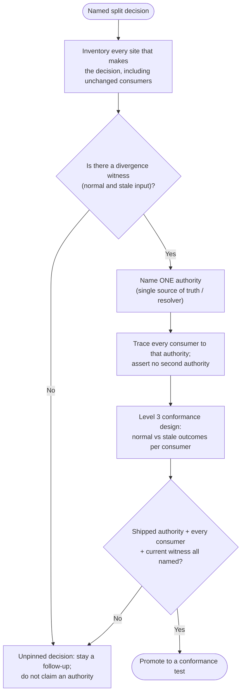

# C1 — Level 2 Action Map (one authority per named split decision)

> **Design draft; not implemented, not promoted to a test.** This is the C1 lens over the [Level 1 Error Handling process](../README.md) for [#437](https://github.com/dyphn1/Harness-everything/issues/437) / [#402](https://github.com/dyphn1/Harness-everything/issues/402). Level 1 remains the authority for the Action sequence, guards, exits and one-Error-Occurrence boundary. A–G are drawing-local aliases, not new identities.
>
> **Scope:** docs only. C1 owns this file and its [Level 3 detail](../details/c1-authority-conformance.md); it does **not** edit `README.md`, `registry.md`, `nodes.yaml` or another class's files. No product target is pinned in this batch — E-0001's System One stage-option work stays #445 — so every authority named below is a *worked, historical* example, not a claim about a shipped in-scope path. [source-traced: C1.md:L4-7; advisor-answer-4.md:L7,L21; class-common.md:L3-5]

**Claim convention:** every factual statement in this map is **source-traced** to a ledger or adjudication line, tagged `[source-traced: <file>:<line>]`. Source keys: `E-0001` / `E-0007` are `.agents/harness-everything/errors/E-0001-doc-check-identity-split-decision.md` / `E-0007-guard-fix-by-instance.md`; `advisor-answer-4.md`, `C1.md`, `class-common.md` are under `.402-work/`. Nothing here is an executed use in this batch.

## What C1 decides (Level 2)

A **split decision** is one decision answered independently at two or more sites, so a fix at one site leaves the others deciding differently. [source-traced: E-0001:L143,L151; E-0007:L108-110] The C1 treatment is to **converge on one authority** for a *named* split decision: name the decision, inventory every site that makes it (including unchanged consumers), then trace each consumer to a single authority. [source-traced: C1.md:L4; advisor-answer-4.md:L7]

**Reading rule:** the inventory is the unit of work, not one failing site. Point-fixing one site per review round is exactly the failure class C1 addresses. [source-traced: E-0001:L147; E-0007:L108-110,L114]

## Authority / consumer inventory (worked examples)

Each table traces **every named consumer** to **one proposed authority** and names a **divergence witness**. All three examples are historical; none is promoted in this batch. [source-traced: advisor-answer-4.md:L7,L21; class-common.md:L3]

### Example A — "Is this the trusted doc-check?"

- **Named decision:** whether a command is the trusted doc-check. [source-traced: E-0001:L5,L143]
- **Authority (shipped historically):** one identity resolver, invariant I1, commit `0308386`. [source-traced: E-0001:L39,L45]
- **Divergence witness:** a self-authored script printing passing doc-check JSON earned credit; a case-variant invocation was dropped from capture while the parser and candidate filter decided identity differently. [source-traced: E-0001:L33,L37]

| Consumer site (decides identity) | Traced to the one authority | Evidence |
| --- | --- | --- |
| `hooks/scripts/lib/doc-reconciliation-pilot.js` | identity resolver I1 | [source-traced: E-0001:L7,L39] |
| `hooks/scripts/lib/doc-reconciliation-provider.js` | identity resolver I1 | [source-traced: E-0001:L8,L39] |
| `opencode-plugin/index.mjs` | identity resolver I1 | [source-traced: E-0001:L16,L39] |
| `ci/mechanism-397-cycle-import.test.js` | identity resolver I1 — **unchanged consumer that was omitted** from P1W's inventory because a parallel packet owned the file; omission produced a P2, fixed in `5a55a8f7` | [source-traced: E-0001:L17,L100-108,L164-166] |

### Example B — "Which stage options are authoritative?"

- **Named decision:** which stage-option set is served. [source-traced: E-0001:L71-95; E-0007:L89-101]
- **Authority (shipped historically):** the trained catalog and `manifest.js` as the single source, commit `1c0d8fcf`. [source-traced: E-0001:L85-87,L151; E-0007:L97-101]
- **Divergence witness:** F4 changed the producer and the installer rejected it; F6 unified three sites and missed `system-one-curves.js`, found only by independent review R1; P2-1 text mismatch was observed. [source-traced: E-0001:L79,L83,L89-91; E-0007:L93-95]
- **Boundary:** the class stays open in #445; owner decision is observe-first, no class fix without an owner go. C1 owns docs only until a separate in-scope target is pinned. [source-traced: E-0001:L89-91,L162; advisor-answer-4.md:L7,L21; class-common.md:L3]

| Consumer site (decides stage options) | Traced to the one authority | Evidence |
| --- | --- | --- |
| `scripts/system-one-cycle/package.js` | trained catalog + `manifest.js` | [source-traced: E-0001:L9,L151] |
| `harness-everything/scripts/system-one/install.js` | trained catalog + `manifest.js` | [source-traced: E-0001:L10,L151] |
| `harness-everything/scripts/system-one/provider.js` | trained catalog + `manifest.js` | [source-traced: E-0001:L11,L151] |
| `scripts/system-one-cycle/score.py` | trained catalog + `manifest.js` — unchanged consumer must still read the one source | [source-traced: E-0001:L12,L151] |
| `scripts/system-one-curves.js` | trained catalog + `manifest.js` — the site missed by F6 and found by R1 | [source-traced: E-0001:L13,L83,L151] |

### Example C — "Is a pinned target inside the root?"

- **Named decision:** whether a pinned target is accepted for Write / git add. [source-traced: E-0007:L59-75]
- **Authority (shipped historically):** one exact-spelling recognizer for capture and all writer surfaces, commit `22dc944a`, after an advisor-gated sweep of nine families × four surfaces. [source-traced: E-0007:L69-71]
- **Divergence witness:** a symlink outside the root was credited, then `./` and `..` aliases of the same target were still credited — the second consecutive round on the same decision. [source-traced: E-0007:L64,L67]

| Consumer surface (decides target acceptance) | Traced to the one authority | Evidence |
| --- | --- | --- |
| capture | exact-spelling recognizer `22dc944a` | [source-traced: E-0007:L69] |
| all writer surfaces | exact-spelling recognizer `22dc944a` | [source-traced: E-0007:L69] |
| `agentResultSurface()` callers (shared helper) | caller inventory — two seams were patched first, the third caller `reviewRecordIndependent()` was found after; helper ended with 0 callers | [source-traced: E-0007:L76-88] |

## Level 2 instructions by behavior block

| Step | What the agent should do (Level 2) | Handoff / condition |
| --- | --- | --- |
| Name the decision | State the single decision being decided independently; do not bundle several decisions. [source-traced: E-0001:L143,L149] | Give the next step one decision name. |
| Inventory sites | List **every** site making that decision, including unchanged consumers and files owned by other packets / outside the write-set. [source-traced: E-0001:L147,L164-166; E-0007:L114] | Complete inventory before naming an authority. |
| Find the witness | Show normal and stale-input outcomes and a current divergence witness. [source-traced: C1.md:L9; advisor-answer-4.md:L30] | No witness → keep it a follow-up. [source-traced: advisor-answer-4.md:L30] |
| Name one authority | Name a single shipped source of truth / resolver, and trace each consumer to it; reject a second authority for the same decision. [source-traced: E-0001:L151; E-0007:L116; advisor-answer-4.md:L30] | Only a *pinned* shipped authority may be claimed. [source-traced: advisor-answer-4.md:L7] |
| Hand to Level 3 | Pass the authority, the consumer list and the witness to the [conformance-test design](../details/c1-authority-conformance.md). | Promotion is a Level 3 decision. |

## Level 3 — detail consulted only when needed

- [C1 conformance-test design](../details/c1-authority-conformance.md) — normal vs stale outcomes, test design and the promotion gate.
- [E-0001 ledger](../../../.agents/harness-everything/errors/E-0001-doc-check-identity-split-decision.md) — identity split-decision class and history, not duplicated here.
- [E-0007 ledger](../../../.agents/harness-everything/errors/E-0007-guard-fix-by-instance.md) — fix-by-instance class and history, not duplicated here.
- [E-0002 Level 2 map](./e0002-action-map.md) — sibling example of the same Level 2/3 document shape.

**Acceptance of this draft:** source-traced inventory and authority/consumer tracing only. No conformance test is promoted and no in-scope product authority is claimed until a separate target is pinned and a current divergence witness is named. [source-traced: advisor-answer-4.md:L7,L21,L30; class-common.md:L3]
