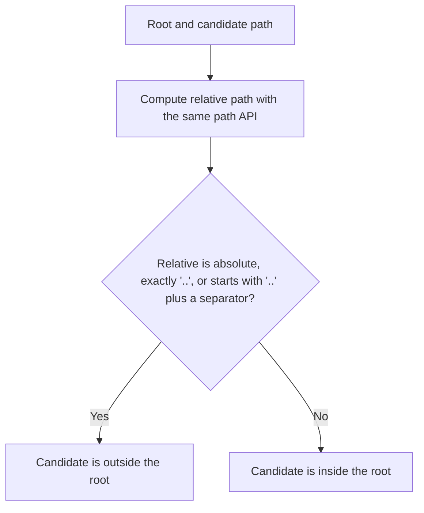

# C2 — Test-root containment (Level 2 Action Map)

> C2 specifies the path decision used by the cycle-import mechanism test to keep temporary fixture data outside the repository root. The existing `isOutside` helper remains the shared predicate for that test path.

| Action | Agent behavior | Acceptance evidence |
| --- | --- | --- |
| Capture | Keep the root, candidate and `path.relative` result together when diagnosing a containment verdict. | The values show the path style and drive involved. |
| Identify | Treat an absolute relative result, `..`, or a `..` parent segment as outside. Treat names such as `..cache` as ordinary child names. | The path segment boundary is explicit. |
| Treat | Reuse `isOutside` in `ci/mechanism-397-cycle-import.test.js`; use `path.win32` for deterministic Windows cases. | Root child, similar-prefix sibling, parent escape and cross-drive fixtures exercise both verdicts. |
| Accept | Run the focused cycle-import test and retain its result. | `node --test ci/mechanism-397-cycle-import.test.js` passes. |

The `path.win32` fixtures run on every host. The existing fixture assertion also exercises the host's native `path` implementation against its temporary directory.

See the [Level 3 C2 test-root containment contract](../details/c2-test-root-containment.md) and [E-0019](../../../.agents/harness-everything/errors/E-0019-windows-cross-drive-relative-path.md).
