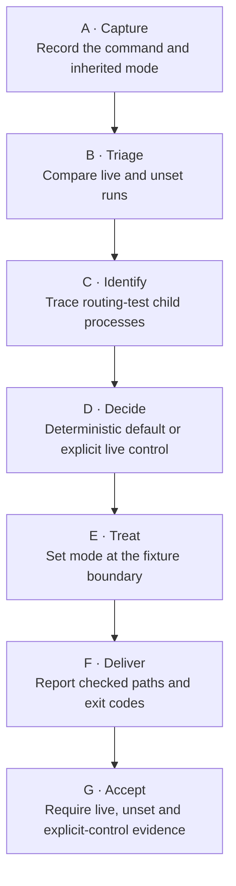

# C3 — Level 2 Action Map

> C3 applies the E-0002 action-map shape to routing-test mode ownership. It records how to keep deterministic routing assertions isolated from an inherited System One mode; it does not change production routing.

| Scope | What the agent should do | Handoff / condition |
| --- | --- | --- |
| **A Capture** | Keep the exact routing-test command and the inherited `HARNESS_SYSTEM_ONE_MODE` value with the failure evidence. | Record whether the mode was `live` or unset. |
| **B Triage → C Identify** | Reproduce under inherited `live`; trace every subprocess that makes routing assertions. Separate deterministic route fixtures from tests that intentionally exercise live mode. | An unset-only pass does not close an inherited-mode failure. |
| **D Decide** | Give deterministic fixtures an explicit `off` default. Use `live` only in a fixture that names live mode as its subject. | Preserve an explicit override for live-mode controls. |
| **E Treat** | Set mode in the shared fixture invocation after inherited environment values and before per-case overrides. Add an inherited-live regression and an explicit-live control. | Keep the correction in test setup; do not change the classifier to compensate for test state. |
| **F Deliver** | List every routing-invariant test file checked and report the focused and package-level results. | Identify any remaining leak as a follow-up rather than silently omitting it. |
| **G Accept** | Run the suite with inherited `live` and with the variable unset; confirm the explicit live control still enters the live path. | Accept only when all three conditions hold. |

The incident is tracked in [E-0018](../../../.agents/harness-everything/errors/E-0018-machine-state-leaks-into-tests.md). A passing test proves the fixture’s mode ownership at the deterministic mechanism layer; it is not live-host behavior evidence.

**Current packet disposition:** independent review found three direct `kernel-router.js` routing fixtures in `ci/router-workflow-plan.test.js` that still inherit `live`. The slice remains blocked until those calls own the mode and the live/unset gates are rerun.
