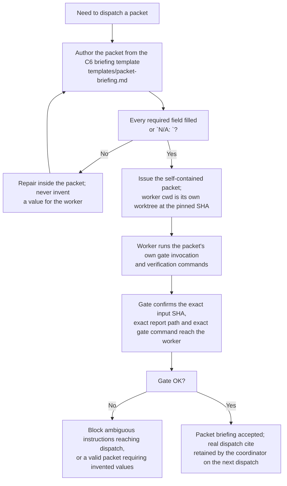

# C6 — Level 2 Action Map (dispatch packet briefing)

> Companion to [#402](https://github.com/dyphn1/Harness-everything/issues/402), advisor answer 4 class C6, and [Level 1 error handling](../README.md). C6 owns the C6 docs and the C6 briefing template only: this map, [details/c6-packet-briefing.md](../details/c6-packet-briefing.md) and [templates/packet-briefing.md](../templates/packet-briefing.md). Monitoring, CI cancellation and training budget retain their own consumers and issues.

**Problem to prevent:** a worker follows a stale shared default (wrong input SHA, wrong report path, gate from another packet) and either executes ambiguous instructions or a valid packet stalls because it must invent values (E-0022 witness; #448 W3 was misled by packet template drift: common-gates SHA, wrong report path). A runtime trust pin cited only inside a packet cannot be followed by installed or public consumers (E-0010 witness).

**Level 2 decision (author / coordinator):** when dispatching, the packet — not shared defaults — owns the pinned input SHA, the exact report path and the gate invocation. Every template field is either filled with the packet's own authoritative value or `N/A: <reason>`. Shared defaults (class-common.md, shared gates files) supply background only.

**C6 instructions by packet stage**

| Stage | What the author does (Level 2) | Condition to proceed |
| --- | --- | --- |
| Author | Fill every template field verbatim where required: runner/model/effort, worktree + input SHA, scope anchor verbatim with source, write-set, gate (dependsOn), verification commands, error-ledger instruction, report path + report-writer invocation, terminal STATUS rule. | All fields filled or `N/A: <reason>` |
| Issue | Hand over the self-contained packet; no out-of-band values in chat or separate files. | Packet carries its own authoritative values |
| Execute (worker) | Run the packet's own gate invocation and verification commands in its own worktree at the pinned input SHA. | Exact SHA, report path, gate command in the packet |
| Accept (gate) | Confirm exact input SHA, exact report path and exact gate command reached the worker; walkthroughs: one stale shared default and one complete packet through the template. | No conflicting shared-gates SHA; no inherited output path from another packet |

**Level 3**

- [C6 packet briefing — field contract, walkthroughs and review cases](../details/c6-packet-briefing.md)
- [C6 briefing template — required fields and `N/A` rule](../templates/packet-briefing.md)

**Acceptance of this map:** structural guidance only. The real dispatch cite is added by the coordinator on the next dispatch; until then it is pending (`N/A: real dispatch cite added by the coordinator on the next dispatch`). No hook delivery, ledger schema, promotion, training-budget or CI-cancellation change enters this class.
