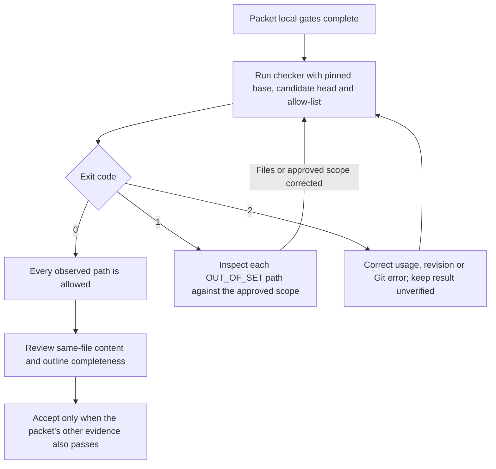

# C7 — Candidate write-set check

After a packet's local gates, the coordinator checks that the candidate slice stayed within its approved paths before accepting it. The checker reports path scope; the coordinator still reviews content and packet requirements.

**Exit 0 is a path-scope result, not packet acceptance.** The checker cannot detect same-file content loss or an omitted approved outline row; the scoped review must compare those inputs directly (see [E-0014](../../../.agents/harness-everything/errors/E-0014-lossy-cleanup.md) and [E-0016](../../../.agents/harness-everything/errors/E-0016-adr-draft-omits-approved-outline-row.md)). Run it after local gates and before accepting the slice. It does not install a hook or change CI behavior.
