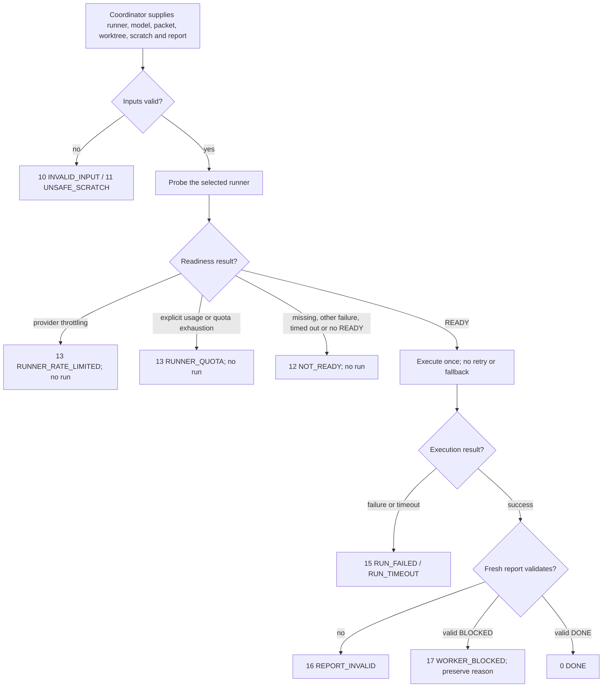

# C8 — Level 2 Action Map (single-run dispatch)

> **Implemented coordinator CLI; not a shared launcher.** C8 is a supporting identity under E · Treat. It adds no Level 1 branch, hook, or distributed plugin command. The [Level 3 contract](../details/c8-dispatch-cli.md) owns concrete options and return codes.

One invocation selects one runner and model, checks readiness, executes once, and validates fresh delivery.

## Coordinator behavior

- Choose the runner and its model explicitly. A throttling result says “Reduce concurrency on the affected key or retry later.” A quota result says “Select an authorized runner or model with available quota.” The CLI never switches runners or retries.
- Other readiness failures return `12 NOT_READY` with “Readiness failed. Keep the available child evidence.” and start no execution.
- Keep packet and worktree selection with the coordinator. Scratch must be absolute and outside every Git repository or worktree, including linked worktrees and symlinked ancestors.
- Use `--dry-run` to validate and inspect the planned argv and cwd. It starts no child and creates no scratch or report.
- Treat readiness, execution, and report validation as separate outcomes. A zero runner exit does not create a DONE report.
- Codex raw output goes through the report writer. The writer strips a valid terminal host label and checks the final report. OpenCode must create a fresh report that passes the same check.
- Deliver logs and raw Codex output for failed attempts. Do not present an unvalidated OpenCode file as a completed report.

## Evidence boundary

The OpenCode ANSI `Error:` stderr envelope and exit 1 are live-traced. The provider 429 body is from the retained OpenCode log, and a live 429 reproduction remains unchecked. OpenCode usage/quota cause text is also retained log evidence. Codex classification rows are fixture-only; no live Codex 429 or usage-limit trace is claimed.

## Boundary

This single-run CLI does not select scratch automatically, manage its lifecycle, enforce launch-path policy, reserve or cap provider keys, or reject packets that need worker `gh`/network access. Those guarantees belong to #466. No live provider run or packaged plugin command is claimed here.
