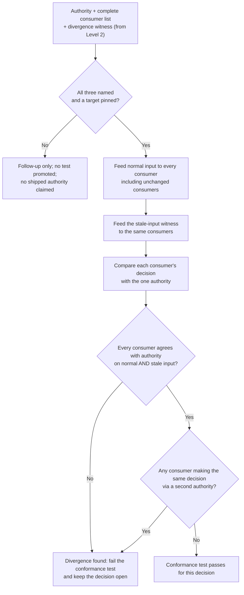

# C1 — Level 3 conformance-test design (one authority per named split decision)

> **Proposed design / Level 3 supporting contract, NOT promoted to a test, NOT an implemented mechanism.** Companion to the [C1 Level 2 authority/consumer inventory](../actions/c1-action-map.md) and [Level 1](../README.md) in [#437](https://github.com/dyphn1/Harness-everything/issues/437) / [#402](https://github.com/dyphn1/Harness-everything/issues/402). This specifies **what a conformance test must check once a target is pinned**; it does not change production code, hooks, report rules or ledger state. Docs-only write-set. [source-traced: C1.md:L6-7; advisor-answer-4.md:L7,L21; class-common.md:L3]

**Claim convention:** every factual statement below is **source-traced** and tagged `[source-traced: <file>:<line>]`, using the same source keys as the [Level 2 map](../actions/c1-action-map.md). No claim here comes from an executed conformance run in this batch.

## Problem to prevent

A split decision — the same decision answered independently at several sites — survives point fixes: each review closes one site and the next review finds another deciding differently. [source-traced: E-0001:L143,L147; E-0007:L108-110] The treatment is to name **one authority**, inventory **every consumer** (including unchanged ones), then gate promotion to a test on three named items. [source-traced: C1.md:L4; advisor-answer-4.md:L7]

**Promotion gate (verbatim authority):** promote to a test **only after** naming (1) a shipped authority, (2) every relevant consumer and (3) a current divergence witness. [source-traced: advisor-answer-4.md:L7] In this batch no in-scope product target is pinned — E-0001's stage-option work stays #445 and C1 owns docs only — so none of the three worked examples below is promoted; an unpinned mechanism stays a follow-up. [source-traced: C1.md:L4; advisor-answer-4.md:L7,L21; E-0001:L89-91,L162]

## Level 3 · conformance design (supporting the Level 2 block)

**Reading rule:** the test's unit is the *decision across all consumers*, not one site. A consumer that is untouched by the fix but still derives the decision on its own is a valid failure. [source-traced: E-0001:L147,L164-166; E-0007:L114,L116]

## Normal vs stale-input outcome comparison (including unchanged consumers)

The gate requires comparing **normal** and **stale-input** outcomes **including unchanged consumers**. [source-traced: C1.md:L9; advisor-answer-4.md:L30] Rows below are designed expectations traced to the worked episodes; none is executed in this batch.

### Example A — trusted doc-check identity

| Consumer | Normal input outcome | Stale-input outcome | Evidence |
| --- | --- | --- | --- |
| doc-check identity resolver (authority) | one decision via invariant I1 | same decision; stale candidate is rejected by the resolver | [source-traced: E-0001:L39,L45] |
| `doc-reconciliation-pilot.js` / `doc-reconciliation-provider.js` | agree with I1 | must not fall back to a parser/filter-local identity | [source-traced: E-0001:L7-L8,L143] |
| `ci/mechanism-397-cycle-import.test.js` (**unchanged consumer**) | agrees with I1 | must still agree though owned by another packet; its omission produced a P2 | [source-traced: E-0001:L17,L100-108,L164-166] |

Stale witnesses that must diverge from the authority: a self-authored checker printing passing JSON, and a case-variant invocation dropped from capture while the parser and candidate filter decided differently. [source-traced: E-0001:L33,L37]

### Example B — stage-option / version-manifest identity

| Consumer | Normal input outcome | Stale-input outcome | Evidence |
| --- | --- | --- | --- |
| trained catalog + `manifest.js` (authority) | serves the one stage-option set | same source; no local re-derivation | [source-traced: E-0001:L85-87,L151; E-0007:L97-101] |
| `package.js` / `install.js` / `provider.js` | read the one source | installer must not reject a producer change (the F4 failure) | [source-traced: E-0001:L79,L151] |
| `score.py` (**unchanged consumer**) | reads the one source | must not cache a different option set | [source-traced: E-0001:L12,L151] |
| `system-one-curves.js` | reads the one source | the site F6 missed and R1 found — primary stale divergence witness | [source-traced: E-0001:L83,L151; E-0007:L93-95] |

Stale witnesses that must be caught: producer changed while installer expected the old identity (F4); three sites unified while one kept deciding on its own (F6/R1); P2-1 served text differing from trained text. [source-traced: E-0001:L79,L83,L89-91; E-0007:L116]

### Example C — pinned target acceptance

| Consumer | Normal input outcome | Stale-input outcome | Evidence |
| --- | --- | --- | --- |
| exact-spelling recognizer `22dc944a` (authority) | accepts only the exact pinned spelling | rejects symlink and `./`/`..` aliases | [source-traced: E-0007:L69-71] |
| capture / all writer surfaces | agree with the recognizer | must not credit the aliases that survived round 1 | [source-traced: E-0007:L64,L67,L69] |
| `agentResultSurface()` callers (**unchanged consumers**) | all callers use the shared helper | a caller patched outside the inventory is the third-seam failure | [source-traced: E-0007:L80-88] |

## Proposed conformance test cases (design only)

| Test case | Expected observable result | Evidence / status |
| --- | --- | --- |
| Normal input, complete consumer list | every consumer's decision equals the authority's | design goal [source-traced: E-0001:L45,L147] |
| Stale-input witness, unchanged consumers included | every consumer still equals the authority; no local re-derivation | design goal [source-traced: E-0001:L164-166; E-0007:L114] |
| Second-authority probe | fail if any consumer makes the same decision via a different source | [source-traced: advisor-answer-4.md:L30; E-0007:L116] |
| Known divergence witness (e.g. `system-one-curves.js`, `./`/`..` alias) | test goes RED on the witness; passes only when the class is fixed at the source | [source-traced: E-0001:L83,L151; E-0007:L67] |
| Omitted-consumer probe (file owned by another packet / outside the write-set) | consumer is present in the inventory regardless of ownership | [source-traced: E-0001:L100-108,L164-166] |
| No pinned target / no current witness | no test promoted; result recorded as follow-up | [source-traced: advisor-answer-4.md:L7,L30] |

**What is measured after promotion (future, not this batch):** whether every consumer agrees with the authority on normal and stale inputs, whether a second authority is absent, and whether a known divergence witness turns the test RED. A green run proves only this decision's conformance, not substantive correctness of the product path. [source-traced: E-0001:L45; E-0007:L116]

## Review blockers (independent review of this design)

| Blocker | Rule | Evidence |
| --- | --- | --- |
| Omitted consumer | every site making the decision is listed, including unchanged consumers and files owned by other packets | [source-traced: E-0001:L147,L164-166; E-0007:L114] |
| Multiple authorities | exactly one authority for the named decision; no second source decides the same thing | [source-traced: advisor-answer-4.md:L30; E-0001:L151; E-0007:L116] |
| Incorrect authority claim | only a pinned, shipped authority may be claimed; no product authority is claimed in this batch | [source-traced: advisor-answer-4.md:L7,L30; E-0001:L162] |
| Missing known consumer | a named consumer from the worked episodes cannot be absent from the inventory | [source-traced: E-0001:L7-L18; E-0007:L7-L12] |
| Unpinned mechanism | stays a follow-up, not a promoted test | [source-traced: advisor-answer-4.md:L30] |

## E-ids applied and scope

- **E-0001** (identity split decision): applied its lesson to inventory every deciding site including unchanged consumers, to trace each to one source of truth, and to keep the #445 stage-option class out of this batch. [source-traced: E-0001:L147,L151,L162]
- **E-0007** (guard fix by instance): applied its lesson to fix the predicate class rather than one spelling and to require a pre/post caller inventory of any shared helper. [source-traced: E-0007:L108-110,L114,L116]
- Out-of-slice follow-ups (listed, not fixed): the #445 class fix and its owner go, a concrete in-scope product target with a current divergence witness, and promotion of any design case into an executable conformance test. [source-traced: E-0001:L89-91,L162; advisor-answer-4.md:L7,L21]

**Status of this design:** three named worked authorities, complete consumer inventories and divergence witnesses are source-traced here; no test is promoted because no in-scope target is pinned. [source-traced: advisor-answer-4.md:L7,L30; class-common.md:L3]
