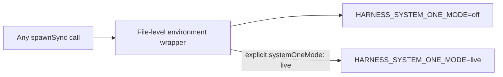

# C3 Treat — Level 3 mode-ownership contract

> C3’s Level 3 detail for #449. Each routing test file owns the System One mode passed to every child process it spawns.

## Failure shape

`HARNESS_SYSTEM_ONE_MODE=live` inherited from a developer shell reached three direct `kernel-router.js` children in `ci/router-workflow-plan.test.js`: `kernelUnknown`, `kernelIterative`, and `initialRetainedRoute`. They bypassed `runTier`, so the live classifier reference block could change deterministic routing assertions. E-0018 records the inherited-live failure class.

## Fixture contract

Both files wrap Node’s `spawnSync` at file scope. The wrapper merges the parent environment and any per-child environment, then sets `HARNESS_SYSTEM_ONE_MODE` to `off`. A child opts into live mode only through the wrapper’s separate `systemOneMode: 'live'` option. Adding another `spawnSync` call in either file therefore inherits the same deterministic default.

## Child-process inventory

Each row names a `spawnSync` source site. `execFileSync` is not used in either file.

| File / child | Environment supplied at the call site | Effective System One mode |
| --- | --- | --- |
| `ci/router-workflow-plan.test.js` — `runTier` | Parent env, optional `options.env`, and `HARNESS_ROUTER_CONTRACT_PATH` | `off`, except the explicit-live control passes `systemOneMode: 'live'` |
| `ci/router-workflow-plan.test.js` — `kernelUnknown` | No child env supplied; inherits parent env | `off` |
| `ci/router-workflow-plan.test.js` — `kernelNotificationPersistFailure` | Parent env plus `HARNESS_STATE_HOME` and `HARNESS_WORKSPACE_ROOT` | `off` |
| `ci/router-workflow-plan.test.js` — `kernelIterative` | No child env supplied; inherits parent env | `off` |
| `ci/router-workflow-plan.test.js` — `initialRetainedRoute` | `retainedEnv` (parent env plus `HARNESS_STATE_HOME` and `HARNESS_WORKSPACE_ROOT`; regression captures it while parent mode is `live`) | `off` |
| `ci/router-workflow-plan.test.js` — `sessionPathResult` | `retainedEnv` plus `TEST_SESSION_ID` | `off` |
| `ci/router-workflow-plan.test.js` — `planCommand` | `retainedEnv` | `off` |
| `ci/router-workflow-plan.test.js` — `startCommand` | `retainedEnv` | `off` |
| `ci/router-workflow-plan.test.js` — `reviewCommand` | `retainedEnv` | `off` |
| `ci/router-workflow-plan.test.js` — `hostNotification` | `retainedEnv` | `off` |
| `ci/invariant-routing.test.js` — `runKernel` | Parent env | `off`, except the explicit-live control passes `systemOneMode: 'live'` |

The invariant-routing file has one `spawnSync` source site, inside `runKernel`; the router-workflow file has ten, including the `runTier` helper. Every child uses the same file-level wrapper.

## Regression and controls

| Input | Expected result |
| --- | --- |
| Parent mode is `live`; call `runTier` or default `runKernel` | No `SYSTEM ONE REFERENCE CONFIDENCE` block |
| Parent mode is `live`; spawn `kernelUnknown`, `kernelIterative`, or `initialRetainedRoute` | No `SYSTEM ONE REFERENCE CONFIDENCE` block |
| Explicit `systemOneMode: 'live'` control | The child emits the confidence block |
| `env HARNESS_SYSTEM_ONE_MODE=live npm run test:routing:invariants` | All routing assertions pass, including inherited-live checks |
| `env -u HARNESS_SYSTEM_ONE_MODE npm run test:routing:invariants` | The same assertions pass without ambient mode |

The block check is exercised against a live-mode child before the wrapper fix. A positive explicit-live control ensures the test still reaches live behavior when requested. Package/mechanism evidence is not a live-host result.
