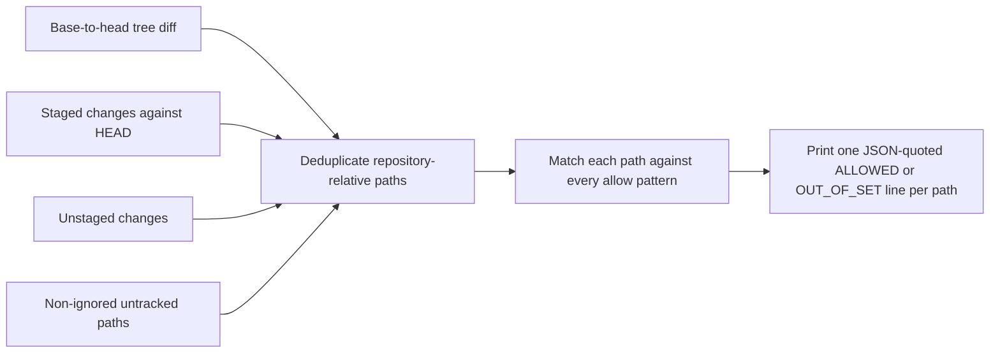

# C7 — Path-level packet write-set check

This detail implements the C7 action in [the action map](../actions/c7-action-map.md). It checks whether a candidate slice stayed inside a packet's approved path set, including generated files and uncommitted output.

## Command

```sh
node scripts/check-packet-write-set.js --base BASE_SHA [--head HEAD_REV] --allow PATH_OR_GLOB... [--allow-file FILE]
```

| Option | Contract |
| --- | --- |
| `--base` | Required pinned commit for the candidate comparison. |
| `--head` | Optional commit or ref; defaults to `HEAD`. |
| `--allow` | Repeatable repository-relative path or glob. |
| `--allow-file` | Optional newline-delimited path/glob list, relative to the invocation directory; empty lines are ignored and CRLF is accepted. |

At least one `--allow` or a non-empty `--allow-file` is required. Allow-file lines are patterns as written; `#` is not a comment marker. Use `/` between path segments on every platform.

Quote glob patterns in shell invocations so the shell passes them to the checker unchanged.

## Paths examined



The tree comparison uses `git diff --no-renames`; a move therefore contributes both its old and new path. The worktree checks also disable rename detection for staged changes. Ignored untracked files are excluded according to Git's ignore rules. Paths are deduplicated and sorted before output, and JSON quoting keeps spaces, tabs and newlines on one output line.

Patterns match the entire Git-style path (slash separators): `*` matches any characters except `/`, `?` matches one character except `/`, and `**` matches across path segments. `**/` also matches zero directory segments. For example, `docs/**` matches `docs/guide.md` but not `docs-extra/guide.md`.

## Results and limits

| Exit | Meaning |
| --- | --- |
| `0` | Every observed path matched an allow pattern. |
| `1` | At least one `OUT_OF_SET` path needs disposition. |
| `2` | Usage, allow-file, revision or Git error; no scope result was established. |

The checker reads Git state with optional Git locks disabled; it does not stage, reset, clean, checkout or write repository files. A valid but incorrect base/head can still produce a misleading comparison, so the coordinator supplies the approved pinned revisions. Exit 0 says nothing about changes inside an allowed file: same-file content loss and omissions from an approved outline remain review obligations.
