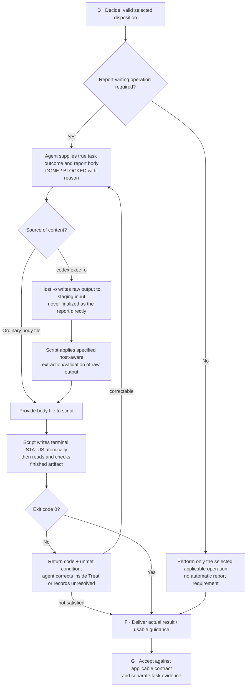
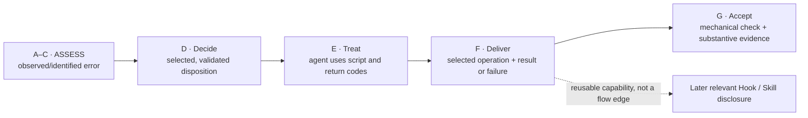

# E-0002 Treat — Level 3 report-writer contract and test cases

> **Shipped W1 CLI.** [#462](https://github.com/dyphn1/Harness-everything/pull/462) added `scripts/report-writer.js`, exposed through `npm run report`. This is the Level 3 contract for the report operation in the proposed [Level 2 Action Map](../actions/e0002-action-map.md) and [Level 1 workflow](../README.md). Hook/Skill disclosure and future node/registry expansion remain proposals.

## Problem to prevent

**E-0002** (`report-protocol`) recurs when a report lacks its required **raw, column-zero, terminal** `STATUS: DONE` or `STATUS: BLOCKED: <reason>` line, or when a harness-label appears after it. Some failures happen in `codex exec -o` outputs where the report is also the final turn text. Previous instructions and reminders were not enough: the next agent can make the same mistake again.

The agent supplies the report body and an evidence-grounded status. The writer assembles and verifies the final report, including the terminal STATUS line.

**Action ownership:** A Capture records facts; B Triage and C Identify establish the case; D Decide chooses treatment. **E Treat defines/applies the mechanical report-writing method**; F Deliver gives the agent a concise instruction and the available CLI; G Accept checks its result. This is an **E-0002-specific Action detail**, not a second Level 1 flow or a claim that all classes have the same treatment.

## Level 3 · Script-mediated operation (supporting the Level 2 block)



A nonzero exit leaves the report operation unresolved. Deliver the evidence through F/G and keep the occurrence open until the applicable acceptance conditions are met.

## Agent-facing procedure

For a step **explicitly required to produce a report**:

1. **Perform the work and collect evidence.** The agent must decide the true task/packet status based on observed results. `DONE` is not inferred by the CLI from a successful invocation; `BLOCKED` requires an actual reason. A completed RED experiment is not automatically product GREEN.
2. **Choose the input mode.** Use `--body-file` for a staged body, `--context` for inline text, or `--from-codex-output` for the raw file captured by `codex exec -o`. Keep STATUS lines and harness-label comments out of ordinary body inputs.
3. **Call the report writer** with the chosen input, final output path, and explicit status. The writer publishes the report atomically with one terminal STATUS line.
4. **Check the written file**, not merely the CLI stdout, and retain the result as evidence. Do not append to the finalized report; to revise, change the body and call the writer again.
5. **Return the report reference and verified result** to the caller. Keep the raw `-o` file as evidence. A separate final turn follows its applicable host label contract.

### Runnable command examples

Run these from the repository root. The output directory must already exist. The body file and raw Codex output are inputs from the report-writing task.

```bash
# Positive result: content is provided by the agent; STATUS is written by the tool
npm run report -- write --body-file work/report-body.md --output reports/review.md --status DONE
npm run report -- check --file reports/review.md

# Blocked result: same writer; explicit failure reason is required
npm run report -- write --context "Verification could not run." --output reports/review.md --status BLOCKED --reason "required verification unavailable"
npm run report -- check --file reports/review.md

# Raw Codex output uses a separate input and final report path
npm run report -- write --from-codex-output work/codex-raw.md --output reports/review.md --status DONE
npm run report -- check --file reports/review.md
```

The same subcommands and flags work with `node scripts/report-writer.js`.

### Minimal writer and checker contract

| Responsibility | Expected behavior |
| --- | --- |
| `write` input | Exactly one of `--body-file`, `--context`, or `--from-codex-output`, plus `--output` and explicit `--status`. A blocked result requires a nonempty `--reason` or `--error`. |
| `write` output | Preserve body content, add a single newline-separated terminal control line at **column zero**, write atomically, fail without corrupting the previous target |
| Structural validation | On the finished output, check exactly one terminal protocol line, nothing after it (including hidden label), and read-back matches what was written |
| Containing structured fields | Reject conflicting column-zero terminal STATUS lines and harness-label metadata in the submitted body; make the conflict explicit rather than silently discarding unknown content |
| Artifact roles | `codex exec -o` writes raw output as **script input**; the script converts and verifies the designated final report according to a host-aware contract. If ambiguous, return nonzero; no hidden manual rewrite |
| Failure outcome | Nonzero exit with diagnostics. Validation failures before publication preserve the prior report and raw input. A read-back failure after publication requires coordinator disposition. |
| Scope | Operate on explicitly designated report output only; do not rewrite unrelated files, judge semantic success, touch the Ledger, or automatically change permissions |
| Revision | Re-run `write` using the edited body + true status; never mutate the terminal report with ordinary append commands |

In `--from-codex-output` mode, the writer can remove one terminal comment that conforms to the [Observations v1 harness-label contract](../../system-one-observations.md#label-line). If the raw input already includes a STATUS line, it must match the requested status and be terminal or immediately precede the label. Invalid input returns nonzero and preserves the raw file.

## Interaction with other Actions and existing facilities



The future Hook/Skill reference is **not** a G feedback/recurrence edge, nor does F make future tasks part of this same Error Occurrence. A new recurrence starts as a **new Capture**; a correction after nonzero exit remains within the current local Action block when permitted.

- **#359:** existing E-0002 Ledger remains class/history authority; do not create a second database.
- **#394 / ROUTE-001:** the proposed Hook/Skill disclosure would surface the available command when relevant. A retired lesson reminder does not remove still-needed operational instructions.
- **#437:** the scoped writer returns validation failures for the agent to handle in the applicable Action.
- **Decide/Accept:** when a machine-checkable condition or approval is not met, the script returns nonzero with the unmet requirement. The Agent can revise appropriately or preserve unresolved status. Owner authorization cannot be fabricated by a script, and a zero script exit code never proves substantive task correctness.

## Acceptance cases

| Test case | Expected observable result |
| --- | --- |
| Valid body + DONE | Final file ends in exactly `STATUS: DONE`; CLI `check` passes |
| Valid body + BLOCKED + reason | Final file ends in `STATUS: BLOCKED: <reason>`; check passes |
| BLOCKED without reason | Write rejected; existing report left untouched |
| Body contains conflicting terminal STATUS or harness-label | Write rejected with useful explanation, no silent normalization |
| Agent revises body after earlier report | A new `write` replaces the report atomically; one terminal STATUS remains |
| `codex exec -o` emits trailing harness-label | Raw `-o` is routed **through the script** to produce/check the final report; script returns nonzero on unsafe/ambiguous transformation |
| Tool unavailable, bad path or read-back fails | Return nonzero with reason; Agent handles correction or delivers UNVERIFIED/unresolved result via F/G; raw evidence retained |
| Report not required | No invocation, no forced report |
| Writer produces compliant format but underlying result is wrong | Structural PASS only; review/behavior acceptance stays separate |

**What to measure:** E-0002 recurrence in later **real report-writing tasks**, whether the agent actually invoked the designated writer, structural violations after invocation, and elapsed/tool/review cost relative to hand-writing. Do not declare E-0002 rooted out merely because a diagram or a one-off check exists.
