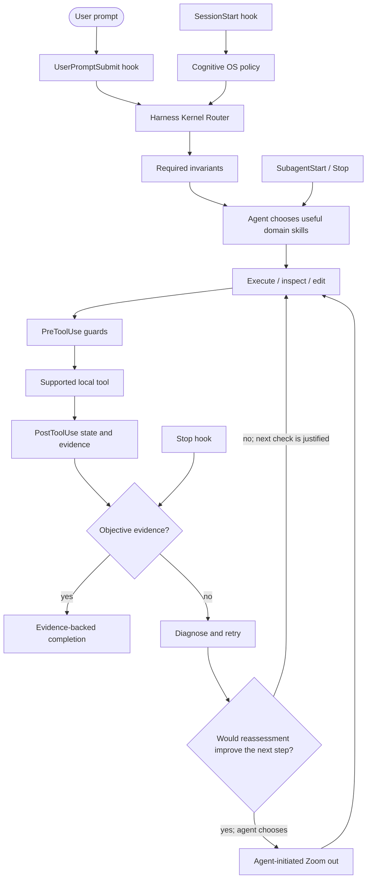

# OpenAI / ChatGPT Plugin Packaging

Harness Everything ships an Agent Plugin package under `plugins/harness-everything/`. The root skill directories remain canonical; packaged copies are synchronized from them.

## Architecture



The local OpenAI adapter observes cross-cutting invariants through the lifecycle events that it packages. Required bindings are declared per active step/stage; the selected topology is mandatory with scoped, evidence-backed escape. The [workflow runtime](workflow-runtime.md) documents active binding visibility, pending/running/satisfied/blocked state, Fable entry, worktree isolation, completion evidence, and degradation limits. Tool enforcement is limited to the host tool names declared in `hooks/hooks.json`.

## Package layout

```text
plugins/harness-everything/
├── plugin.json                 # portable Agent Plugin manifest
├── .codex-plugin/plugin.json   # Codex compatibility manifest
├── hooks/
│   ├── hooks.json
│   ├── session-start.js
│   └── scripts/                # shared runtime hook dependencies
└── skills/                     # 26 synchronized canonical skills
```

The portable manifest follows the Agent Plugins schema and uses a root `skills/` directory. OpenAI-specific hook and interface metadata lives under `extensions.com.openai`; the compatibility manifest keeps the legacy `.codex-plugin` shape for clients that still expect it. These are two distribution manifests for the same package, not two different products.

The package is intentionally skill-only: it does not declare `mcpServers` or `apps`. Hooks are a local package capability and require the host’s trust/review flow; they are not a claim that every OpenAI surface provides the same lifecycle enforcement.

Run:

```bash
npm run plugin:sync
npm run test:plugin:openai
npm run test:plugin:submission
```

`plugin:sync` refreshes package copies from canonical skill directories and copies the shared hook runtime/dependencies into the package. Text parity is normalized to LF so the same package is reproducible from Windows and Unix checkouts. The checks compare both skill trees byte-for-byte, validate both manifest forms, execute local hook entry points, and verify deterministic routing/runtime behavior.

## Managed ChatGPT workspace import

OpenAI documents GitHub marketplace import for workspace administrators. The repository provides both `.agents/plugins/marketplace.json` and `.claude-plugin/marketplace.json`; the source entry resolves to `plugins/harness-everything/`.

Use the repository URL as the source, leave Path empty so the marketplace is read from the repository root, and select the intended branch (normally `main`). In the OpenAI Admin Console, select the workspace and use **Plugins > Add > Import marketplace**. Save the import report with the source/ref and client version, set the installation policy, then install and invoke a representative skill from a fresh eligible member session. Use **Marketplaces > Sync now** after a branch update and retain the sync report and the updated skill result. OpenAI also documents automatic daily sync.

This repository contains the marketplace/package artifacts and deterministic import-shape checks. It does not contain a managed-workspace import report or a fresh host smoke-test artifact, so those operations remain `Unknown` in the compatibility matrix.

Official documentation: [Importing and syncing plugin marketplaces from GitHub](https://help.openai.com/en/articles/20001504-importing-and-syncing-plugin-marketplaces-from-github) and [Plugins in Codex](https://help.openai.com/en/articles/20001256-plugins-in-codex).

## Local Codex / OpenAI package

The local package path is distinct from the general `--codex` installer. The general installer writes advisory `AGENTS.md` and repo-scoped `.agents/skills/`; the plugin package additionally contains local session, prompt, supported-tool, subagent, and stop hooks.

The package tests prove the following repository-side contract:

- the portable root manifest and `.codex-plugin` compatibility manifest agree on identity, version, interface, and hook entry point;
- the root `skills/` tree contains the canonical skills;
- Windows and POSIX hook commands resolve through `PLUGIN_ROOT`;
- session start emits the compact policy and prompt submission invokes invariant-first routing;
- supported local `Bash` and `apply_patch` calls receive the packaged guards and state tracking;
- subagent lifecycle and stop verification contracts are covered;
- identical routing input produces identical output.

These are package/mechanism results. They do not prove that a live Codex or ChatGPT host loaded the package; a preserved host/session artifact is required for that claim. OpenAI’s current event/tool contract is documented in the [Codex/ChatGPT hooks reference](https://learn.chatgpt.com/docs/hooks).

## Public Skills-only submission

OpenAI’s public submission flow supports a **Skills only** plugin. This is separate from managed-workspace marketplace import and from the local hook-capable package.

Build the final upload from the synchronized package:

```bash
npm run plugin:submission:build
```

The generated ZIP has a portable root `plugin.json` and the synchronized `skills/<name>/...` tree. It does **not** include the local `.codex-plugin` lifecycle hooks, MCP definitions, or app wrappers. The generated checksum manifest records each file and the ZIP SHA-256. OpenAI documents a supported plugin manifest as an upload requirement. [Submission error reference](https://developers.openai.com/plugins/deploy/submission-errors#plugin-manifest-errors)

The [public submission runbook](../submission/openai/README.md) covers the developer identity, ZIP upload, automated scans, and publication. It also links to the project smoke cases for a fresh session. Use the [OpenAI submission guide](https://developers.openai.com/plugins/deploy/submission) to confirm the portal requirements.

## Evidence boundary

The local plugin and public Skills-only artifact must not be conflated:

| Artifact | Repository evidence | Claim that is safe today |
| --- | --- | --- |
| Portable/root plugin package | Manifest, tree, hook, and routing mechanism tests | Package shape and local mechanism are verified |
| Managed workspace marketplace | Marketplace JSON and source-path checks | Import-ready repository artifact; live import remains unverified |
| Public Skills-only ZIP | Deterministic builder, portable manifest, and smoke-case inputs | Reproducible skills bundle; approval and live public behavior remain unverified |

See the [platform capability matrix](platform-capabilities.md) for the complete ten-dimension status table and official source URLs.

## Publication smoke checklist

Before public submission, run `plugin:sync`, both OpenAI package checks, and the platform compatibility check. Check that the packaged skills match canonical sources after EOL normalization and that the ZIP is reproducible. Confirm the publisher identity and portal permissions, and run the project smoke cases against the exact bundle being submitted.
