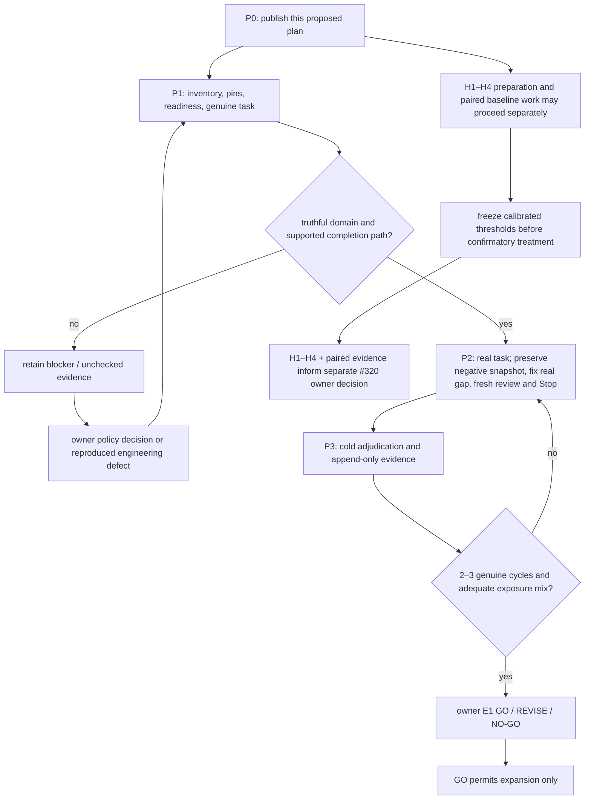

# Own-repo Governance and E1 Execution Plan — 2026-10-25 21:39 +08:00

**Status:** PROPOSED coordination plan; it does not approve policy, qualify E1, or authorize runtime activation.
**Created / filename identity:** 2026-10-25 21:39:23 +08:00 (initial write; filename/title retain its 21:39 minute).
**Updated / writtenAt:** 2026-10-25 21:45:09 +08:00 (Asia/Taipei)
**Branch:** `codex/own-repo-e1-plan-20261025` ([plan on work branch](https://github.com/dyphn1/Harness-everything/blob/codex/own-repo-e1-plan-20261025/docs/own-repo-governance-e1-plan-2026-10-25-2139.md)); verified linked worktree: `/Users/daniel.chang/Desktop/Skills/Harness-everything/.worktrees/own-repo-e1-plan-20261025`.

## Authority and pinned state

The issue contracts are authoritative: [#341 E1 and Phase 1/2](https://github.com/dyphn1/Harness-everything/issues/341), [#325 bounded consumer and H1–H4](https://github.com/dyphn1/Harness-everything/issues/325), and [#320 promotion](https://github.com/dyphn1/Harness-everything/issues/320). This plan orders work and points to evidence; it does not replace those contracts or inherit either older packet's `APPROVED` label. Owner decisions remain reserved below.

Pinned delivery baseline is `main@25c4a8478d5617d1e803940951876bb3ae1ecb37`, which includes #374. [PR #375](https://github.com/dyphn1/Harness-everything/pull/375) head `9ceb57d` is an unmerged evidence input, not main: [E1 README](https://github.com/dyphn1/Harness-everything/blob/9ceb57d/benchmarks/results/doc-evidence-e1/README.md), [E1 JSON](https://github.com/dyphn1/Harness-everything/blob/9ceb57d/benchmarks/results/doc-evidence-e1/evidence.json), and [H1 preparation README](https://github.com/dyphn1/Harness-everything/blob/9ceb57d/benchmarks/results/h1-provider-independence-qualification/README.md). O1/O2 adjudicate zero qualifying E1 cycles, correct withholding, no false MUST PASS/rejection, and no formal E1 decision. Do not repeat the stale-opening wording fix or count its observations again. Refresh mutable branch, PR, host, and CI facts before dispatch.

Evidence provenance: scope/protocol/advisor conclusions are source-traced; the OpenCode discussion is conceptual advice only, not code review, live-host evidence, or a defect finding. Reject its proposed 1-positive/1-negative stopping threshold and its unsupported claim that O2 proves a product bug. Keep #341's 2–3 genuine-cycle target and distinguish case exposure from completed-cycle acceptance.

## Scope and truthful claims

Inventory the declared candidate as pinned Git paths plus explicitly proposed new/untracked paths and baseline deleted/renamed endpoints. Retain both rename endpoints, modes and object identity; record symlink entries without following targets and gitlinks without recursing. A tracked vendor/dependency path stays in the inventory with an explicit disposition. `.git`, ignored/private files, dependencies not tracked by Git, and other worktrees are outside this inventory unless explicitly proposed. This coordination inventory never substitutes for the runtime producer's complete whole-candidate identity or scope.

| Class | Disposition and existing checks |
|---|---|
| Canonical skills/evals | Applicable token, routing/collision, manifest and source/package parity gates |
| Docs | Apply document lifecycle only to configured paths/roles; otherwise record absent/unknown doc-runtime coverage |
| Code/tests/config | Existing CI, kernel, consistency, repository-contract and portability gates; these do not prove each file's semantics |
| Generated views | Named source plus existing regeneration/parity check; never hand-edit generated output |
| Fixtures/evidence | Preserve their stated test/evidence purpose and controls; do not impose production-doc metadata by file extension |
| Vendor, binary, symlink, gitlink | Record identity and explicit applicable/excluded/unknown reason; no universal semantic validation claim |

Use the claim ladder `inventoried → classified → applicable-check-executed → validated-within-declared-scope`. `unknown`, `unavailable`, and `excluded` remain visible outcomes. Report inventory disposition coverage and executed gate scope separately; never say “all files validated/governed.”

Current `.agents/harness-everything/project-docs.json` governs two references and one derived index; it has no domains. The current doc-check therefore reports `doc-lint: partial` even when a changed reference is governed. Credit readiness is blocked unless a real domain/policy basis and owner decision resolve this. Do not invent a `HARNESS` domain, widen globs, change checkers, use an empty-domain workaround, or label partial as pass. This positive-credit blocker does not block independent H1–H4 work.

## Ordered path

## Packets and acceptance

Only P0 is authorized in this turn. Later packets need their own dispatch with exact write-set, entry gate, commands, reviewer, and recovery point; the table is not blanket permission to edit source/config. Workers stay in isolated worktrees, edit only their packet, and report evidence layer. Coordinator owns Git/GH writes and final verification.

| Packet / dependency | Write-set and action | Evidence, acceptance, stop / resume |
|---|---|---|
| **P0 — current, plan-only** | This tracked plan; two old ignored plans and their stale subordinate todo become short pointers after verified private backups. No source, config, issue, or runtime change. | One reviewable PROPOSED plan; one active queue; `Created / filename identity` records the initial write, filename/title share its HH:MM, and `Updated / writtenAt` records the latest write. Local structural checks and whitespace check. Evidence layer: document/source-traced; not E1. |
| **P1 — after P0** | Proposed write-set, pending packet dispatch: private `/Users/daniel.chang/.agents/harness-everything/evidence/own-repo-e1/<case-id>/prereg.json` and `inventory.nul`; packet freezes the case ID and exact paths. No repository mutation. Commands: `git ls-tree -r -z --full-tree BASE`, `git ls-files -z --stage`, `git diff --name-status -z --find-renames BASE`, `git status --porcelain=v1 -z`; separately add explicitly proposed paths. | Every candidate path has class/disposition; preserve NUL-safe path handling, baseline, candidate, config and package digests, task acceptance, expected decision, positive control, host/version/session origin, reviewer capability and completion boundary. For readiness only, inspect the current consumer with `node harness-everything/scripts/doc-check.js check --workspace . --config .agents/harness-everything/project-docs.json --changed-path docs/doc-workflow-reconciliation.md --base BASE` (replace BASE with the pinned revision); this is not a live-cycle case. Inspect returned capability states because exit 0 alone does not mean full coverage. Installed-package/host capture is required for E1; source command inspection is readiness evidence only. Missing truthful domain or supported completion stays BLOCKED/UNCHECKED. |
| **P1b — only if a real blocker is evidenced** | Default zero change. A domain/config or policy change requires owner selection and an exact proposed write-set first. A claimed checker defect requires a separate fixture-first reproduction packet with exact code/test/package paths. | No automatic inference that O2 was a product bug. Require valid positive and withheld negative controls plus applicable source/package and CI gates. If no real domain basis exists, preserve the blocker. |
| **P2 — after P1 is credit-ready and a genuine task exists** | One task-specific write-set, frozen before execution; its dispatch packet lists every exact path, and additions return to the coordinator. Candidate: a still-missing H1/H4 acceptance gap or independently reproduced user-impacting workflow defect. Do not duplicate PR #375's wording correction or create an artificial document change to fill E1 exposure. | Pre-register expectation, acceptance, paths and hashes. Use a host-issued reviewer principal/session bound to host-captured records, distinct from the author and every executor. A cycle completes only at its supported task/reconciliation/Stop boundary with no applicable required MUST unresolved. Partial/unknown coverage, stale/mismatched evidence, or non-independent review may remain an uncredited negative exposure inside a completed cycle; it does not earn full pilot credit. If a required MUST remains unresolved or supported completion is absent, the attempt is not a completed cycle. Preserve negative snapshots, fix only real gaps, and collect fresh hashes/review/Stop. |
| **P3 — after P2 capture is frozen** | Append the completed structured record and concise summary to existing `benchmarks/results/doc-evidence-e1/evidence.json` and `README.md`; do not create per-session narratives or hand-author runtime `pilot-report.json`. If #375 remains unmerged, retain its branch dependency; do not pretend its files are in main. | Cold reviewer uses a host-issued principal/session tied to these captured records, distinct from the author and every executor, with read-only `Read`/`Grep` tools. Bind verdict to exact final hashes. Keep `taskOutcome`, `workflowOutcome`, `pilotCredit`, `reviewOutcome`, and actual completion Stop separate. Post-review edit requires new snapshot and review. |
| **P4 — after 2–3 completed genuine cycles** | Same E1 evidence record plus a concise plan status update. | Independent E1 GO/REVISE/NO-GO against #341; zero false MUST PASS is a hard blocker. Insufficient or unrepresentative exposure is UNCHECKED; extend only with useful genuine work. Track false rejection, repeat defects, audit/compatibility drift and correction effort; no arbitrary numeric threshold or all-cases-`pilotCredit=true` rule. Owner decides Phase 1/2 and closure. |

| Exposure slot (organizer, not quota) | Expected decision and positive control | Completion boundary |
|---|---|---|
| Governed path, fresh valid evidence | Complete applicable checks; valid in-scope control is accepted | Real task reaches supported reconciliation/Stop; independent review binds to current captured hashes |
| Partial or out-of-scope coverage | Withhold credit for uncovered obligations; positive control uses a truthful in-scope path | May be uncredited exposure in a completed task only if no applicable required MUST remains unresolved and supported completion is reached; otherwise incomplete |
| Stale/mismatched evidence or non-independent reviewer | Withhold credit; positive control is fresh matching evidence plus a host-issued independent reviewer | Preserve the observed case; any corrected attempt needs new hashes, host capture and review |
| Unavailable verifier or contradictory observation | Preserve `unknown`/`unavailable`, withhold; positive control is accessible, non-contradictory evidence | Missing required evidence or unsupported Stop means incomplete; otherwise retain as uncredited exposure in a completed cycle |
| Ordinary compatibility work | Existing non-doc behavior remains intact; positive control is the current supported workflow | Record real task outcome and supported Stop separately; do not call compatibility checks an E1 cycle by themselves |

These slots organize genuine observations, add no exposure quota, and never justify artificial tasks. Keep them separate from the five owner-pinned paired-task families below. A refusal alone does not complete a cycle; an unresolved applicable required MUST or missing supported completion makes the attempt incomplete. A completed cycle may contain an uncredited negative exposure, followed by correction and fresh evidence/review/Stop.

## H1–H4 and paired architecture evidence

These may advance independently of E1 GO; none proves E1 or authorizes #320 promotion. Dependency-ready packets may overlap only when their exact write-sets are proven disjoint. Serialize shared README/evidence writes; if a dependency or overlap is unclear, sequence the packets. Do not force parallel work. Each packet names its exact test, fixture, and existing results-summary paths; extend only those files, with no generic router, provider wiring, or runtime redesign.

| Gate | Existing focused test / required result |
|---|---|
| H1 | `ci/mechanism-325-3b-h1-qualification.test.js`: exercise a real alternate executor through the active workflow consumer; valid evidence passes, missing evidence withholds. Existing provider side-input replay is not H1 completion. |
| H2 | `ci/mechanism-325-3b-s3-providers.test.js`: record actual active-step metadata and content reads, with future/unrelated controls. |
| H3 | `ci/mechanism-325-f4-trust-boundary.test.js`: fabricated, missing, stale, substituted, forged, replayed, unsupported-waiver and contradictory evidence cannot produce false MUST PASS; retain valid control. |
| H4 | `ci/mechanism-325-3a-cross.test.js`: assert exact obligation union and explicit unknown/unavailable behavior. |

Focused command for each packet is `node <listed-test-path>`; after the H1–H4 set, run `npm run verify:all -- --fast`. Coordinator runs full `npm run verify:all` once after the final candidate is frozen; rerun only for a changed candidate or failed gate. Node 22 install/platform lanes not run locally remain UNCHECKED.

For paired work, preserve baseline #327 `d9ff242c1fca1b308e4a9c3b55af257f12c44a82` and treatment #358 `550f1a24d327df7022ef3b32b6fe5409c5a7873b` with pilot ON. Use the five owner-pinned families: typo-only ADR; normative PRD plus approval; mixed code/docs; REQ assertion with valid/invalid waiver; broken derived/link evidence with unavailable verifier. Calibrate on baseline, freeze baseline-derived thresholds before treatment outcomes, and freeze model/provider per packet before execution; do not substitute mid-run. Then run comparable fresh-context confirmatory pairs in counterbalanced order. Compare correctness/failure first; report successful-run costs and failed-run overhead separately with uncertainty. Store one structured artifact at `benchmarks/results/h1-provider-independence-qualification/paired-evidence.json`; unavailable hosts stay UNCHECKED.

## Stop, resume, and owner decisions

- False MUST PASS: stop credit and expansion; preserve witness and positive control; route shared semantics to #341 or policy/provenance to #325; fixture-first correction and affected re-observation are required.
- Three consecutive failures with the same signature: stop retries and re-diagnose read-only. Provider failure does not establish a session, request, or product defect.
- Missing host/reviewer, pending MUST, unavailable verifier, stale hash, or unsupported completion: preserve exact inputs as BLOCKED/UNCHECKED; resume only when the named capability/evidence/policy exists. Never hand-edit runtime report or workflow state.
- Owner decisions: real domain/new governed-path policy; E1 final disposition and #341 Phase 1/2; each #320 interface promotion; PR readiness, merge and release. Routine engineering can classify paths, use existing applicable checks, retain unknown, and make a minimum authorized fix.
- Convergence is three separate claims: complete inventory, adequate E1 exposure/adjudication, and H1–H4 plus paired architecture evidence. None implies the others or closes #341/#325 automatically.

## Execution roles and host qualification

- Root coordinates dispatch/synthesis and owns final Git/GH verification; the owner retains merge, release, and reserved policy decisions.
- OpenCode CLI using an available free-pool model is the primary worker. On explicit quota exhaustion, use the existing configured NVIDIA provider; pin the selected available model per packet, with no permanent single-model pin. The completed discussion used GLM 5.3 Flash; the DeepSeek attempt ended with partial `ECONNRESET`, so do not route future work only to that failed model. Luna xhigh handles other execution, tests, and review. Astra medium may advise and completed this plan's source challenge.
- Host qualification is a separate gate from worker/model availability. Keep the host, version, package, session origin, and reviewer principal pinned to captured records. Do not switch host/provider or credentials without existing authorization; a worker being available does not create live-host evidence.

## Superseded local plans and evidence pointers

The two ignored packet plans and the old packet's subordinate todo are superseded, not deleted.

| Superseded local queue file | Private backup |
|---|---|
| `.worktrees/packets/resume-2026-10-25/continuation-plan.md` | `continuation-plan.md` |
| `.worktrees/packets/next-workflow-2026-10-24/tasks/plan.md` | `plan.md` |
| `.worktrees/packets/next-workflow-2026-10-24/tasks/todo.md` | `todo.md` |

Private byte-identical backups of all three queue files and this turn's scope, protocol, discussion, and advisor inputs, with SHA-256/mode manifest, are at `/Users/daniel.chang/.agents/harness-everything/evidence/own-repo-plan-2026-10-25/`. Each pointer names this plan, branch, local worktree, and issue authority. Old `APPROVED` wording is historical and does not carry forward.
