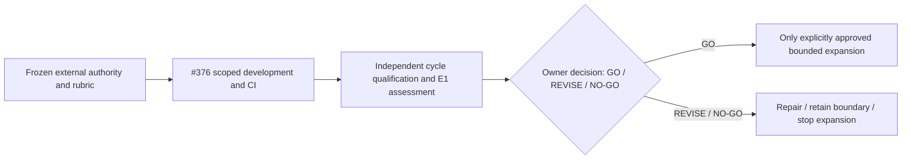
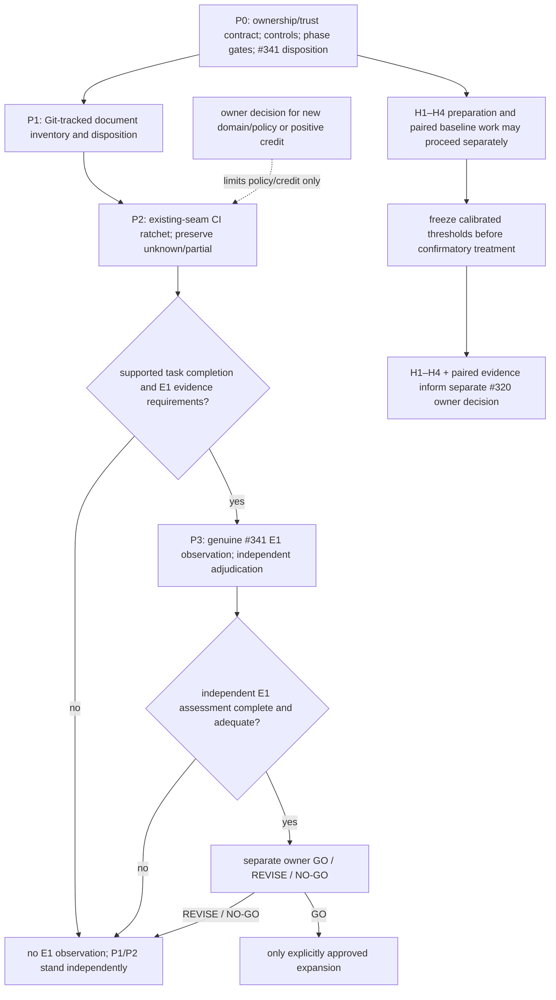

# Own-repo Governance and E1 Execution Plan — 2026-10-25 21:39 +08:00

**Status:** PROPOSED coordination plan; it does not approve policy, qualify E1, or authorize runtime activation.
**Created / filename identity:** 2026-10-25 21:39:23 +08:00 (initial write; filename/title retain its 21:39 minute).
**Updated / writtenAt:** 2026-10-26 21:02 +08:00 (Asia/Taipei)
**Branch:** `codex/own-repo-e1-plan-20261025` ([plan on work branch](https://github.com/dyphn1/Harness-everything/blob/codex/own-repo-e1-plan-20261025/docs/own-repo-governance-e1-plan-2026-10-25-2139.md)); verified linked worktree: `/Users/daniel.chang/Desktop/Skills/Harness-everything/.worktrees/own-repo-e1-plan-20261025`.

## Authority and pinned state

The issue contracts are authoritative: [#341 E1 and Phase 1/2](https://github.com/dyphn1/Harness-everything/issues/341), [#325 bounded consumer and H1–H4](https://github.com/dyphn1/Harness-everything/issues/325), and [#320 promotion](https://github.com/dyphn1/Harness-everything/issues/320). This plan orders work and points to evidence; it does not replace those contracts or inherit either older packet's `APPROVED` label. Owner decisions remain reserved below.

Original P0 delivery baseline was `main@25c4a8478d5617d1e803940951876bb3ae1ecb37`, which includes #374. At publication, [PR #375](https://github.com/dyphn1/Harness-everything/pull/375) head `9ceb57d` was an unmerged evidence input, not main: [E1 README](https://github.com/dyphn1/Harness-everything/blob/9ceb57d/benchmarks/results/doc-evidence-e1/README.md), [E1 JSON](https://github.com/dyphn1/Harness-everything/blob/9ceb57d/benchmarks/results/doc-evidence-e1/evidence.json), and [H1 preparation README](https://github.com/dyphn1/Harness-everything/blob/9ceb57d/benchmarks/results/h1-provider-independence-qualification/README.md). O1/O2 adjudicate zero qualifying E1 cycles, correct withholding, no false MUST PASS/rejection, and no formal E1 decision. Do not repeat the stale-opening wording fix or count its observations again. Refresh mutable branch, PR, host, and CI facts before dispatch. The original `main@25c4a847` pin is retained as historical P0 baseline only; the 2026-10-26 state refresh recorded main at `b733cadec17542b9ae30aabb50c1ba3481a58d74`.

Evidence provenance: scope/protocol/advisor conclusions are source-traced; the OpenCode discussion is conceptual advice only, not code review, live-host evidence, or a defect finding. Reject its proposed 1-positive/1-negative stopping threshold and its unsupported claim that O2 proves a product bug. Keep #341's 2–3 genuine-cycle target and distinguish case exposure from completed-cycle acceptance.

### #341 current state (GitHub connector, confirmed 2026-10-25T14:16:02Z)

| Fact | Record |
|---|---|
| Issue state | OPEN; `state_reason=reopened` (reopened 2026-10-25T14:16:02Z) |
| Body ledger | E0 ACCEPTED; E1 OPEN/UNCHECKED with 0 qualifying cycles |
| Reopening rationale | Owner comment 6398746638: reopening corrected an issue-state/acceptance mismatch |
| Prior closure cause | UNKNOWN — no issue-timeline evidence exists in this session; do not infer or invent one |
| Unchanged contracts | E1 initial 2–3 genuine-cycle/exposure target, Phase 1 typed Obligation Contract decision, Phase 2 guidelines decision or owned follow-ups, closure rule, separate E1 assessment then explicit owner GO/REVISE/NO-GO, and the #320 authorization boundary |

### Owner authorization for PR #376 (comment 6398696762)

The owner explicitly authorizes continuing this existing PR #376 into real P1 inventory/disposition work and P2 existing-seam CI ratchet work after this plan is revised. This revision records that authorization; this turn's write-set stays narrow (this plan plus private P1a readiness evidence only). Authorization of P1/P2 work does not approve domain policy, qualify an E1 cycle, or authorize #320 promotion; H1–H4 and paired evidence under #325 remain separate.

## First self-governance case: trust, safety, and independent verification

Owner direction (2026-10-26): use PR #376 as the first actual self-governance development case, beginning with these boundaries. This authorizes this plan's boundary refinement and, per owner comment 6398696762, the subsequent P1 inventory/disposition and P2 existing-seam CI ratchet work in this same PR. It does not activate the pilot, approve domain policy, or authorize generic #320 CDG/Router migration. Case designation does not qualify an E1 cycle. The plan remains PROPOSED outside this recorded direction.

State refresh (2026-10-26): #375 is now merged at `b733cadec17542b9ae30aabb50c1ba3481a58d74`, also the local main HEAD. The earlier unmerged description above records the original P0 baseline; retain those pins as history and refresh the task baseline before dispatch. #376 remains open at `521e5b3047daf24e284412ab225e8a354be313e4` before this local refinement. Merging #375 does not change its zero qualifying-cycle result.

| Boundary | Required record / authority |
|---|---|
| Trust anchor outside the candidate | Before task execution, pin the issue contracts, owner decisions, baseline verifier/package/config identities, acceptance rubric, and recovery point. Candidate-controlled instructions, checks, workflow state, and reports are evidence inputs, never authority to approve themselves. |
| Changes to the governor | If the write-set touches a checker, policy, hook, evidence producer, or approval rule, explicitly identify the affected trust boundary. Preserve the baseline checks and use separately controlled review/verification against the frozen rubric. A changed checker passing itself cannot certify the change; unavailable independent verification stays UNCHECKED. |
| Safety and authority | Freeze exact paths and allowed actions per packet. Retain default-OFF, bounded, reversible consumer behavior and existing Kernel authorization. No permission widening, fabricated domain, edited runtime verdict, new completion lock, or automatic merge/release. Scope expansion returns for a new dispatch; owner-reserved decisions remain owner-reserved. |
| Independent review | A separate model or fresh context alone does not establish independence. Require the existing host-issued principal/session provenance, distinct from author and every executor, read-only access to frozen inputs, and a verdict bound to exact hashes. Author/coordinator self-review is not E1 adjudication. |
| Evidence custody | Preserve raw host captures, commands, exit/results, baseline/candidate/package/config hashes, reviewer identity, and negative witnesses with positive controls. Keep originals in the existing private evidence location and publish only sanitized summaries with digest references. No credentials or private payloads in repository artifacts; missing provenance remains visible. |
| Failure and recovery | False MUST PASS stops credit and expansion. Preserve the failing snapshot before correction; route shared semantics to #341 and domain/provenance defects to #325. Repaired candidates require fresh capture and independent review; old verdicts do not transfer. |



| Claim | Separate acceptance boundary |
|---|---|
| Development complete / CI Green | Evidence only for the executed engineering gates and exact candidate; not E1 qualification. |
| E1 assessment complete | Independent assessment of 2–3 genuine completed cycles and sufficient exposure under #341, including false passes/rejections, repeat defects, audit/compatibility drift, and maintenance effort. Insufficient exposure remains UNCHECKED; assessment completion does not imply a favorable result. |
| E1 GO | A subsequent explicit owner decision based on the independent assessment, recording rationale, allowed scope, remaining uncertainty, and rollback. Neither elapsed time nor CI nor finishing E1 creates GO. |
| #320 promotion | Still unauthorized. Generic CDG/Router migration requires E1 GO plus #325 H1–H4/paired evidence and a separate owner decision per proven interface. |

Current disposition for #376: governance boundaries are documented in this plan; P1 inventory/disposition is implemented; and P2 includes a base-object guard wired before `npm ci` in candidate-controlled PR CI. The reviewed PR base `e40864fc24a711b96f583caa8e82f4707152f232` has no verifier, so its first invocation is `BOOTSTRAP_UNCHECKED` and does not execute candidate bytes. The guard now includes Git identities for the `ci/fixtures/doc-lifecycle/scenarios/` oracle tree; changes to those fixtures and to configured governed or derived blobs yield `REVIEW_REQUIRED`. That means independent semantic review is required, not that the content is automatically judged invalid. Ordinary ungoverned edits and new unknown documents remain allowed as `PASS` with unknown/unchecked content validation. The independent review found the earlier fixture gap and left semantic MUST preservation unresolved; re-review of the fixed guard at final exact SHAs is pending. The CI invocation remains candidate-controlled and can be removed; no external required-status check is enabled. E1 qualification is NOT YET ESTABLISHED (0 qualifying cycles); GO is NOT ISSUED. CI evidence is not E1 credit or live-host evidence.

## Candidate inventory and coverage

Inventory the declared candidate as pinned Git paths plus explicitly proposed new/untracked paths and baseline deleted/renamed endpoints. Retain both rename endpoints, modes and object identity; record symlink entries without following targets and gitlinks without recursing. A tracked vendor/dependency path stays in the inventory with an explicit disposition. `.git`, ignored/private files, dependencies not tracked by Git, and other worktrees are outside this inventory unless explicitly proposed. This coordination inventory never substitutes for the runtime producer's complete whole-candidate identity or scope.

| Class | Disposition and existing checks |
|---|---|
| Canonical skills/evals | Applicable token, routing/collision, manifest and source/package parity gates |
| Docs | Apply document lifecycle only to configured paths/roles; otherwise record absent/unknown doc-runtime coverage |
| Legacy/archive Markdown | Record legacy/archive classification and why it is retained or superseded; choose applicable checks separately. File extension alone never makes a file a PRD or ADR. |
| Code/tests/config | Existing CI, kernel, consistency, repository-contract and portability gates; these do not prove each file's semantics |
| Generated views | Named source plus existing regeneration/parity check; never hand-edit generated output |
| Fixtures/evidence | Preserve their stated test/evidence purpose and controls; do not impose production-doc metadata by file extension |
| Vendor, binary, symlink, gitlink | Record identity and explicit applicable/excluded/unknown reason; no universal semantic validation claim |

Use the claim ladder `inventoried → classified → applicable-check-executed → validated-within-declared-scope`. `unknown`, `unavailable`, and `excluded` remain visible outcomes. Report inventory disposition coverage and executed gate scope separately; never say “all files validated/governed.”

Four axes stay separate per path and are never merged into one verdict: (1) document role, (2) lifecycle status, (3) governance disposition/coverage, (4) validation outcome. Legacy/archive classification and its disposition reason are recorded on axes 1 and 3; validation remains axis 4. P1 requires an explicit disposition plus reason for 100% of identified tracked document paths; that is disposition coverage only and is never a claim of 100% semantic validation.

| Report item | Checkable / unresolved boundary |
|---|---|
| Git identity | New, deleted and both rename endpoints, modes and OIDs are checkable against an independent Git oracle. |
| Generated, legacy/archive, fixture and vendor docs | Path/class/disposition/reason are reportable. Generated parity requires a declared generator contract; otherwise parity and document semantics remain `unknown`. |
| Relationships | Existing configured lifecycle graph/link checks cover only their declared scope; unconfigured, ambiguous and deleted-reference relationships remain `partial`/`unknown`. |
| Scope and policy | Git/config/manifest/rule changes are diffable; scope completeness and bare-ID/domain policy remain owner decisions. |
| Owner decisions | Truthful domain names and bare-ID policy; which paths/roles and legacy/generated/vendor/fixture content receive semantic validation; relationship completeness and known exclusions. These decisions limit new policy/credit, not inventory/disposition reporting. |

Current `.agents/harness-everything/project-docs.json` governs two references and one derived index; it has no domains. The current doc-check therefore reports `doc-lint: partial` even when a changed reference is governed — observed directly on 2026-10-26, see the P1a readiness subsection below. Preserve that as `partial`/`unknown`: it limits any new policy or positive credit claim that depends on full domain validation, but it does not gate the authorized P1 inventory or P2 CI ratchet. Only a real domain/policy basis and owner decision can authorize new governed policy or such credit. E1 observation has its own supported-completion gate at P3. Do not invent a `HARNESS` domain, widen globs, change checkers, use an empty-domain workaround, or label partial as pass. This does not block independent H1–H4 work.

### P1a readiness observation (2026-10-26, source/package layer only)

Read-only inspection of the current command, with source tracing of `harness-everything/scripts/doc-check.js` (check path reads config/files, emits JSON to stdout, never writes) and its `doc-lifecycle.js lint` subprocess (read-only git plumbing: `check-attr`, `config --get`, `cat-file --batch`). The gate for running it was satisfied: help/source shows read-only behavior and the exact command form is valid per `parseArgs`. Full capture lives in `/tmp/own-repo-e1-p1a-20261026/` and in the private readiness note `/Users/daniel.chang/.agents/harness-everything/evidence/own-repo-e1/p1a-readiness-2026-10-26/README.md`.

| Field | Observed value |
|---|---|
| Command | `node harness-everything/scripts/doc-check.js check --workspace . --config .agents/harness-everything/project-docs.json --changed-path docs/doc-workflow-reconciliation.md --base b733cadec17542b9ae30aabb50c1ba3481a58d74` |
| Exit status | 0 (stdout JSON below; stderr empty) |
| `doc-lint` capability | `partial` — no domains declared; bare `<DOMAIN>-NNN` references not checked; checked path `docs/doc-workflow-reconciliation.md` |
| `link-check` capability | `pass` — 10 links checked, 0 broken |
| Coverage unsupported | Derived view `docs/governed-index.md` `unverified` (`conservative-all-governed`); domains-missing note |
| Reminders | 1 SHOULD `prose-share` (0.718 > 0.5) on the changed reference; never affects exit |
| Input digests (SHA-256) | `doc-check.js` `da5e51a7…bbdb`; `doc-lifecycle.js` `4a823df0…ebe7`; `project-docs.json` `7f13c0b1…4f0a` |
| Host facts | OpenCode CLI v2.1.4; Node v24.22.1 (`/Users/daniel.chang/.nvm/versions/node/v24.22.1/bin` first on PATH); primary `opencode/beam-free` session `ses_e8c0932dcffe9O0l1Tc7d5NGOM` returned explicit `provider.free-limit` HTTP 429; the authorized `nvidia/z-ai/glm-5.3-flash` fallback session `ses_e8c0904a5ffeIXC08OPyap5ySY` executed this readiness command; worktree HEAD `521e5b3047daf24e284412ab225e8a354be313e4` |
| Evidence layer | Source/package readiness only. Not live-host behavior, not an E1 attempt, not P1 completion. |

This is readiness evidence for the P1 packet, distinct from E1 evidence at `benchmarks/results/doc-evidence-e1/` (historical O1/O2, 0 qualifying cycles). The old E1 path stays the only qualifying-cycle evidence location; the private `own-repo-e1/p1a-readiness-2026-10-26/` packet never substitutes for it.

The observed `doc-lint: partial` limits new policy and positive-credit claims, not inventory or ratchet work. Proposed P1 packet (not dispatched): case `p1-inventory-2026-10-26`; repository write-set = `.agents/harness-everything/document-inventory.json`, `harness-everything/scripts/doc-lifecycle.js`, generated `plugins/harness-everything/skills/harness-everything/scripts/doc-lifecycle.js`, `ci/mechanism-2ax-doc-lifecycle.test.js`, and `ci/mechanism-325-f1-doc-check.test.js`. Private preregistration and raw NUL-delimited inventory are `/Users/daniel.chang/.agents/harness-everything/evidence/own-repo-e1/p1-inventory-2026-10-26/prereg.json` and `inventory.nul`; never put private evidence in the repository. Entry gate: this plan revision accepted in PR #376 and a separate packet dispatch. Inventory command: `node harness-everything/scripts/doc-lifecycle.js inventory --workspace . --manifest .agents/harness-everything/document-inventory.json --base <BASE>`. Sync source/package with `npm run plugin:sync`; extend `ci/mechanism-2ax-doc-lifecycle.test.js` for inventory API and source/packaged inventory CLI, and `ci/mechanism-325-f1-doc-check.test.js` for doc-check source/packaged behavior. Run both focused files, then `npm run test:consistency` and `npm run test:plugin:openai`. Acceptance: NUL-safe full Git candidate identity with explicit disposition+reason for each identified tracked document, including unknown paths; source/package parity; fixtures for add/delete/rename endpoints, unusual path bytes, symlink/gitlink non-following, and a truthful in-scope positive beside withheld/unknown controls. Record unavailable reviewer principal or unsupported Stop as `null`/`UNCHECKED`; P1 inventory is not E1 evidence. Recovery: retain `unknown`/`partial` and the exact failed witness; repair only a reproduced inventory defect within this packet, or route new policy/credit requests for owner decision. No policy or credit gate is added to P1.

## Ordered path



Phases are exactly P0–P3. A truthful domain/policy decision limits new policy and positive credit; it is not an entry gate for P1/P2. P3 separately requires a supported genuine-task completion to count an E1 observation. Plans, readiness commands, CI, static review, provider attempts/failures, and agent-authored reports never count as qualifying E1 cycles.

## Packets and acceptance

The 2026-10-26 owner direction and owner comment 6398696762 authorize this PR #376 to carry P1 inventory/disposition and P2 existing-seam CI ratchet work after this revised plan. Each packet still gets its own dispatch with exact write-set, entry gate, commands, reviewer, and recovery point; the table is not blanket permission to edit source/config. Workers stay in isolated worktrees, edit only their packet, and report evidence layer. Root coordinates dispatch, performs final acceptance, and owns all Git/GH writes; accepted stages are committed to and represented by existing PR #376; nobody merges.

| Packet / dependency | Write-set and action | Evidence, acceptance, stop / resume |
|---|---|---|
| **P0 — current** | Self-governance ownership/trust contract, decision-required items, negative-control→fixture/test mapping, P0–P3 phase gates, and current-main/#341 disposition — all in this tracked plan. P1a readiness observation is read-only and private. No source, config, issue, or runtime change. | P0 acceptance dimensions: (1) ownership and trust graph recorded (boundary table); (2) owner-decision list explicit; (3) every adversarial control mapped to an existing or proposed fixture/test (table below) without claiming they were run; (4) P0–P3 gates stated; (5) #341 status/disposition recorded exactly (OPEN/reopened, E0 ACCEPTED, E1 0 qualifying cycles, closure cause UNKNOWN). Plan contract vs implemented enforcement distinguished. One reviewable PROPOSED plan; `Created / filename identity` records the initial write, `Updated / writtenAt` the latest. Evidence layer: document/source-traced; not E1. |
| **P1 — after P0** | Inventory/disposition only; unknown and partial outcomes stay reportable. Exact proposed repository write-set: `.agents/harness-everything/document-inventory.json`; `harness-everything/scripts/doc-lifecycle.js`; generated `plugins/harness-everything/skills/harness-everything/scripts/doc-lifecycle.js`; `ci/mechanism-2ax-doc-lifecycle.test.js`; `ci/mechanism-325-f1-doc-check.test.js`. Private evidence: `/Users/daniel.chang/.agents/harness-everything/evidence/own-repo-e1/p1-inventory-2026-10-26/prereg.json` and `inventory.nul`. Entry gate: this plan accepted in PR #376 plus separate packet dispatch. Commands: `node harness-everything/scripts/doc-lifecycle.js inventory --workspace . --manifest .agents/harness-everything/document-inventory.json --base <BASE>`; `npm run plugin:sync`; `node ci/mechanism-2ax-doc-lifecycle.test.js`; `node ci/mechanism-325-f1-doc-check.test.js`; `npm run test:consistency`; `npm run test:plugin:openai`. | Acceptance: NUL-safe full Git candidate identity; explicit role/lifecycle/disposition+reason and separate validation outcome for each identified tracked document; preserve both rename endpoints, modes/OIDs, add/delete paths, unusual bytes, symlink/gitlink entries without following targets. Positive control: existing in-scope path appears with its declared disposition and applicable check. Negative controls: an omitted/unclassified path remains visible as `unknown`+reason; unavailable reviewer principal or Stop is `null`/`UNCHECKED`. P1 is disposition coverage only, never 100% semantic validation or E1 evidence. Recovery: retain `unknown`/`partial` and exact failing witness; repair only reproduced inventory defects in this write-set. New domain/policy or positive credit requires owner decision and does not block P1. |
| **P2 — after P1 inventory and separate dispatch** | CI ratchet on the existing inventory/doc-check seams. Exact repository write-set: `scripts/doc-governance-guard.js`; `ci/mechanism-2ax-doc-lifecycle.test.js`; `ci/mechanism-325-f1-doc-check.test.js`; `.github/workflows/ci.yml`; `docs/own-repo-governance-e1-plan-2026-10-25-2139.md`; `docs/platform-capabilities.md`; and generated `docs/repository-contract.md`. Before `npm ci`, the pull-request self-regression step extracts the verifier blob from the validated event base SHA and runs only those frozen bytes against the event base/head SHAs. It never executes the candidate verifier. A base with no guard reports `BOOTSTRAP_UNCHECKED` with a warning and step summary, then continues ordinary regression checks; non-PR events without an external verifier report `UNCHECKED`. Once a base-owned verifier is available, its nonzero result remains nonzero. This invocation remains candidate-controlled and can be removed with the workflow; it is not an external trust anchor or protected required check. Independent review of the frozen guard and final exact SHAs remains required. No product runtime consumer, new policy, package distribution, or dependency is added. | Commands: `node ci/mechanism-2ax-doc-lifecycle.test.js`; `node ci/mechanism-325-f1-doc-check.test.js`; `npm run test:repo-contract`; `npm run test:docs:capabilities`; `npm run docs:sync`; then `npm test` and `npm run verify:all -- --fast`. For 2ax, run actual inventory/report and independently derive raw Git identity from a frozen `BASE_SHA`; compare path bytes, modes, OIDs and rename endpoints without reading report oracle fields; retain a baseline→candidate fixture. Keep four disposition axes separate and unknown visible. Preserve F1 source/package controls: no domains means `doc-lint=partial` with reason and independent link state; a valid domain can pass; real lint/link defects fail. Guard controls cover ordinary doc edits, policy/trust-surface changes, malformed inputs, fake approvals and special Git entries. The CI step must use exact PR base/head SHAs, record the extracted blob and SHA-256, report `GITHUB_SHA` separately from PR head, avoid candidate fallback, show `BOOTSTRAP_UNCHECKED`/`UNCHECKED` distinctly, and propagate the executed guard's nonzero code. Because the invocation is candidate-controlled and baseline main lacks the verifier, the first run is bootstrap evidence only: a separate reviewer freezes the candidate guard/rubric before adversarial mutations and binds the verdict to final exact SHAs. No external required-check/protection claim is made. Preserve unknown/partial and exact failures; repair only reproduced defects in this write-set. P2 is CI evidence, never an E1 cycle; E1 remains at 0 qualifying cycles and owner GO is not issued. |
| **P3 — after P2 capture is frozen** | Genuine #341 E1 observation through the existing evidence path, only after a real task reaches supported completion/Stop: append the completed structured record and concise summary to existing `benchmarks/results/doc-evidence-e1/evidence.json` and `README.md`; do not create per-session narratives or hand-author runtime `pilot-report.json`. After 2–3 completed genuine cycles, the same record plus a concise plan status update feeds a complete independent E1 assessment against #341, then a separate owner GO/REVISE/NO-GO decision. | Cold reviewer uses a host-issued principal/session tied to these captured records, distinct from the author and every executor, with read-only `Read`/`Grep` tools. Bind verdict to exact final hashes. Keep `taskOutcome`, `workflowOutcome`, `pilotCredit`, `reviewOutcome`, and actual completion Stop separate. Post-review edit requires new snapshot and review. Assessment tracks false MUST PASS (hard blocker), false rejection, repeat defects, audit/compatibility drift and correction effort; no arbitrary numeric threshold or all-cases-`pilotCredit=true` rule; insufficient or unrepresentative exposure is UNCHECKED. Owner decides #341 Phase 1/2, closure, and any expansion; assessment completion alone permits none. Qualifying cycles are genuine task observations only: plans, readiness commands, CI, static review, provider attempts/failures, and agent-authored reports never qualify. |

| Exposure slot (organizer, not quota) | Expected decision and positive control | Completion boundary |
|---|---|---|
| Governed path, fresh valid evidence | Complete applicable checks; valid in-scope control is accepted | Real task reaches supported reconciliation/Stop; independent review binds to current captured hashes |
| Partial or out-of-scope coverage | Withhold credit for uncovered obligations; positive control uses a truthful in-scope path | May be uncredited exposure in a completed task only if no applicable required MUST remains unresolved and supported completion is reached; otherwise incomplete |
| Stale/mismatched evidence or non-independent reviewer | Withhold credit; positive control is fresh matching evidence plus a host-issued independent reviewer | Preserve the observed case; any corrected attempt needs new hashes, host capture and review |
| Unavailable verifier or contradictory observation | Preserve `unknown`/`unavailable`, withhold; positive control is accessible, non-contradictory evidence | Missing required evidence or unsupported Stop means incomplete; otherwise retain as uncredited exposure in a completed cycle |
| Ordinary compatibility work | Existing non-doc behavior remains intact; positive control is the current supported workflow | Record real task outcome and supported Stop separately; do not call compatibility checks an E1 cycle by themselves |

These slots organize genuine observations, add no exposure quota, and never justify artificial tasks. Keep them separate from the five owner-pinned paired-task families below. A refusal alone does not complete a cycle; an unresolved applicable required MUST or missing supported completion makes the attempt incomplete. A completed cycle may contain an uncredited negative exposure, followed by correction and fresh evidence/review/Stop.

### Adversarial control → fixture/test mapping (P0 acceptance dimension)

This table records the P0 mapping at plan formation; later P1/P2 execution is recorded in the handoff sections below. A mapped fixture or source trace alone is not execution evidence.

| Adversarial control | Mapped fixture/test | Status |
|---|---|---|
| Self-authored or tampered doc-check earns no credit | `ci/mechanism-325-f4-trust-boundary.test.js` (R1/R2 legs, G0 implementation-pin controls) | Exists; source-traced |
| Fabricated/missing/stale/substituted/forged/replayed evidence cannot produce false MUST PASS | `ci/mechanism-325-f4-trust-boundary.test.js` (H3 gate) | Exists; source-traced |
| Config validation rejects invalid project-docs declarations | `ci/mechanism-2aw-project-docs-config.test.js` | Exists; source-traced |
| Lifecycle lint/index diagnostics and graph behavior | `ci/mechanism-2ax-doc-lifecycle.test.js` | Exists; source-traced |
| Partial capability never reported as full pass | `doc-check.js` per-capability report contract; `ci/doc-capability-consistency.test.js` | Exists; source-traced |
| NUL/odd-byte Git paths, symlinks/gitlinks not followed, rename endpoints retained, deleted-at-base, mode/object-identity changes, nested fixture/vendor docs all carry explicit disposition | P1 inventory projection tests beside existing seams (exact path frozen in the P1 packet) | Proposed; not written |
| Truthful in-scope positive control alongside each withheld negative | P1 packet `prereg.json` positive/negative control pairs | Proposed; not written |
| Narrowed glob hides a previously governed path | Negative disposable config narrows the glob; expected `partial`/coverage evidence plus P1 inventory still listing the path. Positive unchanged in-scope path retains its independently reported capability (`partial` while domains are absent). Map to `ci/mechanism-325-f1-doc-check.test.js` and `ci/mechanism-2ax-doc-lifecycle.test.js`. | Planned; not written |
| Removed governed registry/path or inventory entry silently drops a tracked doc | Negative disposable manifest/config removes the path; expected Git oracle still lists it as `unknown`+reason. Positive retained entry reports its disposition. Map to `ci/mechanism-2ax-doc-lifecycle.test.js`; F1 source/packaged case checks the separate doc-check capability state. | Planned; not written |
| Removed required MUST or weakened checker/policy produces false pass | Negative disposable source/package fixture weakens/removes the rule; frozen expected outcome must expose false pass. Positive unchanged required MUST withholds incomplete evidence and accepts valid evidence. Map to `ci/mechanism-325-f1-doc-check.test.js` source/packaged legs plus independent read-only review against the frozen P0 rubric. Current F1 does not test policy/MUST enforcement. | Planned; not written |
| Weakening/deleting the test itself escapes its control | The base-owned guard compares exact baseline/candidate test identities and yields `REVIEW_REQUIRED` for any changed test object; the unchanged test is the positive control. Its invocation is still in candidate-controlled `ci.yml`, and unchanged bytes do not prove semantic adequacy. Map to the P2 guard fixture, both P2 test files, and independent exact-SHA review. | Mechanism detects changed bytes when invoked; workflow bypass and semantic adequacy remain external-review boundaries. |
| Generated view drifts from its declared source | Negative disposable derived view differs and must report drift; positive regenerated view compares equal. Map to a planned new compare-derived CLI case in `ci/mechanism-325-f1-doc-check.test.js` (no such case exists yet). | Planned; not written |

## H1–H4 and paired architecture evidence

These may advance independently of E1 GO; none proves E1 or authorizes #320 promotion. Dependency-ready packets may overlap only when their exact write-sets are proven disjoint. Serialize shared README/evidence writes; if a dependency or overlap is unclear, sequence the packets. Do not force parallel work. Each packet names its exact test, fixture, and existing results-summary paths; extend only those files, with no generic router, provider wiring, or runtime redesign.

| Gate | Existing focused test / required result |
|---|---|
| H1 | `ci/mechanism-325-3b-h1-qualification.test.js`: exercise a real alternate executor through the active workflow consumer; valid evidence passes, missing evidence withholds. Existing provider side-input replay is not H1 completion. |
| H2 | `ci/mechanism-325-3b-s3-providers.test.js`: record actual active-step metadata and content reads, with future/unrelated controls. |
| H3 | `ci/mechanism-325-f4-trust-boundary.test.js`: fabricated, missing, stale, substituted, forged, replayed, unsupported-waiver and contradictory evidence cannot produce false MUST PASS; retain valid control. |
| H4 | `ci/mechanism-325-3a-cross.test.js`: assert exact obligation union and explicit unknown/unavailable behavior. |

Focused command for each packet is `node <listed-test-path>`; after the H1–H4 set, run `npm run verify:all -- --fast`. Coordinator runs full `npm run verify:all` once after the final candidate is frozen; rerun only for a changed candidate or failed gate. Node 22 install/platform lanes not run locally remain UNCHECKED.

For paired work, preserve baseline #327 `d9ff242c1fca1b308e4a9c3b55af257f12c44a82` and treatment #358 `550f1a24d327df7022ef3b32b6fe5409c5a7873b` with pilot ON. Use the five owner-pinned families: typo-only ADR; normative PRD plus approval; mixed code/docs; REQ assertion with valid/invalid waiver; broken derived/link evidence with unavailable verifier. Calibrate on baseline, freeze baseline-derived thresholds before treatment outcomes, and freeze model/provider per packet before execution; do not substitute mid-run. Then run comparable fresh-context confirmatory pairs in counterbalanced order. Compare correctness/failure first; report successful-run costs and failed-run overhead separately with uncertainty. Store one structured artifact at `benchmarks/results/h1-provider-independence-qualification/paired-evidence.json`; unavailable hosts stay UNCHECKED.

## Stop, resume, and owner decisions

- False MUST PASS: stop credit and expansion; preserve witness and positive control; route shared semantics to #341 or policy/provenance to #325; fixture-first correction and affected re-observation are required.
- Three consecutive failures with the same signature: stop retries and re-diagnose read-only. Provider failure does not establish a session, request, or product defect.
- Missing host/reviewer, pending MUST, unavailable verifier, stale hash, or unsupported completion: preserve exact inputs as BLOCKED/UNCHECKED; resume only when the named capability/evidence/policy exists. Never hand-edit runtime report or workflow state.
- Owner decisions: real domain/new governed-path policy; E1 final disposition and #341 Phase 1/2; each #320 interface promotion; PR readiness, merge and release. Routine engineering can classify paths, use existing applicable checks, retain unknown, and make a minimum authorized fix.
- Convergence is three separate claims: complete inventory, adequate E1 exposure/adjudication, and H1–H4 plus paired architecture evidence. None implies the others or closes #341/#325 automatically.

## Execution roles and host qualification

Operating roles per the 2026-10-26 user/session override:

- **Root is coordinator**: dispatches packets, performs final acceptance, and owns all Git/GH writes. Accepted stages are committed and represented in existing PR #376. Nobody merges; PR readiness and merge remain owner decisions.
- **OpenCode free pool is primary worker.** This task's `opencode/beam-free` attempt (OpenCode CLI v2.1.4, session `ses_e8c0932dcffe9O0l1Tc7d5NGOM`) returned explicit `provider.free-limit` HTTP 429; the one authorized `nvidia/z-ai/glm-5.3-flash` fallback executed the plan/readiness work (session `ses_e8c0904a5ffeIXC08OPyap5ySY`). Authors are one-shot: read the packet, do it, write the report, exit.
- **NVIDIA fallback**: only an explicit free-quota/token-limit response triggers one fallback to the already-configured NVIDIA provider (inventory includes `nvidia/z-ai/glm-5.3-flash`); ordinary errors never qualify. Provider/model configuration is not changed.
- **Luna xhigh** handles other implementation/test/review work. **Astra medium** is optional and advisory only.
- **Reviewers are read-only** and never edit; independence and host-issued principal/session rules above are unchanged.
- Host qualification is a separate gate from worker/model availability. Keep the host, version, package, session origin, and reviewer principal pinned to captured records. Do not switch host/provider or credentials without existing authorization; worker availability or this OpenCode session does not create qualified live-host evidence.

## Superseded local plans and evidence pointers

The two ignored packet plans and the old packet's subordinate todo are superseded, not deleted.

| Superseded local queue file | Private backup |
|---|---|
| `.worktrees/packets/resume-2026-10-25/continuation-plan.md` | `continuation-plan.md` |
| `.worktrees/packets/next-workflow-2026-10-24/tasks/plan.md` | `plan.md` |
| `.worktrees/packets/next-workflow-2026-10-24/tasks/todo.md` | `todo.md` |

Private byte-identical backups of all three queue files and this turn's scope, protocol, discussion, and advisor inputs, with SHA-256/mode manifest, are at `/Users/daniel.chang/.agents/harness-everything/evidence/own-repo-plan-2026-10-25/`. Each pointer names this plan, branch, local worktree, and issue authority. Old `APPROVED` wording is historical and does not carry forward.

### P1 engineering handoff/status (2026-10-26)

| Item | Status |
|---|---|
| P0 / P1 | P0 is committed and synced at `bb451005de9377c29a592b839bc03bef200da218`. P1 inventory/disposition is implemented; focused gates passed. Independent cold review passed in its stated A/B/F scope (A/B executed; F source-traced). |
| Inventory snapshot | Base `bb451005de9377c29a592b839bc03bef200da218`; manifest SHA-256 `b9c2a62beff148fb9dc9d6aefb876365fa34c2a0290cc57e6ff9da3cf29cc036`; 617 identified paths, 617 explicit dispositions, complete disposition coverage. Four-axis unknown/unchecked counts: role 191 unknown, lifecycle 248 unknown, disposition 248 unknown, validation 617 unchecked. Full distributions and final source/package/repeat snapshots are in the private P1 result addendum. |
| Verification / limits | `plugin:sync`, 2ax, F1 (76 PASS), consistency, OpenAI package, and diff-check passed. Windows CI and full `verify:all` were not run. This establishes source/mechanism evidence only; it is not semantic validation or live-host behavior. |
| Provenance | Actual author: local Luna xhigh worker. Host-issued author principal remains `null`/`UNCHECKED`. The OpenCode NVIDIA run was stopped at exit 130 after read-only repeated reads; this was not a provider fault and produced no edit. |
| Next / authority | P2 guard integration is implemented under its separate dispatch. The current-base result is deliberately `BOOTSTRAP_UNCHECKED`; independent exact-SHA review and coordinator full verification remain pending. E1 remains at 0 qualifying cycles, GO is not issued, and #320 is unauthorized. |

### P2 engineering handoff/status (2026-10-26)

| Item | Status |
|---|---|
| Integration | On `pull_request`, `.github/workflows/ci.yml` extracts the guard blob from the event base and runs those bytes against the event base/head SHAs before `npm ci`; it logs the blob OID and SHA-256 and reports `GITHUB_SHA` separately. The reviewed base `e40864fc24a711b96f583caa8e82f4707152f232` has no verifier, so the current-base result is `BOOTSTRAP_UNCHECKED`; non-PR events without an external verifier report `UNCHECKED`. Neither path executes candidate guard bytes. |
| Guarded identities and outcomes | The trust surface includes every Git entry under `ci/fixtures/doc-lifecycle/scenarios/`, compared by raw Git identity (`mode`, `type`, `oid`), so fixture edits, deletions, mode changes, and candidate-only additions yield `REVIEW_REQUIRED`. Configured governed and derived paths also require baseline mode and blob OID identity; a blob change yields `REVIEW_REQUIRED` and requires independent semantic review. This is not an automatic finding that the content is invalid, and the guard does not validate natural-language MUST preservation. Ordinary ungoverned edits and new unknown documents remain `PASS`, with new paths reported `unknown`/`unchecked`. |
| Verification | The Node 24 focused `ci/mechanism-2ax-doc-lifecycle.test.js` passes the fixture edit/delete/mode/add cases, unchanged-fixture positive control, governed/derived blob-change cases, and ordinary ungoverned/new-unknown controls. Node 24 `--check` on both changed JavaScript files and `git diff --check` passed. Earlier reported checks also include `ci/mechanism-325-f1-doc-check.test.js` (76 PASS), `npm run test:repo-contract`, `npm run test:docs:capabilities`, and a parsed YAML step simulation for bootstrap, push `UNCHECKED`, extracted-guard `PASS`, and `REVIEW_REQUIRED` exit-2 propagation. |
| Evidence / limits | These are deterministic mechanism and local step-simulation results, not hosted GitHub Actions or live-host evidence. Full `npm test` and `verify:all` are not established here. The independent review of the earlier frozen guard found the fixture-oracle gap and left semantic MUST preservation unresolved; independent re-review of the fixed guard against the final exact SHAs remains pending. Candidate-controlled `.github/workflows/ci.yml` can remove the invocation, and no external required-status check is enabled. |
| E1 / authority | P2 is CI engineering evidence only. E1 remains at 0 qualifying cycles; status is NOT GO / owner GO is NOT ISSUED, and #320 remains unauthorized. |

### Next session

| Remaining item | Next action / boundary |
|---|---|
| #378 S2b portability | Wait for owner merge; otherwise validate its portability overlay in #376 against frozen exact SHAs. |
| #376 verification | Freeze the candidate SHA, run full `npm run verify:all`, and record the final CI matrix result for that exact SHA. Do not infer completion from focused checks or in-progress jobs. |
| Independent review | Obtain a fresh exact-SHA re-review of the fixed guard and current evidence. |
| External enforcement | Candidate-controlled CI can omit its own guard call; no external required check is enabled. The owner must decide whether to establish repository-controlled governance. |
| Closeout | Keep E1 at 0 qualifying cycles / NOT GO and update the PR body ledger with final evidence and remaining boundaries. |

可貼續作 prompt：

```text
續作 PR #376：先讀此 plan、目前 evidence/report 與 PR body ledger，確認 exact base/head SHA。只處理列出的剩餘項目；coordinator 負責派發、Git/GH 寫入和最終驗收，worker 僅改明確 write-set，reviewer 唯讀。OpenCode free 優先；只有明確 free-limit/quota 失敗才用已設定的 NVIDIA，若 NVIDIA 不可用或失敗，再由 Luna xhigh 接手有界工作。先彙整 worker 資訊，再請 Astra medium 做只讀 advisory review。每階段完成後由 coordinator commit 並更新既有 PR；不自行 merge。先處理 #378 S2b portability（等 owner merge，否則在 #376 對 frozen exact SHA 驗證 overlay），再凍結 #376 exact SHA、收齊 CI matrix、跑完整 verify:all、取得 fixed guard 的最新 independent exact-SHA re-review，並補齊 PR body ledger。明確記錄 candidate-controlled CI 可移除 guard、目前沒有 external required check；此事留給 owner 做 governance 決策。E1 維持 0 qualifying cycles / NOT GO，沒有 owner GO 前不得擴張。
```
