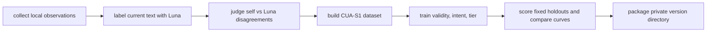

# System One monthly training cycle

The owner starts one cycle when ready. The public repository supplies the scripts; prompts, labels, checkpoints, and version packages stay in a private data directory. This runbook has no manual label or spot-check step.



## Before the monthly run

- Use a fresh, private directory for this cycle, outside the Harness checkout. On POSIX hosts the scripts set directory permissions to `0700` and data files to `0600`; on Windows, use a user-private directory with a restrictive ACL.
- Set `--since` to the last completed collection boundary. `collect` requires this date and accepts an optional `--sessions` path for a non-default Codex session directory.
- Pick a version id containing letters, numbers, dots, underscores, or hyphens. Reuse the same data directory and version id to resume; use a new directory for the next month.
- Replace the placeholders in the commands below with real paths, dates, and a version id.

## Steps

| Step | Command | Inputs → outputs | Typical duration and resources¹ | Resume |
|---|---|---|---|---|
| Collect | `node scripts/system-one-cycle.js collect --data-dir "<private-cycle-dir>" --since <YYYY-MM-DD>` | Local Codex session observations and the local observation store → `training/observed/prompts-observed.jsonl`, `labels-observed.jsonl`, and a count-only export report. Previous-message text and self `contextDependent` fields are removed. | Minutes for a local session scan; low CPU and local disk. | The completed step is recorded in `cycle-state.json`. Start another month in a new directory. |
| Label | `node scripts/system-one-cycle.js label --data-dir "<private-cycle-dir>"` | Current text only → Luna tier and intent rows in `training/relabel-luna/`. `null` maps to invalid; every other tier label maps to actionable for the validity stage. | Model latency dominates. Defaults: batches of 20, concurrency 4. | Rows already written are skipped by id. Failed batches are recorded with ids and reason codes, then retried on the next invocation. |
| Judge | `node scripts/system-one-cycle.js judge --data-dir "<private-cycle-dir>"` | Self tier and text-only Luna tier disagreements → private `training/adjudication/input.jsonl` and `consensus.jsonl`. Two independent votes are collected from Luna and OpenCode using current text and candidate labels. | Two model calls per batch of up to 20 disagreements; low local memory. | Completed majority and no-majority rows are skipped. Failed batches have no consensus row and are retried. A split vote is dropped during build; it does not request human review. |
| Build | `node scripts/system-one-cycle.js build --data-dir "<private-cycle-dir>"` | Observed text, Luna labels, consensus, behavior contradictions, and the existing frozen holdouts → consensus-adjusted tier/intent rows under `training/v1/`, raw Luna validity labels under `training/v1-validity/`, and a count-only report. | Usually seconds to minutes; memory grows with the dataset. | Safe to rerun; outputs are rebuilt from the current input files. Validation copies win over normalized train duplicates. |
| Train | `node scripts/system-one-cycle.js train --data-dir "<private-cycle-dir>" --version <version-id>` | The validity task reads raw Luna labels from `training/v1-validity/`; tier and intent read the consensus-adjusted dataset in `training/v1/`. Outputs are CUA-S1 checkpoints, validation scores, calibration, and `resource-guard.json` under `training/runs/<version-id>/`. | CPU training with 4 threads by default and a 6144 MB RSS ceiling. Duration depends on row count and epochs. | Completed stages are reused. If interrupted inside a stage, that stage starts again; earlier completed stages are kept. |
| Evaluate | `node scripts/system-one-cycle.js evaluate --data-dir "<private-cycle-dir>" --version <version-id>` | Candidate checkpoints, validation scores, and the existing frozen holdouts → score files, `curves.json`, and `trend.json` in a candidate version directory. Calls `scripts/system-one-curves.js` with contract C and appends to the private history file. | CPU scoring at one thread plus the curve calculation; typically seconds to minutes after checkpoint loading. | If curves and trend were written before interruption, the next invocation reuses them instead of adding another history row. |
| Package | `node scripts/system-one-cycle.js package --data-dir "<private-cycle-dir>" --version <version-id>` | Trained candidate and evaluation artifacts → `training/versions/<version-id>/manifest.json` with three stage entries, relative artifact paths, thresholds, and weight SHA-256 values. | A local file copy and hashes; usually seconds. | Safe to rerun. It rewrites the manifest from the candidate artifacts and carries the evaluation reference forward. |

¹ Durations are planning estimates, not measurements from this checkout. Model latency and dataset size vary.

## Run or resume the ordered path

Run the full cycle with one command:

```sh
node scripts/system-one-cycle.js all --until package --data-dir "<private-cycle-dir>" --since <YYYY-MM-DD> --version <version-id>
```

`all` runs each step in order and stops at `--until`. Completed collection, label, and judge steps with their outputs are skipped. If a label or judge batch fails, `all` stops at that step without marking it complete; rerun the same command to resume. `build` can be rerun. Training resumes between completed stages; evaluation reuses complete curve artifacts; packaging can be repeated.

For a synthetic integration check that does not read local session data or invoke model engines, prepare the earlier stage artifacts and completion entries under `.s1-work/`, then run:

```sh
node scripts/system-one-cycle.js all --until build --data-dir ".s1-work/<synthetic-cycle-dir>"
```

Repository-local build input is accepted only under `.s1-work/` and only when each fixture text is marked synthetic.

## Label and privacy policy

- Luna sees only each current text. Agent-dispatch requests remain valid when their text states the requested work. A `null` tier is reserved for text that requires prior conversation context to understand.
- The self `contextDependent` flag does not affect labels. Only a disagreement between the self tier and Luna's tier enters the two-judge vote.
- If a majority exists, build uses that tier; with no majority or no vote, it drops the disagreement. A `tier1-with-writes` behavior contradiction raises the final tier to `tier2`.
- Validity uses Luna's original text-only tier result: null means invalid and any tier means actionable, even if the adjudicated tier differs. Tier uses consensus; intent comes from Luna. No-majority rows are excluded from all training datasets.
- Reports and failure records contain counts, ids, field names, or reason codes only. Current and previous prompt text stays in the private cycle files and is not printed by the cycle commands.
- The cycle trains only CUA-S1 validity, intent, and tier stages. It does not train ngram or Laya models, create a new owner-reviewed holdout, publish weights, or activate a version. Keep packages private; installation and active-pointer changes are handled by the opt-in runtime workflow.
